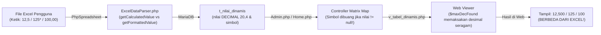

# Laporan Audit Teknis: End-to-End Flow Tabel Dinamis, Master Data, Presisi Input Excel, serta Skema & Query Database

**Proyek**: DDA Online CI4 - Modul Tabel Dinamis (`dda-online-ci4-tabel-dinamis`)  
**Tanggal Pembaruan**: 28 Oktober 2026  
**Cakupan Audit**:
1. Input Data & Fitur *Shifting* Nomor Tabel (`master_tabel`, `master_tabel_opd`, `shift_table_numbers`, `resequence_tabel`)
2. Manajemen Master Data: **Duplikat/Clone Tahunan (`clone_tahunan`)**, **Hapus Semua/Reset Tahun (`reset_tahun`)**, **Hapus Satuan/Global (`act_del`)**, **Kelola/Sync Item Master Dimensi (`sync_karakteristik_items`, `sync_periode_items`)**, dan **Buka Kunci & Reset Data (`unlock_dimensi_tabel`)**
3. Pengisian Master Tabel Dinamis (`master_dimensi`, `M_tabeldinamis`)
4. Pembuatan Kerangka Tabel Dinamis & Generator Template Excel (`generator_tabel`, `save_generator_tabel`, `ExcelTemplateGenerator`)
5. Pengisian Data Tabel Dinamis & Parser (`upload_excel_dinamis`, `ExcelDataParser`, `batchUpsertNilai`)
6. **[BAGIAN KHUSUS 1] Presisi Nilai Input Excel vs Tampilan Web (WYSIWYG: What You See in Excel is What You Get on Web)**: Mengapa angka di web bisa berbeda dari yang diketik di Excel (desimal dipaksa seragam, trailing zero hilang, simbol BPS `*`/`e` terpotong, format sel Excel membulatkan angka).
7. **[BAGIAN KHUSUS 2] Audit Skema Database, Migrasi, & Query SQL**: Pemeriksaan mendalam terhadap struktur tabel, *Primary/Foreign/Unique Key*, indeks, riwayat migrasi, serta efisiensi & akurasi query SQL di seluruh model/controller.
8. Verifikasi & Publikasi (`dda`, `periksa_tabel`, `konfirmasi`, `periksa`, `batal_verif`, `act_toggle_publish`)
9. Penampilan Data di Frontend (`Home::index`, `Home::search`, `Home::view_dinamis`, `M_frontend`, `frontend/v_tabel_dinamis.php`)

---

## Ringkasan Eksekutif

Berdasarkan hasil pemeriksaan menyeluruh pada *controller*, *model*, *library*, *view*, **skema migrasi database**, dan **query SQL**, **tidak ditemukan *syntax error* fatal (PHP Parse Error)** yang menghentikan aplikasi secara langsung. Namun, ditemukan **47 temuan teknis** yang terdiri dari:
1. **Presisi Nilai Input Excel vs Tampilan Web (WYSIWYG — 6 Temuan)**: Rantai dari template Excel -> parser -> database -> controller -> web viewer memiliki 6 titik kritis di mana angka atau simbol statistik resmi yang diketik pengguna di Excel terdistorsi atau hilang saat ditampilkan di web.
2. **Skema Database, Migrasi, & Query SQL (13 Temuan)**: Ketidaksinkronan antara kolom `NOT NULL` di migrasi dengan fitur matriks 2-dimensi, absennya `UNIQUE KEY` pada relasi `1:1` `m_indikator_tabel.id_tahun_tabel`, absennya *composite index* pada `t_tahun_tabel`, kontradiksi migrasi (`format_nomor_baris` vs `kolom_nomor`, `satuan` hilang dari `$allowedFields`), hingga bug SQL *Three-Valued Logic* (`NULL NOT LIKE`) yang menyebabkan Tabel Dinamis tidak terhitung pada statistik "Belum Diisi" di Dashboard & Laporan Excel.
3. **Bug Logika Bisnis & Operasi Master Data**: Potensi data hilang/yatim saat *clone* tahunan, inkonsistensi nomor tabel saat *shifting*.
4. **Celah Keamanan Fatal**: IDOR dan ketiadaan autentikasi pada *endpoint* verifikasi/pengisian, bypass RBAC pada verifikasi BPS, potensi SQL Injection pada parameter session `$ta`/`$th`, dan hardcoded token Satu Data.
5. **Ketidakselarasan Admin Viewer vs Frontend Publik**: Fitur multi-baris (`||`), baris total runtun waktu, dan catatan tabel belum diimplementasikan di frontend publik.

| Tingkat Keparahan | Jumlah Temuan | Fokus Area |
| :--- | :---: | :--- |
| 🔴 **P0 - Kritis (Critical)** | 12 (1 Fixed) | Kehilangan data saat sync item dimensi (Fixed 2.1), Celah Keamanan (Auth/RBAC/SQLi/Token), Korupsi Angka Desimal US, Desinkronisasi Multi-Baris Frontend, Pemaksaan Desimal Seragam (`$maxDecFound`), Simbol BPS (`*`/`e`) Dibuang, Salah Tafsir Koma 3-Digit, Kolom Dimensi `NOT NULL` di Migrasi, Bug SQL `NULL NOT LIKE` pada Statistik Dashboard & Rekap |
| 🟠 **P1 - Tinggi (High)** | 19 (2 Fixed) | *Orphaned data* pada Hapus Semua & Hapus Global (Fixed 2.2 & 2.3), Duplikat Tahunan (`clone_tahunan`) tanpa transaksi, Shifting nomor tabel tidak sinkron, Bypass verifikasi publish, Format Sel Excel Membulatkan Desimal, Hilangnya *Trailing Zeros*, Absennya `UNIQUE KEY` pada `id_tahun_tabel`, Absennya FK & Composite Index, Bug `LIMIT 0, 150` di `periksa_tabel`, Urutan `DELETE` Terbalik di `sync*Items` |
| 🟡 **P2 - Sedang (Medium)** | 12 | Rumus Excel terpotong `DECIMAL(20,4)`, Kontradiksi migrasi & `$allowedFields`, Redundansi denormalisasi `m_indikator_tabel`, Memory exhaustion `SELECT *` di `t_nilai_dinamis`, Positional `INSERT` tanpa nama kolom, Pencarian `LIKE` tanpa Full-Text Index, Bug formatting Excel Subtotal, Filter tahun `admin/dda` mati |
| 🔵 **P3 - Rendah / Best Practice** | 4 | Penghapusan dimensi via GET, Double query count, full-table scan duplicate check, *Fat Controller*, AutoRoute CI4 |

---

## Bagian Khusus 1: Audit Presisi Nilai Input Excel vs Tampilan Web (Prinsip WYSIWYG)

> **Tujuan Utama**: Memastikan nilai yang tampil di halaman web (Admin Viewer maupun Publik) **sama persis 100%** dengan apa yang dilihat dan diisi pengguna di berkas template Excel (*What You See in Excel is What You Get on Web*).

Pemeriksaan menyeluruh pada siklus hidup data: `ExcelTemplateGenerator` -> File Excel Pengguna -> `ExcelDataParser` -> Database `t_nilai_dinamis` -> `Admin.php`/`Home.php` -> `v_tabel_dinamis.php` mengungkap **6 akar penyebab** mengapa angka di web seringkali tidak sesuai dengan inputan Excel:



### A.1. [🔴 Critical] Pemaksaan Digit Desimal Seragam (`$maxDecFound`) Merusak Presisi Asli Sel
- **Lokasi**: [admin/v_tabel_dinamis.php](file:///E:/BPS%20JATENG/DDA/dda-online-ci4-tabel-dinamis/app/Views/admin/v_tabel_dinamis.php#L1300-L1338) & [frontend/v_tabel_dinamis.php](file:///E:/BPS%20JATENG/DDA/dda-online-ci4-tabel-dinamis/app/Views/frontend/v_tabel_dinamis.php#L1360-L1398)
- **Akar Masalah**:
  Sebelum merender baris-baris tabel, view menjalankan perulangan ke seluruh data matriks untuk mencari digit desimal terpanjang di antara semua sel:
  ```php
  $maxDecFound = 0;
  foreach ($nilaiMap as $val) {
      if (is_numeric($val) && strpos((string)$val, '.') !== false) {
          $decimals = explode('.', (string)$val)[1];
          $maxDecFound = max($maxDecFound, strlen($decimals));
      }
  }
  $finalDecimals = ($indikator->desimal > 0) ? $indikator->desimal : $maxDecFound;
  ```
  Kemudian saat setiap sel dirender, kode mengeksekusi:
  ```php
  number_format((float)$val, $finalDecimals, ',', '.');
  ```
- **Dampak Nyata**:
  Jika di dalam satu tabel terdapat 100 sel angka bulat/1 desimal (contoh: `12,5`), namun ada **1 sel saja** yang memiliki 3 desimal (contoh: `8,125`), maka `$maxDecFound` menjadi `3`. Akibatnya, seluruh sel `12,5` dipaksa tampil menjadi `12,500` di web! Pengguna merasa sistem menambahkan angka `00` sembarangan yang tidak pernah mereka ketik di Excel.
- **Rekomendasi Solusi**:
  Format angka harus dihitung **secara independen per masing-masing sel** berdasarkan digit desimal riil dari sel tersebut, bukan diglobalkan ke seluruh tabel. Jika sel A memiliki 1 desimal, format dengan 1 desimal (`12,5`). Jika sel B memiliki 3 desimal, format dengan 3 desimal (`8,125`).

### A.2. [🔴 Critical] Karakter Simbol Gabungan (`*`, `e`) Dibuang dari Tampilan Jika Ada Nilai Angka
- **Lokasi**: [`Admin::view_tabel_dinamis()`](file:///E:/BPS%20JATENG/DDA/dda-online-ci4-tabel-dinamis/app/Controllers/Admin.php#L5669-L5674) & [`Home::view_dinamis()`](file:///E:/BPS%20JATENG/DDA/dda-online-ci4-tabel-dinamis/app/Controllers/Home.php#L360-L365)
- **Akar Masalah**:
  Dalam standar publikasi BPS, angka seringkali memiliki tanda khusus statistik resmi:
  - `*` : Angka sementara (*preliminary data*)
  - `e` / `e)` : Angka estimasi (*estimated data*)
  Ketika pengguna mengetik `"125*"` atau `"125e"` di template Excel, `ExcelDataParser.php` sudah berhasil memisahkan angka numerik `125` ke kolom `nilai` dan simbol `*` ke kolom `simbol` di database `t_nilai_dinamis`.
  Namun, ketika Controller menyusun matriks data untuk dikirim ke view:
  ```php
  $val = $nr->nilai !== null ? (float)$nr->nilai : ($nr->simbol ?: null);
  ```
  Karena `$nr->nilai !== null` (bernilai `125`), kondisi ternary di atas menghasilkan `$val = (float)$nr->nilai`, sedangkan properti `$nr->simbol` **dibuang 100% dan tidak pernah dikirimkan ke view**!
- **Dampak Nyata**:
  Tanda bintang `*` atau huruf `e` hilang sama sekali di tampilan web Admin maupun Frontend publik. Yang tampil hanya angka `125`. Pengguna mengira data simbolik BPS tidak tersimpan.
- **Rekomendasi Solusi**:
  Kirimkan kedua nilai ke view (atau simpan dalam bentuk string gabungan yang sudah diformat):
  ```php
  $displayVal = ($nr->nilai !== null) ? formatNumberIndo($nr->nilai) . ($nr->simbol ?? '') : ($nr->simbol ?? '-');
  ```

### A.3. [🔴 Critical] Ambiguitas String Koma 3-Digit (`"1,500"`) Diubah Menjadi Ribuan Karena Desimal Nol
- **Lokasi**: [`ExcelDataParser::sanitizeValue()`](file:///E:/BPS%20JATENG/DDA/dda-online-ci4-tabel-dinamis/app/Libraries/ExcelDataParser.php#L754-L758)
- **Akar Masalah**:
  Terdapat potongan kode heuristik pada parser:
  ```php
  if ($expectedDecimals === 0 && preg_match('/^\d{1,3},\d{3}$/', $cleaned)) {
      // Format ribuan Indonesia tanpa desimal: 1,500 -> 1500
      $cleaned = str_replace(',', '', $cleaned);
  }
  ```
  Jika admin saat menyusun generator tidak menentukan desimal (`$expectedDecimals === 0`), lalu ada pengguna yang mengisi indikator berskala kecil (misalnya Laju Pertumbuhan, Rasio Jenis Kelamin, atau Indeks Kedalaman Kemiskinan) dengan mengetik `"1,500"` dengan maksud **1 koma 500** (presisi 3 desimal), regex mencocokkan format tersebut dan menganggap koma adalah pemisah ribuan. Koma dihapus sehingga nilai menjadi integer `1500`!
- **Dampak Nyata**:
  Nilai terdistorsi sebesar **1.000 kali lipat** di database (angka `1,5` menjadi `1.500`).
- **Rekomendasi Solusi**:
  Hapus heuristik pemaksaan penghapusan koma tunggal saat `expectedDecimals === 0`. Gunakan pemeriksaan tipe sel asli dari PhpSpreadsheet (`$cell->getDataType()`). Jika sel diinput sebagai angka dengan koma dalam konteks BPS Indonesia, koma tunggal harus diperlakukan sebagai pemisah desimal, bukan ribuan.

### A.4. [🟠 High] Format Sel di Template Excel Membulatkan Tampilan Desimal Saat Diketik Pengguna
- **Lokasi**: [`ExcelTemplateGenerator::generate()`](file:///E:/BPS%20JATENG/DDA/dda-online-ci4-tabel-dinamis/app/Libraries/ExcelTemplateGenerator.php#L67-L68) & [`Admin::save_generator_tabel()`](file:///E:/BPS%20JATENG/DDA/dda-online-ci4-tabel-dinamis/app/Controllers/Admin.php#L5508)
- **Akar Masalah**:
  Di `Admin::save_generator_tabel()`, field `desimal` disimpan `0` secara default karena tidak ada opsi input desimal di form UI generator. Akibatnya di `ExcelTemplateGenerator`:
  ```php
  $desimal = (int)($indikator->desimal ?? 2);
  $numFormat = ($desimal > 0) ? '#,##0.' . str_repeat('0', $desimal) : '#,##0';
  ```
  Karena `$desimal === 0`, seluruh sel input putih di Excel di-set dengan format angka `#,##0`.
  Ketika pengguna membuka template Excel dan mengetik `12,75`, Excel secara otomatis membulatkan tampilan visual sel tersebut menjadi `13` di layar Excel mereka! Walaupun nilai di formula bar tetap `12.75`, pengguna merasa template rusak atau menolak angka desimal.
- **Dampak Nyata**:
  Pengguna merasa bingung karena angka yang mereka ketik langsung berubah/membulat di Excel sebelum sempat diunggah.
- **Rekomendasi Solusi**:
  Atur format sel default ke format desimal dinamis Excel:
  ```php
  $numFormat = ($desimal > 0) ? '#,##0.' . str_repeat('0', $desimal) : '#,##0.##';
  ```
  Dengan `#,##0.##`, jika pengguna mengetik angka bulat (`100`) akan tampil `100`, dan jika mengetik desimal (`12,75`) akan tampil `12,75` tanpa dibulatkan.

### A.5. [🟠 High] Hilangnya Nol di Belakang Koma (*Trailing Zeros*) Karena Operasi Float & Kolom `DECIMAL(20,4)`
- **Lokasi**: [`ExcelDataParser.php`](file:///E:/BPS%20JATENG/DDA/dda-online-ci4-tabel-dinamis/app/Libraries/ExcelDataParser.php#L608-L615) & [v_tabel_dinamis.php](file:///E:/BPS%20JATENG/DDA/dda-online-ci4-tabel-dinamis/app/Views/admin/v_tabel_dinamis.php#L1315-L1335)
- **Akar Masalah**:
  Jika pengguna mengetik `"12,50"` di Excel dengan maksud menegaskan standar pelaporan 2 desimal:
  1. PhpSpreadsheet `getCalculatedValue()` mengembalikan tipe *float* murni `12.5` (nol terakhir hilang).
  2. Database menyimpannya di kolom `DECIMAL(20,4)` menjadi `12.5000`.
  3. Saat view membaca kembali angka tersebut dan mengecek jumlah desimal riil, string dipotong menjadi `"12,5"` (angka `0` kedua hilang).
  4. Untuk angka `"100,00"`, view memeriksa `(float)$val == (int)$val`, lalu memformatnya dengan `0 desimal` sehingga tampil `"100"`.
- **Dampak Nyata**:
  Presisi statistik resmi BPS (misalnya inflasi atau kemiskinan yang wajib mencantumkan 2 desimal seperti `12,50%`) kehilangan angka nol di web.
- **Rekomendasi Solusi**:
  Pada `ExcelDataParser`, selain membaca `getCalculatedValue()`, baca juga teks visual sel menggunakan `$cell->getFormattedValue()`. Simpan string terformat ini di kolom `simbol` (atau buat kolom baru `nilai_formatted`) sehingga view dapat menampilkan teks visual asli Excel secara 100% presisi.

### A.6. [🟡 Medium] Rumus / Formula Excel Menghasilkan Angka Irasional yang Terpotong `DECIMAL(20,4)`
- **Lokasi**: [`ExcelDataParser.php`](file:///E:/BPS%20JATENG/DDA/dda-online-ci4-tabel-dinamis/app/Libraries/ExcelDataParser.php#L605)
- **Akar Masalah**:
  Pengguna sering memasukkan rumus pembagian di template Excel, misalnya `=10/3`. Di Excel, pengguna mengatur format sel 2 desimal sehingga yang mereka lihat adalah `3,33`.
  Namun parser memanggil `$cell->getCalculatedValue()`, yang mengembalikan nilai floating point mentah `3.3333333333333335`. Ketika di-insert ke database `DECIMAL(20,4)`, nilai terpotong menjadi `3.3333`. Di web, sistem menampilkannya dengan 4 desimal `3,3333`, berbeda dari tampilan `3,33` di Excel pengguna.
- **Rekomendasi Solusi**:
  Gunakan `$cell->getFormattedValue()` sebagai representasi visual utama yang disimpan dan ditampilkan ke web.

---

## Bagian Khusus 2: Audit Skema Database, Migrasi, & Query SQL

Bagian ini membahas temuan mendalam pada arsitektur tabel database, file migrasi di `app/Database/Migrations/`, dokumentasi ERD di [DIAGRAM_HUBUNGAN_TABEL_DAN_KOLOM.md](file:///E:/BPS%20JATENG/DDA/dda-online-ci4-tabel-dinamis/DIAGRAM_HUBUNGAN_TABEL_DAN_KOLOM.md), serta query SQL di `M_tabeldinamis.php`, `M_frontend.php`, `M_kelolakegiatan.php`, dan `Admin.php`.

### I. Temuan Skema Database & Migrasi (Schema & Constraint Issues)

#### S.1. [🔴 Critical] Kolom `id_karakteristik_kelompok` & `id_periode_kelompok` di `m_indikator_tabel` Masih `NOT NULL` pada Migrasi, Sedangkan Aplikasi Mengirim `NULL` (Kegagalan Matriks 2-Dimensi)
- **Lokasi**:
  - Migrasi Awal: [2026-10-12-073931_CreateDynamicTableSchema.php](file:///E:/BPS%20JATENG/DDA/dda-online-ci4-tabel-dinamis/app/Database/Migrations/2026-10-12-073931_CreateDynamicTableSchema.php#L326-L349)
  - Migrasi Susulan: [2026-10-16-100000_MakeBarisKelompokNullableInIndikatorTabel.php](file:///E:/BPS%20JATENG/DDA/dda-online-ci4-tabel-dinamis/app/Database/Migrations/2026-10-16-100000_MakeBarisKelompokNullableInIndikatorTabel.php#L12-L20)
  - Controller: [`Admin::save_generator_tabel()`](file:///E:/BPS%20JATENG/DDA/dda-online-ci4-tabel-dinamis/app/Controllers/Admin.php#L5450-L5502)
- **Masalah**:
  Di `Admin::save_generator_tabel()` (baris 5450–5455), sistem mengizinkan perakitan matriks **minimal 2 dimensi dari 3 dimensi** (misalnya: Baris + Periode tanpa Karakteristik Kolom, atau Baris + Karakteristik tanpa Periode). Saat salah satu dimensi dikosongkan, kode pada baris 5499–5501 mengirimkan nilai `null`:
  ```php
  'id_karakteristik_kelompok' => !empty($id_karakteristik) ? $id_karakteristik : null,
  'id_baris_kelompok'         => !empty($id_baris) ? $id_baris : null,
  'id_periode_kelompok'       => !empty($id_periode) ? $id_periode : null,
  ```
  Namun di dalam riwayat migrasi database, hanya `id_baris_kelompok` yang diubah menjadi `null => true` (melalui migrasi `MakeBarisKelompokNullableInIndikatorTabel.php`), sedangkan **`id_karakteristik_kelompok` dan `id_periode_kelompok` masih berstatus `NOT NULL`**!
- **Dampak**:
  Pada database dengan `STRICT_TRANS_TABLES` aktif (default MySQL 5.7+ / 8.0+ / MariaDB 10.2+), menyimpan tabel dinamis 2 dimensi (tanpa Karakteristik atau tanpa Periode) akan langsung gagal dengan `DatabaseException: Column 'id_karakteristik_kelompok' / 'id_periode_kelompok' cannot be null`.
- **Rekomendasi**:
  Buat migrasi untuk mengubah `id_karakteristik_kelompok` dan `id_periode_kelompok` di `m_indikator_tabel` menjadi `INT(11) UNSIGNED NULL DEFAULT NULL`.

#### S.2. [🟠 High] Absennya `UNIQUE KEY` pada `m_indikator_tabel.id_tahun_tabel` Padahal Kardinalitasnya `1:1` (Risiko *Ghost/Duplicate Indicator* karena Race Condition)
- **Lokasi**:
  - Migrasi: [2026-10-12-073931_CreateDynamicTableSchema.php](file:///E:/BPS%20JATENG/DDA/dda-online-ci4-tabel-dinamis/app/Database/Migrations/2026-10-12-073931_CreateDynamicTableSchema.php#L384) (`$this->forge->addKey('id_tahun_tabel');`)
  - Dokumentasi ERD: [DIAGRAM_HUBUNGAN_TABEL_DAN_KOLOM.md](file:///E:/BPS%20JATENG/DDA/dda-online-ci4-tabel-dinamis/DIAGRAM_HUBUNGAN_TABEL_DAN_KOLOM.md#L25-L28)
  - Controller: [`Admin::save_generator_tabel()`](file:///E:/BPS%20JATENG/DDA/dda-online-ci4-tabel-dinamis/app/Controllers/Admin.php#L5471-L5518)
- **Masalah**:
  Secara bisnis dan dokumentasi ERD, setiap 1 baris `t_tahun_tabel` hanya boleh memiliki tepat 1 baris konfigurasi di `m_indikator_tabel` (relasi **1 : 1**). Seluruh kode pembacaan di aplikasi selalu memanggil `$mTabelDinamis->where('id_tahun_tabel', $id)->first()`.
  Akan tetapi, di skema database, kolom `id_tahun_tabel` hanya diberi indeks biasa (`KEY`), **bukan `UNIQUE KEY`**. Selain itu, `save_generator_tabel()` menggunakan pola *check-then-insert* (`$existing = ...->first(); if (!$existing) insert(...)`) di luar transaksi.
- **Dampak**:
  Jika admin tidak sengaja melakukan *double-click* pada tombol "Simpan Matriks" saat pertama kali merakit tabel, dua request paralel dapat sama-sama melihat `$existing === null` dan mengeksekusi dua `INSERT` ke `m_indikator_tabel` untuk `id_tahun_tabel` yang sama. Akibatnya muncul 2 indikator kembar, di mana `->first()` hanya membaca salah satunya sehingga data nilai sel menjadi tidak konsisten.
- **Rekomendasi**:
  Ubah indeks `id_tahun_tabel` pada `m_indikator_tabel` menjadi `UNIQUE KEY uk_indikator_tahun_tabel (id_tahun_tabel)`.

#### S.3. [🟠 High] Ketidaksinkronan Foreign Key antara Dokumentasi ERD (12 FK) vs Fisik Database (Hanya 5 FK) & Penggunaan Nilai Sentinel `0` di `t_nilai_dinamis`
- **Lokasi**:
  - Migrasi FK: [2026-10-22-080000_AddForeignKeyCascadeConstraints.php](file:///E:/BPS%20JATENG/DDA/dda-online-ci4-tabel-dinamis/app/Database/Migrations/2026-10-22-080000_AddForeignKeyCascadeConstraints.php#L18-L46)
  - Dokumentasi ERD: [DIAGRAM_HUBUNGAN_TABEL_DAN_KOLOM.md](file:///E:/BPS%20JATENG/DDA/dda-online-ci4-tabel-dinamis/DIAGRAM_HUBUNGAN_TABEL_DAN_KOLOM.md#L64-L80)
- **Masalah**:
  Di dokumentasi `DIAGRAM_HUBUNGAN_TABEL_DAN_KOLOM.md` tercantum **12 Foreign Key**, namun pada migrasi database hanya **5 Foreign Key** yang benar-benar dibuat. Tujuh relasi lainnya belum memiliki constraint fisik di database:
  1. `t_tahun_tabel.id_tabel` -> `m_list_tabel.id` (Belum ada FK)
  2. `m_indikator_tabel.id_baris_kelompok` -> `m_baris_kelompok.id` (Belum ada FK `ON DELETE RESTRICT`)
  3. `m_indikator_tabel.id_karakteristik_kelompok` -> `m_karakteristik_kelompok.id` (Belum ada FK `ON DELETE RESTRICT`)
  4. `m_indikator_tabel.id_periode_kelompok` -> `m_periode_kelompok.id` (Belum ada FK `ON DELETE RESTRICT`)
  5. `t_nilai_dinamis.id_baris_item` -> `m_baris_item.id`
  6. `t_nilai_dinamis.id_karakteristik_item` -> `m_karakteristik_item.id`
  7. `t_nilai_dinamis.id_periode_item` -> `m_periode_item.id`
  Khusus untuk poin 5, 6, dan 7 pada `t_nilai_dinamis`, kode aplikasi menggunakan **angka sentinel `0`** (misalnya `id_periode_item = 0` jika tabel tanpa periode, atau `id_baris_item = 0` untuk baris Total otomatis pada mode `runtun_waktu`) supaya `UNIQUE KEY uk_cell_position (id_indikator, id_baris_item, id_karakteristik_item, id_periode_item)` tetap mampu mencegah duplikasi (mengingat `NULL != NULL` pada indeks unik SQL). Karena tidak ada `id = 0` di tabel master item, FK fisik memang tidak bisa dipasang pada 3 kolom `t_nilai_dinamis` tersebut.
- **Rekomendasi**:
  1. Pasang Foreign Key `ON DELETE RESTRICT` pada `m_indikator_tabel` untuk `id_baris_kelompok`, `id_karakteristik_kelompok`, dan `id_periode_kelompok` (setelah ketiganya dijadikan `NULLABLE` dan nilai `0` dibersihkan menjadi `NULL`).
  2. Perjelas di `DIAGRAM_HUBUNGAN_TABEL_DAN_KOLOM.md` bahwa `id_baris_item`, `id_karakteristik_item`, dan `id_periode_item` pada `t_nilai_dinamis` adalah *Logical Foreign Key* dengan dukungan nilai sentinel `0`.

#### S.4. [🟠 High] Absennya *Composite Index* pada Tabel Transaksi Utama `t_tahun_tabel`
- **Lokasi**:
  - Migrasi: [2026-10-12-073931_CreateDynamicTableSchema.php](file:///E:/BPS%20JATENG/DDA/dda-online-ci4-tabel-dinamis/app/Database/Migrations/2026-10-12-073931_CreateDynamicTableSchema.php#L463-L474) & [2026-10-23-063000_AddPublishedAtToTTahunTabel.php](file:///E:/BPS%20JATENG/DDA/dda-online-ci4-tabel-dinamis/app/Database/Migrations/2026-10-23-063000_AddPublishedAtToTTahunTabel.php)
  - Query: `M_frontend::getRecentTables()`, `M_frontend::searchTables()`, `Admin::master_tabel()`, `Admin::check_new_table_conflict()`, `Admin::ajax_get_last_table_number()`
- **Masalah**:
  Hampir seluruh query utama di aplikasi memfilter dan mengurutkan `t_tahun_tabel` berdasarkan kombinasi kolom berikut:
  - `WHERE tahun = ? AND no_tabel LIKE ?` (saat cek nomor tabel, live suggestion bab, shifting, dan resequence)
  - `WHERE is_publish = 1 ORDER BY published_at DESC, id DESC` (saat membuka beranda publik & pencarian)
  - `WHERE id_tabel = ? AND tahun = ?` (saat cek riwayat tahun tabel)
  Namun saat penambahan kolom `is_dynamic` dan `published_at`, belum ditambahkan *composite index* untuk mendukung pola query tersebut.
- **Dampak**:
  Database melakukan *Full Table Scan* dan *Filesort* pada `t_tahun_tabel` di setiap request halaman publik maupun admin.
- **Rekomendasi**:
  Tambahkan 3 composite index pada `t_tahun_tabel`:
  - `INDEX idx_tt_tahun_notabel (tahun, no_tabel)`
  - `INDEX idx_tt_publish_date (is_publish, published_at, id)`
  - `INDEX idx_tt_idtabel_tahun (id_tabel, tahun)`

#### S.5. [🟡 Medium] Kontradiksi Riwayat Migrasi (`format_nomor_baris` vs `kolom_nomor`, `satuan`) & Absennya `'satuan'` di `$allowedFields` Model
- **Lokasi**:
  - [2026-10-23-143000_DropUnusedPhase1DynamicColumns.php](file:///E:/BPS%20JATENG/DDA/dda-online-ci4-tabel-dinamis/app/Database/Migrations/2026-10-23-143000_DropUnusedPhase1DynamicColumns.php#L13-L18) (menghapus `format_nomor_baris` & `satuan`)
  - [2026-10-26-025915_FixMissingColumnsIndikatorTabel.php](file:///E:/BPS%20JATENG/DDA/dda-online-ci4-tabel-dinamis/app/Database/Migrations/2026-10-26-025915_FixMissingColumnsIndikatorTabel.php#L12-L34) (menambahkan kembali `format_nomor_baris` & `satuan`)
  - [2026-10-27-080000_AddKolomNomorToIndikatorTabel.php](file:///E:/BPS%20JATENG/DDA/dda-online-ci4-tabel-dinamis/app/Database/Migrations/2026-10-27-080000_AddKolomNomorToIndikatorTabel.php#L12-L23) (menambahkan `kolom_nomor`)
  - [`M_tabeldinamis::$allowedFields`](file:///E:/BPS%20JATENG/DDA/dda-online-ci4-tabel-dinamis/app/Models/M_tabeldinamis.php#L14-L33)
- **Masalah**:
  1. Terjadi duplikasi kolom fungsional di `m_indikator_tabel`: `format_nomor_baris` (`ENUM('auto','none','reset_kategori')`) yang ditambahkan kembali pada 26 Oktober, lalu sehari kemudian (27 Oktober) dibuat kolom baru `kolom_nomor` (`ENUM('tampilkan','sembunyikan')`). Saat ini seluruh view dan controller hanya menggunakan `kolom_nomor`, sehingga `format_nomor_baris` kembali menjadi kolom mati (*dead column*).
  2. Kolom `satuan` sudah dihidupkan kembali di tabel `m_indikator_tabel` dan tercantum di dokumentasi ERD, **tetapi `'satuan'` belum dimasukkan kembali ke dalam `$allowedFields` di `M_tabeldinamis.php`**. Jika `M_tabeldinamis::insert()` atau `update()` dipanggil dengan menyertakan `'satuan'`, CodeIgniter 4 Model otomatis membuang nilai `'satuan'` tersebut.
- **Rekomendasi**:
  Tambahkan `'satuan'` ke dalam `$allowedFields` di `M_tabeldinamis.php` dan hapus kolom `format_nomor_baris` yang sudah digantikan oleh `kolom_nomor`.

#### S.6. [🟡 Medium] Redundansi Kolom Denormalisasi di `m_indikator_tabel` (`no_tabel`, `judul_ind`, `judul_en`, `id_unitkerja`) yang Tidak Pernah Di-update Saat Master Tabel Diedit
- **Lokasi**:
  - Skema `m_indikator_tabel`: menyimpan salinan `no_tabel`, `judul_ind`, `judul_en`, `id_unitkerja`.
  - [`Admin::master_tabel()` -> `act_edt`](file:///E:/BPS%20JATENG/DDA/dda-online-ci4-tabel-dinamis/app/Controllers/Admin.php#L1388-L1391) & [`Admin::dda()` -> `kondef_update`](file:///E:/BPS%20JATENG/DDA/dda-online-ci4-tabel-dinamis/app/Controllers/Admin.php#L588)
- **Masalah**:
  `m_indikator_tabel` menyimpan salinan `no_tabel`, `judul_ind`, `judul_en`, dan `id_unitkerja` yang disalin dari `t_tahun_tabel` dan `m_list_tabel` pada saat tombol "Simpan Matriks" diklik di `save_generator_tabel()`.
  Namun, ketika admin mengubah Judul Tabel, Nomor Tabel, atau OPD pemilik tabel melalui menu **Master Tabel (`act_edt` baris 1389)**, query hanya meng-update `m_list_tabel` dan `t_tahun_tabel`:
  ```sql
  UPDATE m_list_tabel m JOIN t_tahun_tabel t ON m.id = t.id_tabel
  SET m.judul_ind=?, m.judul_en=?, t.no_tabel=?, ..., m.id_unitkerja=? WHERE t.id=?
  ```
  Akibatnya, keempat kolom di `m_indikator_tabel` langsung menjadi basi (*stale/out-of-sync*)! Ketika `ExcelTemplateGenerator` membaca `$indikator->judul_ind` atau `$indikator->no_tabel`, template Excel yang terunduh masih menampilkan judul atau nomor tabel yang lama.
- **Rekomendasi**:
  Selalu baca `no_tabel`, `judul_ind`, `judul_en`, dan `id_unitkerja` langsung dari hasil `JOIN t_tahun_tabel` dan `m_list_tabel` (*Single Source of Truth*), atau ikut perbarui `m_indikator_tabel` saat `act_edt` di `master_tabel`.

---

### II. Temuan Query SQL & Model (SQL Logic & Performance Issues)

#### Q.1. [🔴 Critical] Bug SQL *Three-Valued Logic* (`NULL NOT LIKE '%portal%'`) di `M_kelolakegiatan` & `Admin::export_excel_*` yang Membuat Tabel Dinamis Hilang dari Statistik "Belum Diisi" + SQL Injection pada `$th`
- **Lokasi**:
  - [`M_kelolakegiatan::get_statistik_dashboard()`](file:///E:/BPS%20JATENG/DDA/dda-online-ci4-tabel-dinamis/app/Models/M_kelolakegiatan.php#L168-L178)
  - [`M_kelolakegiatan::get_statistik_per_opd()`](file:///E:/BPS%20JATENG/DDA/dda-online-ci4-tabel-dinamis/app/Models/M_kelolakegiatan.php#L181-L200)
  - [`M_kelolakegiatan::get_statistik_per_tim()`](file:///E:/BPS%20JATENG/DDA/dda-online-ci4-tabel-dinamis/app/Models/M_kelolakegiatan.php#L202-L220)
  - [`Admin::export_excel_instansi()`](file:///E:/BPS%20JATENG/DDA/dda-online-ci4-tabel-dinamis/app/Controllers/Admin.php#L1941-L1951) & [`Admin::export_excel_tim()`](file:///E:/BPS%20JATENG/DDA/dda-online-ci4-tabel-dinamis/app/Controllers/Admin.php#L1985-L1997)
- **Masalah**:
  1. **Bug Fatal `NULL NOT LIKE` pada Perhitungan "Belum Diisi"**:
     Perhatikan query perhitungan statistik dashboard dan laporan rekap:
     ```sql
     SUM(CASE WHEN (is_periksa = 0 AND link_tabel NOT LIKE '%portal%' AND link_tabel NOT LIKE '%satudata%') AND is_confirm != 1 THEN 1 ELSE 0 END) as belum_diisi
     ```
     Saat sebuah tabel baru dibuat (atau merupakan **Tabel Dinamis** yang memang tidak menggunakan tautan Google Sheets), kolom `link_tabel` często bernilai `NULL`!
     Dalam standar SQL (*Three-Valued Logic*), jika `link_tabel` adalah `NULL`:
     - `NULL NOT LIKE '%portal%'` menghasilkan **`NULL` (UNKNOWN)**, bukan `TRUE`!
     - Akibatnya, kondisi `CASE WHEN` bernilai `FALSE`, dan **seluruh tabel (termasuk Tabel Dinamis) yang `link_tabel`-nya `NULL` tidak pernah terhitung sebagai `belum_diisi` / `total_belum`!**
     - Hal serupa terjadi pada `export_excel_instansi()` baris 1944: `NOT (t.link_tabel LIKE '%portal%' OR t.link_tabel LIKE '%satudata%')` yang juga menghasilkan `NULL` jika `t.link_tabel` bernilai `NULL`.
  2. **SQL Injection Langsung pada Variabel `$th`**:
     Di ketiga fungsi `M_kelolakegiatan.php` (baris 175, 195, 214), variabel `$th` dimasukkan langsung ke string SQL tanpa *binding*: `WHERE t.tahun = '$th'`.
  3. **Ketidakpatuhan terhadap `ONLY_FULL_GROUP_BY`**:
     Pada `export_excel_instansi()` baris 1942 & 1949, query melakukan `SELECT m.unitkerja_ind ... GROUP BY m.id_unitkerja` tanpa menyertakan `m.unitkerja_ind` di `GROUP BY`.
- **Rekomendasi**:
  Gunakan `COALESCE(t.link_tabel, '')` sebelum operator `LIKE` / `NOT LIKE` dan gunakan parameter binding `?`:
  ```sql
  SUM(CASE WHEN t.id IS NOT NULL AND t.is_periksa = 0 AND COALESCE(t.link_tabel, '') NOT LIKE '%portal%' AND COALESCE(t.link_tabel, '') NOT LIKE '%satudata%' AND t.is_confirm != 1 THEN 1 ELSE 0 END) AS belum_diisi
  ```

#### Q.2. [🟠 High] Bug Query `LIMIT ?, ?` Tanpa `ORDER BY` dan Salah Hitung `$total_row` pada `Admin::dda()` (`periksa_tabel`) & `Admin::forum_diskusi()`
- **Lokasi**:
  - [`Admin::dda()`](file:///E:/BPS%20JATENG/DDA/dda-online-ci4-tabel-dinamis/app/Controllers/Admin.php#L460-L471) & [baris 595-603](file:///E:/BPS%20JATENG/DDA/dda-online-ci4-tabel-dinamis/app/Controllers/Admin.php#L595-L603)
  - [`Admin::forum_diskusi()`](file:///E:/BPS%20JATENG/DDA/dda-online-ci4-tabel-dinamis/app/Controllers/Admin.php#L669-L698) & [baris 744](file:///E:/BPS%20JATENG/DDA/dda-online-ci4-tabel-dinamis/app/Controllers/Admin.php#L744)
- **Masalah**:
  1. Di awal `Admin::dda()` (baris 460), dieksekusi query `SELECT COUNT(*) as total FROM t_tahun_tabel` (menghitung total seluruh tabel lintas semua tahun dan semua OPD) yang sebenarnya tidak terpakai dan langsung ditimpa di blok `else` (baris 609) dengan `SELECT COUNT(*) as total FROM m_unitkerja`.
  2. Ketika mengakses `admin/dda/periksa_tabel?id={id_unitkerja}` (baris 598 & 601), query dipasangi `LIMIT ?, ?` (`0, 150`) **tanpa `ORDER BY`** dan tanpa kontrol halaman di view `l_dda_periksa.php` (sedangkan `view_tabel` di baris 592 tidak memakai `LIMIT`). Jika satu instansi (misalnya BPS Provinsi) memiliki lebih dari 150 tabel pada satu tahun, tabel ke-151 dan seterusnya terpotong secara diam-diam dan tidak pernah tampil di halaman pemeriksaan!
  3. Di `Admin::forum_diskusi()` baris 669, `$total_row` selalu dihitung dari `SELECT COUNT(*) FROM m_unitkerja`, padahal pada mode `view_topik` dan `view_comment` yang dipaginasi adalah tabel `m_forumtopic` dan `forumcomment` dengan `LIMIT 0, 10`.
- **Rekomendasi**:
  Hapus `LIMIT ?, ?` pada cabang `periksa_tabel` di `Admin::dda()`, tambahkan `ORDER BY` nomor tabel, dan hapus query `COUNT(*)` mubazir di baris 460.

#### Q.3. [🟠 High] Urutan `DELETE` Terbalik (Menghapus Tabel Induk Sebelum Tabel Anak) pada `M_tabeldinamis::sync*Items()`
- **Lokasi**:
  - [`M_tabeldinamis::syncKarakteristikItems()`](file:///E:/BPS%20JATENG/DDA/dda-online-ci4-tabel-dinamis/app/Models/M_tabeldinamis.php#L250-L251) & [baris 378-379](file:///E:/BPS%20JATENG/DDA/dda-online-ci4-tabel-dinamis/app/Models/M_tabeldinamis.php#L378-L379)
  - [`M_tabeldinamis::syncBarisItems()`](file:///E:/BPS%20JATENG/DDA/dda-online-ci4-tabel-dinamis/app/Models/M_tabeldinamis.php#L755-L756) & [baris 850-851](file:///E:/BPS%20JATENG/DDA/dda-online-ci4-tabel-dinamis/app/Models/M_tabeldinamis.php#L850-L851)
  - [`M_tabeldinamis::syncPeriodeItems()`](file:///E:/BPS%20JATENG/DDA/dda-online-ci4-tabel-dinamis/app/Models/M_tabeldinamis.php#L1136-L1137) & [baris 1199-1200](file:///E:/BPS%20JATENG/DDA/dda-online-ci4-tabel-dinamis/app/Models/M_tabeldinamis.php#L1199-L1200)
- **Masalah**:
  Saat menghapus item dimensi yang sudah tidak dipakai (atau hanya berisi baris `t_nilai_dinamis` dengan `nilai IS NULL AND simbol IS NULL`), kode mengeksekusi:
  ```php
  $this->db->table('m_baris_item')->whereIn('id', $deleteIds)->delete();
  $this->db->table('t_nilai_dinamis')->whereIn('id_baris_item', $deleteIds)->delete();
  ```
  Tabel induk (`m_*_item`) dihapus **sebelum** tabel anak (`t_nilai_dinamis`). Urutan yang benar dalam database relasional adalah menghapus anak (`t_nilai_dinamis`) terlebih dahulu baru menghapus induk (`m_*_item`).
- **Rekomendasi**:
  Balik urutan kedua baris tersebut sehingga penghapusan `t_nilai_dinamis` selalu dieksekusi lebih dulu sebelum `m_*_item`.

#### Q.4. [🟠 High] Query Sorting Hirarki Nomor Tabel (`SUBSTRING_INDEX` + `CAST`) Non-SARGable dan Salah Mengurutkan Nomor Tabel Bersuffix Huruf (`1.1.2a` vs `1.1.2b`)
- **Lokasi**:
  - [`Admin::master_tabel()`](file:///E:/BPS%20JATENG/DDA/dda-online-ci4-tabel-dinamis/app/Controllers/Admin.php#L1239) & [baris 1467](file:///E:/BPS%20JATENG/DDA/dda-online-ci4-tabel-dinamis/app/Controllers/Admin.php#L1467)
  - [`Admin::resequence_tabel()`](file:///E:/BPS%20JATENG/DDA/dda-online-ci4-tabel-dinamis/app/Controllers/Admin.php#L3090)
- **Masalah**:
  Query pengurutan nomor tabel menggunakan:
  ```sql
  ORDER BY (l.tahun = '2026') DESC, l.tahun DESC,
    CAST(SUBSTRING_INDEX(l.no_tabel, '.', 1) AS UNSIGNED) ASC,
    CAST(SUBSTRING_INDEX(SUBSTRING_INDEX(CONCAT(l.no_tabel,'.0'), '.', 2), '.', -1) AS UNSIGNED) ASC,
    CAST(SUBSTRING_INDEX(SUBSTRING_INDEX(CONCAT(l.no_tabel,'.0.0'), '.', 3), '.', -1) AS UNSIGNED) ASC,
    ml.judul_ind ASC
  ```
  Jika terdapat tabel dengan suffix huruf (yang memang didukung oleh `shift_table_numbers` pada baris 1003: `preg_match('/^(.*[\.])?(\d+)([a-zA-Z]*)$/')`, contoh: `4.1.2a` dan `4.1.2b`), maka `CAST('2a' AS UNSIGNED)` dan `CAST('2b' AS UNSIGNED)` sama-sama menghasilkan angka `2`. Karena tie-breaker berikutnya adalah `ml.judul_ind ASC` (bukan `l.no_tabel ASC`), urutan antara `4.1.2a` dan `4.1.2b` menjadi teracak berdasarkan abjad judul!
- **Rekomendasi**:
  Tambahkan `l.no_tabel ASC` tepat sebelum `ml.judul_ind ASC` pada klausa `ORDER BY`.

#### Q.5. [🟡 Medium] Query `SELECT *` Tanpa Batas pada `t_nilai_dinamis` di `exportDynamicTablesForMatching()` Berisiko Memicu *Memory Exhaustion*
- **Lokasi**: [`M_tabeldinamis::exportDynamicTablesForMatching()`](file:///E:/BPS%20JATENG/DDA/dda-online-ci4-tabel-dinamis/app/Models/M_tabeldinamis.php#L1512)
- **Masalah**:
  ```php
  $rows = $this->db->table('t_nilai_dinamis')->whereIn('id_indikator', $indIds)->get()->getResult();
  ```
  Query ini memuat seluruh sel dari seluruh tabel dinamis dalam satu tahun sekaligus ke dalam array objek PHP menggunakan `getResult()` (termasuk kolom `created_at` dan `updated_at`). Jika dalam 1 tahun terdapat 400 tabel dinamis dengan rata-rata 500 sel (200.000 baris), alokasi 200.000 objek `stdClass` secara bersamaan dengan array `$cache['nilai']` berisiko menembus `memory_limit` PHP.
- **Rekomendasi**:
  Gunakan `->select('id, id_indikator, id_baris_item, id_karakteristik_item, id_periode_item, nilai, simbol')` dan iterasi menggunakan `getUnbufferedRow()`.

#### Q.6. [🟡 Medium] Query `INSERT INTO ... VALUES (NULL, ?, ...)` Tanpa Daftar Kolom Eksplisit (*Positional Insert*) yang Rapuh Terhadap Perubahan Skema
- **Lokasi**:
  - [`Admin::dda()`](file:///E:/BPS%20JATENG/DDA/dda-online-ci4-tabel-dinamis/app/Controllers/Admin.php#L573) (`INSERT INTO t_oi VALUES (NULL, ...)`)
  - [`Admin::forum_diskusi()`](file:///E:/BPS%20JATENG/DDA/dda-online-ci4-tabel-dinamis/app/Controllers/Admin.php#L728) & [baris 774](file:///E:/BPS%20JATENG/DDA/dda-online-ci4-tabel-dinamis/app/Controllers/Admin.php#L774) (`INSERT INTO m_forumtopic VALUES ...`, `INSERT INTO forumcomment VALUES ...`)
  - [`Admin::master_tabel_opd()`](file:///E:/BPS%20JATENG/DDA/dda-online-ci4-tabel-dinamis/app/Controllers/Admin.php#L1586) (`INSERT INTO m_master_tabel_usulan VALUES ...`)
  - [`Admin::master_opd()`](file:///E:/BPS%20JATENG/DDA/dda-online-ci4-tabel-dinamis/app/Controllers/Admin.php#L1726) (`INSERT INTO m_unitkerja VALUES ...`)
- **Masalah**:
  Penulisan `INSERT INTO nama_tabel VALUES (...)` tanpa menyebutkan nama-nama kolomnya akan langsung error (`Column count doesn't match value count at row 1`) apabila di kemudian hari ada penambahan kolom baru pada tabel-tabel tersebut.
- **Rekomendasi**:
  Selalu tuliskan daftar kolom secara eksplisit pada setiap perintah `INSERT`.

#### Q.7. [🟡 Medium] Pencarian Frontend (`M_frontend::searchTables`) Menggunakan `LIKE '%token%'` Berantai di 5 Kolom Tanpa *Full-Text Index*
- **Lokasi**: [`M_frontend::searchTables()`](file:///E:/BPS%20JATENG/DDA/dda-online-ci4-tabel-dinamis/app/Models/M_frontend.php#L191-L204)
- **Masalah**:
  Setiap kata kunci yang diketik pengunjung menghasilkan 5 klausa `OR LIKE '%token%'` lintas tabel `m_list_tabel` dan `t_tahun_tabel`, ditambah evaluasi fungsi string `CONCAT` dan `REPLACE` di `getBaseTableSelect()`.
- **Rekomendasi**:
  Pastikan composite index pada `t_tahun_tabel (is_publish, tahun, published_at)` tersedia agar MySQL menyaring baris yang `is_publish = 1` terlebih dahulu sebelum mengevaluasi `LIKE`.

---

## Tahap 1: Input Data & Fitur Shifting Nomor Tabel

File terkait:
- [Admin.php](file:///E:/BPS%20JATENG/DDA/dda-online-ci4-tabel-dinamis/app/Controllers/Admin.php#L951-L1435)
- [f_master_tabel.php](file:///E:/BPS%20JATENG/DDA/dda-online-ci4-tabel-dinamis/app/Views/admin/f_master_tabel.php#L298-L785)
- [f_add_opd.php](file:///E:/BPS%20JATENG/DDA/dda-online-ci4-tabel-dinamis/app/Views/admin/f_add_opd.php#L368-L545)

### 1.1. [🟠 High] Operasi Shifting & Resequence Tidak Dibungkus Database Transaction dan Tidak Meng-update `m_indikator_tabel.no_tabel`
- **Lokasi**: [`Admin::shift_table_numbers()`](file:///E:/BPS%20JATENG/DDA/dda-online-ci4-tabel-dinamis/app/Controllers/Admin.php#L999-L1038) dan [`Admin::resequence_tabel()`](file:///E:/BPS%20JATENG/DDA/dda-online-ci4-tabel-dinamis/app/Controllers/Admin.php#L3032-L3131)
- **Masalah**:
  1. Proses *shifting* mengeksekusi puluhan query `UPDATE t_tahun_tabel SET no_tabel = ? WHERE id = ?` di dalam perulangan `foreach` **tanpa `$this->db->transStart()` dan `$this->db->transComplete()`**. Jika terjadi kegagalan di tengah iterasi, penomoran tabel akan rusak sebagian (setengah bergeser, setengah tidak).
  2. Ketika nomor tabel digeser oleh `shift_table_numbers()` atau `resequence_tabel()`, hanya kolom `t_tahun_tabel.no_tabel` yang diperbarui, sedangkan **`m_indikator_tabel.no_tabel` TIDAK ikut diperbarui**. Akibatnya, nomor tabel di `m_indikator_tabel` menjadi tidak sinkron dengan `t_tahun_tabel`.
- **Rekomendasi**:
  Bungkus seluruh rangkaian *shifting* dan *insert* dalam satu transaksi database (`$this->db->transStart()`), dan tambahkan query sinkronisasi:
  ```php
  $this->db->query("UPDATE m_indikator_tabel SET no_tabel = ? WHERE id_tahun_tabel = ?", [$new_no_tabel, $row->id]);
  ```

### 1.2. [🟠 High] Pengecekan Konflik & Fitur Shifting Absen Saat Edit Master Tabel (`act_edt`)
- **Lokasi**: [`Admin::master_tabel()`](file:///E:/BPS%20JATENG/DDA/dda-online-ci4-tabel-dinamis/app/Controllers/Admin.php#L1374-L1394) dan [f_master_tabel.php](file:///E:/BPS%20JATENG/DDA/dda-online-ci4-tabel-dinamis/app/Views/admin/f_master_tabel.php#L298) & [baris 643](file:///E:/BPS%20JATENG/DDA/dda-online-ci4-tabel-dinamis/app/Views/admin/f_master_tabel.php#L643)
- **Masalah**:
  Modal resolusi konflik dan *interceptor* AJAX `check_no_tabel` di `f_master_tabel.php` dibungkus dalam kondisi `<?php if ($act == "act_add"): ?>`. Di sisi backend (`act_edt` baris 1374), perubahan `no_tabel` langsung di-*update* ke `t_tahun_tabel` tanpa mengecek apakah nomor tabel baru tersebut sudah dipakai tabel lain. Akibatnya, jika admin mengedit nomor tabel ke nomor yang sudah ada, akan terjadi duplikasi nomor tabel tanpa opsi *shifting*.
- **Rekomendasi**:
  Aktifkan pengecekan `check_no_tabel` pada mode `edt` (dengan mengecualikan `id_tahun_tabel` yang sedang diedit) apabila nilai `no_tabel` berubah dari nilai awalnya.

### 1.3. [🔴 Critical] Potensi SQL Injection pada Variabel Session `$ta` yang Tidak Di-bind
- **Lokasi**: [`Admin::master_tabel()`](file:///E:/BPS%20JATENG/DDA/dda-online-ci4-tabel-dinamis/app/Controllers/Admin.php#L1239) & [baris 1467](file:///E:/BPS%20JATENG/DDA/dda-online-ci4-tabel-dinamis/app/Controllers/Admin.php#L1467), serta [`M_kelolakegiatan`](file:///E:/BPS%20JATENG/DDA/dda-online-ci4-tabel-dinamis/app/Models/M_kelolakegiatan.php#L175)
- **Masalah**:
  Variabel `$ta` digabungkan langsung (*string concatenation*) ke dalam klausa SQL:
  ```php
  ORDER BY (l.tahun = '" . $ta . "') DESC
  ```
- **Rekomendasi**:
  Sanitasi `$ta = (int)$ta;` dan gunakan *parameter binding* `?` di seluruh query SQL.

### 1.4. [🟡 Medium] Inkonsistensi Nilai Default `is_confirm` (`'2'` vs `'0'`)
- **Lokasi**: [`Admin::master_tabel()`](file:///E:/BPS%20JATENG/DDA/dda-online-ci4-tabel-dinamis/app/Controllers/Admin.php#L1111) vs [`Admin::batal_verif()`](file:///E:/BPS%20JATENG/DDA/dda-online-ci4-tabel-dinamis/app/Controllers/Admin.php#L1805)
- **Masalah**:
  Saat tabel baru dibuat (`act_add`), `is_confirm` diisi `'2'`, sedangkan saat verifikasi dibatalkan (`batal_verif`), `is_confirm` diubah menjadi `'0'`. Di berbagai query statistik, kondisi "Belum Terverifikasi" harus memeriksa `is_confirm != '1'`, namun jika ada query yang memeriksa `is_confirm = '0'`, tabel baru dengan nilai `'2'` tidak akan terhitung.
- **Rekomendasi**:
  Standarisasikan nilai *default* `is_confirm` menjadi `'0'` (Belum Konfirmasi) dan `'1'` (Sudah Terkonfirmasi).

---

## Tahap 2: Audit Fungsi-Fungsi Master Data (Duplikat, Hapus Semua, Hapus Satuan, & Sync Item Dimensi)

File terkait:
- [Admin.php](file:///E:/BPS%20JATENG/DDA/dda-online-ci4-tabel-dinamis/app/Controllers/Admin.php#L1118-L1208) (`master_tabel` -> `act_del`)
- [Admin.php](file:///E:/BPS%20JATENG/DDA/dda-online-ci4-tabel-dinamis/app/Controllers/Admin.php#L2841-L3019) (`clone_tahunan`, `reset_tahun`)
- [Admin.php](file:///E:/BPS%20JATENG/DDA/dda-online-ci4-tabel-dinamis/app/Controllers/Admin.php#L4780-L5175) (`del_*`, `sync_*_items`)
- [M_tabeldinamis.php](file:///E:/BPS%20JATENG/DDA/dda-online-ci4-tabel-dinamis/app/Models/M_tabeldinamis.php#L119-L384) (`syncKarakteristikItems`, `parsePeriodeFromText`, `generatePeriodeYearRange`)

### 2.1. [✅ Fixed] Fungsi "Kelola Item" (`sync_karakteristik_items` & `sync_periode_items`) Telah Diperbaiki Menggunakan Pola `UPDATE` Berbasis `db_id` & Proteksi Data Nilai
- **Status**: **SUDAH DIPERBAIKI (23 Oktober 2026)**
- **Solusi yang Diterapkan**:
  1. Pada [Admin.php](file:///E:/BPS%20JATENG/DDA/dda-online-ci4-tabel-dinamis/app/Controllers/Admin.php), `sync_karakteristik_items` dan `sync_periode_items` kini membaca input `items_json` yang dikirim dari form modal master dimensi, lalu memanggil method baru `syncKarakteristikFromTreeItems()` dan `syncPeriodeFromTreeItems()`.
  2. Pada [M_tabeldinamis.php](file:///E:/BPS%20JATENG/DDA/dda-online-ci4-tabel-dinamis/app/Models/M_tabeldinamis.php), `syncKarakteristikItems()`, `syncPeriodeItems()`, dan `syncBarisItems()` memprioritaskan pencocokan `db_id` dari client. Jika `db_id` cocok, item lama di-`UPDATE` di tempat sehingga primary key `id` **tidak pernah berubah**, menjaga relasi data `t_nilai_dinamis` tetap utuh saat perbaikan typo atau perubahan teks.
  3. Ditambahkan **Safety Guard** pada `syncKarakteristikItems()`, `syncPeriodeItems()`, dan `syncBarisItems()`: jika admin mencoba menghapus item yang sudah memiliki data nilai aktif di `t_nilai_dinamis` (`nilai IS NOT NULL OR simbol IS NOT NULL`), transaksi otomatis dibatalkan (*rollback*) dan sistem melemparkan pesan peringatan informatif.

### 2.2. [✅ Fixed] Fungsi "Hapus Semua / Kosongkan Tabel Tahunan" (`Admin::reset_tahun`) Telah Dibungkus Transaksi & Menghapus Bertingkat `t_nilai_dinamis` -> `m_indikator_tabel` -> `t_tahun_tabel`
- **Status**: **SUDAH DIPERBAIKI (26 Oktober 2026)**
- **Solusi yang Diterapkan**:
  Pada [`Admin::reset_tahun()`](file:///E:/BPS%20JATENG/DDA/dda-online-ci4-tabel-dinamis/app/Controllers/Admin.php#L2993-L3010), operasi penghapusan dibungkus secara menyeluruh dalam transaksi database (`$this->db->transStart()` dan `$this->db->transComplete()`) dengan urutan anak -> induk (`t_nilai_dinamis` -> `m_indikator_tabel` -> `t_tahun_tabel`).

### 2.3. [✅ Fixed] Fungsi "Hapus Master Tabel" (`Admin::master_tabel` -> `act_del`) Telah Mendukung Penghapusan Eksplisit Serta Pilihan Lingkup Hapus (Tahun Ini vs Global Semua Tahun)
- **Status**: **SUDAH DIPERBAIKI (26 Oktober 2026)**
- **Solusi yang Diterapkan**:
  Menyediakan opsi radio button `scope = 'current'` (hanya tahun aktif) vs `scope = 'all'` (seluruh tahun beserta master tabel) dengan penghapusan berurutan di dalam transaksi database.

### 2.4. [🟠 High] Fungsi "Duplikat / Clone Tahunan" (`Admin::clone_tahunan`) Tanpa Transaksi Database, Mengalami N+1 Query, dan Menyalin Tahun Periode Lama Mentah-mentah
- **Lokasi**: [`Admin::clone_tahunan()`](file:///E:/BPS%20JATENG/DDA/dda-online-ci4-tabel-dinamis/app/Controllers/Admin.php#L2841-L2945)
- **Masalah**:
  1. **Tanpa Database Transaction**: Melakukan ratusan `INSERT INTO t_tahun_tabel` dan `INSERT INTO m_indikator_tabel` di dalam perulangan `foreach ($data_sumber as $row)` **tanpa `$this->db->transStart()` / `$this->db->transComplete()`**.
  2. **N+1 Query di Dalam Loop**: Pada baris 2928, mengeksekusi query `SELECT * FROM m_indikator_tabel WHERE id_tahun_tabel = ?` satu per satu untuk setiap tabel dinamis.
  3. **Tahun Periode Tidak Disesuaikan ke Tahun Tujuan**: Kolom `periode_id` dan `periode_en` di `t_tahun_tabel` disalin mentah-mentah dari tahun sumber (`$row['periode_id']`).
- **Rekomendasi**:
  Bungkus dalam transaksi database, sesuaikan `periode_id` jika sama dengan `$tahun_sumber`, dan lakukan *pre-fetching* `m_indikator_tabel` di luar loop.

### 2.5. [🔵 Best Practice] Tombol Hapus Kelompok Dimensi (`del_karakteristik`, `del_baris`, `del_periode`) Menggunakan HTTP `GET`
- **Lokasi**: [l_master_dimensi.php](file:///E:/BPS%20JATENG/DDA/dda-online-ci4-tabel-dinamis/app/Views/admin/l_master_dimensi.php#L772) dan [`Admin::master_dimensi()`](file:///E:/BPS%20JATENG/DDA/dda-online-ci4-tabel-dinamis/app/Controllers/Admin.php#L4780-L5126)
- **Masalah**:
  Aksi penghapusan kelompok dimensi dipicu melalui tautan `<a href="...">` (HTTP GET).
- **Rekomendasi**:
  Gunakan form `POST`.

---

## Tahap 3: Pengisian Master Tabel Dinamis (Master Dimensi)

File terkait:
- [Admin.php](file:///E:/BPS%20JATENG/DDA/dda-online-ci4-tabel-dinamis/app/Controllers/Admin.php#L4585-L5217)
- [M_tabeldinamis.php](file:///E:/BPS%20JATENG/DDA/dda-online-ci4-tabel-dinamis/app/Models/M_tabeldinamis.php#L40-L114)

### 3.1. [🔵 Best Practice] Query Hitung Item Dimensi Dieksekusi Dua Kali (Redundant Query)
- **Lokasi**: [`Admin::master_dimensi()`](file:///E:/BPS%20JATENG/DDA/dda-online-ci4-tabel-dinamis/app/Controllers/Admin.php#L5195-L5213) dan [`Admin::generator_tabel()`](file:///E:/BPS%20JATENG/DDA/dda-online-ci4-tabel-dinamis/app/Controllers/Admin.php#L5278-L5295)
- **Masalah**:
  Method `getKarakteristikKelompokAll()`, `getBarisKelompokAll()`, dan `getPeriodeKelompokAll()` sudah melakukan `LEFT JOIN ... COUNT(i.id) AS total_items`. Namun di Controller dipanggil lagi `getKarakteristikCounts()`, `getBarisCounts()`, dan `getPeriodeCounts()` untuk menimpa properti `$k->total_items`.
- **Rekomendasi**:
  Hapus pemanggilan `get*Counts()` beserta *loop* penimpaannya.

### 3.2. [🔵 Best Practice] *Full Table Scan* di Memori PHP pada `checkDuplicateDimensi()`
- **Lokasi**: [`Admin::checkDuplicateDimensi()`](file:///E:/BPS%20JATENG/DDA/dda-online-ci4-tabel-dinamis/app/Controllers/Admin.php#L4605-L4644)
- **Masalah**:
  Menarik seluruh baris dari tabel kelompok dimensi ke memori PHP (`$builder->get()->getResult()`), lalu melakukan `foreach` dan `preg_replace` satu per satu.
- **Rekomendasi**:
  Simpan kolom `normalized_name` terindeks di tabel master atau gunakan query SQL terfilter.

---

## Tahap 4: Pembuatan Kerangka Tabel Dinamis & Template Excel

File terkait:
- [Admin.php](file:///E:/BPS%20JATENG/DDA/dda-online-ci4-tabel-dinamis/app/Controllers/Admin.php#L5227-L5600)
- [ExcelTemplateGenerator.php](file:///E:/BPS%20JATENG/DDA/dda-online-ci4-tabel-dinamis/app/Libraries/ExcelTemplateGenerator.php#L1-L2167)
- [f_generator_tabel.php](file:///E:/BPS%20JATENG/DDA/dda-online-ci4-tabel-dinamis/app/Views/admin/f_generator_tabel.php#L1-L800)

### 4.1. [🟡 Medium] Variabel `$satuan` Tidak Terdefinisi di `ExcelTemplateGenerator::generate()`
- **Lokasi**: [`ExcelTemplateGenerator::generate()`](file:///E:/BPS%20JATENG/DDA/dda-online-ci4-tabel-dinamis/app/Libraries/ExcelTemplateGenerator.php#L457-L463)
- **Masalah**:
  Pada baris 457 terdapat pengecekan `if (!empty($satuan))`, namun variabel `$satuan` **tidak pernah didefinisikan** di dalam method `generate()`.
- **Rekomendasi**:
  Definisikan `$satuan = $indikator->satuan ?? '';` di baris 66 bersama `$sumber` dan `$catatan`.

### 4.2. [🟡 Medium] Bug Batas Awal Kolom Loop pada Baris `subtotal` di `ExcelTemplateGenerator`
- **Lokasi**: [`ExcelTemplateGenerator::generate()`](file:///E:/BPS%20JATENG/DDA/dda-online-ci4-tabel-dinamis/app/Libraries/ExcelTemplateGenerator.php#L1890-L1895)
- **Masalah**:
  Perulangan untuk memformat sel angka pada baris `subtotal` dimulai dari kolom ke-2 (`for ($c = 2; $c <= $lastColIndex; $c++)`), padahal jika tabel menggunakan mode **Multi-Baris** atau **Baris 2 Kolom**, kolom `B` adalah kolom teks label ke-2 dan data angka baru dimulai pada `$startDataColIndex` (kolom ke-3 / `C`).
- **Rekomendasi**:
  Ubah inisialisasi loop menjadi `for ($c = $startDataColIndex; $c <= $lastColIndex; $c++)`.

### 4.3. [🟠 High] Proteksi Lembar Kerja Excel Dinonaktifkan (`setSheet(false)`) Membahayakan Koordinat Metadata
- **Lokasi**: [`ExcelTemplateGenerator::generate()`](file:///E:/BPS%20JATENG/DDA/dda-online-ci4-tabel-dinamis/app/Libraries/ExcelTemplateGenerator.php#L2028)
- **Masalah**:
  `$sheet->getProtection()->setSheet(false);` memungkinkan pengguna menyisipkan/menghapus baris atau kolom di Excel, yang akan menggeser posisi sel dari koordinat statis `excel_row` dan `excel_col` yang tersimpan di sheet `__METADATA_DDA__`.
- **Rekomendasi**:
  Aktifkan kembali `$sheet->getProtection()->setSheet(true);` atau tambahkan verifikasi label baris/kolom di `ExcelDataParser`.

### 4.4. [🟡 Medium] Nilai Default `desimal` Selalu `0` Saat Menyimpan Konfigurasi Generator
- **Lokasi**: [`Admin::save_generator_tabel()`](file:///E:/BPS%20JATENG/DDA/dda-online-ci4-tabel-dinamis/app/Controllers/Admin.php#L5508) vs [`ExcelTemplateGenerator::generate()`](file:///E:/BPS%20JATENG/DDA/dda-online-ci4-tabel-dinamis/app/Libraries/ExcelTemplateGenerator.php#L67)
- **Masalah**:
  Karena `$indikator->desimal` disimpan `0` (bukan `null`), ekspresi `$indikator->desimal ?? 2` tetap menghasilkan `0`, sehingga format sel di template Excel selalu `#,##0` (lihat juga Temuan **A.4**).

---

## Tahap 5: Pengisian Data Tabel Dinamis (Upload Excel & Parser)

File terkait:
- [Admin.php](file:///E:/BPS%20JATENG/DDA/dda-online-ci4-tabel-dinamis/app/Controllers/Admin.php#L5698-L5919)
- [ExcelDataParser.php](file:///E:/BPS%20JATENG/DDA/dda-online-ci4-tabel-dinamis/app/Libraries/ExcelDataParser.php#L1-L760)
- [M_tabeldinamis.php](file:///E:/BPS%20JATENG/DDA/dda-online-ci4-tabel-dinamis/app/Models/M_tabeldinamis.php#L1358-L1412)

### 5.1. [🔴 Critical] Bug Korupsi Angka pada `ExcelDataParser::sanitizeValue()` untuk String Berformat Ribuan Koma (`1,234.56`)
- **Lokasi**: [`ExcelDataParser::sanitizeValue()`](file:///E:/BPS%20JATENG/DDA/dda-online-ci4-tabel-dinamis/app/Libraries/ExcelDataParser.php#L696-L716)
- **Masalah**:
  Ketika sel bertipe teks mengandung titik (`.`) dan koma (`,`) sekaligus, kode mengasumsikan format tersebut **selalu** format Indonesia (`1.234,56`). Jika pengguna melakukan *copy-paste* angka berformat US `"1,234.56"`, nilai berubah menjadi `1.23456` (mengecil 1.000x lipat).
- **Rekomendasi**:
  Bandingkan posisi terakhir kemunculan koma vs titik (`strrpos($cleaned, ',') > strrpos($cleaned, '.')`).

### 5.2. [🟠 High] Checksum Keamanan `__METADATA_DDA__` Dihitung tetapi Tidak Pernah Divalidasi
- **Lokasi**: [`ExcelDataParser::parse()`](file:///E:/BPS%20JATENG/DDA/dda-online-ci4-tabel-dinamis/app/Libraries/ExcelDataParser.php#L17) & [baris 55-115](file:///E:/BPS%20JATENG/DDA/dda-online-ci4-tabel-dinamis/app/Libraries/ExcelDataParser.php#L55-L115)
- **Masalah**:
  Konstanta `SECRET_SALT` dideklarasikan di `ExcelDataParser` dan sel `B8` dibaca, namun nilai checksum SHA-256 tidak pernah divalidasi terhadap konfigurasi dimensi aktif di database.
- **Rekomendasi**:
  Validasi hash checksum serta kesesuaian ID dimensi sebelum memproses koordinat sel.

### 5.3. [🟡 Medium] *Nested Transaction* Tanpa *Try-Finally* Berisiko Menggantung Transaksi jika Terjadi Exception
- **Lokasi**: [`Admin::upload_excel_dinamis()`](file:///E:/BPS%20JATENG/DDA/dda-online-ci4-tabel-dinamis/app/Controllers/Admin.php#L5810-L5890) dan [`M_tabeldinamis::batchUpsertNilai()`](file:///E:/BPS%20JATENG/DDA/dda-online-ci4-tabel-dinamis/app/Models/M_tabeldinamis.php#L1368-L1405)
- **Masalah**:
  `upload_excel_dinamis()` membuka `$this->db->transStart()` di dalam `try`, lalu memanggil `batchUpsertNilai()` yang juga membuka `$this->db->transStart()`. Jika terjadi exception sebelum `transComplete()`, eksekusi melompat ke `catch` tanpa menutup transaksi luar.
- **Rekomendasi**:
  Tambahkan `$this->db->transRollback()` di dalam blok `catch (\Throwable $e)`.

---

## Tahap 6: Verifikasi & Publikasi Tabel

File terkait:
- [Admin.php](file:///E:/BPS%20JATENG/DDA/dda-online-ci4-tabel-dinamis/app/Controllers/Admin.php#L530-L650) & [baris 1754-1928](file:///E:/BPS%20JATENG/DDA/dda-online-ci4-tabel-dinamis/app/Controllers/Admin.php#L1754-L1928)
- [l_dda.php](file:///E:/BPS%20JATENG/DDA/dda-online-ci4-tabel-dinamis/app/Views/admin/l_dda.php#L94-L533)
- [l_dda_periksa.php](file:///E:/BPS%20JATENG/DDA/dda-online-ci4-tabel-dinamis/app/Views/admin/l_dda_periksa.php#L1-L687)

### 6.1. [🔴 Critical] Celah Keamanan Tanpa Autentikasi & IDOR pada `act_update_isi()` dan `batal_isi()`
- **Lokasi**: [`Admin::act_update_isi()`](file:///E:/BPS%20JATENG/DDA/dda-online-ci4-tabel-dinamis/app/Controllers/Admin.php#L1754-L1767) dan [`Admin::batal_isi()`](file:///E:/BPS%20JATENG/DDA/dda-online-ci4-tabel-dinamis/app/Controllers/Admin.php#L1769-L1789)
- **Masalah**:
  Kedua method publik ini **tidak memiliki pengecekan sesi login (`session()->get('admin_valid')`) maupun pengecekan kepemilikan OPD (`admin_unitkerja`)**.
- **Rekomendasi**:
  Tambahkan validasi autentikasi session dan otorisasi kepemilikan OPD di awal kedua fungsi.

### 6.2. [🔴 Critical] Celah *Privilege Escalation* (RBAC Bypass) pada Aksi Verifikasi `dda/act_konfirmasi` & `dda/act_periksa`
- **Lokasi**: [`Admin::dda()`](file:///E:/BPS%20JATENG/DDA/dda-online-ci4-tabel-dinamis/app/Controllers/Admin.php#L540-L556)
- **Masalah**:
  Blok `act_konfirmasi` dan `act_periksa` hanya memeriksa login, tetapi **tidak memeriksa apakah `session()->get('admin_unitkerja') === 'bps'`**, sehingga akun OPD dapat memverifikasi sendiri tabel miliknya lewat request POST.
- **Rekomendasi**:
  Tambahkan pengecekan `if ($this->session->get('admin_unitkerja') !== 'bps')` sebelum mengeksekusi query `UPDATE t_tahun_tabel SET is_confirm='1'`.

### 6.3. [🟠 High] Inkonsistensi Validasi Publish Antara View vs Controller
- **Lokasi**: [`Admin::act_toggle_publish()`](file:///E:/BPS%20JATENG/DDA/dda-online-ci4-tabel-dinamis/app/Controllers/Admin.php#L1877-L1889) vs [l_dda_periksa.php](file:///E:/BPS%20JATENG/DDA/dda-online-ci4-tabel-dinamis/app/Views/admin/l_dda_periksa.php#L323)
- **Masalah**:
  Pastikan pengecekan keterisian data (`$is_filled`) pada `l_dda_periksa.php` dan `act_toggle_publish()` menggunakan aturan yang 100% identik.

### 6.4. [🟡 Medium] Dropdown Filter Tahun di Halaman `admin/dda` Tidak Berfungsi
- **Lokasi**: [l_dda.php](file:///E:/BPS%20JATENG/DDA/dda-online-ci4-tabel-dinamis/app/Views/admin/l_dda.php#L94-L103) dan [`Admin::dda()`](file:///E:/BPS%20JATENG/DDA/dda-online-ci4-tabel-dinamis/app/Controllers/Admin.php#L590-L650)
- **Masalah**:
  Parameter GET `filter_tahun` dari dropdown di `l_dda.php` tidak pernah dibaca di `Admin::dda()`.
- **Rekomendasi**:
  Baca `$filter_tahun = $this->request->getGet('filter_tahun') ?: $ta;` di `Admin::dda()`.

---

## Tahap 7: Penampilan Data di Frontend

File terkait:
- [Home.php](file:///E:/BPS%20JATENG/DDA/dda-online-ci4-tabel-dinamis/app/Controllers/Home.php#L292-L383)
- [M_frontend.php](file:///E:/BPS%20JATENG/DDA/dda-online-ci4-tabel-dinamis/app/Models/M_frontend.php#L1-L334)
- [frontend/v_tabel_dinamis.php](file:///E:/BPS%20JATENG/DDA/dda-online-ci4-tabel-dinamis/app/Views/frontend/v_tabel_dinamis.php#L1-L2364)
- [admin/v_tabel_dinamis.php](file:///E:/BPS%20JATENG/DDA/dda-online-ci4-tabel-dinamis/app/Views/admin/v_tabel_dinamis.php#L1-L2300)

### 7.1. [🔴 Critical] Ketidakselarasan Rendering Tabel Multi-Baris (`||`) antara Admin Viewer vs Frontend Publik
- **Lokasi**: [admin/v_tabel_dinamis.php](file:///E:/BPS%20JATENG/DDA/dda-online-ci4-tabel-dinamis/app/Views/admin/v_tabel_dinamis.php#L47-L112) **VS** [frontend/v_tabel_dinamis.php](file:///E:/BPS%20JATENG/DDA/dda-online-ci4-tabel-dinamis/app/Views/frontend/v_tabel_dinamis.php#L87-L120)
- **Masalah**:
  Di **`frontend/v_tabel_dinamis.php`**, seluruh logika `$isMultiBaris` (pemisah `||`) **belum diterapkan/hilang**. Akibatnya, jika sebuah tabel dinamis berformat `||` dipublikasikan ke frontend, teks mentah `||` tampil apa adanya di satu kolom dan *colspan* penomoran kolom menjadi rusak.
- **Rekomendasi**:
  Sinkronkan logika deteksi dan *rendering* `$isMultiBaris` dari `admin/v_tabel_dinamis.php` ke `frontend/v_tabel_dinamis.php`.

### 7.2. [🟠 High] Baris Total Otomatis pada Mode `runtun_waktu` & `Catatan` Tabel Tidak Tampil di Frontend
- **Lokasi**: [admin/v_tabel_dinamis.php](file:///E:/BPS%20JATENG/DDA/dda-online-ci4-tabel-dinamis/app/Views/admin/v_tabel_dinamis.php#L1984-L2025) vs [frontend/v_tabel_dinamis.php](file:///E:/BPS%20JATENG/DDA/dda-online-ci4-tabel-dinamis/app/Views/frontend/v_tabel_dinamis.php#L1940-L1952)
- **Masalah**:
  Blok fallback `if ($isRuntunWaktu && !$hasRenderedViewTotal)` dan tampilan `$indikator->catatan` belum ada di `frontend/v_tabel_dinamis.php`.
- **Rekomendasi**:
  Tambahkan kedua blok tersebut di `frontend/v_tabel_dinamis.php`.

### 7.3. [🟠 High] Pergeseran Kolom pada Baris Subtotal di `admin/v_tabel_dinamis.php` Jika `$isBarisDuaKolom` & `$hasNoCol` Aktif Bersamaan
- **Lokasi**: [admin/v_tabel_dinamis.php](file:///E:/BPS%20JATENG/DDA/dda-online-ci4-tabel-dinamis/app/Views/admin/v_tabel_dinamis.php#L1640) vs [baris 1737](file:///E:/BPS%20JATENG/DDA/dda-online-ci4-tabel-dinamis/app/Views/admin/v_tabel_dinamis.php#L1737)
- **Masalah**:
  Di baris 1640 (baris Subtotal), perhitungan `colspan` menggunakan `($isRuntunWaktu || $isBarisDuaKolom || $hasNoCol) ? 2 : 1` (maksimal `2`), padahal jika `$isBarisDuaKolom` dan `$hasNoCol` keduanya aktif, terdapat `3` kolom label di sisi kiri.
- **Rekomendasi**:
  Samakan rumus `colspan` dengan baris Grand Total: `($hasNoCol ? 1 : 0) + (($isMultiBaris || $isBarisDuaKolom || $isRuntunWaktu) ? 2 : 1)`.

### 7.4. [🔴 Critical] Hardcoded Production Bearer Token & Penonaktifan Verifikasi SSL (`CURLOPT_SSL_VERIFYPEER => false`)
- **Lokasi**: [`Home::callApi2()`](file:///E:/BPS%20JATENG/DDA/dda-online-ci4-tabel-dinamis/app/Controllers/Home.php#L77-L88) dan [`Admin::callApi2()`](file:///E:/BPS%20JATENG/DDA/dda-online-ci4-tabel-dinamis/app/Controllers/Admin.php#L2220-L2235)
- **Masalah**:
  Token Bearer API Satu Data Jawa Tengah ditulis secara *hardcoded* di dalam source code dan pemeriksaan sertifikat SSL dimatikan.
- **Rekomendasi**:
  Pindahkan token API ke `.env` (`env('SATUDATA_API_TOKEN')`).

---

## Temuan Arsitektur & Best Practice Umum

### 8.1. [🟠 High] `$routes->setAutoRoute(true)` Aktif di `app/Config/Routes.php`
- **Lokasi**: [Routes.php](file:///E:/BPS%20JATENG/DDA/dda-online-ci4-tabel-dinamis/app/Config/Routes.php#L9)
- **Rekomendasi**:
  Gunakan **CodeIgniter 4 Auth Filter** (`app/Filters/AuthFilter.php`) untuk memproteksi seluruh rute `/admin/*` secara terpusat di `Routes.php`.

### 8.2. [🔵 Best Practice] *Fat Controller* & Duplikasi Kode Matriks (~4.500 Baris Kode Duplikat)
- **Lokasi**: `Admin.php`, `f_generator_tabel.php`, `admin/v_tabel_dinamis.php`, dan `frontend/v_tabel_dinamis.php`
- **Rekomendasi**:
  Ekstrak logika kalkulasi matriks ke dalam satu *Library/View Cell* terpusat (`DynamicTableRenderer`).

---

## Tabel Prioritas Eksekusi Perbaikan (Action Plan)

Berikut adalah urutan prioritas perbaikan menyeluruh dari yang **paling mendesak (P0 - Kritis: mencegah kehilangan data, memperbaiki bug skema/query fatal, menutup celah keamanan, dan mencegah distorsi angka input)** hingga **optimasi arsitektur (P3 - Best Practice)**:

| Urutan | Prioritas | Kode Temuan | Modul / Area | File & Baris | Masalah Utama | Dampak jika Tidak Segera Diperbaiki |
| :---: | :---: | :---: | :--- | :--- | :--- | :--- |
| **1** | ✅ **Selesai (Fixed)** | **2.1** | Master Dimensi (`sync_*_items`) | [M_tabeldinamis.php](file:///E:/BPS%20JATENG/DDA/dda-online-ci4-tabel-dinamis/app/Models/M_tabeldinamis.php#L118-L380) | `DELETE` + `INSERT` ulang diganti dengan `UPDATE` in-place berbasis `db_id` dan proteksi *safety guard* database transaction. | **Sudah Beres**: Relasi data nilai di `t_nilai_dinamis` terjaga 100% saat edit teks / typo. |
| **2** | 🔴 **P0 (Kritis)** | **A.1** | Web Viewer Desimal (`$maxDecFound`) | [admin/v_tabel_dinamis.php](file:///E:/BPS%20JATENG/DDA/dda-online-ci4-tabel-dinamis/app/Views/admin/v_tabel_dinamis.php#L1300-L1338), [frontend/v_tabel_dinamis.php](file:///E:/BPS%20JATENG/DDA/dda-online-ci4-tabel-dinamis/app/Views/frontend/v_tabel_dinamis.php#L1360-L1398) | Mencari desimal terpanjang di tabel dan memaksakan format desimal seragam ke seluruh sel lain. | **Distorsi Visual Desimal**: Angka `12,5` dipaksa tampil menjadi `12,500` jika ada sel lain 3 desimal. |
| **3** | 🔴 **P0 (Kritis)** | **A.2** | Presentation Simbol (`Admin.php` & `Home.php`) | [Admin.php](file:///E:/BPS%20JATENG/DDA/dda-online-ci4-tabel-dinamis/app/Controllers/Admin.php#L5669-L5674), [Home.php](file:///E:/BPS%20JATENG/DDA/dda-online-ci4-tabel-dinamis/app/Controllers/Home.php#L360-L365) | Kolom `simbol` dibuang dari data matriks jika sel memiliki nilai angka (`$nr->nilai !== null`). | **Hilangnya Simbol BPS**: Angka sementara `125*` atau estimasi `125e` kehilangan tanda `*` dan `e` di tampilan web. |
| **4** | 🔴 **P0 (Kritis)** | **A.3 & 5.1** | Parser Angka Excel (`ExcelDataParser::sanitizeValue`) | [ExcelDataParser.php](file:///E:/BPS%20JATENG/DDA/dda-online-ci4-tabel-dinamis/app/Libraries/ExcelDataParser.php#L696-L758) | Teks koma 3 digit `"1,500"` dihapus komanya saat desimal=0; angka format US `"1,234.56"` dianggap format ID. | **Korupsi Angka Fatal (1.000x)**: Angka `1,5` menjadi `1500`; angka `1,234.56` menjadi `1.23456`. |
| **5** | 🔴 **P0 (Kritis)** | **S.1** | Skema Migrasi `m_indikator_tabel` | [CreateDynamicTableSchema.php](file:///E:/BPS%20JATENG/DDA/dda-online-ci4-tabel-dinamis/app/Database/Migrations/2026-10-12-073931_CreateDynamicTableSchema.php#L326-L349) | Kolom `id_karakteristik_kelompok` & `id_periode_kelompok` masih `NOT NULL`, padahal generator mengizinkan 2 dimensi (`NULL`). | **Gagal Simpan Matriks 2-Dimensi**: Database melempar error `cannot be null` pada mode strict. |
| **6** | 🔴 **P0 (Kritis)** | **Q.1 & 1.3** | Query Statistik Dashboard & Rekap (`M_kelolakegiatan` & `Admin`) | [M_kelolakegiatan.php](file:///E:/BPS%20JATENG/DDA/dda-online-ci4-tabel-dinamis/app/Models/M_kelolakegiatan.php#L168-L220), [Admin.php](file:///E:/BPS%20JATENG/DDA/dda-online-ci4-tabel-dinamis/app/Controllers/Admin.php#L1941-L1997) | Ekspresi `link_tabel NOT LIKE '%portal%'` bernilai `NULL` saat `link_tabel IS NULL`; variabel `$th`/`$ta` tidak di-bind. | **Statistik Salah & SQLi**: Tabel Dinamis yang belum diisi tidak terhitung di "Belum Diisi"; celah SQL Injection. |
| **7** | 🔴 **P0 (Kritis)** | **6.1 & 6.2** | Keamanan Verifikasi & Pengisian (`act_update_isi`, `batal_isi`, `dda`) | [Admin.php](file:///E:/BPS%20JATENG/DDA/dda-online-ci4-tabel-dinamis/app/Controllers/Admin.php#L540-L556), [baris 1754-1789](file:///E:/BPS%20JATENG/DDA/dda-online-ci4-tabel-dinamis/app/Controllers/Admin.php#L1754-L1789) | Tidak ada cek login pada `act_update_isi` & `batal_isi`; tidak ada cek role `bps` pada `act_konfirmasi` & `act_periksa`. | **Celah Keamanan Fatal**: User tanpa login bisa mereset isian OPD; akun OPD bisa memverifikasi tabelnya sendiri. |
| **8** | 🔴 **P0 (Kritis)** | **7.1 & 7.2** | Frontend Viewer (`v_tabel_dinamis.php`) | [frontend/v_tabel_dinamis.php](file:///E:/BPS%20JATENG/DDA/dda-online-ci4-tabel-dinamis/app/Views/frontend/v_tabel_dinamis.php#L87-L120), [baris 1872-1952](file:///E:/BPS%20JATENG/DDA/dda-online-ci4-tabel-dinamis/app/Views/frontend/v_tabel_dinamis.php#L1872-L1952) | Logika Multi-Baris (`\|\|`), baris Total `runtun_waktu`, dan `Catatan` belum ada di Frontend. | **Tampilan Publik Rusak**: Tabel berformat `\|\|` tampil mentah di frontend publik dan baris total runtun waktu hilang. |
| **9** | 🔴 **P0 (Kritis)** | **7.4** | Keamanan Token API Satu Data | [Home.php](file:///E:/BPS%20JATENG/DDA/dda-online-ci4-tabel-dinamis/app/Controllers/Home.php#L77-L88), [Admin.php](file:///E:/BPS%20JATENG/DDA/dda-online-ci4-tabel-dinamis/app/Controllers/Admin.php#L2220-L2235) | Bearer Token Satu Data ditulis *hardcoded* di source code & `CURLOPT_SSL_VERIFYPEER => false`. | Kebocoran kredensial produksi di repositori Git & risiko *Man-in-the-Middle*. |
| **10** | ✅ **Selesai (Fixed)** | **2.2 & 2.3** | Master Data: Hapus Semua (`reset_tahun`) & Hapus Global (`act_del`) | [Admin.php](file:///E:/BPS%20JATENG/DDA/dda-online-ci4-tabel-dinamis/app/Controllers/Admin.php#L1131-L1207), [baris 2993-3010](file:///E:/BPS%20JATENG/DDA/dda-online-ci4-tabel-dinamis/app/Controllers/Admin.php#L2993-L3010) | Penghapusan bertingkat eksplisit `t_nilai_dinamis` -> `m_indikator_tabel` -> `t_tahun_tabel` dalam transaksi DB & opsi lingkup hapus. | **Sudah Beres**: Database bersih dari data yatim (*orphaned data*). |
| **11** | 🟠 **P1 (Tinggi)** | **A.4 & A.5** | Format Desimal Template Excel & Trailing Zeros | [ExcelTemplateGenerator.php](file:///E:/BPS%20JATENG/DDA/dda-online-ci4-tabel-dinamis/app/Libraries/ExcelTemplateGenerator.php#L67-L68), [ExcelDataParser.php](file:///E:/BPS%20JATENG/DDA/dda-online-ci4-tabel-dinamis/app/Libraries/ExcelDataParser.php#L608-L615) | Default format sel `#,##0` membulatkan tampilan desimal di Excel; `getCalculatedValue()` menghilangkan *trailing zeros* (`12,50` -> `12,5`). | Angka desimal membulat saat diketik di Excel; nol di belakang koma hilang di tampilan web. |
| **12** | 🟠 **P1 (Tinggi)** | **S.2, S.3, S.4** | Constraint & Indexing Database (`UNIQUE`, `FK`, `Composite Index`) | [CreateDynamicTableSchema.php](file:///E:/BPS%20JATENG/DDA/dda-online-ci4-tabel-dinamis/app/Database/Migrations/2026-10-12-073931_CreateDynamicTableSchema.php#L384), [AddForeignKeyCascadeConstraints.php](file:///E:/BPS%20JATENG/DDA/dda-online-ci4-tabel-dinamis/app/Database/Migrations/2026-10-22-080000_AddForeignKeyCascadeConstraints.php) | `m_indikator_tabel.id_tahun_tabel` belum `UNIQUE`; FK `m_indikator_tabel` ke dimensi belum ada; `t_tahun_tabel` belum punya composite index. | Risiko indikator ganda akibat *double-click*; *full table scan* pada setiap query daftar tabel. |
| **13** | 🟠 **P1 (Tinggi)** | **Q.2, Q.3, Q.4** | Query `periksa_tabel`, Urutan `DELETE` `sync*Items`, & Sorting Nomor Tabel | [Admin.php](file:///E:/BPS%20JATENG/DDA/dda-online-ci4-tabel-dinamis/app/Controllers/Admin.php#L595-L603), [M_tabeldinamis.php](file:///E:/BPS%20JATENG/DDA/dda-online-ci4-tabel-dinamis/app/Models/M_tabeldinamis.php#L250-L251) | `periksa_tabel` dipotong `LIMIT 0, 150` tanpa `ORDER BY`; `sync*Items` menghapus induk sebelum anak; sorting `4.1.2a` vs `4.1.2b` teracak. | Tabel ke-151+ milik OPD hilang dari layar pemeriksaan; urutan nomor tabel bersuffix huruf salah. |
| **14** | 🟠 **P1 (Tinggi)** | **2.4** | Master Data: Duplikat Tahunan (`clone_tahunan`) | [Admin.php](file:///E:/BPS%20JATENG/DDA/dda-online-ci4-tabel-dinamis/app/Controllers/Admin.php#L2841-L2945) | Duplikasi ratusan tabel tidak dibungkus transaksi DB, menyalin `periode_id` tahun lama mentah-mentah, dan N+1 query. | Jika gagal di tengah jalan, data tahun baru masuk sebagian; periode tahun tabel baru tetap tertulis tahun lama. |
| **15** | 🟠 **P1 (Tinggi)** | **1.1, 1.2, S.6** | Master Tabel: Shifting, Edit (`act_edt`), & Sinkronisasi Denormalisasi | [Admin.php](file:///E:/BPS%20JATENG/DDA/dda-online-ci4-tabel-dinamis/app/Controllers/Admin.php#L999-L1038), [baris 1374-1394](file:///E:/BPS%20JATENG/DDA/dda-online-ci4-tabel-dinamis/app/Controllers/Admin.php#L1374-L1394) | Shifting tanpa transaksi DB; edit master tabel tidak cek konflik nomor & tidak meng-update `m_indikator_tabel`. | Nomor tabel & judul di `m_indikator_tabel` (serta template Excel) tidak sinkron setelah diedit di Master Tabel. |
| **16** | 🟠 **P1 (Tinggi)** | **4.3 & 5.2** | Proteksi Sheet Excel & Validasi Checksum Metadata | [ExcelTemplateGenerator.php](file:///E:/BPS%20JATENG/DDA/dda-online-ci4-tabel-dinamis/app/Libraries/ExcelTemplateGenerator.php#L2028), [ExcelDataParser.php](file:///E:/BPS%20JATENG/DDA/dda-online-ci4-tabel-dinamis/app/Libraries/ExcelDataParser.php#L55-L115) | `setSheet(false)` membiarkan baris Excel disisipkan/dihapus; checksum SHA-256 tidak divalidasi saat upload. | Jika pengguna menyisipkan 1 baris di Excel atau mengupload template lama, angka masuk ke baris/item yang salah. |
| **17** | 🟠 **P1 (Tinggi)** | **7.3** | Colspan Subtotal Admin Viewer | [admin/v_tabel_dinamis.php](file:///E:/BPS%20JATENG/DDA/dda-online-ci4-tabel-dinamis/app/Views/admin/v_tabel_dinamis.php#L1640) | Colspan subtotal hanya bernilai `2` jika `$hasNoCol && $isBarisDuaKolom` aktif bersamaan (seharusnya `3`). | Angka pada baris subtotal bergeser 1 kolom ke kiri. |
| **18** | 🟡 **P2 (Sedang)** | **S.5, Q.5, Q.6, Q.7** | `$allowedFields` Model, Unbuffered Fetch, Positional Insert, & Search Index | [M_tabeldinamis.php](file:///E:/BPS%20JATENG/DDA/dda-online-ci4-tabel-dinamis/app/Models/M_tabeldinamis.php#L14-L33), [baris 1512](file:///E:/BPS%20JATENG/DDA/dda-online-ci4-tabel-dinamis/app/Models/M_tabeldinamis.php#L1512), [M_frontend.php](file:///E:/BPS%20JATENG/DDA/dda-online-ci4-tabel-dinamis/app/Models/M_frontend.php#L191-L204) | `'satuan'` absen di `$allowedFields`; `exportDynamicTablesForMatching` menarik seluruh `t_nilai_dinamis` sekaligus; `INSERT` tanpa nama kolom. | Field `satuan` terbuang saat update via model; risiko kehabisan RAM saat matching ratusan tabel dinamis. |
| **19** | 🟡 **P2 (Sedang)** | **A.6, 4.1, 4.2, 4.4, 5.3, 6.4** | Rumus Excel, Generator Template, Transaksi Upload, & Filter Tahun DDA | [ExcelTemplateGenerator.php](file:///E:/BPS%20JATENG/DDA/dda-online-ci4-tabel-dinamis/app/Libraries/ExcelTemplateGenerator.php#L457), [Admin.php](file:///E:/BPS%20JATENG/DDA/dda-online-ci4-tabel-dinamis/app/Controllers/Admin.php#L590) | Rumus Excel terpotong `DECIMAL(20,4)`; `$satuan` belum didefinisikan di generator; loop subtotal mulai dari kolom B; filter tahun `l_dda` mati. | Satuan tidak tercetak di Excel; kolom B pada baris subtotal rata kanan; dropdown filter tahun `admin/dda` tidak bereaksi. |
| **20** | 🔵 **P3 (Best Practice)** | **2.5, 3.1, 3.2, 8.1, 8.2** | Refactoring Arsitektur, Method POST Hapus Dimensi, & AuthFilter | [Routes.php](file:///E:/BPS%20JATENG/DDA/dda-online-ci4-tabel-dinamis/app/Config/Routes.php#L9), [Admin.php](file:///E:/BPS%20JATENG/DDA/dda-online-ci4-tabel-dinamis/app/Controllers/Admin.php#L4605), [l_master_dimensi.php](file:///E:/BPS%20JATENG/DDA/dda-online-ci4-tabel-dinamis/app/Views/admin/l_master_dimensi.php#L772) | Penghapusan dimensi via GET, query `get*Counts` ganda, `setAutoRoute(true)`, dan duplikasi view matriks. | Beban pemeliharaan kode tinggi (perubahan di admin viewer harus disalin manual ke frontend viewer). |
