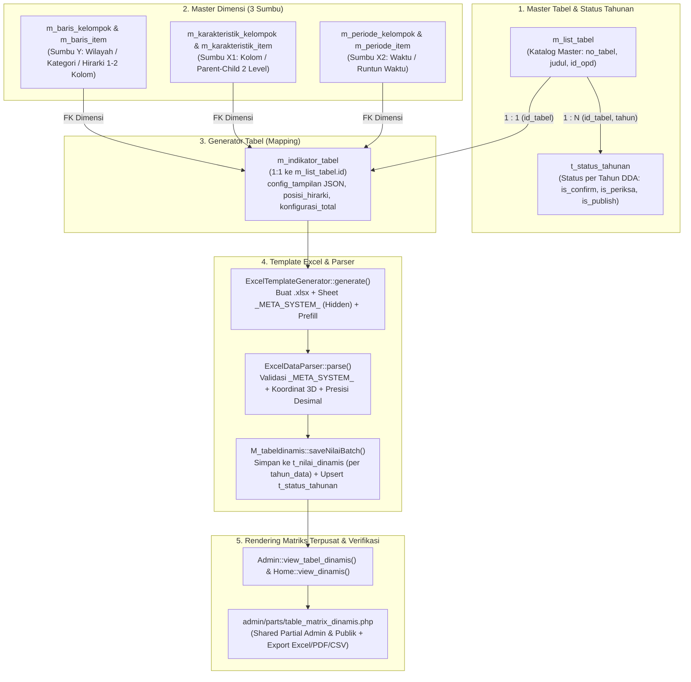

# 📋 Laporan Audit Teknis: Flow, Sintaks, Query SQL, & Bug Modul Tabel Dinamis

**Proyek**: DDA Online Provinsi Jawa Tengah (`dda-online-ci4-tabel-dinamis`)  
**Branch**: `tabel_dinamis` (Commit: `ad4ee15`)  
**Database Aktif**: Aiven Cloud MySQL (`defaultdb`)  
**Tanggal Audit**: 4 November 2026  
**Cakupan Audit**: Arsitektur Alur (*End-to-End Flow*), Sintaks PHP/JS, Query SQL & Skema Database Multi-Tahun, serta Analisis Bug, Edge Cases, dan Keamanan (Tanpa Eksekusi Perubahan Kode).

---

## 1. Audit Arsitektur & Alur Sistem (*End-to-End Flow*)

Pasca-migrasi skema multi-tahun melalui [`2026-10-30-000001_RefactorMultiYearDynamicAndApiSchema.php`](file:///e:/BPS%20JATENG/DDA/dda-online-ci4-tabel-dinamis/app/Database/Migrations/2026-10-30-000001_RefactorMultiYearDynamicAndApiSchema.php), arsitektur Tabel Dinamis memisahkan **Katalog Master Tabel** (`m_list_tabel`), **Status Operasional Tahunan** (`t_status_tahunan`), **Konfigurasi Dimensi Indikator** (`m_indikator_tabel`), dan **Penyimpanan Sel Multi-Tahun** (`t_nilai_dinamis`).

---

## 2. Audit Sintaks (*Syntax & Dead Code Check*)

| File | Baris | Status Sintaks | Catatan Teknis |
| :--- | :---: | :---: | :--- |
| [`app/Controllers/Admin.php`](file:///e:/BPS%20JATENG/DDA/dda-online-ci4-tabel-dinamis/app/Controllers/Admin.php) | 7.036 | ✅ Valid | Tidak ada error fatal sintaks; terdapat celah RBAC/IDOR dan inkonsistensi penanganan status tahunan. |
| [`app/Controllers/Home.php`](file:///e:/BPS%20JATENG/DDA/dda-online-ci4-tabel-dinamis/app/Controllers/Home.php) | 523 | ✅ Valid | Menggunakan `formatDynamicTableTitle()` dan partial matriks terpusat; memiliki filter redundan `is_periksa=1` yang memblokir tabel publikasi sah. |
| [`app/Models/M_tabeldinamis.php`](file:///e:/BPS%20JATENG/DDA/dda-online-ci4-tabel-dinamis/app/Models/M_tabeldinamis.php) | 2.497 | ✅ Valid | Struktur rapi; metode `saveNilaiBatch()` belum meng-update `is_confirm = '2'` saat import nilai. |
| [`app/Models/M_frontend.php`](file:///e:/BPS%20JATENG/DDA/dda-online-ci4-tabel-dinamis/app/Models/M_frontend.php) | 353 | ✅ Valid | Menggunakan parameter binding `?`, namun klausa `is_periksa = 1` memfilter keluar 87,6% tabel publikasi sah. |
| [`app/Libraries/ExcelTemplateGenerator.php`](file:///e:/BPS%20JATENG/DDA/dda-online-ci4-tabel-dinamis/app/Libraries/ExcelTemplateGenerator.php) | 2.266 | ✅ Valid | Sintaks valid; terdapat bug selisih 1 tahun pada nilai default di `download()` vs `generate()`. |
| [`app/Libraries/ExcelDataParser.php`](file:///e:/BPS%20JATENG/DDA/dda-online-ci4-tabel-dinamis/app/Libraries/ExcelDataParser.php) | 862 | ✅ Valid | Deteksi ribuan US vs ID sudah berjalan akurat; sanitasi simbol catatan belum terintegrasi utuh ke format viewer. |
| [`app/Helpers/my_helper.php`](file:///e:/BPS%20JATENG/DDA/dda-online-ci4-tabel-dinamis/app/Helpers/my_helper.php) | 232 | ✅ Valid | Fungsi `formatDynamicTableTitle()` dan `formatDynamicCellValue()` bebas dari syntax error. |
| [`app/Views/admin/parts/table_matrix_dinamis.php`](file:///e:/BPS%20JATENG/DDA/dda-online-ci4-tabel-dinamis/app/Views/admin/parts/table_matrix_dinamis.php) | 1.617 | ✅ Valid | Partial tunggal matriks; terdapat bug penanganan Total DB pada mode Portrait. |
| [`app/Views/admin/v_tabel_dinamis.php`](file:///e:/BPS%20JATENG/DDA/dda-online-ci4-tabel-dinamis/app/Views/admin/v_tabel_dinamis.php) | 1.052 | ⚠️ *Dead Code* | Baris 44–185 memuat ~140 baris kalkulasi judul matriks yang sudah tidak digunakan. |
| [`app/Views/frontend/v_tabel_dinamis.php`](file:///e:/BPS%20JATENG/DDA/dda-online-ci4-tabel-dinamis/app/Views/frontend/v_tabel_dinamis.php) | 1.268 | ⚠️ *Dead Code* | Baris 82–191 memuat blok perhitungan serupa yang diabaikan karena pendelegasian ke partial. |

---

## 3. Audit Skema Database & Query SQL

1. **Skema & Indeks**:
   - `t_nilai_dinamis` telah memiliki `UNIQUE KEY uk_cell_multiyear (id_indikator, tahun_data, id_baris_item, id_karakteristik_item, id_periode_item)` dan `KEY idx_indikator_tahun (id_indikator, tahun_data)`.
   - `t_status_tahunan` memiliki `UNIQUE KEY uk_status_tabel_tahun (id_tabel, tahun)` dengan Foreign Key ke `m_list_tabel(id) ON DELETE CASCADE`.
2. **Kelemahan Query**:
   - **Unfiltered Query**: [`Admin::view_tabel_dinamis()`](file:///e:/BPS%20JATENG/DDA/dda-online-ci4-tabel-dinamis/app/Controllers/Admin.php#L6422), [`Admin::ajax_preview_matrix_dinamis()`](file:///e:/BPS%20JATENG/DDA/dda-online-ci4-tabel-dinamis/app/Controllers/Admin.php#L6970), dan [`Home::view_dinamis()`](file:///e:/BPS%20JATENG/DDA/dda-online-ci4-tabel-dinamis/app/Controllers/Home.php#L441) menarik semua nilai `t_nilai_dinamis` tanpa klausa `whereIn('tahun_data', $selected_years)`.
   - **Urutan Transaksi**: Metode `sync*Items()` di `M_tabeldinamis.php` menghapus tabel induk `m_*_item` sebelum menghapus baris anak di `t_nilai_dinamis`.

---

## 4. Temuan Bug & Celah Keamanan Aktif (Prioritas P0 s.d. P3)

### 🔴 [P0 - Kritis #1] Filter `is_periksa = 1` di Frontend Menyembunyikan 233 dari 266 Tabel Publikasi (87,6%)
- **Lokasi**:
  - [`app/Models/M_frontend.php` baris 51, 60, 65, 136, 154, 304](file:///e:/BPS%20JATENG/DDA/dda-online-ci4-tabel-dinamis/app/Models/M_frontend.php#L51)
  - [`app/Controllers/Home.php` baris 319](file:///e:/BPS%20JATENG/DDA/dda-online-ci4-tabel-dinamis/app/Controllers/Home.php#L319)
- **Akar Masalah**:
  Di database `t_status_tahunan`, syarat sebuah tabel berstatus publikasi resmi adalah `is_publish = 1` dan `is_confirm = '1'`. Dari total 266 record publikasi yang ada di database:
  - 233 tabel memiliki `is_publish = 1`, `is_confirm = '1'`, dan `is_periksa = 0`.
  - Hanya 33 tabel yang memiliki `is_periksa = 1`.
  Namun di `M_frontend.php` dan `Home.php`, query memaksakan filter:
  `WHERE s.is_publish = 1 AND s.is_periksa = 1 AND s.is_confirm = '1'`
- **Dampak Fatal**:
  Sebanyak **233 tabel yang sudah resmi dipublikasikan (87,6%) hilang total dari hasil pencarian publik**. Jika pengunjung mengakses link langsung tabel tersebut di web, sistem langsung melempar error: *"Tabel data belum dipublikasikan untuk umum"*.
- **Rekomendasi**:
  Hapus syarat `AND s.is_periksa = 1` dari seluruh query di `M_frontend.php` dan `Home.php`. Cukup gunakan `s.is_publish = 1 AND s.is_confirm = '1'`.

---

### 🔴 [P0 - Kritis #2] Error Penolakan Unggah Excel Akibat Ketidaksinkronan Parameter Tahun di `download()` vs `generate()`
- **Lokasi**:
  - [`ExcelTemplateGenerator::download()` baris 2239–2241](file:///e:/BPS%20JATENG/DDA/dda-online-ci4-tabel-dinamis/app/Libraries/ExcelTemplateGenerator.php#L2239-L2241)
  - [`ExcelDataParser::parse()` baris 89–98](file:///e:/BPS%20JATENG/DDA/dda-online-ci4-tabel-dinamis/app/Libraries/ExcelDataParser.php#L89-L98)
- **Akar Masalah**:
  - Di `generate()`, jika `$tahunInput` null, tahun target dihitung sebagai `$activeTa - 1` (misal sesi DDA 2026 -> Tahun Data 2025).
  - Namun di wrapper `download()`, baris 2239 mengisi `$tahunInput = $activeTa` (2026, tanpa `- 1`) sebelum meneruskannya ke `generate()`.
- **Dampak Fatal**:
  Ketika Admin mengunduh template dari tombol tautan standar (`admin/download_template_tabel/{id}` tanpa segmen tahun), template terstempel tahun 2026 di sel metadata `B4`. Saat file tersebut diunggah kembali melalui form input default (yang mengirim `$tahun_data = 2025`), `ExcelDataParser` langsung menolak dan melempar Exception:
  *"Tahun pada berkas Excel (2026) tidak sesuai dengan tahun data yang dipilih (2025)"*.
- **Rekomendasi**:
  Ubah baris 2240 di `ExcelTemplateGenerator.php` menjadi:
  `$tahunInput = ((int)(session()->get('admin_ta') ?: session()->get('tahun') ?: date('Y'))) - 1;`

---

### 🔴 [P0 - Kritis #3] Inkonsistensi Tahun Publikasi (`tahun` DDA) vs Tahun Data (`tahun_data`) pada `t_status_tahunan`
- **Lokasi**:
  - [`Admin::ajax_hapus_nilai_tahun()` baris 5997–6001](file:///e:/BPS%20JATENG/DDA/dda-online-ci4-tabel-dinamis/app/Controllers/Admin.php#L5997-L6001)
  - [`Admin::upload_excel_dinamis()` baris 6594–6598](file:///e:/BPS%20JATENG/DDA/dda-online-ci4-tabel-dinamis/app/Controllers/Admin.php#L6594-L6598)
  - [`M_tabeldinamis::saveNilaiBatch()` baris 1604–1607](file:///e:/BPS%20JATENG/DDA/dda-online-ci4-tabel-dinamis/app/Models/M_tabeldinamis.php#L1604-L1607)
- **Akar Masalah**:
  - Pada `ajax_hapus_nilai_tahun()`, saat data tahun 2025 dihapus hingga kosong, method memanggil `upsertStatusTahunan(..., 2025, ...)` menggunakan `$tahun_data` (2025), bukan tahun publikasi DDA aktif (2026). Akibatnya status pada tahun buku 2026 tidak ter-reset, dan timbul record status salah sasaran di tahun 2025.
  - Pada `saveNilaiBatch()` dan `upload_excel_dinamis()`, saat file Excel berhasil diunggah, kode hanya meng-update `is_periksa => 1`, tetapi **tidak meng-update `is_confirm => '2'`** (Menunggu Verifikasi). Jika sebelumnya tabel berstatus `is_confirm = '0'` (belum diisi), status konfirmasinya tetap 0.
- **Rekomendasi**:
  - Di `ajax_hapus_nilai_tahun()`, reset status pada tahun publikasi `$targetTa = (int)$tahun_data + 1` (serta reset `is_confirm => '0'`).
  - Di `saveNilaiBatch()`, sertakan `'is_confirm' => '2'` saat import data berhasil.

---

### 🔴 [P0 - Kritis #4] Celah Keamanan Autentikasi & Otorisasi (RBAC / IDOR) pada Endpoint Mutasi
- **Lokasi**:
  - [`Admin::act_update_isi()`](file:///e:/BPS%20JATENG/DDA/dda-online-ci4-tabel-dinamis/app/Controllers/Admin.php#L2096) & [`Admin::batal_isi()`](file:///e:/BPS%20JATENG/DDA/dda-online-ci4-tabel-dinamis/app/Controllers/Admin.php#L2116)
  - [`Admin::save_generator_tabel()`](file:///e:/BPS%20JATENG/DDA/dda-online-ci4-tabel-dinamis/app/Controllers/Admin.php#L6020) & [`Admin::unlink_generator_tabel()`](file:///e:/BPS%20JATENG/DDA/dda-online-ci4-tabel-dinamis/app/Controllers/Admin.php#L6169)
  - [`Admin::ajax_save_konfigurasi_tampilan_dinamis()`](file:///e:/BPS%20JATENG/DDA/dda-online-ci4-tabel-dinamis/app/Controllers/Admin.php#L6728) & [`Admin::ajax_save_default_tahun_tampil()`](file:///e:/BPS%20JATENG/DDA/dda-online-ci4-tabel-dinamis/app/Controllers/Admin.php#L6822)
- **Akar Masalah**:
  - `act_update_isi()` dan `batal_isi()` tidak memiliki pengecekan `admin_valid`.
  - Endpoint mutasi dimensi tabel hanya mengecek status login tanpa memeriksa apakah pengguna memiliki wewenang Admin BPS atau hak akses OPD atas tabel terkait.
- **Rekomendasi**:
  Pasang guard autentikasi terpusat dan validasi hak akses unit kerja sebelum memproses mutasi data tabel dinamis.

---

### 🟠 [P1 - Tinggi #5] Pengabaian Baris Total Database & Distorsi Auto-SUM pada Mode Portrait
- **Lokasi**:
  - [`app/Views/admin/parts/table_matrix_dinamis.php` baris 1002–1005 & 1554–1614](file:///e:/BPS%20JATENG/DDA/dda-online-ci4-tabel-dinamis/app/Views/admin/parts/table_matrix_dinamis.php#L1002)
- **Akar Masalah**:
  Pada tabel berorientasi Portrait (multi-tahun ke bawah):
  1. Jika tabel memiliki baris Total di database (`tipe_baris === 'total'`), baris tersebut di-*skip* di baris 1004 dengan komentar `// dirender di blok total bawah`, namun variabel `$hasDbTotalRow` tidak pernah di-set `true`.
  2. Jika Auto-SUM vertikal dinonaktifkan (`$totalVertikal = false`), blok bawah (baris 1554) tidak dieksekusi sehingga baris Total DB hilang total.
  3. Jika Auto-SUM vertikal aktif, blok bawah merender `$colVerticalSums[$cIdx]` yang menjumlahkan seluruh baris tahun ke bawah (akumulasi lintas tahun yang tidak valid secara statistik).
- **Rekomendasi**:
  Set `$hasDbTotalRow = true` pada baris 1002 dan render nilai database dari `$nilaiMap` pada footer tabel.

---

### 🟠 [P1 - Tinggi #6] Konflik Sinkronisasi JSON `config_tampilan` vs Kolom Fisik `m_indikator_tabel`
- **Lokasi**:
  - [`Admin::save_generator_tabel()` baris 6095–6145](file:///e:/BPS%20JATENG/DDA/dda-online-ci4-tabel-dinamis/app/Controllers/Admin.php#L6095)
  - [`Admin::view_tabel_dinamis()` baris 6332](file:///e:/BPS%20JATENG/DDA/dda-online-ci4-tabel-dinamis/app/Controllers/Admin.php#L6332)
  - [`Home::view_dinamis()` baris 362](file:///e:/BPS%20JATENG/DDA/dda-online-ci4-tabel-dinamis/app/Controllers/Home.php#L362)
- **Akar Masalah**:
  Kolom `config_tampilan` sudah terisi JSON pada seluruh baris pasca-migrasi. Ketika Admin mengubah `posisi_hirarki` atau `konfigurasi_total` di halaman Generator Tabel, fungsi hanya meng-update kolom fisik tanpa memperbarui isi JSON `config_tampilan`. Karena viewer mengutamakan JSON jika tidak kosong (`if (!$hasSavedCfgJson)`), perubahan tersebut diabaikan total.
- **Rekomendasi**:
  Di `save_generator_tabel()`, baca JSON `config_tampilan`, perbarui key terkait, dan simpan kembali JSON tersebut ke database.

---

### 🟠 [P1 - Tinggi #7] Hilangnya Nilai Angka Saat Sel Memiliki Catatan Simbol (`125*` / `125e`)
- **Lokasi**:
  - [`app/Helpers/my_helper.php` baris 203–205 (`formatDynamicCellValue`)](file:///e:/BPS%20JATENG/DDA/dda-online-ci4-tabel-dinamis/app/Helpers/my_helper.php#L203)
  - [`ExcelTemplateGenerator.php` baris 2069–2073](file:///e:/BPS%20JATENG/DDA/dda-online-ci4-tabel-dinamis/app/Libraries/ExcelTemplateGenerator.php#L2069)
  - [`M_tabeldinamis::buildDynamicTableExport()` baris 2066–2073](file:///e:/BPS%20JATENG/DDA/dda-online-ci4-tabel-dinamis/app/Models/M_tabeldinamis.php#L2066)
- **Akar Masalah**:
  `ExcelDataParser::sanitizeValue()` berhasil memisahkan input `"125*"` menjadi `nilai = 125.0` dan `simbol = '*'`. Namun pada `formatDynamicCellValue()` dan *prefill* Excel:
  `if ($simbol !== null && $simbol !== '') return (string)$simbol;`
  Fungsi langsung mengembalikan `'*'` dan membuang angka `125`. Sel di Excel terisi `'*'`, dan jika diunggah kembali, angka `125` di database terhapus menjadi null.
- **Rekomendasi**:
  Jika nilai numerik ada dan simbol adalah penanda catatan (seperti `*`, `**`, `e`, `r`), tampilkan gabungan angka terformat diikuti simbol (misal `125*`).

---

### 🟡 [P2 - Menengah #8] Format Rata Kanan Subtotal Merusak Kolom B pada Tabel Hirarki 2 Kolom
- **Lokasi**: [`ExcelTemplateGenerator::generate()` baris 1940](file:///e:/BPS%20JATENG/DDA/dda-online-ci4-tabel-dinamis/app/Libraries/ExcelTemplateGenerator.php#L1940)
- **Deskripsi**: Loop pemformatan teks/angka baris `subtotal` dimulai dari kolom `2` (Kolom B), bukan `$startDataColIndex` (Kolom C pada mode 2 kolom), menyebabkan nama baris di kolom B terkena format rata kanan angka.

---

### 🟡 [P2 - Menengah #9] Checksum Keamanan `_META_SYSTEM_` (`B14`) Tidak Diverifikasi
- **Lokasi**: [`ExcelDataParser::parse()` baris 56–74](file:///e:/BPS%20JATENG/DDA/dda-online-ci4-tabel-dinamis/app/Libraries/ExcelDataParser.php#L56)
- **Deskripsi**: Hash MD5 dibuat di sel `B14` sheet metadata dan dibaca oleh parser, namun parser tidak memverifikasi kecocokan hash tersebut, sehingga modifikasi manual sheet tersembunyi tidak terdeteksi.

---

### 🟡 [P2 - Menengah #10] Query `t_nilai_dinamis` Memuat Seluruh Tahun Historis Tanpa Filter
- **Lokasi**: [`Admin::view_tabel_dinamis()` baris 6422](file:///e:/BPS%20JATENG/DDA/dda-online-ci4-tabel-dinamis/app/Controllers/Admin.php#L6422), [`Admin::ajax_preview_matrix_dinamis()` baris 6970](file:///e:/BPS%20JATENG/DDA/dda-online-ci4-tabel-dinamis/app/Controllers/Admin.php#L6970), dan [`Home::view_dinamis()` baris 441](file:///e:/BPS%20JATENG/DDA/dda-online-ci4-tabel-dinamis/app/Controllers/Home.php#L441)
- **Deskripsi**: Query mengambil seluruh baris sel untuk indikator tanpa membatasi `tahun_data`, mengabaikan indeks komposit `idx_indikator_tahun`.

---

### 🟢 [P3 - Rendah #11] Dead Code Sisa Rendering Matriks di View Induk
- **Lokasi**: [`app/Views/admin/v_tabel_dinamis.php` baris 44–185](file:///e:/BPS%20JATENG/DDA/dda-online-ci4-tabel-dinamis/app/Views/admin/v_tabel_dinamis.php#L44) dan [`app/Views/frontend/v_tabel_dinamis.php` baris 82–191](file:///e:/BPS%20JATENG/DDA/dda-online-ci4-tabel-dinamis/app/Views/frontend/v_tabel_dinamis.php#L82)
- **Deskripsi**: Terdapat ~140 baris kode penyiapan variabel matriks yang tidak lagi dipakai karena tabel kini dirender terpusat oleh `admin/parts/table_matrix_dinamis.php`.

---

### 🟢 [P3 - Rendah #12] Urutan Transaksi Penghapusan Induk Sebelum Anak pada Sinkronisasi Dimensi
- **Lokasi**: [`M_tabeldinamis.php` baris 307, 828, 922, 1238](file:///e:/BPS%20JATENG/DDA/dda-online-ci4-tabel-dinamis/app/Models/M_tabeldinamis.php#L307)
- **Deskripsi**: Pada method `sync*Items()`, tabel master dimensi (`m_*_item`) dihapus sebelum tabel anak `t_nilai_dinamis`.
