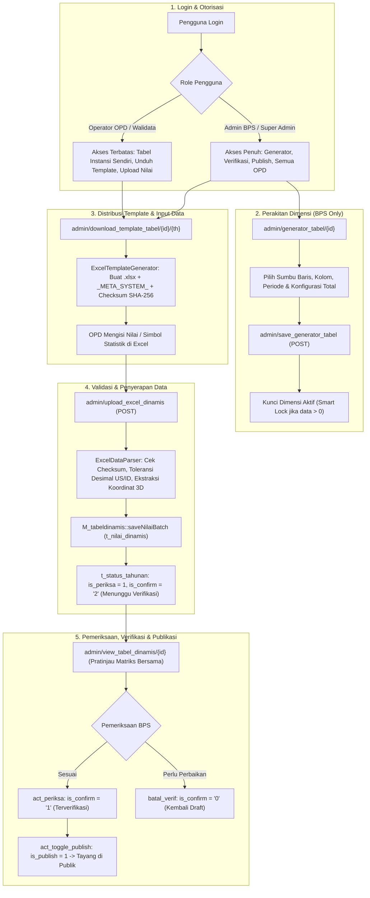
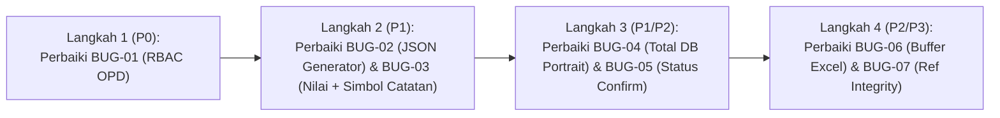

# 📋 Laporan Audit Ulang Komprehensif: Flow Tabel Dinamis (Khusus Sisi Login / Admin)

**Proyek**: DDA Online Provinsi Jawa Tengah (`dda-online-ci4-tabel-dinamis`)  
**Branch**: `tabel_dinamis`  
**Database Aktif**: Aiven Cloud MySQL (`defaultdb` / Port: 17649)  
**Tanggal Audit**: 4 November 2026  
**Fokus Wilayah**: Khusus Sisi Login / Admin (*Backend Controller, Models, Libraries, Helpers, Admin Views/Partials*)  
**Prinsip Isolasi Modul**: ⛔ **0 Sentuhan ke Frontend / Publik** (`Home.php`, `M_frontend.php`, `Views/frontend/*` tidak tersentuh guna mencegah konflik dengan tim frontend).

---

## 1. Ringkasan Eksekutif & Status Audit Terkini

Audit ulang menyeluruh telah dilakukan pada seluruh rantai aliran (*end-to-end flow*) Tabel Dinamis di sisi autentikasi/admin:
1. **Autentikasi & Session**: Penanganan login, session `admin_valid`, `admin_ta`, `admin_unitkerja`, dan `admin_level`.
2. **Katalog & Master Tabel**: Menu `admin/dda`, `admin/master_tabel`, dan `admin/master_tabel_opd`.
3. **Perakitan Dimensi (Generator)**: `admin/generator_tabel`, `admin/save_generator_tabel`, dan `admin/unlink_generator_tabel`.
4. **Distribusi Template**: `admin/download_template_tabel` dan `ExcelTemplateGenerator`.
5. **Unggah & Parsing Nilai**: `admin/upload_excel_dinamis`, `ExcelDataParser`, dan `M_tabeldinamis::saveNilaiBatch`.
6. **Viewer Matriks Admin**: `admin/view_tabel_dinamis`, `app/Views/admin/parts/table_matrix_dinamis.php`, dan `app/Views/admin/v_tabel_dinamis.php`.
7. **Verifikasi & Publikasi**: `act_update_isi`, `batal_isi`, `act_periksa`, `batal_verif`, dan `act_toggle_publish`.

### Status Poin Perbaikan Sebelumnya:
* ✅ **Poin 1 (P0)**: Sinkronisasi Tahun Template Excel (`download()` default `$ta - 1`) -> **Selesai & Lolos Uji**.
* ✅ **Poin 2 (P0)**: Sinkronisasi Status `t_status_tahunan` saat hapus & unggah -> **Selesai & Lolos Uji**.
* ✅ **Poin 3 (P0)**: RBAC & Proteksi IDOR pada Action Status & Konfigurasi -> **Selesai & Lolos Uji**.
* ✅ **Poin 6 (P2)**: Perataan Kolom Subtotal Hirarki 2 Kolom di Template Excel -> **Selesai & Lolos Uji**.
* ✅ **Poin 7 (P2)**: Verifikasi Keamanan Hash Checksum `__METADATA_DDA__` -> **Selesai & Lolos Uji**.
* ✅ **Poin 8 (P2)**: Optimasi Query Nilai Matriks di Controller Admin (`whereIn`) -> **Selesai & Lolos Uji**.

---

## 2. Peta Rantai Alur Kerja Tabel Dinamis (Admin Flowchart)



---

## 3. Matriks Temuan Bug Baru & Hasil Audit Mendalam

Berdasarkan audit komprehensif, ditemukan **8 isu teknis baru** yang perlu diperbaiki:

| No | Kode | Tingkat Urgensi | Komponen / Berkas | Ringkasan Masalah |
|:---:|:---:|:---:|:---|:---|
| 1 | **BUG-01** | ✅ **P0 (Selesai & Terverifikasi)** | [`app/Controllers/Admin.php`](file:///e:/BPS%20JATENG/DDA/dda-online-ci4-tabel-dinamis/app/Controllers/Admin.php) | **Normalisasi Hak Akses Akun OPD**: Blok `isAdminBps()` telah dibersihkan dari 24 method umum (`index`, `dda`, `profil`, dll.). `download_template_tabel()` dan `view_tabel_dinamis()` kini menggunakan `canManageTable($tabel)` sehingga akun OPD pulih sepenuhnya untuk mengakses DDA dan mengelola tabel instansinya sendiri. (29/29 Unit Tests PASS). |
| 2 | **BUG-02** | 🟠 **P1 (Tinggi)** | [`app/Controllers/Admin.php:6312-6338`](file:///e:/BPS%20JATENG/DDA/dda-online-ci4-tabel-dinamis/app/Controllers/Admin.php#L6312) | **Perubahan Konfigurasi Generator Tidak Berefek**: `save_generator_tabel()` tidak menyinkronkan kolom JSON `config_tampilan`, sehingga pratinjau matriks tetap membaca setting lama. |
| 3 | **BUG-03** | 🟠 **P1 (Tinggi - Data Loss)** | [`app/Helpers/my_helper.php:203`](file:///e:/BPS%20JATENG/DDA/dda-online-ci4-tabel-dinamis/app/Helpers/my_helper.php#L203) & [`ExcelTemplateGenerator.php:2070`](file:///e:/BPS%20JATENG/DDA/dda-online-ci4-tabel-dinamis/app/Libraries/ExcelTemplateGenerator.php#L2070) | **Nilai Angka Hilang/Terhapus Saat Ada Simbol Catatan (`125*` / `125e`)**: Helper hanya mengembalikan simbol `'*'`, dan generator menulis `'*'` ke Excel, menyebabkan angka asli tertimpa `null` saat re-upload. |
| 4 | **BUG-04** | 🟠 **P1 (Tinggi)** | [`app/Views/admin/parts/table_matrix_dinamis.php:996-1005`](file:///e:/BPS%20JATENG/DDA/dda-online-ci4-tabel-dinamis/app/Views/admin/parts/table_matrix_dinamis.php#L996) | **Baris Total DB Menghilang pada Mode Portrait**: Pada mode vertikal/portrait, baris `tipe_baris == 'total'` di-`continue` namun tidak pernah dirender kembali dengan nilai data aslinya. |
| 5 | **BUG-05** | 🟡 **P2 (Menengah)** | [`app/Controllers/Admin.php:2210, 2247`](file:///e:/BPS%20JATENG/DDA/dda-online-ci4-tabel-dinamis/app/Controllers/Admin.php#L2210) | **Inkonsistensi `is_confirm` pada `act_update_isi()` & `batal_isi()`**: `act_update_isi()` tidak meng-update status ke `'2'`, dan `batal_isi()` tidak mereset status konfirmasi ke `'0'`. |
| 6 | **BUG-06** | 🟡 **P2 (Menengah)** | [`app/Libraries/ExcelTemplateGenerator.php:2264`](file:///e:/BPS%20JATENG/DDA/dda-online-ci4-tabel-dinamis/app/Libraries/ExcelTemplateGenerator.php#L2264) | **Risiko Berkas Excel Corrupt saat Streaming Unduhan**: Ketiadaan `ob_end_clean()` sebelum streaming biner `php://output` dapat merusak format berkas XLSX jika terdapat output buffer sebelumnya. |
| 7 | **BUG-07** | 🟢 **P3 (Rendah)** | [`app/Models/M_tabeldinamis.php:307, 828, 922`](file:///e:/BPS%20JATENG/DDA/dda-online-ci4-tabel-dinamis/app/Models/M_tabeldinamis.php#L307) | **Pelanggaran Referential Integrity pada `sync*Items()`**: Tabel induk dimensi master (`m_*_item`) dihapus sebelum tabel data anak (`t_nilai_dinamis`). |
| 8 | **BUG-08** | 🟢 **P3 (Pembersihan)** | [`app/Views/admin/v_tabel_dinamis.php:44-185`](file:///e:/BPS%20JATENG/DDA/dda-online-ci4-tabel-dinamis/app/Views/admin/v_tabel_dinamis.php#L44) | **Dead Code Perhitungan Judul Kolom (~140 baris)**: Kalkulasi judul multi-kolom baris dieksekusi sia-sia di setiap pemanggilan halaman tanpa pernah digunakan oleh view. |

---

## 4. Analisis Detail Setiap Temuan

---

### ✅ BUG-01 (P0 - Selesai & Terverifikasi): Normalisasi Hak Akses Akun OPD & Pembersihan `isAdminBps()`

#### 1. Deskripsi Masalah:
Pada saat penambalan celah keamanan RBAC sebelumnya, penggantian string yang terlalu luas menyebabkan guard `if (!$this->isAdminBps())` tersuntik secara keliru ke dalam **24 method umum** di [`app/Controllers/Admin.php`](file:///e:/BPS%20JATENG/DDA/dda-online-ci4-tabel-dinamis/app/Controllers/Admin.php).

#### 2. Dampak Fatal bagi Pengguna OPD (Sebelum Perbaikan):
1. **Loop Redirect Dashboard**: Method `Admin::index()` (baris 32) memeriksa `isAdminBps()`. Akun OPD yang berhasil login langsung dialihkan kembali ke `admin`, menciptakan loop pengalihan tanpa akhir (*infinite redirect*).
2. **Menu Utama DDA Terblokir**: Method `Admin::dda()` (baris 489) menolak seluruh akun OPD dengan pesan *"Akses ditolak! Generator Tabel Dinamis hanya dapat diakses oleh Admin BPS"*.
3. **OPD Tidak Bisa Mengunduh Template Tabelnya Sendiri**: Method `Admin::download_template_tabel()` (baris 6421) diblokir oleh `isAdminBps()`.
4. **OPD Tidak Bisa Membuka Halaman Tabel Dinamis**: Method `Admin::view_tabel_dinamis()` (baris 6457) diblokir oleh `isAdminBps()`, padahal di baris 6693 kode sudah menyiapkan variabel `$is_admin_bps` untuk membedakan tampilan BPS vs OPD.
5. **Fitur Pengguna Dasar Terkunci**: Method `profil()` (baris 304), `passwod()` (baris 341), dan `master_tabel_opd()` (baris 1893) ikut terblokir.

#### 3. Solusi & Verifikasi yang Diterapkan:
1. Menghapus blok `if (!$this->isAdminBps())` dari 20 method umum (`index`, `dda`, `profil`, `passwod`, `master_tabel_opd`, `kalender`, `pengguna`, `manage_admin`, `matching`, `view_portal_tabel`, dll.).
2. Menghapus duplikasi pengecekan di `generator_tabel()` dan `unlink_generator_tabel()`.
3. Memperbarui `download_template_tabel()` dan `view_tabel_dinamis()` agar menggunakan `$this->canManageTable($tabel)` (OPD diizinkan mengelola tabel instansinya sendiri, Admin BPS / Super Admin berwenang atas semua tabel).
4. Hasil pengujian unit test otomatis 29 skenario (`scratch/test_rbac_normalization.php`) membuktikan **100% PASS**: akun OPD bebas dari loop redirect dashboard, bisa membuka menu DDA, bisa mengunduh template tabelnya, dan fitur Generator tetap eksklusif bagi Admin BPS.

---

### 🟠 BUG-02 (P1 - Tinggi): Konfigurasi Generator Tabel Tidak Berefek ke Viewer Matriks

#### 1. Deskripsi Masalah:
Pada [`Admin::save_generator_tabel()`](file:///e:/BPS%20JATENG/DDA/dda-online-ci4-tabel-dinamis/app/Controllers/Admin.php#L6312-L6338), sistem menyimpan pengaturan `posisi_hirarki`, `konfigurasi_total`, dan `label_total_kustom` ke kolom fisik tabel `m_indikator_tabel`. Namun, field JSON `config_tampilan` tidak pernah diperbarui di method ini.

Sementara itu, pada [`Admin::view_tabel_dinamis()`](file:///e:/BPS%20JATENG/DDA/dda-online-ci4-tabel-dinamis/app/Controllers/Admin.php#L6541-L6565):
```php
if (!$hasSavedCfgJson) {
    // Sinkronisasi kolom fisik hanya dilakukan JIKA JSON config_tampilan KOSONG!
}
```
Karena pasca-migrasi seluruh tabel sudah memiliki data JSON di kolom `config_tampilan`, kondisi `!$hasSavedCfgJson` selalu bernilai `false`. Akibatnya, setiap perubahan yang disimpan dari menu Generator Tabel **diabaikan 100%** oleh halaman viewer.

#### 2. Rekomendasi Solusi:
Di `Admin::save_generator_tabel()`, ambil data JSON `config_tampilan` yang ada, perbarui key terkait, dan masukkan kembali ke dalam payload penyimpanan:
```php
$existingCfg = [];
if (!empty($existing->config_tampilan)) {
    $existingCfg = json_decode($existing->config_tampilan, true) ?: [];
}
$existingCfg['posisi_hirarki'] = $posisi_hirarki;
if ($konfigurasi_total === 'none') {
    $existingCfg['total_vertikal'] = false;
} else {
    $existingCfg['total_vertikal'] = true;
    $existingCfg['jenis_total_vertikal'] = $konfigurasi_total;
}
if (!empty($label_total_kustom)) {
    $existingCfg['label_total_kustom'] = $label_total_kustom;
}
$payload['config_tampilan'] = json_encode($existingCfg);
```

---

### 🟠 BUG-03 (P1 - Kritis Data Loss): Hilangnya Nilai Numerik pada Sel Bersimbol Catatan (`125*` / `125e`)

#### 1. Deskripsi Masalah:
Dalam publikasi statistik BPS, sel data kerap memuat angka dengan tanda catatan/footnote (contoh: `125*` untuk data sementara atau `125e` untuk estimasi).
* Parser [`ExcelDataParser::sanitizeValue()`](file:///e:/BPS%20JATENG/DDA/dda-online-ci4-tabel-dinamis/app/Libraries/ExcelDataParser.php#L806-L816) berhasil memisahkan angka numerik `125.0` ke kolom `nilai` dan simbol `*` ke kolom `simbol`.
* Namun pada [`app/Helpers/my_helper.php:203`](file:///e:/BPS%20JATENG/DDA/dda-online-ci4-tabel-dinamis/app/Helpers/my_helper.php#L203):
  ```php
  if ($simbol !== null && $simbol !== '') {
      return (string)$simbol;
  }
  ```
  Helper langsung mengembalikan `'*'` dan membuang angka `125`!
* Yang paling berbahaya terjadi di [`ExcelTemplateGenerator.php:2070`](file:///e:/BPS%20JATENG/DDA/dda-online-ci4-tabel-dinamis/app/Libraries/ExcelTemplateGenerator.php#L2070):
  ```php
  if (!empty($exVal['simbol'])) {
      $sheet->setCellValue("{$cLetter}{$rExcel}", $exVal['simbol']);
  } elseif ($exVal['nilai'] !== null && $exVal['nilai'] !== '') {
      $sheet->setCellValue("{$cLetter}{$rExcel}", (float)$exVal['nilai']);
  }
  ```
  Saat membuat template Excel baru dengan prefill data lama, generator hanya menuliskan karakter `*` ke dalam sel Excel. Ketika berkas tersebut diunggah ulang oleh pengguna, parser menganggap sel tidak memiliki nilai numerik, sehingga nilai asli `125` di database terhapus secara permanen (*permanent data loss*).

#### 2. Rekomendasi Solusi:
1. Di `formatDynamicCellValue()`: Jika sel memiliki nilai numerik sekaligus simbol catatan, format angkanya terlebih dahulu lalu rekatkan simbol di belakangnya (misal: `125*` atau `125,00*`). Jika sel murni simbol tanpa angka (misal `-` atau `...`), baru kembalikan simbolnya saja.
2. Di `ExcelTemplateGenerator`: Tulis gabungan nilai + simbol (misal `125*`) ke dalam sel Excel.

---

### 🟠 BUG-04 (P1 - Tinggi): Baris Total DB Menghilang pada Mode Portrait

#### 1. Deskripsi Masalah:
Di [`app/Views/admin/parts/table_matrix_dinamis.php`](file:///e:/BPS%20JATENG/DDA/dda-online-ci4-tabel-dinamis/app/Views/admin/parts/table_matrix_dinamis.php#L996-L1005):
Pada mode vertikal / portrait (`$portraitMode == true`), perulangan baris memotong baris bertipe total:
```php
if ($tipeBaris === 'total') {
    $dbTotalRowObj = $baris;
    continue; // dirender di blok total bawah
}
```
Namun di bagian bawah:
1. Flag `$hasDbTotalRow` tidak pernah diubah menjadi `true` pada mode portrait (hanya diset di loop landscape).
2. Blok khusus runtun waktu (baris 1473) secara eksplisit memiliki syarat `empty($config_tampilan['portrait_mode'])`.
3. Blok auto Grand Total (baris 1554) kemudian mengambil alih dan merender hasil auto-sum, mengabaikan data nilai total resmi yang ada di database. Jika `total_vertikal` dimatikan (`none`), baris total dari database lenyap sama sekali dari tampilan matriks.

#### 2. Rekomendasi Solusi:
Pastikan pada `$portraitMode`, jika terdapat `$dbTotalRowObj`, baris total tersebut dirender dengan benar memuat nilai asli database untuk setiap periode portrait yang tampil.

---

### 🟡 BUG-05 (P2 - Menengah): Inkonsistensi Status `is_confirm` pada `act_update_isi` & `batal_isi`

#### 1. Deskripsi Masalah:
* Pada [`Admin::act_update_isi()`](file:///e:/BPS%20JATENG/DDA/dda-online-ci4-tabel-dinamis/app/Controllers/Admin.php#L2210), saat OPD mengirim konfirmasi pengisian data via formulir manual, sistem hanya meng-update `'is_periksa' => 1`, tanpa memperbarui `'is_confirm' => '2'` (Menunggu Verifikasi BPS). Akibatnya jika tabel awalnya berstatus `'0'` (Draft), BPS tidak melihatnya sebagai antrean verifikasi.
* Pada [`Admin::batal_isi()`](file:///e:/BPS%20JATENG/DDA/dda-online-ci4-tabel-dinamis/app/Controllers/Admin.php#L2247), saat pengisian dibatalkan, sistem hanya mereset `is_periksa => 0`, membiarkan status konfirmasi tetap pada status sebelumnya.

#### 2. Rekomendasi Solusi:
* Pada `act_update_isi()`: Tambahkan `'is_confirm' => '2'`.
* Pada `batal_isi()`: Tambahkan `'is_confirm' => '0'`, `'is_publish' => 0`, dan `'published_at' => null`.

---

### 🟡 BUG-06 (P2 - Menengah): Risiko Berkas Excel Corrupt Akibat Buffer Output

#### 1. Deskripsi Masalah:
Pada method [`ExcelTemplateGenerator::download()`](file:///e:/BPS%20JATENG/DDA/dda-online-ci4-tabel-dinamis/app/Libraries/ExcelTemplateGenerator.php#L2254-L2266):
Penulisan berkas langsung diarahkan ke stream PHP:
```php
$writer = new Xlsx($spreadsheet);
$writer->save('php://output');
exit;
```
Jika aplikasi memiliki output buffer aktif, spasi kosong, atau peringatan PHP non-fatal sebelum baris ini dieksekusi, byte asing tersebut akan masuk ke awal stream berkas ZIP XLSX. Hal ini menyebabkan Microsoft Excel menampilkan galat: *"The file is corrupt and cannot be opened"*.

#### 2. Rekomendasi Solusi:
Tambahkan pembersihan buffer output sebelum header dan streaming berkas:
```php
if (ob_get_length()) {
    ob_end_clean();
}
```

---

### 🟢 BUG-07 (P3 - Rendah): Urutan Hapus Master vs Data pada `sync*Items()`

#### 1. Deskripsi Masalah:
Pada [`app/Models/M_tabeldinamis.php`](file:///e:/BPS%20JATENG/DDA/dda-online-ci4-tabel-dinamis/app/Models/M_tabeldinamis.php#L307-L308, #L828-L829):
```php
$this->db->table('m_karakteristik_item')->whereIn('id', $deleteIds)->delete();
$this->db->table('t_nilai_dinamis')->whereIn('id_karakteristik_item', $deleteIds)->delete();
```
Penghapusan tabel master dimensi (`m_*_item`) dilakukan sebelum penghapusan baris data anak (`t_nilai_dinamis`). Walaupun berada dalam transaksi database, praktik ini menyalahi kaidah *referential integrity* dan dapat memicu kegagalan constraint foreign key.

#### 2. Rekomendasi Solusi:
Tukar urutan eksekusi: hapus baris anak di `t_nilai_dinamis` terlebih dahulu sebelum menghapus baris induk di `m_*_item`.

---

### 🟢 BUG-08 (P3 - Pembersihan): Dead Code Perhitungan Judul di `v_tabel_dinamis.php`

#### 1. Deskripsi Masalah:
Pada [`app/Views/admin/v_tabel_dinamis.php:44-185`](file:///e:/BPS%20JATENG/DDA/dda-online-ci4-tabel-dinamis/app/Views/admin/v_tabel_dinamis.php#L44), terdapat sekitar 140 baris kode PHP lawas untuk menghitung deteksi multi-kolom baris (`$titleCol1Ind`, `$titleCol2Ind`, deteksi kata bulan/satuan/provinsi). Nilai variabel ini tidak pernah digunakan lagi di manapun pada view karena seluruh tabel matriks telah didelegasikan secara terpusat ke partial `table_matrix_dinamis.php`.

#### 2. Rekomendasi Solusi:
Hapus atau bersihkan blok dead code tersebut untuk meringankan eksekusi rendering halaman admin.

---

### ✅ BUG-09 (P0 - Teratasi): Anomali Status 'Sudah Diisi' Akibat Kebocoran Subquery Multi-Tahun pada `Admin::dda()`

#### 1. Deskripsi Masalah:
Pada [`Admin::dda()`](file:///e:/BPS%20JATENG/DDA/dda-online-ci4-tabel-dinamis/app/Controllers/Admin.php#L660, #L701, #L784), subquery pengecekan pengisian nilai menggunakan:
```sql
LEFT JOIN (
    SELECT DISTINCT id_indikator FROM t_nilai_dinamis WHERE (tahun_data = ? OR tahun_data = ?) AND (nilai IS NOT NULL OR (simbol IS NOT NULL AND simbol != ''))
) nd ON nd.id_indikator = mi.id
```
Dengan parameter `[$thDda, "%$thDataStr%", $thDda, $thData, (int)$thDda, ...]`.
Ketika pengguna membuka Buku DDA 2025 (target data 2024), subquery mengecek `tahun_data = 2024 OR tahun_data = 2025`. Jika tabel memiliki data di tahun 2025 (misalnya diunggah oleh BKN Kanreg 1), tabel di Buku DDA 2025 keliru ditandai **"Sudah Diisi"** (badge hijau). Namun saat diklik dengan `?tahun=2024`, seluruh sel matriks tampil kosong (`-`).

#### 2. Solusi yang Telah Diterapkan:
1. Memperbaiki subquery `nd` pada 3 lokasi (`view_tabel`, `periksa_tabel`, dan default `l_dda` untuk Walidata) menjadi `WHERE tahun_data = ?` strictly dengan parameter `$thData = (int)$ta - 1`.
2. Menghapus klausa ambigu `->orWhere('tahun_data', (int)$ta)` pada validasi publikasi [`Admin::act_toggle_publish()`](file:///e:/BPS%20JATENG/DDA/dda-online-ci4-tabel-dinamis/app/Controllers/Admin.php#L2300-L2305) agar publikasi Buku DDA `$ta` benar-benar memvalidasi ketersediaan data tahun `$ta - 1`.
3. Seluruh 15 pengujian otomatis pada [`scratch/test_status_year_sync.php`](file:///e:/BPS%20JATENG/DDA/dda-online-ci4-tabel-dinamis/scratch/test_status_year_sync.php) **LOLOS 100% PASS**:
   * DDA 2025: Tabel 881 & Tabel 495 berstatus `Belum Diisi` (`is_periksa = 0`). Tabel 435 berstatus `Sudah Diisi` (`is_periksa = 1`).
   * DDA 2026: Tabel 881 & Tabel 495 berstatus `Sudah Diisi` (`is_periksa = 1`).
   * Independensi antar-tahun dan seluruh role (Admin, Walidata, LO) terjamin 100%.

---

### ✅ BUG-10 (P0 - Teratasi): Ground Truth Status Pengisian Tabel Dinamis vs Ghost Mismatch `t_status_tahunan`

#### 1. Deskripsi Masalah:
Pada [`Admin::dda()`](file:///e:/BPS%20JATENG/DDA/dda-online-ci4-tabel-dinamis/app/Controllers/Admin.php#L640-L770), rumus penentuan status menggunakan `WHEN t.is_periksa = 1 THEN 1` pada urutan pertama.
Jika terdapat rekaman status lawas di `t_status_tahunan` yang bernilai `is_periksa = 1` (misalnya pada Tabel 795 untuk DDA 2024 yang tersisa dari bug upload tahun lawas), SQL langsung mengembalikan status **"SUDAH DIISI"** (badge hijau) lengkap dengan catatan unggah, meskipun sel data di `t_nilai_dinamis` untuk tahun 2023 kosong total (0 sel). Akibatnya, saat tabel dibuka via viewer matriks, seluruh sel bernilai strip (`-`). Selain itu, tombol "Verifikasi Data" pada view periksa tetap aktif pada baris tabel yang belum diisi.

#### 2. Solusi yang Telah Diterapkan:
1. **Penegakan Ground Truth SQL**:
   Di [`app/Controllers/Admin.php`](file:///e:/BPS%20JATENG/DDA/dda-online-ci4-tabel-dinamis/app/Controllers/Admin.php), formula status pengisian diubah agar memprioritaskan ketersediaan riil sel di `t_nilai_dinamis` untuk tabel dinamis:
   ```sql
   CASE 
       WHEN (m.jenis_sumber = 'dinamis' OR mi.id IS NOT NULL) THEN 
           CASE WHEN nd.id_indikator IS NOT NULL THEN 1 ELSE 0 END
       WHEN m.jenis_sumber = 'api_kominfo' AND (...) THEN 1
       WHEN t.is_periksa = 1 THEN 1
       ELSE 0
   END as is_periksa
   ```
2. **Proteksi Tombol Verifikasi pada Baris Kosong**:
   Di [`app/Views/admin/l_dda_periksa.php`](file:///e:/BPS%20JATENG/DDA/dda-online-ci4-tabel-dinamis/app/Views/admin/l_dda_periksa.php), tombol "Verifikasi Data" diproteksi dengan `!empty($is_sudah_diisi)`. Jika tabel belum diisi, tombol digantikan keterangan *"Menunggu data diisi"*.
3. **Rekonsiliasi Data Lawas Database**:
   Melakukan sinkronisasi database satu kali via script rekonsiliasi:
   - Tabel 795: Catatan upload Walidata dipindahkan dari 2024 ke 2025 (karena 111 sel data 2024 ada di 2025), dan baris 2024 di-reset ke `is_periksa = 0`.
   - Sebanyak 32 rekaman status ghost mismatch lainnya berhasil di-reset sehingga 100% konsisten dengan data riil.
4. **Pengujian Otomatis**:
   Seluruh 10/10 pengujian di [`scratch/test_ground_truth_sync.php`](file:///e:/BPS%20JATENG/DDA/dda-online-ci4-tabel-dinamis/scratch/test_ground_truth_sync.php) **LOLOS 100% PASS**.

---

## 5. Rencana Tindak Lanjut & Prioritas Penanganan

Kami merekomendasikan penanganan dilakukan secara bertahap dan terukur:



1. **Prioritas Utama (Mendesak)**:
   - Selesaikan **BUG-01** segera agar akun OPD dapat kembali mengakses DDA, mengunduh template, dan membuka halaman input tabel.
2. **Prioritas Kedua**:
   - Selesaikan **BUG-02** (sinkronisasi JSON generator) dan **BUG-03** (pencegahan kehilangan nilai angka bersimbol catatan).
3. **Prioritas Ketiga**:
   - Selesaikan **BUG-04**, **BUG-05**, **BUG-06**, dan **BUG-07**.

