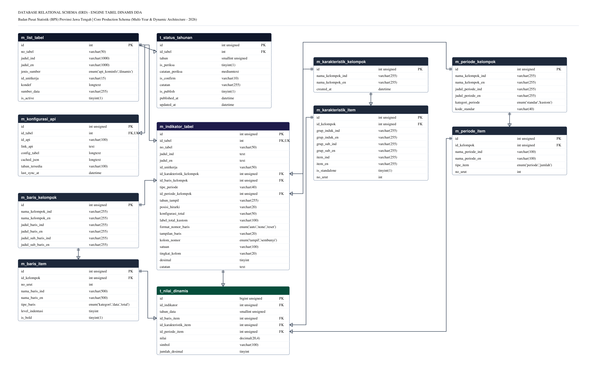

# 📊 DIAGRAM RELASI DATABASE (ERD) - TABEL DINAMIS DDA
## Badan Pusat Statistik (BPS) Provinsi Jawa Tengah

Berikut adalah diagram relasi database (*Entity Relationship Diagram*) resmi yang disusun sesuai standar pemodelan relasional database terkini (Arsitektur Multi-Tahun & Tabel Dinamis 2026), menampilkan struktur tabel, tipe data, *Primary Key* (**PK**), *Foreign Key* (**FK**), *Unique Key* (**UK**), serta notasi relasi *Crow's Foot* (**1:1**, **1:N**).

---

## 🖼️ Visual Schema Diagram (ERD)

> 💡 **Panduan Membaca Logika Alur Relasi (3 Lapisan Sederhana):**
> - **Lapisan 1 (Master Judul & Percabangan):**
>   - Puncak utama adalah `m_list_tabel` (Master Judul DDA).
>   - Jika tipe tabel API ──► mengarah ke `m_konfigurasi_api`.
>   - Jika tipe tabel Dinamis ──► mengarah ke `m_indikator_tabel`.
>   - `m_list_tabel` juga terhubung ke `t_status_tahunan` untuk merekam status pengisian per tahun (2024, 2025, 2026).
> - **Lapisan 2 (Generator / Perakitan Matriks):**
>   - `m_indikator_tabel` mengarah ke 3 kelompok dimensi: `m_baris_kelompok`, `m_karakteristik_kelompok`, dan `m_periode_kelompok`.
>   - Masing-masing kelompok mengarah ke rincian itemnya: `m_baris_item`, `m_karakteristik_item`, dan `m_periode_item`.
> - **Lapisan 3 (Pengisian Sel Nilai & Update Status):**
>   - Item-item dimensi tersebut bermuara ke `t_nilai_dinamis` (tempat angka sel disimpan).
>   - Saat sel di `t_nilai_dinamis` terisi/disimpan ──► status pada `t_status_tahunan` otomatis diperbarui menjadi **'Sudah Diisi'**.

---

## 📌 Penjelasan Alur Relasi Antar-Tabel & Kolom

### 1. Hubungan Master Publikasi ke Status Tahunan (`m_list_tabel` ──► `t_status_tahunan`)
* **Kardinalitas:** `1 : N` *(One-to-Many)*
* **Kunci Penghubung:** `m_list_tabel.id` [PK] ──► `t_status_tahunan.id_tabel` [FK]
* **Makna Bisnis:** Satu judul master tabel statistik berlaku permanen lintas tahun dan menaungi banyak edisi tahun publikasi DDA (misal: 2023, 2024, 2025, 2026). Setiap tahun mencatat status pengisian (`is_periksa`), verifikasi BPS (`is_confirm`), catatan arahan (`catatan`), serta kontrol publikasi (`is_publish`).

---

### 2. Hubungan Master Publikasi ke Integrasi API SatuData (`m_list_tabel` ──► `m_konfigurasi_api`)
* **Kardinalitas:** `1 : 1` *(One-to-One)*
* **Kunci Penghubung:** `m_list_tabel.id` [PK] ──► `m_konfigurasi_api.id_tabel` [FK, UNIQUE]
* **Makna Bisnis:** Tabel yang bersumber dari API Kominfo / SatuData Jateng memiliki konfigurasi endpoint, UUID dataset (`id_api`), format kolom, serta payload cache untuk sinkronisasi otomatis.

---

### 3. Hubungan Master Publikasi ke Perakitan Matriks Dinamis (`m_list_tabel` ──► `m_indikator_tabel`)
* **Kardinalitas:** `1 : 1` *(One-to-One)*
* **Kunci Penghubung:** `m_list_tabel.id` [PK] ──► `m_indikator_tabel.id_tabel` [FK, UNIQUE]
* **Makna Bisnis:** Setiap tabel dinamis memiliki tepat satu konfigurasi perakitan tata letak matriks permanen yang menghubungkan master buku ke 3 sumbu dimensi reusable (Baris, Kolom, Waktu).

---

### 4. Hubungan Perakitan Matriks ke Kamus 3 Dimensi (*Reusable Dimensions*)
Tabel `m_indikator_tabel` bertindak sebagai "otak" perakit yang memilih kelompok dimensi:
1. **Dimensi Baris (Sumbu Y):**  
   `m_indikator_tabel.id_baris_kelompok` [FK] ──► `m_baris_kelompok.id` [PK]  
   *Selanjutnya:* `m_baris_kelompok.id` ──► `m_baris_item.id_kelompok` *(Memuat rincian 35 Kab/Kota atau kategori indikator)*.  
   *(Hierarki dan indentasi baris diatur linier melalui `level_indentasi`, `tipe_baris`, dan `is_bold`)*.

2. **Dimensi Kolom / Karakteristik (Sumbu X):**  
   `m_indikator_tabel.id_karakteristik_kelompok` [FK] ──► `m_karakteristik_kelompok.id` [PK]  
   *Selanjutnya:* `m_karakteristik_kelompok.id` ──► `m_karakteristik_item.id_kelompok` *(Memuat sub-kolom variabel seperti Laki-laki, Perempuan, Total, atau rincian bertingkat)*.

3. **Dimensi Waktu / Periode (Sumbu Z):**  
   `m_indikator_tabel.id_periode_kelompok` [FK] ──► `m_periode_kelompok.id` [PK] *(Opsional untuk tabel berperiode sub-tahunan)*.  
   *Selanjutnya:* `m_periode_kelompok.id` ──► `m_periode_item.id_kelompok` *(Memuat titik waktu seperti Bulan, Triwulan, Semester)*.

---

### 5. Muara Titik Temu Sel Data (`t_nilai_dinamis`)
Seluruh koordinat dimensi bertemu di tabel penyimpanan sel `t_nilai_dinamis`:
* **`id_indikator`** [FK] ◄── `m_indikator_tabel.id` *(Mengunci konfigurasi matriks tabel)*
* **`tahun_data`** *(Tahun data riil statistik, misal: 2023, 2024, 2025)*
* **`id_baris_item`** [FK] ◄── `m_baris_item.id` *(Koordinat Baris / Wilayah)*
* **`id_karakteristik_item`** [FK] ◄── `m_karakteristik_item.id` *(Koordinat Kolom / Variabel)*
* **`id_periode_item`** [FK] ◄── `m_periode_item.id` *(Koordinat Sub-Periode, `0` jika murni tahunan)*
* **`nilai`** *(Angka riil statistik BPS presisi tinggi: `DECIMAL(20,4)`)*
* **`simbol`** *(Notasi resmi statistik BPS: `-`, `NA`, `e`, `r`)*
* **`jumlah_desimal`** *(Presisi desimal bawaan per-sel)*

---

## 📋 Tabel Rangkuman Kunci Relasi (*Foreign Key Reference*)

| No | Kolom Asal (*Source*) | Tabel Asal | Kolom Tujuan (*Target*) | Tabel Tujuan | Kardinalitas |
|:--:| :--- | :--- | :--- | :--- | :---: |
| 1 | `id` | `m_list_tabel` | `id_tabel` | `t_status_tahunan` | `1 : N` |
| 2 | `id` | `m_list_tabel` | `id_tabel` | `m_konfigurasi_api` | `1 : 1` |
| 3 | `id` | `m_list_tabel` | `id_tabel` | `m_indikator_tabel` | `1 : 1` |
| 4 | `id_baris_kelompok` | `m_indikator_tabel` | `id` | `m_baris_kelompok` | `N : 1` |
| 5 | `id` | `m_baris_kelompok` | `id_kelompok` | `m_baris_item` | `1 : N` |
| 6 | `id_karakteristik_kelompok` | `m_indikator_tabel` | `id` | `m_karakteristik_kelompok` | `N : 1` |
| 7 | `id` | `m_karakteristik_kelompok` | `id_kelompok` | `m_karakteristik_item` | `1 : N` |
| 8 | `id_periode_kelompok` | `m_indikator_tabel` | `id` | `m_periode_kelompok` | `N : 1` |
| 9 | `id` | `m_periode_kelompok` | `id_kelompok` | `m_periode_item` | `1 : N` |
| 10 | `id` | `m_indikator_tabel` | `id_indikator` | `t_nilai_dinamis` | `1 : N` |
| 11 | `id` | `m_baris_item` | `id_baris_item` | `t_nilai_dinamis` | `1 : N` |
| 12 | `id` | `m_karakteristik_item` | `id_karakteristik_item` | `t_nilai_dinamis` | `1 : N` |
| 13 | `id` | `m_periode_item` | `id_periode_item` | `t_nilai_dinamis` | `1 : N` |

---

## 🏛️ Rangkuman Struktur 11 Tabel Aktif Produksi

| Nama Tabel | Deskripsi & Peran | Kolom-Kolom Utama |
| :--- | :--- | :--- |
| **`m_list_tabel`** | Master judul buku DDA permanen lintas tahun | `id` [PK], `no_tabel`, `judul_ind`, `judul_en`, `jenis_sumber`, `id_unitkerja`, `kondef`, `sumber_data`, `is_active` |
| **`t_status_tahunan`** | Edisi publikasi tahunan, verifikasi, catatan LO & status publish | `id` [PK], `id_tabel` [FK], `tahun`, `is_periksa`, `catatan_periksa`, `is_confirm`, `catatan`, `is_publish`, `published_at`, `updated_at` |
| **`m_konfigurasi_api`** | Integrasi API SatuData/Portal untuk tabel non-dinamis/hybrid | `id` [PK], `id_tabel` [FK, UK], `id_api`, `link_api`, `config_tabel`, `cached_json`, `tahun_tersedia`, `last_sync_at` |
| **`m_indikator_tabel`** | Konfigurasi perakitan matriks & tata letak tabel dinamis | `id` [PK], `id_tabel` [FK, UK], `no_tabel`, `judul_ind`, `judul_en`, `id_unitkerja`, `id_karakteristik_kelompok` [FK], `id_baris_kelompok` [FK], `tipe_periode`, `id_periode_kelompok` [FK], `tahun_tampil`, `posisi_hirarki`, `tingkat_kolom`, `konfigurasi_total`, `label_total_kustom`, `format_nomor_baris`, `tampilan_baris`, `kolom_nomor`, `satuan`, `desimal`, `catatan` |
| **`m_baris_kelompok`** | Kelompok dimensi baris (Sumbu Y) | `id` [PK], `nama_kelompok_ind`, `nama_kelompok_en`, `judul_baris_ind`, `judul_baris_en`, `judul_sub_baris_ind`, `judul_sub_baris_en` |
| **`m_baris_item`** | Rincian baris data, kategori, indentasi, & format tebal | `id` [PK], `id_kelompok` [FK], `no_urut`, `nama_baris_ind`, `nama_baris_en`, `tipe_baris`, `level_indentasi`, `is_bold` |
| **`m_karakteristik_kelompok`** | Kelompok dimensi kolom/variabel (Sumbu X) | `id` [PK], `nama_kelompok_ind`, `nama_kelompok_en` |
| **`m_karakteristik_item`** | Rincian sub-kolom bertingkat (Induk & Anak) / standalone | `id` [PK], `id_kelompok` [FK], `grup_induk_ind`, `grup_induk_en`, `grup_sub_ind`, `grup_sub_en`, `item_ind`, `item_en`, `is_standalone`, `no_urut` |
| **`m_periode_kelompok`** | Kelompok dimensi waktu/periode (Sumbu Z) | `id` [PK], `nama_kelompok_ind`, `nama_kelompok_en`, `judul_periode_ind`, `judul_periode_en`, `kategori_periode`, `kode_standar` |
| **`m_periode_item`** | Rincian titik waktu publikasi (Bulan/Triwulan/Semester) | `id` [PK], `id_kelompok` [FK], `nama_periode_ind`, `nama_periode_en`, `tipe_item`, `no_urut` |
| **`t_nilai_dinamis`** | Koordinat sel data numerik & simbol resmi BPS multi-tahun | `id` [PK], `id_indikator` [FK], `tahun_data`, `id_baris_item` [FK], `id_karakteristik_item` [FK], `id_periode_item` [FK], `nilai`, `simbol`, `jumlah_desimal` |
