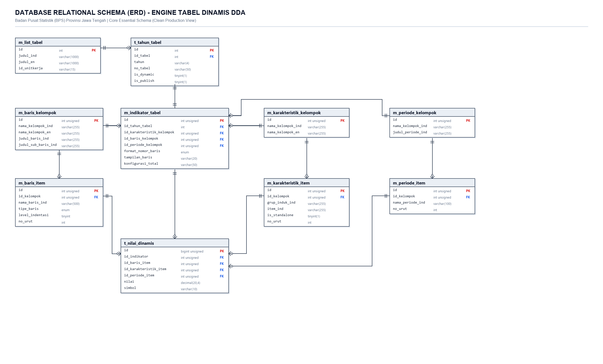

# 📊 DIAGRAM RELASI DATABASE (ERD) - TABEL DINAMIS DDA
## Badan Pusat Statistik (BPS) Provinsi Jawa Tengah

Berikut adalah diagram relasi database (*Entity Relationship Diagram*) resmi yang disusun sesuai standar pemodelan relasional database, menampilkan struktur tabel, tipe data, *Primary Key* (**PK**), *Foreign Key* (**FK**), serta notasi relasi *Crow's Foot* (**1:1**, **1:N**).

---

## 🖼️ Visual Schema Diagram (ERD)

> 💡 **Panduan Presentasi:** Jika gambar di atas diklik, Anda dapat melihat seluruh relasi 10 tabel mulai dari master publikasi di kiri atas, perakitan matriks di tengah, kamus 3 dimensi di kanan dan kiri, hingga bermuara pada tabel koordinat sel angka `t_nilai_dinamis` di bagian bawah.

---

## 📌 Penjelasan Alur Relasi Antar-Tabel & Kolom

### 1. Hubungan Master Publikasi (`m_list_tabel` ──► `t_tahun_tabel`)
* **Kardinalitas:** `1 : N` *(One-to-Many)*
* **Kunci Penghubung:** `m_list_tabel.id` [PK] ──► `t_tahun_tabel.id_tabel` [FK]
* **Makna Bisnis:** Satu judul master tabel statistik berlaku permanen dan menaungi banyak edisi tahun publikasi DDA (misal: 2023, 2024, 2025).

---

### 2. Hubungan Tabel Tahunan ke Matriks Dinamis (`t_tahun_tabel` ──► `m_indikator_tabel`)
* **Kardinalitas:** `1 : 1` *(One-to-One)*
* **Kunci Penghubung:** `t_tahun_tabel.id` [PK] ──► `m_indikator_tabel.id_tahun_tabel` [FK]
* **Makna Bisnis:** Setiap tabel publikasi pada tahun tertentu memiliki tepat satu konfigurasi perakitan matriks dinamis yang mengatur tata letak dan desimalnya.

---

### 3. Hubungan Perakitan Matriks ke Kamus 3 Dimensi (*Reusable Dimensions*)
Tabel `m_indikator_tabel` bertindak sebagai "otak" perakit yang memilih kelompok dimensi:
1. **Dimensi Baris (Sumbu Y):**  
   `m_indikator_tabel.id_baris_kelompok` [FK] ──► `m_baris_kelompok.id` [PK]  
   *Selanjutnya:* `m_baris_kelompok.id` ──► `m_baris_item.id_kelompok` *(Memuat daftar 35 Kab/Kota atau kategori indikator)*.  
   *(Hierarki dan indentasi baris diatur secara linier melalui kolom `level_indentasi` dan `tipe_baris`)*.

2. **Dimensi Kolom (Sumbu X):**  
   `m_indikator_tabel.id_karakteristik_kelompok` [FK] ──► `m_karakteristik_kelompok.id` [PK]  
   *Selanjutnya:* `m_karakteristik_kelompok.id` ──► `m_karakteristik_item.id_kelompok` *(Memuat variabel seperti Laki-laki, Perempuan, Total)*.

3. **Dimensi Waktu (Sumbu Z):**  
   `m_indikator_tabel.id_periode_kelompok` [FK] ──► `m_periode_kelompok.id` [PK]  
   *Selanjutnya:* `m_periode_kelompok.id` ──► `m_periode_item.id_kelompok` *(Memuat titik waktu publikasi)*.

---

### 4. Muara Titik Temu Sel Data (`t_nilai_dinamis`)
Seluruh dimensi bertemu di tabel penyimpanan sel `t_nilai_dinamis`:
* **`id_indikator`** [FK] ◄── `m_indikator_tabel.id` *(Mengunci tabel & tahun)*
* **`id_baris_item`** [FK] ◄── `m_baris_item.id` *(Koordinat Baris / Wilayah)*
* **`id_karakteristik_item`** [FK] ◄── `m_karakteristik_item.id` *(Koordinat Kolom / Variabel)*
* **`id_periode_item`** [FK] ◄── `m_periode_item.id` *(Koordinat Waktu)*
* **`nilai`** *(Angka riil statistik BPS presisi tinggi: `DECIMAL(20,4)`)*
* **`simbol`** *(Notasi resmi statistik BPS: `-`, `NA`, `e`, `r`)*

> 🔒 **Composite Unique Key (`uk_cell_position`):**  
> `UNIQUE KEY (id_indikator, id_baris_item, id_karakteristik_item, id_periode_item)`  
> *Menjamin secara matematis di level database bahwa tidak akan pernah terjadi duplikasi data sel pada satu titik koordinat yang sama.*

---

## 📋 Tabel Rangkuman Kunci Relasi (*Foreign Key Reference*)

| No | Kolom Asal (*Source*) | Tabel Asal | Kolom Tujuan (*Target*) | Tabel Tujuan | Kardinalitas |
|:--:| :--- | :--- | :--- | :--- | :---: |
| 1 | `id` | `m_list_tabel` | `id_tabel` | `t_tahun_tabel` | `1 : N` |
| 2 | `id` | `t_tahun_tabel` | `id_tahun_tabel` | `m_indikator_tabel` | `1 : 1` |
| 3 | `id_baris_kelompok` | `m_indikator_tabel` | `id` | `m_baris_kelompok` | `N : 1` |
| 4 | `id` | `m_baris_kelompok` | `id_kelompok` | `m_baris_item` | `1 : N` |
| 5 | `id_karakteristik_kelompok` | `m_indikator_tabel` | `id` | `m_karakteristik_kelompok` | `N : 1` |
| 6 | `id` | `m_karakteristik_kelompok` | `id_kelompok` | `m_karakteristik_item` | `1 : N` |
| 7 | `id_periode_kelompok` | `m_indikator_tabel` | `id` | `m_periode_kelompok` | `N : 1` |
| 8 | `id` | `m_periode_kelompok` | `id_kelompok` | `m_periode_item` | `1 : N` |
| 9 | `id` | `m_indikator_tabel` | `id_indikator` | `t_nilai_dinamis` | `1 : N` |
| 10 | `id` | `m_baris_item` | `id_baris_item` | `t_nilai_dinamis` | `1 : N` |
| 11 | `id` | `m_karakteristik_item` | `id_karakteristik_item` | `t_nilai_dinamis` | `1 : N` |
| 12 | `id` | `m_periode_item` | `id_periode_item` | `t_nilai_dinamis` | `1 : N` |

---

## 🗑️ Daftar Kolom yang Tidak Digunakan (Rekomendasi Pembersihan / Drop Columns)

Berdasarkan audit empiris langsung terhadap seluruh baris data di database MySQL, berikut adalah daftar kolom yang **tidak digunakan (0% terisi)** atau **redundant** sehingga sudah dihilangkan dari diagram ERD di atas dan aman untuk Anda hapus (*DROP COLUMN*) di kemudian hari:

| No | Nama Tabel | Nama Kolom | Status Keterisian di DB | Alasan & Rekomendasi Pembersihan |
|:--:| :--- | :--- | :---: | :--- |
| **1** | `m_baris_item` | **`parent_id`** | **0 / 2.984 (0%)** | **Kosong total.** Hierarki dan indentasi baris diatur menggunakan `level_indentasi` dan `tipe_baris`. Kolom ini aman dihapus. |
| **2** | `m_indikator_tabel` | **`label_total_kustom`** | **0 / 213 (0%)** | **Kosong total.** Label baris total dikelola dinamis di view / master baris. |
| **3** | `m_indikator_tabel` | **`satuan`** | **0 / 213 (0%)** | **Kosong total.** Satuan tabel melekat pada judul atau kolom rincian. |
| **4** | `m_indikator_tabel` | **`desimal`** | **0 / 213 (0%)** | **Kosong total.** Format angka menggunakan pembulatan standar numerik. |
| **5** | `m_indikator_tabel` | **`catatan`** | **0 / 213 (0%)** | **Kosong total.** Catatan tabel sudah tersimpan pada tabel induk `t_tahun_tabel.catatan`. |
| **6** | `m_baris_kelompok` | **`judul_sub_baris_en`** | **0 / 106 (0%)** | **Kosong total.** Tidak pernah diisi. |
| **7** | `m_baris_kelompok` | **`keterangan`** | **3 / 106 (2.8%)** | Catatan internal kelompok yang tidak pernah ditampilkan ke publik/antarmuka. |
| **8** | `m_karakteristik_kelompok`| **`keterangan`** | **1 / 251 (0.4%)** | Nyaris kosong total. |
| **9** | `m_periode_kelompok` | **`keterangan`** | **1 / 29 (3.4%)** | Nyaris kosong total. |

> 💡 **Catatan Khusus Kolom Baris:** Kolom **`judul_sub_baris_ind`** tetap dipertahankan pada `m_baris_kelompok` karena aktif digunakan untuk memberi label pada kolom kedua saat tabel menggunakan format tata letak 2 kolom (*Induk & Rincian / 2 Kolom Baris*).

> 💡 **Hasil Pembersihan:** Diagram ERD yang ditampilkan di atas kini **100% bersih hanya memuat kolom-kolom inti yang aktif bekerja**. Ketika Anda siap menghapus kolom-kolom di atas dari database, struktur tabel di database akan persis sama dengan diagram ERD di dokumen ini.

