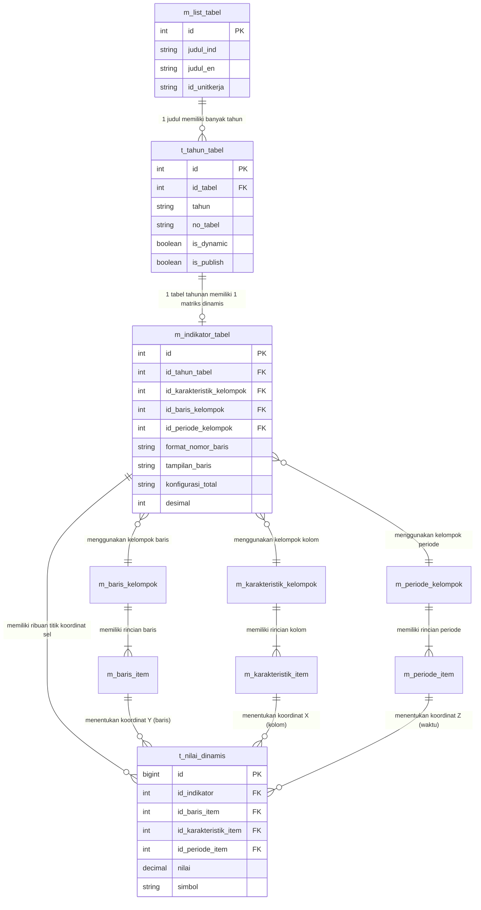

# 📘 DOKUMENTASI LENGKAP ARSITEKTUR & LOGIKA TABEL DINAMIS
## Sistem Publikasi Daerah Dalam Angka (DDA) - BPS Provinsi Jawa Tengah

---

## 📌 1. Pendahuluan & Filosofi Perancangan

Sebelum modul Tabel Dinamis dikembangkan, sistem DDA BPS mengandalkan tabel statis (tautan spreadsheet/PDF eksternal atau konfigurasi HTML statis). Pendekatan ini memiliki kelemahan mendasar:
1. Data tidak terstruktur di tingkat sel/atomik sehingga tidak dapat diagregasi, difilter, atau dianalisis lintas tahun.
2. Format tabel sangat beragam dan tidak memiliki konsistensi standar visual publikasi BPS.
3. Proses entri data oleh Walidata OPD dan pengawasan oleh LO BPS sulit divalidasi secara otomatis.

**Modul Tabel Dinamis** dirancang menggunakan **Konsep Multidimensi OLAP (*Online Analytical Processing*) Ringan**, di mana setiap sel angka statistik diposisikan pada perpotongan koordinat dimensi terstandar:
* **Dimensi Baris (*Stub*):** Wilayah (Kabupaten/Kota), rincian indikator sektoral, kategori sub-indikator.
* **Dimensi Kolom/Karakteristik (*Boxhead*):** Variabel klasifikasi (jenis kelamin, kelompok umur, sektor usaha, status).
* **Dimensi Waktu/Periode (*Temporal*):** Tahun, semester, triwulan, atau bulan.
* **Titik Koordinat Nilai (*Data Cell Coordinates*):** Nilai numerik presisi tinggi atau simbol statistik resmi BPS (`-`, `NA`, `e`, `r`).

---

## 🗄️ 2. Arsitektur Database & Kamus Data

Engine Tabel Dinamis dibangun di atas **8 tabel relasional utama** yang terintegrasi langsung dengan 2 tabel master eksisting (`m_list_tabel` dan `t_tahun_tabel`).

```
                              ┌────────────────┐
                              │  m_list_tabel  │ (Kamus Master Judul Tabel)
                              └───────┬────────┘
                                      │ 1:N
                                      ▼
┌─────────────────────────┐   ┌────────────────┐
│  t_nilai_dinamis        │   │  t_tahun_tabel │ (Tabel DDA per Tahun)
│  (Ribuan Koordinat Sel) │   │  is_dynamic=1  │
└────────────┬────────────┘   └───────┬────────┘
             │                        │ 1:1
             │ N:1                    ▼
             │            ┌──────────────────────┐
             └───────────►│  m_indikator_tabel   │ (Metadata Perakitan Matriks)
                          └──────────┬───────────┘
                                     │
         ┌───────────────────────────┼───────────────────────────┐
         │ N:1                       │ N:1                       │ N:1
         ▼                           ▼                           ▼
┌──────────────────┐        ┌──────────────────┐        ┌──────────────────┐
│m_baris_kelompok  │        │m_karakteristik_kl│        │m_periode_kelompok│
└────────┬─────────┘        └────────┬─────────┘        └────────┬─────────┘
         │ 1:N                       │ 1:N                       │ 1:N
         ▼                           ▼                           ▼
┌──────────────────┐        ┌──────────────────┐        ┌──────────────────┐
│  m_baris_item    │        │m_karakteristik_it│        │  m_periode_item  │
└──────────────────┘        └──────────────────┘        └──────────────────┘
```

---

### 2.1. Rincian Skema Tabel

#### A. Tabel Master Dimensi Karakteristik / Kolom (*Boxhead*)
1. **`m_karakteristik_kelompok`**: Header grup kolom (contoh: *"Jenis Kelamin"*, *"Status Lapangan Usaha"*, *"Kelompok Umur"*).
   * `id` *(INT UNSIGNED, PK)*: ID unik kelompok kolom.
   * `nama_kelompok_ind` / `nama_kelompok_en` *(VARCHAR 255)*: Nama kelompok kolom dwibahasa.
   * `keterangan` *(TEXT)*: Penjelasan tambahan atau referensi metodologi.

2. **`m_karakteristik_item`**: Item rincian kolom (contoh: *"Laki-laki"*, *"Perempuan"*, *"Jumlah / Total"*).
   * `id` *(INT UNSIGNED, PK)*: ID unik item kolom (digunakan sebagai koordinat `id_karakteristik_item`).
   * `id_kelompok` *(INT UNSIGNED, FK)*: Tautan ke `m_karakteristik_kelompok.id`.
   * `grup_induk_ind` / `grup_induk_en` *(VARCHAR 255)*: Nama induk jika kolom bertingkat 2 (*2-level hierarchical header*, misal: *"Penduduk Bekerja"*).
   * `item_ind` / `item_en` *(VARCHAR 255)*: Nama sub-item daun (*leaf item*, misal: *"Formal"*, *"Informal"*).
   * `no_urut` *(INT)*: Urutan tampilan kolom dari kiri ke kanan.
   * `is_standalone` *(TINYINT 1)*: Bernilai `1` jika kolom berdiri sendiri tanpa sub-kolom (merentang 2 baris header / `rowspan="2"`), contohnya kolom *"Jumlah / Total"*.

---

#### B. Tabel Master Dimensi Baris (*Stub*)
3. **`m_baris_kelompok`**: Header grup baris (contoh: *"35 Kabupaten/Kota Jawa Tengah"*, *"Sektor Lapangan Usaha (KBLI)"*).
   * `id` *(INT UNSIGNED, PK)*: ID unik kelompok baris.
   * `nama_kelompok_ind` / `nama_kelompok_en` *(VARCHAR 255)*: Nama kelompok baris.
   * `judul_baris_ind` / `judul_baris_en` *(VARCHAR 255)*: Label tajuk kolom di tabel (misal: *"Kabupaten/Kota"*, *"Golongan Pokok"*).
   * `judul_sub_baris_ind` / `judul_sub_baris_en` *(VARCHAR 255)*: Label kolom kedua jika menggunakan tata letak 2 kolom (*Induk & Rincian*).

4. **`m_baris_item`**: Item baris data (contoh: *"01. Cilacap"*, *"02. Banyumas"*, atau hierarki KBLI).
   * `id` *(INT UNSIGNED, PK)*: ID unik baris (digunakan sebagai koordinat `id_baris_item`).
   * `id_kelompok` *(INT UNSIGNED, FK)*: Tautan ke `m_baris_kelompok.id`.
   * `parent_id` *(INT UNSIGNED, NULL)*: ID baris induk untuk pohon hierarki (*tree*).
   * `nama_baris_ind` / `nama_baris_en` *(VARCHAR 500)*: Nama baris data dwibahasa.
   * `tipe_baris` *(ENUM)*:
     * `'kategori'`: Baris pemisah/header kategori (tidak menerima input angka).
     * `'data'`: Baris data reguler tempat pengisian angka.
     * `'subtotal'`: Baris subtotal agregat.
     * `'total'`: Baris total keseluruhan (misal: *"JAWA TENGAH"*).
   * `level_indentasi` *(TINYINT)*: Kedalaman hierarki (`0` = rata kiri, `1` = tab 1x / 1.5rem, `2` = tab 2x / 3rem).
   * `is_bold` *(TINYINT 1)*: Penegas tebal (biasanya `1` untuk total, subtotal, dan kategori).
   * `no_urut` *(INT)*: Urutan baris dari atas ke bawah.

---

#### C. Tabel Master Dimensi Periode / Waktu (*Temporal*)
5. **`m_periode_kelompok`**: Grup periode waktu (contoh: *"Seri 3 Tahun Terakhir"*, *"Triwulanan 2024"*).
   * `id` *(INT UNSIGNED, PK)*: ID unik kelompok periode.
   * `nama_kelompok_ind` / `nama_kelompok_en` *(VARCHAR 255)*: Nama kelompok periode.
   * `judul_periode_ind` / `judul_periode_en` *(VARCHAR 255)*: Label tajuk waktu (default: *"Tahun"* / *"Year"*).

6. **`m_periode_item`**: Rincian titik waktu (contoh: *"2021"*, *"2022"*, *"2023"*, atau *"Triwulan I"*).
   * `id` *(INT UNSIGNED, PK)*: ID unik titik waktu (digunakan sebagai koordinat `id_periode_item`).
   * `id_kelompok` *(INT UNSIGNED, FK)*: Tautan ke `m_periode_kelompok.id`.
   * `nama_periode_ind` / `nama_periode_en` *(VARCHAR 100)*: Label periode.
   * `no_urut` *(INT)*: Urutan tampilan waktu.

---

#### D. Tabel Perakitan Matriks & Metadata Konfigurasi
7. **`m_indikator_tabel`**: "Jantung" konfigurasi yang menyatukan seluruh dimensi ke dalam satu tabel publikasi.
   * `id` *(INT UNSIGNED, PK)*: ID unik indikator/matriks dinamis.
   * `id_tahun_tabel` *(INT, FK)*: Tautan ke `t_tahun_tabel.id`. Satu tabel tahunan memiliki tepat satu konfigurasi matriks dinamis (1:1).
   * `no_tabel` *(VARCHAR 50)*: Nomor publikasi tabel (misal: `1.1.1`, `3.2.4`).
   * `judul_ind` / `judul_en` *(TEXT)*: Judul resmi tabel dwibahasa.
   * `id_unitkerja` *(VARCHAR 50)*: Kepemilikan instansi produsen data/Walidata OPD.
   * `id_karakteristik_kelompok` *(INT UNSIGNED, FK)*: Dimensi kolom yang digunakan.
   * `id_baris_kelompok` *(INT UNSIGNED, FK)*: Dimensi baris yang digunakan.
   * `id_periode_kelompok` *(INT UNSIGNED, FK)*: Dimensi waktu yang digunakan.
   * `posisi_hirarki` *(VARCHAR 20)*: Tata susun level header (`kolom_atas` atau `periode_atas`).
   * `konfigurasi_total` *(VARCHAR 50)*: Kebijakan baris total (`default` = hitung otomatis, `hide` = sembunyikan, `custom` = label khusus).
   * `label_total_kustom` *(VARCHAR 100)*: Teks pengganti label total (misal: *"JAWA TENGAH"*, *"Rata-rata"*).
   * `format_nomor_baris` *(ENUM)*:
     * `'auto'`: Penomoran baris berurutan otomatis `(1..N)`.
     * `'none'`: Tanpa penomoran baris.
     * `'reset_kategori'`: Penomoran di-reset menjadi `1` setiap kali masuk kategori baru.
   * `tampilan_baris` *(VARCHAR 20)*:
     * `'1_kolom'`: Format standar BPS (kolom baris tunggal berindentasi visual).
     * `'2_kolom'`: Format 2 kolom terpisah (*Induk* di kolom 1, *Rincian* di kolom 2).
   * `satuan` *(VARCHAR 100)*: Satuan data (misal: *"Jiwa"*, *"Ton"*, *"Persen"*, *"Rupiah"*).
   * `desimal` *(TINYINT)*: Jumlah digit desimal pembulatan tampilan (`0` s.d. `4`).
   * `catatan` *(TEXT)*: Catatan kaki teknis metodologi BPS.

---

#### E. Tabel Penyimpanan Nilai Sel (*Coordinate Data Points*)
8. **`t_nilai_dinamis`**: Tempat penyimpanan nilai angka perpotongan dimensi.
   * `id` *(BIGINT UNSIGNED, PK)*: Auto-increment ID.
   * `id_indikator` *(INT UNSIGNED, FK)*: Tautan ke `m_indikator_tabel.id`.
   * `id_baris_item` *(INT UNSIGNED)*: ID koordinat baris data.
   * `id_karakteristik_item` *(INT UNSIGNED)*: ID koordinat kolom. Nilai `0` jika tabel tidak menggunakan dimensi kolom.
   * `id_periode_item` *(INT UNSIGNED)*: ID koordinat periode. Nilai `0` jika tabel berupa tabel tahun tunggal.
   * `nilai` *(DECIMAL 20,4, NULL)*: Nilai numerik presisi tinggi (mendukung angka hingga triliunan dengan 4 digit desimal).
   * `simbol` *(VARCHAR 10, NULL)*: Notasi resmi statistik BPS jika sel bukan angka reguler:
     * `-` : Nilai nihil / nol absolut.
     * `NA` : *Not Available* / data belum tersedia.
     * `...` : Angka belum dapat ditampilkan.
     * `e` : Angka estimasi / perkiraan.
     * `r` : Angka revisi / perbaikan.
   * **Composite Unique Key (`uk_cell_position`):**  
     `UNIQUE KEY (id_indikator, id_baris_item, id_karakteristik_item, id_periode_item)`  
     *Kunci unik gabungan ini menjamin tidak akan pernah ada sel ganda pada satu koordinat yang sama.*

---

## 🔗 3. Diagram Hubungan Antar Tabel (Entity Relationship Diagram)



---

## 🔄 3. Hubungan Antar-Baris Data (Row-Level Data Lineage & Duplikasi Tahun)

Untuk memahami bagaimana data saling mengalir di tingkat baris (*instance level*), berikut adalah simulasi konkret dari satu tabel nyata: **"Jumlah Penduduk Menurut Kabupaten/Kota dan Jenis Kelamin"**.

---

### 3.1. Simulasi Baris demi Baris pada Seluruh Tabel

#### 1. Baris Master Judul (`m_list_tabel`)
Menyimpan kamus master tabel yang berlaku permanen lintas tahun:
| `id` (PK) | `judul_ind` | `id_unitkerja` |
| :---: | :--- | :---: |
| **`15`** | Jumlah Penduduk Menurut Kabupaten/Kota dan Jenis Kelamin | `dinkes` |

---

#### 2. Baris Tabel Tahunan (`t_tahun_tabel`)
Setiap publikasi tahunan membuat 1 baris baru yang menunjuk ke `id_tabel = 15`:
| `id` (PK) | `id_tabel` (FK) | `tahun` | `no_tabel` | `is_dynamic` | Keterangan Baris |
| :---: | :---: | :---: | :---: | :---: | :--- |
| **`8001`** | **`15`** | **2024** | `1.1.1` | `1` | Edisi DDA Tahun 2024 |
| **`8500`** | **`15`** | **2025** | `1.1.1` | `1` | Edisi DDA Tahun 2025 (*Hasil Duplikasi Tahun*) |

---

#### 3. Baris Perakitan Matriks (`m_indikator_tabel`)
Setiap baris di `t_tahun_tabel` memiliki tepat **1 baris konfigurasi** di `m_indikator_tabel`:
| `id` (PK) | `id_tahun_tabel` (FK) | `id_baris_kelompok` (FK) | `id_karakteristik_kelompok` (FK) | `id_periode_kelompok` (FK) | `desimal` |
| :---: | :---: | :---: | :---: | :---: | :---: |
| **`101`** | **`8001`** *(2024)* | **`3`** *(35 Kab/Kota)* | **`7`** *(Jenis Kelamin)* | **`1`** *(Tahunan)* | `0` |
| **`205`** | **`8500`** *(2025)* | **`3`** *(35 Kab/Kota)* | **`7`** *(Jenis Kelamin)* | **`1`** *(Tahunan)* | `0` |

> 💡 **Poin Kunci:** Perhatikan bahwa baris `101` (tahun 2024) dan baris `205` (tahun 2025) sama-sama menunjuk ke kelompok dimensi yang sama: **`id_baris_kelompok = 3`** dan **`id_karakteristik_kelompok = 7`**. Master dimensinya **tidak diduplikasi**, melainkan dipakai bersama (*reusable*).

---

#### 4. Baris Master Dimensi Kolom & Itemnya
* **`m_karakteristik_kelompok`**:
  | `id` (PK) | `nama_kelompok_ind` |
  | :---: | :--- |
  | **`7`** | Jenis Kelamin |

* **`m_karakteristik_item`** (Item kolom yang menjadi koordinat sumbu X):
  | `id` (PK) | `id_kelompok` (FK) | `item_ind` | `is_standalone` | `no_urut` |
  | :---: | :---: | :--- | :---: | :---: |
  | **`701`** | **`7`** | Laki-laki | `0` | 1 |
  | **`702`** | **`7`** | Perempuan | `0` | 2 |
  | **`703`** | **`7`** | Jumlah / Total | `1` *(rowspan 2)* | 3 |

---

#### 5. Baris Master Dimensi Baris & Itemnya
* **`m_baris_kelompok`**:
  | `id` (PK) | `nama_kelompok_ind` | `judul_baris_ind` |
  | :---: | :--- | :--- |
  | **`3`** | 35 Kabupaten/Kota Jawa Tengah | Kabupaten/Kota |

* **`m_baris_item`** (Item baris yang menjadi koordinat sumbu Y):
  | `id` (PK) | `id_kelompok` (FK) | `parent_id` (FK) | `nama_baris_ind` | `tipe_baris` | `level_indentasi` |
  | :---: | :---: | :---: | :--- | :---: | :---: |
  | **`300`** | **`3`** | *NULL* | **KABUPATEN** | `kategori` | 0 |
  | **`301`** | **`3`** | **`300`** | 01. Cilacap | `data` | 1 |
  | **`302`** | **`3`** | **`300`** | 02. Banyumas | `data` | 1 |
  | **`335`** | **`3`** | *NULL* | **KOTA** | `kategori` | 0 |
  | **`336`** | **`3`** | **`335`** | 71. Kota Magelang | `data` | 1 |
  | **`399`** | **`3`** | *NULL* | **JAWA TENGAH** | `total` | 0 |

---

#### 6. Baris Master Dimensi Periode & Itemnya
* **`m_periode_kelompok`**:
  | `id` (PK) | `nama_kelompok_ind` | `judul_periode_ind` |
  | :---: | :--- | :--- |
  | **`1`** | Tahunan | Tahun |

* **`m_periode_item`** (Item waktu yang menjadi koordinat sumbu Z):
  | `id` (PK) | `id_kelompok` (FK) | `nama_periode_ind` | `no_urut` |
  | :---: | :---: | :--- | :---: |
  | **`10`** | **`1`** | 2024 | 1 |
  | **`11`** | **`1`** | 2025 | 2 |

---

#### 7. Baris Nilai Titik Sel Dinamis (`t_nilai_dinamis`)
Inilah tabel tempat bertemunya seluruh koordinat baris data. Perhatikan bagaimana `id_indikator` membedakan data tahun 2024 dan 2025:

| `id` (PK) | `id_indikator` (FK) | `id_baris_item` (FK) | `id_karakteristik_item` (FK) | `id_periode_item` (FK) | `nilai` | Arti Koordinat Baris |
| :---: | :---: | :---: | :---: | :---: | :---: | :--- |
| **1** | **`101`** *(Th 2024)* | **`301`** *(Cilacap)* | **`701`** *(Laki-laki)* | **`10`** *(2024)* | `998120.0000` | Penduduk Laki-laki Cilacap 2024 |
| **2** | **`101`** *(Th 2024)* | **`301`** *(Cilacap)* | **`702`** *(Perempuan)* | **`10`** *(2024)* | `989430.0000` | Penduduk Perempuan Cilacap 2024 |
| **3** | **`101`** *(Th 2024)* | **`301`** *(Cilacap)* | **`703`** *(Total)* | **`10`** *(2024)* | `1987550.0000` | Total Penduduk Cilacap 2024 |
| **...** | ... | ... | ... | ... | ... | *(Data 2024 lainnya)* |
| **501** | **`205`** *(Th 2025)* | **`301`** *(Cilacap)* | **`701`** *(Laki-laki)* | **`11`** *(2025)* | `1005200.0000` | Penduduk Laki-laki Cilacap 2025 *(Setelah diisi)* |
| **502** | **`205`** *(Th 2025)* | **`301`** *(Cilacap)* | **`702`** *(Perempuan)* | **`11`** *(2025)* | `995800.0000` | Penduduk Perempuan Cilacap 2025 *(Setelah diisi)* |

---

### 3.2. Silsilah Baris Data Saat Fitur "Duplikasi Tahun" Dijalankan

Ketika Super Admin mengklik tombol **"Duplikasi Tahun"** (misal dari Tahun 2024 ke Tahun 2025):

```
TAHUN SUMBER (2024)                              TAHUN BARU (2025)
───────────────────────────                      ───────────────────────────
t_tahun_tabel [id: 8001]                         t_tahun_tabel [id: 8500] ──► DIBUAT BARU
  │                                                │
  ▼                                                ▼
m_indikator_tabel [id: 101]                      m_indikator_tabel [id: 205] ──► DISALIN BARU
  │  id_baris_kelompok: 3 ──────────────────────────► (Tetap ID: 3, TIDAK DIBUAT BARU)
  │  id_karakteristik_kelompok: 7 ──────────────────► (Tetap ID: 7, TIDAK DIBUAT BARU)
  │  id_periode_kelompok: 1 ────────────────────────► (Tetap ID: 1, TIDAK DIBUAT BARU)
  │
  ▼
t_nilai_dinamis (Ribuan Baris Angka 2024)        t_nilai_dinamis (0 Baris / KOSONG BERSIH)
                                                 Menunggu unggah Excel / sync PDF 2025
```

**Aturan Penanganan Kolom pada Baris Baru:**
1. `id_tahun_tabel` diisi dengan ID baru (`8500`).
2. `is_confirm` di-reset ke `'2'` (Belum Dikonfirmasi).
3. `is_periksa` di-reset ke `0` (Belum Diperiksa).
4. `link_tabel` dikosongkan (siap menerima data baru).
5. `link_sebelumnya` diisi dengan link tahun lalu sebagai jejak audit riwayat.
6. `t_nilai_dinamis` untuk `id_indikator = 205` dibiarkan **kosong (0 baris)** agar tidak terjadi kesalahan duplikasi data angka tahun lalu ke publikasi tahun baru.

---

### 3.3. Hubungan Hierarki Antar-Baris (*Parent-Child*) pada Dimensi Baris

Di dalam tabel `m_baris_item`, terdapat relasi berulang (*self-referencing relationship*) antar baris menggunakan kolom `parent_id` dan `level_indentasi`:

```
m_baris_item:
├── [id: 300] "KABUPATEN" (parent_id: NULL, tipe: kategori, indent: 0)
│    ├── [id: 301] "01. Cilacap" (parent_id: 300, tipe: data, indent: 1)
│    ├── [id: 302] "02. Banyumas" (parent_id: 300, tipe: data, indent: 1)
│    └── [id: 303] "03. Purbalingga" (parent_id: 300, tipe: data, indent: 1)
├── [id: 335] "KOTA" (parent_id: NULL, tipe: kategori, indent: 0)
│    ├── [id: 336] "71. Kota Magelang" (parent_id: 335, tipe: data, indent: 1)
│    └── [id: 337] "72. Kota Surakarta" (parent_id: 335, tipe: data, indent: 1)
└── [id: 399] "JAWA TENGAH" (parent_id: NULL, tipe: total, indent: 0)
```

**Dampaknya pada Tampilan Web & Excel:**
* Baris dengan `tipe = 'kategori'` otomatis dirender sebagai baris pemisah bercetak tebal (*bold banner*) dengan warna abu-abu lembut / oranye muda, dan sel angkanya dinonaktifkan.
* Baris dengan `parent_id` terisi otomatis diberi spasi indentasi (`padding-left: 1.5rem` di web, atau 3 spasi indentasi di file Excel).
* Baris dengan `tipe = 'total'` otomatis diberi garis ganda bawah khas publikasi BPS (*accounting double bottom border*) dan formula penjumlahan otomatis.

---

## 🧠 4. Logika Bisnis & Alur Kerja (*Core Algorithms*)

### 4.1. Algoritma Pembentukan Header Hirarki Kolom (`buildColumnStructure`)
Pada publikasi BPS, header kolom sering kali memiliki dua tingkat (misal: kelompok umur yang dibagi menjadi Laki-laki dan Perempuan) atau kolom mandiri yang merentang vertikal (seperti Total):
1. **Analisis Struktur:** Sistem membaca daftar `m_karakteristik_item`.
2. **Pengelompokan Induk:** Item yang memiliki `grup_induk_ind` dikelompokkan bersama.
   * `colspan` induk dihitung dari total jumlah anak daun (*leaf items*).
3. **Penanganan Kolom Standalone (`is_standalone = 1`):**
   * Diberi atribut `rowspan="2"` pada baris header pertama sehingga sejajar secara vertikal.
4. **Penomoran Kolom BPS Otomatis:**
   * Di bawah deretan header variabel, sistem secara otomatis merender satu baris nomor kolom:  
     `[(1)] | [(2)] | [(3)] | [(4)] | ...`  
     yang menjadi ciri khas publikasi DDA BPS.

---

### 4.2. Algoritma Struktur Baris & Cerdas Penomoran (*Smart Numbering*)
Sistem mendukung klasifikasi baris hierarkis melalui `detectTipeBaris`:
1. **Deteksi Otomatis:**
   * Jika teks baris diakhiri titik dua (`:`) atau memiliki anak di bawahnya $\rightarrow$ Tipe `kategori` (huruf tebal, latar netral, tidak ada sel input).
   * Jika mengandung kata *"Jumlah"*, *"Total"*, *"Subtotal"* $\rightarrow$ Tipe `subtotal` / `total`.
   * Selain itu $\rightarrow$ Tipe `data`.
2. **Logika Penomoran Baris:**
   * **`auto`**: Baris berjenis `data` otomatis diberi nomor berurutan `1, 2, 3, ...` dari atas ke bawah.
   * **`reset_kategori`**: Nomor baris dimulai dari `1` kembali setiap kali berganti kategori induk.
   * **`none`**: Kolom nomor dihilangkan jika nama baris di master sudah mengandung nomor manual (misal: kode Kabupaten/Kota BPS: `3301`, `3302`, dst.).

---

### 4.3. Algoritma Penyimpanan Nilai Sel (*Atomic Multi-Dimension Upsert*)
Saat Walidata mengunggah berkas Excel atau mengisi form, data masuk melalui metode `batchUpsertNilai`:
```sql
INSERT INTO t_nilai_dinamis 
    (id_indikator, id_baris_item, id_karakteristik_item, id_periode_item, nilai, simbol, updated_at)
VALUES 
    (12, 101, 205, 1, 452.8500, NULL, NOW())
ON DUPLICATE KEY UPDATE 
    nilai = VALUES(nilai),
    simbol = VALUES(simbol),
    updated_at = NOW();
```
* **Kelebihan Pendekatan Ini:**
  * **Idempoten:** Pengunggahan ulang file Excel yang sama tidak akan menduplikasi baris.
  * **Sparsitas Efisien:** Sel yang tidak memiliki data tidak perlu disimpan (menghemat ukuran database hingga 70% dibanding tabel matriks statis).

---

### 4.4. Algoritma Lookup & Rendering Data Cepat
Ketika halaman pratinjau (`v_tabel_dinamis.php`) dimuat:
1. Controller memanggil `getMatrixLookup($id_indikator)`.
2. Seluruh titik sel diubah menjadi *In-Memory Multi-Key Map*:
   ```php
   $key = $id_baris . '_' . $id_kolom . '_' . $id_periode;
   $val = $nilaiMap[$key] ?? '–';
   ```
3. Waktu render tabel dengan 1.000 titik koordinat berlangsung instan (**< 15 milidetik**) karena kompleksitas pencarian data adalah $O(1)$.

---

### 4.5. Siklus Integrasi Impor & Ekspor Excel Berstandar BPS
```
┌─────────────────────────────────┐
│   Generator / Template Dinamis  │
└────────────────┬────────────────┘
                 │
                 │ 1. Download Template (.xlsx)
                 ▼
┌─────────────────────────────────┐
│ File Excel Terstandarisasi BPS: │
│ - Header Oranye & Judul Dwibahasa│
│ - Koordinat Terpetakan          │
│ - Formula Total Otomatis        │
└────────────────┬────────────────┘
                 │
                 │ 2. Diisi oleh Walidata OPD
                 │ 3. Diunggah ke Sistem (Upload Excel)
                 ▼
┌─────────────────────────────────┐
│    Parser Excel & Validator     │
│ - Validasi Tipe Data            │
│ - Proteksi IDOR (Kepemilikan OPD│
│ - Batch Upsert ke Database      │
└────────────────┬────────────────┘
                 │
                 │ 4. Koordinat Tersimpan
                 ▼
┌─────────────────────────────────┐
│     Tabel Dinamis Terisi        │
│ (Viewer Admin, Publik, API Sync)│
└─────────────────────────────────┘
```

1. **Ekspor Template:**
   * Script PHP (`PhpSpreadsheet`) menggabungkan konfigurasi `m_indikator_tabel`, `m_baris_item`, `m_karakteristik_item`, dan `m_periode_item`.
   * Menyusun tata letak sel persis dengan format standar publikasi BPS.
   * Menyematkan formula Excel otomatis pada baris Total (`=SUM(...)`).
2. **Impor Berkas:**
   * Membaca sel lembar kerja mulai dari perpotongan baris data pertama dan kolom karakteristik pertama.
   * Memetakan kembali koordinat baris Excel ke `id_baris_item` dan koordinat kolom ke `id_karakteristik_item`.
   * Memvalidasi otorisasi kepemilikan OPD sebelum data dimasukkan ke `t_nilai_dinamis`.

---

## 🚀 5. Panduan Pemeliharaan & Migrasi ke Aiven Database

Jika aplikasi akan dideploy atau disinkronkan ke server database Aiven di masa mendatang:

1. **Berkas Migrasi Siap Pakai:**  
   Berkas migrasi untuk mengaktifkan integritas referensial fisik (*Foreign Key Cascade Delete*) telah tersedia di:  
   [`app/Database/Migrations/2026-10-22-080000_AddForeignKeyCascadeConstraints.php`](file:///e:/BPS%20JATENG/DDA/dda-online-ci4-tabel-dinamis/app/Database/Migrations/2026-10-22-080000_AddForeignKeyCascadeConstraints.php)

2. **Perintah Eksekusi Saat Siap Deploy:**
   Setelah koneksi database Aiven terpasang pada berkas `.env`, jalankan perintah migrasi CodeIgniter 4:
   ```bash
   php spark migrate
   ```
   *Migrasi ini akan secara otomatis:*
   * Membersihkan data yatim piatu yang tersisa.
   * Menambahkan foreign key constraints dengan aturan `ON DELETE CASCADE` sehingga integritas data antara tabel induk dan anak selalu terjaga secara permanen di level mesin MySQL Aiven.

---

## 📌 Ringkasan Keunggulan Arsitektur
| Aspek | Desain Lama (Statis) | Desain Engine Dinamis Baru |
| :--- | :--- | :--- |
| **Penyimpanan Data** | File fisik terpisah / URL eksternal | Terstruktur di tingkat sel numerik (`t_nilai_dinamis`) |
| **Konsistensi Visual** | Bergantung pada pembuat file | 100% konsisten dengan standar publikasi resmi DDA BPS |
| **Penomoran Baris/Kolom** | Manual dan rawan salah | Otomatis (*Smart Numbering* & nomor kolom resmi) |
| **Pencegahan Data Yatim** | Manual | Terjamin via *Database Transactions* & *Cascade Delete* |
| **Pengisian Angka** | Copy-paste manual | Terintegrasi via Excel template & Python PDF extractor |
| **Keamanan Data** | Rawan IDOR & SQL Injection | Terlindungi Otorisasi OPD, Global CSRF, & Parameter Binding |
