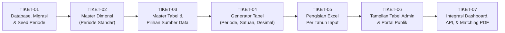

# 📐 Blueprint Arsitektur, ERD, Alur Kerja Sistem, Hasil Audit, & Tiket Implementasi Detail: Tabel Dinamis Lintas Tahun (*Single Master & Multi-Year Time-Series*)

**Proyek**: DDA Online (Jawa Tengah Dalam Angka) — BPS Provinsi Jawa Tengah  
**Tanggal Pembaruan**: 30 Oktober 2026  
**Status Dokumen**: Final Blueprint Teknis Siap Implementasi (Dilengkapi DDL Eksak, Logika Penyimpanan Lintas Tahun, Aturan Default Tampilan Tahun Aktif, Algoritma Migrasi 100% Data, & *Acceptance Criteria* per Tiket)

---

## 1. Perbandingan Konseptual: Mengapa Alur Lama Diubah? (*As-Is* vs *To-Be*)

| Aspek | ❌ Alur Lama (*As-Is*) | ✅ Alur Baru (*To-Be*) |
| :--- | :--- | :--- |
| **Pembuatan Tabel & Indikator** | Dibuat/di-copy ulang setiap ganti tahun buku (`t_tahun_tabel` menjadi induk `m_indikator_tabel` dan link API). | **Cukup dibuat 1 kali selamanya**. 1 Master Tabel (`m_list_tabel`) = 1 Konfigurasi API (`m_konfigurasi_api`) **atau** 1 Kerangka Indikator (`m_indikator_tabel`) yang berlaku lintas tahun. |
| **Penentuan Sumber Data** | Tercampur di `t_tahun_tabel` dan `is_dynamic`, serta ada 4 tabel API duplikat (`t_api_data`, `t_dataportal`, `t_data_portal`, `t_tabel_match`). | **Ditentukan tegas sejak buat/edit Master Tabel (`Pilihan 1`)**: memilih **`🔗 API Satu Data Kominfo`** (OPD) atau **`🧩 Tabel Dinamis Rakit Sendiri`** (Instansi Vertikal/BPS). |
| **Pengisian Data Tahun Baru** | Jika tabel menampilkan `2021–2025`, saat masuk `2026` harus merakit ulang periode `2022–2026` dan menginput ulang seluruh tahun. | Data `2021–2025` sudah tersimpan di database. Saat masuk `2026`, **cukup pilih Tahun Input `2026`**, unduh Excel yang **hanya berisi kolom `2026`**, isi, lalu upload. |
| **Dimensi Periode Waktu** | Admin membuat 38+ kelompok tahun manual (`"Tahunan 2021-2025"`, `"Tahunan 2023-2025"`, `"Tahun 2025"`, dll.). | Menggunakan **Jenis Periode Standar** (`Tahunan`, `Tahunan dan Jumlah`, `Tahunan dan Rata-rata`, `Tahun Ajaran`, `Bulanan`, `Bulanan dan Jumlah`, `Triwulanan`, dll.) + **Dropdown Checklist Tahun**. |
| **Satuan & Presisi Desimal** | Kolom `satuan` dan `desimal` sudah ada di tabel `m_indikator_tabel`, tetapi belum dimunculkan di toolbar Generator Tabel. | **Tersedia langsung di Toolbar Generator Tabel**: Admin dapat mengisi **Satuan** (misal *Jiwa, Ton, Persen, Km²*) dan memilih **Desimal** (*Otomatis Excel, 0, 1, 2, 3*). |
| **Judul Tabel (`judul_ind` & `judul_en`)** | Tahun ditulis mati di ujung judul (misal `..., 2025`), sehingga harus diedit manual tiap ganti tahun. | Disimpan **tanpa angka tahun statis**. Sistem merakit akhiran tahun pada judul secara otomatis mengikuti tahun yang sedang dicentang (`, 2025`, `, 2024 dan 2025`, atau `, 2021–2025`). |

---

## 2. Detail Perubahan pada Tabel Master Dimensi (`Baris`, `Karakteristik`, & `Periode`)

### A. Dimensi Baris (`m_baris_kelompok` & `m_baris_item`) $\rightarrow$ **Struktur Tabel TETAP, Data "Salah Kamar" & Duplikat Dibersihkan**
* **Status Skema**: **Tidak ada perubahan DDL kolom**.
* **Aturan Best Practice Baris Total (`Jawa Tengah` / `Jumlah`)**:
  * Item baris penutup seperti **`Jawa Tengah`** atau **`Jumlah`** (`tipe_baris = 'total'`, `is_bold = 1`) **TETAP DIPERTAHANKAN** di dalam `m_baris_item`.
  * **Alasan**: Agar saat Organisasi Vertikal / OPD mengunduh Template Excel dan mengunggah data (terutama untuk tabel **Persentase, Rasio, Indeks, IPM, atau Rata-rata Tertimbang** yang angka Provinsinya tidak bisa dijumlahkan biasa dari 35 Kab/Kota), baris `Jawa Tengah` / `Jumlah` sudah tersedia di Excel dan diisi langsung oleh OPD produsen data!
* **Pembersihan Otomatis Saat Migrasi (`TIKET-01`)**:
  1. **Hapus Kelompok Sampah / Orphan**: Kelompok percobaan seperti `id = 121 ('test')` (beserta indikator dummy `ind = 367 ('test')`) dan kelompok yang tidak direferensikan indikator mana pun dihapus.
  2. **Konversi Kelompok "Salah Kamar" (Tahun di Master Baris vs Bulan di Tabel 3-Dimensi)**:
     * **Tahun di Master Baris (`id = 70, 115, 116, 120, 127`)**: Sel datanya di `t_nilai_dinamis` dipindahkan ke `tahun_data` (`2017..2025`), `id_baris_kelompok` pada indikator diset `NULL` (Tabel Runtun Waktu Makro), dan mode **`portrait_mode = true` (`posisi_hirarki = 'periode_baris'`)** diaktifkan.
     * **Aturan Penting untuk Kelompok Baris Bulan (`id = 9, 82, 83, 89, 103, 106`)**:
       * Pada tabel **3-Dimensi** seperti *Inflasi per Bulan Menurut Kelompok Pengeluaran* (`ind = 289, 291, 296, 298, 299, 366` dll.) yang sudah memiliki **Karakteristik Kolom** (`Umum, Makanan, Pakaian...`) **DAN** membutuhkan **Tahun Data** (`2025, 2026`), kelompok baris **`Bulan (Januari..Desember)` (`id = 9, 103, 106`) TETAP DIPERTAHANKAN sebagai Baris** (`id_baris_kelompok`) dengan `tipe_periode = 'tahunan'`. Mengapa? Karena jika Bulan dipindah ke Periode, tabel akan kehilangan slot untuk memilih Tahun `2025, 2026`! Dengan mempertahankan `Bulan` di Baris (`id = 9`), Admin/OPD bisa mengisi data Bulanan untuk Tahun `2025`, `2026`, dst. tanpa bentrok 3 dimensi!
       * Hanya kelompok baris bulan yang **tidak terpakai (`orphan`: `id = 82, 83, 89`)** yang dihapus, dan `id = 106` (*Bulan dan Jawa Tengah*) disatukan ke `id = 9` (*Bulan*).
  3. **Penyatuan (*Auto-Deduplication*) Kelompok yang Dobel (Aturan *100% Exact Mapping*)**:
     * **Kelompok Kabupaten/Kota yang 100% Standar 35 Kab/Kota (`id = 67` dan `id = 102`)** disatukan secara otomatis ke **Master Standar BPS (`id = 1`: `Kabupaten/Kota di Jawa Tengah`)** melalui pencocokan nama Kabupaten/Kota yang dinormalisasi + baris total `Jawa Tengah`. Sementara kelompok wilayah khusus yang memiliki item ekstra/berbeda (seperti `id = 57` yang memiliki baris tambahan `'Provinsi Jawa Tengah'` terpisah dari `'Jawa Tengah'`, atau `id = 101` *Kepolisian Resort*, `id = 84` *Kantor Pelayanan*) **dibiarkan tetap mandiri** agar tidak ada 1 sel pun di `t_nilai_dinamis` yang hilang atau salah baris!
     * Kelompok baris lain yang memiliki daftar item **100% identik (*Exact Content Fingerprint* pada jumlah item, `nama_baris_ind`, dan `tipe_baris`)** disatukan otomatis ke ID terkecil (Kanonik).

### B. Dimensi Karakteristik Kolom (`m_karakteristik_kelompok` & `m_karakteristik_item`) $\rightarrow$ **Struktur Tabel TETAP, Data "Salah Kamar" & Duplikat Dibersihkan**
* **Status Skema**: **Tidak ada perubahan DDL kolom** (Nama kolom eksak di DB: `id, id_kelompok, grup_induk_ind, grup_induk_en, grup_sub_ind, grup_sub_en, item_ind, item_en, no_urut, is_standalone`).
* **Aturan Best Practice Kolom Subtotal/Jumlah (`item_ind = 'Jumlah' / 'Total'` atau `is_standalone = 1`)**:
  * Item karakteristik bernama **`Jumlah / Total`** (atau subtotal per sub-header seperti pada tabel *Panti Asuhan & Anak Asuh*, *Pidana Penjara*, serta *Perkotaan + Perdesaan*) **TETAP DIPERTAHANKAN** di dalam `m_karakteristik_item`.
  * **Alasan**: Menjamin akurasi tabel yang memiliki multi-satuan dalam 1 tabel, tabel persentase gabungan, maupun kemudahan *copy-paste* Template Excel oleh OPD. Sementara itu, jika ada Master Karakteristik yang belum memiliki kolom `Jumlah`, Admin dapat memunculkannya kapan saja lewat toggle **`Hitung Total Horizontal`** di modal **`⚙️ KONFIGURASI TABEL`** (yang otomatis mengecek apakah sudah ada `item_ind` bernama `'Jumlah'` / `'Total'` agar tidak menduplikasi kolom `Jumlah`).
* **Pembersihan Otomatis Saat Migrasi (`TIKET-01`)**:
  1. **Hapus Kelompok Sampah / Orphan**: Kelompok yang tidak dipakai indikator mana pun seperti `id = 143` (tahun murni tidak terpakai) dan `id = 255 ('test')` dihapus.
  2. **Penanganan Kelompok Karakteristik Kompleks (`id = 199, 263, 264`)**:
     * Kelompok `id = 199, 263, 264` yang saat ini aktif dipakai oleh indikator eksisting tetap dipertahankan dengan `tipe_periode = 'tahunan'` agar tidak merusak struktur kolom berjenjang (`grup_induk_ind` & `grup_sub_ind`) pada tabel Imigrasi/Kemenkumham yang sudah terisi data.
  3. **Penyatuan (*Auto-Deduplication*) Kelompok yang 100% Identik (*Exact Content Fingerprint*)**:
     * Kelompok karakteristik yang duplikat 100% identik (jumlah item sama persis dan di setiap urutan `no_urut` memiliki `grup_induk_ind`, `grup_sub_ind`, `item_ind`, serta `is_standalone` yang sama, seperti `id = 110` & `280` [*Satuan, Gedung, Sipil, Khusus, Konstruksi*], `id = 45` & `53` [*TPS*], `id = 14` & `63` [*Jenis Kelamin*], dll.) otomatis digabungkan ke ID Kanonik terkecil dan seluruh referensi di `m_indikator_tabel` serta `t_nilai_dinamis` di-update secara otomatis.

### C. Dimensi Periode Waktu (`m_periode_kelompok` & `m_periode_item`) $\rightarrow$ **DIUBAH PERANNYA & DITAMBAH KOLOM PENANDA**
1. **Audit 38 Kelompok di `m_periode_kelompok` & 27.189 Sel di `t_nilai_dinamis`**:
   Berdasarkan pemeriksaan langsung pada `backup_barusupernewduperdda.sql`, seluruh 38 kelompok periode yang ada saat ini terbagi menjadi **5 kategori**:
   * **Kategori 1 — Tahun Murni 4 Digit (28 Kelompok: `id = 1..7, 9..11, 13, 15, 19, 20, 23, 24, 26..29, 32..34, 36..38`)**:
     * Seluruh item di dalamnya yang memiliki nilai di `t_nilai_dinamis` adalah angka tahun 4 digit (`2019` s.d. `2026`).
     * **Konversi Otomatis**: Indikator diubah ke `tipe_periode = 'tahunan'`, `id_periode_kelompok = NULL`. Sel di `t_nilai_dinamis` diisi `tahun_data = CAST(nama_periode_ind AS UNSIGNED)` dan `id_periode_item = 0`.
   * **Kategori 2 — Tahun + Kolom Jumlah (2 Kelompok: `id = 16, 35`)**:
     * Berisi item tahun (`2021..2025`) ditambah 1 item `'Jumlah'` (`id_periode_item = 73` dan `136`).
     * **Konversi Otomatis**: Indikator diubah ke `tipe_periode = 'tahunan_jumlah'`, `id_periode_kelompok = NULL`. Sel tahun dikonversi ke `tahun_data`, sedangkan sel `'Jumlah'` dihitung otomatis (*on-the-fly*) oleh sistem.
   * **Kategori 3 — Tahun Ajaran Pendidikan `YYYY/YYYY+1` (1 Kelompok: `id = 25`, dipakai 9 tabel Pendidikan `4.1.1` s.d. `4.1.9`, total 864 sel)**:
     * Berisi item `id=99 ('2024/2025')` dan `id=100 ('2025/2026')`.
     * **Konversi Otomatis**: Ditambahkan opsi standar **`Tahun Ajaran (YYYY/YYYY+1)`** (`tipe_periode = 'tahun_ajaran'`). Nilai `2024/2025` disimpan sebagai `tahun_data = 2024, id_periode_item = 0` (dirender sebagai `2024/2025`), dan `2025/2026` disimpan sebagai `tahun_data = 2025, id_periode_item = 0` (dirender sebagai `2025/2026`). Saat masuk 2026, otomatis dirender `2026/2027`!
   * **Kategori 4 — Sub-Tahunan Maret & September Lintas Tahun (3 Kelompok: `id = 21, 30, 31`, dipakai `ind = 17` & `ind = 343`, total 104 sel)**:
     * Berisi item `'2024 || Maret'`, `'2024 || September'`, `'2025 || Maret'`, `'2025 || September'`.
     * **Konversi Otomatis**: Indikator diarahkan ke kelompok standar **`Maret dan September`** (`kode_standar = 'maret_september'`, `tipe_periode = 'custom'`), dan 104 sel datanya dipetakan ke `tahun_data = 2024` / `2025` dengan `id_periode_item` = ID item `Maret` / `September`.
   * **Kategori 5 — Tahun + Kolom Satuan Per Baris (2 Kelompok: `id = 17, 18`, dipakai `ind = 69, 174..178`)**:
     * Pada `ind = 174` (*Produksi Hasil Hutan*), item `id=74 ('Satuan')` menyimpan satuan tiap baris di kolom `simbol` (`'m3/m3'`, `'ton/ton'`, `'stapel meter'`), diikuti tahun `2021..2025` (`id=75..79`).
     * **Konversi Otomatis**: Satuan per baris dari `id_periode_item = 74` digabungkan secara otomatis ke rincian kolom kedua `m_baris_item` (`nama_baris_ind = 'Kayu Jati || m3'`) dengan mengaktifkan `tampilan_baris = '2_kolom'` (`Jenis Produksi | Satuan`), lalu baris `id_periode_item = 74` dihapus dari `t_nilai_dinamis` dan indikator diubah menjadi `tipe_periode = 'tahunan'`. Hasilnya: satuan tiap komoditas tampil permanen di kolom ke-2 baris tanpa perlu diinput ulang tiap tahun!

---

## 3. Entity Relationship Diagram (ERD) & Spesifikasi Tipe Data Eksak

> [!IMPORTANT]
> **Kesesuaian Tipe Data Foreign Key (`SIGNED` vs `UNSIGNED`) & Collation (`utf8mb4`)**:
> - Di database eksisting, `m_list_tabel.id` dan `t_tahun_tabel.id` bertipe **`INT` (SIGNED)**, sedangkan `m_indikator_tabel.id`, `m_baris_kelompok.id`, `m_karakteristik_kelompok.id`, dan `m_periode_kelompok.id` bertipe **`INT UNSIGNED`**.
> - Oleh karena itu, kolom `id_tabel` pada `m_indikator_tabel` dan `m_konfigurasi_api` **WAJIB bertipe `INT` (SIGNED)** agar *Foreign Key* ke `m_list_tabel(id)` valid di MySQL InnoDB.
> - Tabel `m_list_tabel` dan `t_tahun_tabel` yang sebelumnya masih `latin1` wajib dikonversi ke `utf8mb4 COLLATE utf8mb4_general_ci` agar tidak terjadi error *Illegal mix of collations* saat di-JOIN dengan `m_indikator_tabel`.

```mermaid
erDiagram
    m_unitkerja ||--o{ m_list_tabel : "1:N (Penanggung Jawab OPD/Instansi)"
    m_list_tabel ||--o| m_konfigurasi_api : "1:1 (Jika jenis_sumber = api_kominfo)"
    m_list_tabel ||--o| m_indikator_tabel : "1:1 (Jika jenis_sumber = dinamis)"
    m_list_tabel ||--o{ t_tahun_tabel : "1:N (Status Progres per Edisi Tahun Buku)"

    m_baris_kelompok ||--o{ m_baris_item : "1:N (Rincian Baris + Baris Total JT/Jumlah)"
    m_karakteristik_kelompok ||--o{ m_karakteristik_item : "1:N (Hierarki Kolom 1-3 Level + Kolom Jumlah)"
    m_periode_kelompok ||--o{ m_periode_item : "1:N (Sub-Tahunan: Bulan/Triwulan/Semester/Kustom)"

    m_baris_kelompok ||--o{ m_indikator_tabel : "1:N (id_baris_kelompok - Nullable utk Makro)"
    m_karakteristik_kelompok ||--o{ m_indikator_tabel : "1:N (id_karakteristik_kelompok - Opsional)"
    m_periode_kelompok ||--o{ m_indikator_tabel : "1:N (id_periode_kelompok - Khusus Sub-Tahunan)"

    m_indikator_tabel ||--o{ t_nilai_dinamis : "1:N (Sel Data Lintas Tahun)"
    m_baris_item ||--o{ t_nilai_dinamis : "id_baris_item (0 jika Makro/Total Sintetis)"
    m_karakteristik_item ||--o{ t_nilai_dinamis : "id_karakteristik_item (0 jika tanpa karakteristik)"
    m_periode_item ||--o{ t_nilai_dinamis : "id_periode_item (0 jika Tahunan/Tahun Ajaran)"

    m_unitkerja {
        varchar id_unitkerja PK "varchar(20) - Kode OPD / Instansi Vertikal / BPS"
        varchar nama_unitkerja "varchar(255) - Nama OPD / Subject Matter"
        int kategori "1=Subject Matter BPS, 2=OPD Provinsi, 3=Instansi Vertikal"
    }

    m_list_tabel {
        int id PK "SIGNED INT AUTO_INCREMENT"
        varchar id_unitkerja FK "varchar(20) FK ke m_unitkerja"
        varchar no_tabel "varchar(50) NULL - Nomor tabel baku (misal 1.1.1)"
        varchar judul_ind "varchar(1000) - Judul dasar Indonesia (tanpa tahun statis)"
        varchar judul_en "varchar(1000) - Judul dasar Inggris (tanpa tahun statis)"
        enum jenis_sumber "api_kominfo | dinamis"
        longtext kondef "Konsep & Definisi"
        varchar sumber_data "varchar(255) NULL - Teks sumber kaki tabel"
        tinyint is_active "tinyint(1) DEFAULT 1"
    }

    m_konfigurasi_api {
        int_unsigned id PK "INT UNSIGNED AUTO_INCREMENT"
        int id_tabel UK "SIGNED INT UNIQUE FK ke m_list_tabel.id"
        varchar id_api "varchar(100) NULL - UUID API Satu Data Jateng"
        text link_api "URL Endpoint / view_portal_tabel"
        longtext config_tabel "JSON Konfigurasi Kolom, Total & Pivot API"
        longtext cached_json "Cache JSON API Terakhir"
        varchar tahun_tersedia "varchar(100) NULL - Contoh: 2021,2022,2023,2024,2025"
        datetime last_sync_at
        datetime created_at
        datetime updated_at
    }

    m_indikator_tabel {
        int_unsigned id PK "INT UNSIGNED AUTO_INCREMENT"
        int id_tabel UK "SIGNED INT UNIQUE FK ke m_list_tabel.id"
        int id_tahun_tabel "SIGNED INT NULL (Legacy compatibility)"
        varchar no_tabel "varchar(50) NULL"
        text judul_ind
        text judul_en
        varchar id_unitkerja "varchar(50) NULL"
        int_unsigned id_baris_kelompok FK "Nullable: NULL khusus Tabel Runtun Waktu Makro"
        int_unsigned id_karakteristik_kelompok FK "Nullable: NULL jika kolom murni Tahun/Bulan"
        varchar tipe_periode "tahunan | tahun_ajaran | bulanan | triwulanan | semesteran | custom (+ legacy _jumlah/_rata)"
        int_unsigned id_periode_kelompok FK "Nullable: NULL jika Tahunan/Tahun Ajaran; terisi jika Sub-Tahunan"
        varchar tahun_tampil "varchar(255) NULL - Default checklist tahun yg dikunci Admin"
        varchar posisi_hirarki "periode_atas (Default) | kolom_atas | periode_baris | periode_baris_pisah"
        varchar tingkat_kolom "semua | 1 | 1,2 | 1,2,3"
        varchar konfigurasi_total "default | jawa_tengah | jumlah | runtun_waktu | none | kustom"
        varchar label_total_kustom "varchar(100) NULL"
        enum format_nomor_baris "auto | none | reset_kategori"
        varchar tampilan_baris "1_kolom | 2_kolom"
        enum kolom_nomor "tampilkan | sembunyikan"
        varchar satuan "varchar(100) NULL - Contoh: Jiwa, Ton, Persen (%)"
        tinyint desimal "TINYINT NOT NULL DEFAULT -1 (-1=Otomatis Excel, 0..3=Tetap)"
        longtext config_tampilan "JSON Konfigurasi Modal (Total Horizontal/Vertikal, Grup Wilayah, Prioritas, Portrait/Pivot)"
        text catatan "Catatan kaki tabel"
        datetime created_at
        datetime updated_at
    }

    m_baris_kelompok {
        int_unsigned id PK "INT UNSIGNED AUTO_INCREMENT (id=1: Master Kab/Kota Standar)"
        varchar nama_kelompok_ind "varchar(255)"
        varchar nama_kelompok_en "varchar(255)"
        varchar judul_baris_ind "varchar(255) - Header Kolom Kiri (ID)"
        varchar judul_baris_en "varchar(255) - Header Kolom Kiri (EN)"
        varchar judul_sub_baris_ind "varchar(255) NULL - Header Kolom Ke-2 Rincian/Satuan (ID)"
        varchar judul_sub_baris_en "varchar(255) NULL - Header Kolom Ke-2 Rincian/Satuan (EN)"
        datetime created_at
        datetime updated_at
    }

    m_baris_item {
        int_unsigned id PK "INT UNSIGNED AUTO_INCREMENT"
        int_unsigned id_kelompok FK "FK ke m_baris_kelompok.id"
        int no_urut "Urutan baris"
        varchar nama_baris_ind "varchar(255) - Mendukung pemisah || utk 2 kolom"
        varchar nama_baris_en "varchar(255)"
        enum tipe_baris "kategori | data | subtotal | total (Jawa Tengah / Jumlah tetap dipertahankan)"
        tinyint level_indentasi "0 | 1 | 2"
        tinyint is_bold "0 | 1"
    }

    m_karakteristik_kelompok {
        int_unsigned id PK "INT UNSIGNED AUTO_INCREMENT"
        varchar nama_kelompok_ind "varchar(255)"
        varchar nama_kelompok_en "varchar(255)"
        datetime created_at
        datetime updated_at
    }

    m_karakteristik_item {
        int_unsigned id PK "INT UNSIGNED AUTO_INCREMENT"
        int_unsigned id_kelompok FK "FK ke m_karakteristik_kelompok.id"
        varchar grup_induk_ind "varchar(255) NULL - Header Level 1 (ID)"
        varchar grup_induk_en "varchar(255) NULL - Header Level 1 (EN)"
        varchar grup_sub_ind "varchar(255) NULL - Header Level 2 (ID)"
        varchar grup_sub_en "varchar(255) NULL - Header Level 2 (EN)"
        varchar item_ind "varchar(255) - Header Level 3 / Rincian Kolom (ID, termasuk Jumlah/Total)"
        varchar item_en "varchar(255) - Header Level 3 / Rincian Kolom (EN)"
        int no_urut "Urutan kolom"
        tinyint is_standalone "0=Berjenjang, 1=Kolom Mandiri / Jumlah (Rowspan Penuh)"
    }

    m_periode_kelompok {
        int_unsigned id PK "INT UNSIGNED AUTO_INCREMENT"
        varchar nama_kelompok_ind "varchar(255)"
        varchar nama_kelompok_en "varchar(255)"
        varchar judul_periode_ind "varchar(255)"
        varchar judul_periode_en "varchar(255)"
        enum kategori_periode "standar | kustom | arsip_tahunan"
        varchar kode_standar "bulanan | triwulanan | semesteran | maret_september | februari_agustus | NULL"
        datetime created_at
        datetime updated_at
    }

    m_periode_item {
        int_unsigned id PK "INT UNSIGNED AUTO_INCREMENT"
        int_unsigned id_kelompok FK "FK ke m_periode_kelompok.id"
        varchar nama_periode_ind "varchar(255) - Contoh: Januari..Desember / Triwulan I..IV"
        varchar nama_periode_en "varchar(255)"
        enum tipe_item "periode | jumlah | rata_rata"
        int no_urut "Urutan periode"
    }

    t_nilai_dinamis {
        bigint_unsigned id PK "BIGINT UNSIGNED AUTO_INCREMENT"
        int_unsigned id_indikator FK "UK1: FK ke m_indikator_tabel.id"
        smallint_unsigned tahun_data "UK2: SMALLINT UNSIGNED NOT NULL DEFAULT 2025 (2017..2030+)"
        int_unsigned id_baris_item "UK3: 0 jika baris tahun makro / total sintetis"
        int_unsigned id_karakteristik_item "UK4: 0 jika tanpa karakteristik"
        int_unsigned id_periode_item "UK5: 0 jika Tahunan/Tahun Ajaran; ID item jika Sub-Tahunan"
        decimal nilai "decimal(20,4) NULL"
        varchar simbol "varchar(100) NULL - Untuk tanda -, ..., NA, atau teks"
        tinyint jumlah_desimal "TINYINT NULL (Presisi asli sel Excel)"
        datetime updated_at
    }

    t_tahun_tabel {
        int id PK "SIGNED INT AUTO_INCREMENT"
        int id_tabel FK "SIGNED INT FK ke m_list_tabel.id"
        varchar tahun "varchar(4) NOT NULL - Edisi Tahun Buku (misal 2025, 2026)"
        varchar no_tabel "varchar(50) NULL"
        varchar is_confirm "0: Belum Dicek, 1: Diverifikasi, 2: Perlu Perbaikan"
        int is_periksa "0: Belum Diisi, 1: Sudah Diisi"
        text catatan_periksa
        text catatan
        tinyint is_publish
        tinyint is_dynamic
    }
```



---

## 4. Alur Kerja Sistem (*System Workflow*) Secara Menyeluruh dari Hulu ke Hilir

```mermaid
flowchart TD
    subgraph WORKFLOW_1["ALUR 1: PENYIAPAN MASTER DIMENSI (OLEH ADMIN BPS)"]
        W1_A["Dimensi Judul Baris<br/>(m_baris_kelompok & m_baris_item)<br/>Kabupaten/Kota, Komoditas, Unsur Iklim, dll."]
        W1_B["Dimensi Karakteristik Kolom<br/>(m_karakteristik_kelompok & m_karakteristik_item)<br/>Indikator 1 s.d. 3 Tingkat"]
        W1_C["Dimensi Periode Waktu<br/>(m_periode_kelompok & m_periode_item)<br/>- Tahunan & Tahun Ajaran otomatis ditangani sistem<br/>- Sub-tahunan standar: Bulanan, Triwulanan, Semesteran<br/>- Kustom: Maret-September, Februari-Agustus, dll."]
    end

    subgraph WORKFLOW_2["ALUR 2: PEMBUATAN MASTER TABEL & SUMBER DATA (1X SELAMANYA)"]
        W2_A["Admin buka Form Master Tabel (f_master_tabel.php)<br/>Isi No. Tabel, Judul Dasar (Tanpa Tahun), & Instansi/OPD"]
        W2_A --> W2_B{"Pilih jenis_sumber<br/>(Pilihan 1)"}
        W2_B -->|"🔗 API Satu Data Kominfo"| W2_API["Masukkan ID / Link API Kominfo<br/>Tersimpan di m_konfigurasi_api (1:1 ke m_list_tabel)"]
        W2_B -->|"🧩 Tabel Dinamis"| W2_DYN["Simpan Master Tabel<br/>Lanjut klik 'Kelola Dimensi di Generator Tabel'"]
    end

    subgraph WORKFLOW_3["ALUR 3: PERAKITAN KERANGKA DI GENERATOR TABEL (1X SELAMANYA)"]
        W2_DYN --> W3_A["Pilih 3 Komponen Utama:<br/>1. Judul Baris (Selalu di Kiri)<br/>2. Karakteristik Kolom (Selalu di Bawah Periode)<br/>3. Jenis Periode Standar (Selalu di Atas Karakteristik)"]
        W1_A --> W3_A
        W1_B --> W3_A
        W1_C --> W3_A
        W3_A --> W3_B["Atur Toolbar Sederhana:<br/>Tingkat Kolom | Baris Total | Tampilan Baris | Kolom No | SATUAN | DESIMAL<br/>(Tanpa tombol otak-atik Posisi; posisi standar otomatis)"]
        W3_B --> W3_C["Live Preview Merender Wujud Tabel Standar:<br/>- Jika Tahunan -> tampil contoh kolom 2021..2025 (+ Jumlah/Rata2)<br/>- Jika Bulanan -> tampil kolom Januari..Desember<br/>- Jika Satuan diisi -> tampil 'Satuan: ...' di kanan atas tabel<br/>- Klik Simpan Matriks -> tersimpan di m_indikator_tabel"]
    end

    subgraph WORKFLOW_4["ALUR 4: PENGISIAN DATA TAHUNAN (TIDAK PERLU INPUT ULANG TAHUN LAMA)"]
        W2_API --> W4_API["Saat Masuk Tahun Baru (misal 2026):<br/>Sistem menarik JSON dari API Kominfo.<br/>Jika di JSON ada tahun_data = 2026,<br/>otomatis masuk & status 2026 = 'Sudah Diisi'"]
        W3_C --> W4_DYN1["Saat Masuk Tahun Baru (misal 2026):<br/>Admin / OPD klik 'Unduh Template' atau 'Upload Excel'"]
        W4_DYN1 --> W4_DYN2["Pilih 'Tahun Data yang Akan Diisi' = 2026<br/>(Default mengikuti Tahun Aktif di Navbar)"]
        W4_DYN2 --> W4_DYN3["Excel yang diunduh HANYA meminta data Tahun 2026:<br/>- Tabel Tahunan: hanya 1 blok kolom Tahun 2026<br/>- Tabel Bulanan: 12 kolom Jan..Des khusus Tahun 2026"]
        W4_DYN3 --> W4_DYN4["Upload Excel Tahun 2026:<br/>- Tersimpan di t_nilai_dinamis dengan tahun_data = 2026<br/>- Data 2021..2025 tetap aman 100%<br/>- t_tahun_tabel (tahun=2026) otomatis menjadi 'Sudah Diisi'"]
    end

    subgraph WORKFLOW_5["ALUR 5: TAMPILAN TABEL, DROPDOWN TAHUN, & MODAL KONFIGURASI PIVOT (SERAGAM API & DINAMIS)"]
        W4_API --> W5_A["Halaman Lihat Tabel (v_portal_tabel / v_tabel_dinamis / Portal Publik)"]
        W4_DYN4 --> W5_A
        W5_A --> W5_DEFAULT["Default Saat Dibuka Pertama Kali:<br/>Hanya mencentang & menampilkan 1 Tahun Aktif (misal ☑ 2026)<br/>(Fallback ke tahun terakhir yg terisi jika 2026 belum diisi,<br/>atau mengikuti Default Tampilan yg dikunci Admin)"]
        W5_DEFAULT --> W5_B["Toolbar Halaman Lihat Tabel Admin (Persis Tabel API):<br/>1. Dropdown [📅 Tahun] -> Checklist Tahun Tampil (☑ 2021..2026)<br/>2. Tombol [⚙️ Konfigurasi] -> Atur Pivot Periode ke Baris, Baris Total, Satuan, Desimal<br/>3. Tombol [📥 Export Excel]"]
        W5_B --> W5_C["Sistem Merender Kolom Lintas Tahun & Pivot Secara Real-time:<br/>1. Kolom tahun-tahun lain muncul berdampingan (2021..2026)<br/>2. Hitung otomatis kolom Jumlah / Rata-rata Tahunan<br/>3. Format angka sesuai Desimal & tampilkan Satuan<br/>4. Rakit akhiran tahun pada Judul Tabel otomatis (..., 2021–2026)<br/>5. Tampilan Frontend Publik otomatis mengikuti Konfigurasi Admin"]
    end
```



---

## 4B. Logika Penyimpanan Lintas Tahun & Aturan Default Tampilan Tahun Aktif

### A. Bagaimana Data Tahun Lalu (`2021–2025`) dan Data Tahun Baru (`2026`) Terhubung Tanpa Input Ulang?
1. **Kerangka Master & Indikator Dibuat 1 Kali Selamanya (`1:1`)**:
   * `m_list_tabel` (`id = 10`) $\leftrightarrow$ `m_indikator_tabel` (`id = 50, id_tabel = 10`) memegang struktur tetap: Judul Baris (`id_baris_kelompok`), Karakteristik (`id_karakteristik_kelompok`), Jenis Periode (`tipe_periode`), `satuan`, dan `desimal`.
2. **Setiap Sel Angka di `t_nilai_dinamis` Memiliki Koordinat 5-Kunci (`uk_cell_multiyear`)**:
   * `(id_indikator, tahun_data, id_baris_item, id_karakteristik_item, id_periode_item)`
   * Seluruh data historis (`2021..2025`) dan data tahun baru (`2026`) terhubung ke **`id_indikator` dan `id_baris_item` yang sama**, hanya dibedakan oleh kolom **`tahun_data`**.
3. **Saat Mengisi Data Tahun Baru (`2026`)**:
   * Ketika pengguna mengunduh template Excel untuk `tahun_data = 2026`, sistem hanya membangkitkan kolom input untuk tahun `2026`.
   * Ketika file Excel `2026` diunggah, `M_tabeldinamis::saveNilaiBatch()` hanya menimpa baris dengan `WHERE id_indikator = 50 AND tahun_data = 2026`.
   * Data tahun `2021, 2022, 2023, 2024, 2025` **tidak tersentuh sama sekali** dan langsung bisa disandingkan kapan saja.

### B. Aturan Default Tahun yang Terlihat Saat Tabel Dibuka (`Default = Tahun Aktif`) & Modal `⚙️ KONFIGURASI TABEL` (Seragam 100% dengan Tabel API)
1. **Kondisi Default Saat Tabel Dibuka Pertama Kali**:
   * Secara default, sistem **hanya mencentang dan menampilkan 1 tahun yaitu Tahun Aktif (`$ta`, misal `2025` atau `2026`)**.
   * **Fallback Pintar**: Jika kegiatan tahun baru (misal `2026`) baru saja dimulai dan tabel tersebut belum memiliki data untuk `2026`, sistem otomatis mencentang **1 tahun terakhir yang sudah memiliki data** (misal `2025`) disertai badge informasi kecil (`"Menampilkan data terakhir: 2025 (Data 2026 belum tersedia)"`) agar tabel tidak tampak kosong.
   * Karena hanya 1 tahun yang aktif saat dibuka, tampilan tabel menjadi sangat ringkas dan judul tabel otomatis tertulis `..., 2025` (atau `..., 2026`).
2. **Kondisi Saat Pengguna Mencentang Tahun Lain di Dropdown Checklist**:
   * Di bagian atas tabel tersedia tombol dropdown **`📅 Tahun`** yang memuat seluruh tahun yang tersedia di database (misal `2021, 2022, 2023, 2024, 2025, 2026`).
   * Begitu pengguna mencentang tahun-tahun lain di dropdown (`☑ 2021`, `☑ 2022`, dst.), kolom tahun-tahun tersebut **langsung muncul berdampingan** (`2021 | 2022 | ... | 2026`), kolom `Jumlah`/`Rata-rata` (jika aktif) otomatis menjumlahkan tahun yang dicentang, dan ujung Judul Tabel otomatis berubah menjadi `..., 2021–2026`.
3. **Pemisahan Tugas Generator vs Modal `⚙️ KONFIGURASI TABEL` di Halaman Lihat Tabel Admin (Satu Rasa dengan Tabel API `v_portal_tabel.php`)**:
   * **Di Generator Tabel (`f_generator_tabel.php`) $\rightarrow$ Super Simpel**:
     * Admin **hanya memilih 3 bahan dasar**: **Judul Baris** (selalu di kiri), **Karakteristik Kolom** (selalu di bawah Periode), dan **Jenis Periode Murni** (`Tahunan`, `Tahun Ajaran`, `Bulanan`, `Triwulanan`, `Semesteran`, atau `Kustom` — tanpa perlu dipecah-pecah menjadi varian `+ Jumlah` di Generator), ditambah input **Satuan** dan **Desimal**.
     * Template Excel yang diunduh selalu rapi, seragam, dan tidak membingungkan pengisi data.
   * **Di Halaman Lihat Tabel Admin (`v_tabel_dinamis.php`) $\rightarrow$ Tombol `⚙️ KONFIGURASI` (Adopsi Penuh dari `modal_config_tabel.php` milik Tabel API)**:
     * Sama persis dengan pengalaman di Tabel API, ketika Admin menekan tombol **`⚙️ KONFIGURASI`**, muncul modal konfigurasi dengan **Tab 1: Kolom, Label & Total** dan **Tab 2: Pivot & Orientasi**, lengkap dengan tombol **`👁️ Preview`** dan **`✅ Terapkan & Simpan`**:

| Pengaturan / Toggle Switch di Modal `⚙️ KONFIGURASI TABEL` | Cara Kerja & Logika Otomatis pada Tabel Dinamis |
| :--- | :--- |
| **🔘 `Hitung Total Horizontal (Baris)`** *(+ pilihan: `Jumlah` atau `Rata-rata`, & sub-toggle `Sembunyikan Rincian`)* | Menambahkan kolom **`Jumlah / Total`** (atau **`Rata-rata / Average`**) di paling kanan tabel yang otomatis menjumlahkan/merata-ratakan nilai per baris dari kiri ke kanan. *(Pintar: Jika di Master Karakteristik sudah ada kolom bernama `'Jumlah'`, sistem otomatis mendeteksinya agar tidak dobel).* |
| **🔘 `Jumlah per Kelompok Kolom`** | Jika ada beberapa kelompok kolom (misal saat mencentang multi-tahun atau ada grup karakteristik bertingkat), otomatis menyisipkan sub-kolom **`Jumlah`** di akhir setiap kelompok kolom! |
| **🔘 `Tampilkan Total Vertikal (Baris JT / Jumlah)`** *(+ pilihan label: `Jawa Tengah`, `Jumlah`, `Runtun Waktu Multi-Tahun`, atau `Kustom`)* | Jika **`ON`**: Menampilkan baris Grand Total berwarna oranye di paling bawah tabel. Jika di Master Baris sudah ada angka baris total dari Excel, tampilkan angka tersebut; **jika di Master Baris belum ada baris total, sistem otomatis menjumlahkan nilai dari atas ke bawah (`SUM` vertikal)**! Jika **`OFF`**: Baris total disembunyikan (cocok untuk tabel rasio/persentase/indeks). |
| **🔘 `Grup Wilayah (Kab/Kota)`** | Mengaktifkan/menonaktifkan baris sekat pembatas kategori **`Kabupaten / Regency`** dan **`Kota / Municipality`**. |
| **🔘 `Prioritas Karakteristik (Karakteristik » Tahun)`** | **Default `OFF`**: **Tahun selalu di atas Karakteristik** (`2024 | 2025` $\rightarrow$ `Laki | Perempuan`). Jika **`ON`**: Membalik header menjadi **Karakteristik di atas Tahun** (`Laki-laki` $\rightarrow$ `2024 | 2025`). |
| **🔘 `Jadikan Periode sebagai Baris (Portrait / Pivot Mode)`** *(+ opsi `Gabung` / `Pisah` kolom)* | Jika **`ON`**: Memutar (pivot) Periode/Tahun menjadi sub-baris vertikal di sebelah kiri, sedangkan Karakteristik menjadi kolom di atas! |
| **📏 `Satuan` & 🔢 `Desimal`** | Mengubah satuan (*Jiwa, Ton, %*) dan presisi desimal (*Otomatis, 0, 1, 2, 3*) langsung dari halaman Lihat Tabel. |

   * Saat Admin menekan **`✅ Terapkan & Simpan`**, konfigurasi disimpan ke `m_indikator_tabel` (`config_tampilan`, `posisi_hirarki`, `konfigurasi_total`, `satuan`, `desimal`), dan halaman **Frontend Publik (`frontend/v_tabel_dinamis.php`)** otomatis menyajikan tabel persis sesuai konfigurasi tersebut!

---

## 5. Hasil Audit Kode Sistem Eksisting & Penanganan 8 Edge-Case Kritis (*Best Practice Checklist*)

1. **Resolusi Ganda Parameter URL (`Dual-ID Resolver`: `id_tabel` vs `id_tahun_tabel`)**:
   * **Temuan**: Di kode lama, URL seperti `admin/generator_tabel/(:num)` dan `admin/view_tabel_dinamis/(:num)` menerima `$id_tahun_tabel`. Di alur baru, halaman Master Tabel menampilkan `m_list_tabel` secara langsung (yang mungkin belum memiliki baris di `t_tahun_tabel` untuk tahun baru).
   * **Solusi**: Buat fungsi terpusat `M_tabeldinamis::resolveTableContext($id_param, $tahun_aktif)` yang pintar mendeteksi apakah `$id_param` adalah `t_tahun_tabel.id` atau `m_list_tabel.id`, serta otomatis menyediakan objek `$tabel` (`m_list_tabel`), `$indikator` (`m_indikator_tabel`), dan `$tahun_tabel` (`t_tahun_tabel` untuk `$tahun_aktif`). Semua link lama maupun baru dijamin 100% bekerja tanpa *404 Not Found*.
2. **Deduplikasi Indikator Ganda pada `m_list_tabel.id = 321`**:
   * **Temuan Audit SQL**: Dari 315 baris di `m_indikator_tabel`, ditemukan tepat 1 Master Tabel (`m_list_tabel.id = 321`, Tabel `9.1.8` milik KAI) yang memiliki 2 baris di `m_indikator_tabel`: `id = 23` (`tt = 7514`, 3 sel data) dan `id = 183` (`tt = 767`, 101 sel data).
   * **Solusi**: Sebelum memasang `UNIQUE KEY uk_id_tabel (id_tabel)` pada `m_indikator_tabel`, skrip migrasi otomatis memilih indikator dengan jumlah sel terbanyak (`id = 183`), memindahkan sel dari `id = 23` menggunakan `INSERT IGNORE`, lalu menghapus `id = 23`.
3. **Pencegahan Error `Duplicate entry` pada `uk_judul_opd` Saat Membersihkan Tahun di Judul `m_list_tabel`**:
   * **Temuan Audit SQL**: Tabel `m_list_tabel` memiliki constraint `UNIQUE KEY uk_judul_opd (judul_ind(255), id_unitkerja)`.
   * **Solusi**: Saat membersihkan akhiran tahun pada `m_list_tabel.judul_ind`, skrip migrasi memeriksa apakah judul bersih tersebut akan bentrok dengan baris lain di OPD yang sama; jika tidak bentrok baru di-update, sehingga migrasi bebas dari error MySQL `1062`.
4. **Portal Publik Frontend ([Home.php](file:///e:/BPS%20JATENG/DDA/dda-online-ci4-tabel-dinamis/app/Controllers/Home.php), [M_frontend.php](file:///e:/BPS%20JATENG/DDA/dda-online-ci4-tabel-dinamis/app/Models/M_frontend.php), [frontend/v_tabel_dinamis.php](file:///e:/BPS%20JATENG/DDA/dda-online-ci4-tabel-dinamis/app/Views/frontend/v_tabel_dinamis.php))**:
   * **Solusi**: Ikut diperbarui di `TIKET-06` dan `TIKET-07` agar tabel dinamis dan tabel API di halaman publik menampilkan checklist multi-tahun, kalkulasi otomatis `Jumlah`/`Rata-rata`, `Satuan`, dan `Desimal`.
5. **Urutan Aman Penghapusan 7 Tabel Warisan (`t_tabel_match`, `t_dataportal`, `t_api_data`, `m_kondef`)**:
   * **Solusi**: Pemetaan `id_api_new` dari `t_tabel_match` dimigrasikan ke `m_konfigurasi_api` di `TIKET-01`, lalu seluruh query di `Admin.php`, `M_frontend.php`, dan `view_report.php` dialihkan ke `m_konfigurasi_api` pada `TIKET-07` sebelum ke-7 tabel warisan di-drop.
6. ***Smart Locking* (Kunci Struktural vs Presentasi) & Reset Data Per Tahun**:
   * **Solusi**: Mengubah `Satuan`, `Desimal`, `Kolom Nomor`, `Format Nomor Baris`, `Tampilan Baris`, `Tingkat Kolom`, `Baris Total`, atau berpindah antar varian tahunan (`Tahunan` $\leftrightarrow$ `Tahunan dan Jumlah` $\leftrightarrow$ `Tahunan dan Rata-rata` $\leftrightarrow$ `Tahun Ajaran`) **tidak dikunci** dan **tidak menghapus data**. Selain itu disediakan tombol **Hapus Data Tahun Tertentu** (misal hanya menghapus `tahun_data = 2026`).
7. **Dukungan Penuh 3 Layout Khusus BPS Eksisting**:
   * Tabel Runtun Waktu Makro Tanpa Baris Wilayah (`id_baris_kelompok = NULL`, contoh `ind = 57, 76, 187, 188, 204, 354, 359`), mode `konfigurasi_total = 'runtun_waktu'` (`ind = 123, 134, 227..229, 304`), dan mode `posisi_hirarki = 'periode_baris' / 'periode_baris_pisah'` (`ind = 17, 179`) tetap didukung penuh.
8. **Penyesuaian Fitur *Auto-Config* & *Auto-Fill* dari PDF (`auto_config_tabel_pdf` & `sync_pdf_to_dinamis`)**:
   * **Solusi**: Disesuaikan di `TIKET-07` agar menggunakan `tipe_periode = 'tahunan'` dan menyimpan nilai ekstraksi PDF ke `t_nilai_dinamis.tahun_data` tanpa membuat kelompok tahun manual baru di `m_periode_kelompok`.

---

## 6. Spesifikasi Detail Tiket Implementasi (`TIKET-01` s.d. `TIKET-07`)



---

### 🎫 TIKET-01: Skema Database Baru, Migrasi Otomatis (*Zero Data Loss*), & Seeding Periode Standar

* **Tujuan**: Menyiapkan skema tabel baru, menyamakan collation ke `utf8mb4`, menyuntikkan kelompok periode standar BPS, dan mengonversi seluruh **315 indikator** serta **27.189 baris nilai** di `t_nilai_dinamis` ke skema multi-tahun (`tahun_data`) tanpa kehilangan satu sel pun.
* **File yang Ditambah/Diubah**:
  * Buat file migrasi baru: `app/Database/Migrations/2026-10-30-000001_RefactorMultiYearDynamicAndApiSchema.php`
  * Tambah fungsi helper resolusi tabel di [app/Models/M_tabeldinamis.php](file:///e:/BPS%20JATENG/DDA/dda-online-ci4-tabel-dinamis/app/Models/M_tabeldinamis.php) (`resolveTableContext()`)
* **Langkah-Langkah & Logika Teknis (Step-by-Step di dalam Migration `up()`)**:
  1. **Normalisasi Charset & Collation**:
     * Jalankan `ALTER TABLE m_list_tabel CONVERT TO CHARACTER SET utf8mb4 COLLATE utf8mb4_general_ci;` dan `ALTER TABLE t_tahun_tabel CONVERT TO CHARACTER SET utf8mb4 COLLATE utf8mb4_general_ci;`.
  2. **Perubahan Struktur `m_list_tabel`**:
     * Tambah kolom:
       * `no_tabel VARCHAR(50) NULL DEFAULT NULL AFTER id_unitkerja`
       * `jenis_sumber ENUM('api_kominfo', 'dinamis') NOT NULL DEFAULT 'api_kominfo' AFTER judul_en`
       * `sumber_data VARCHAR(255) NULL DEFAULT NULL AFTER kondef`
       * `is_active TINYINT(1) NOT NULL DEFAULT 1 AFTER sumber_data`
     * Isi `m_list_tabel.no_tabel` dari `COALESCE(m_indikator_tabel.no_tabel, t_tahun_tabel.no_tabel)` terbaru.
     * Isi `m_list_tabel.kondef` dari `m_kondef.kondef` jika di `m_list_tabel.kondef` masih kosong/strip.
     * Set `jenis_sumber = 'dinamis'` untuk semua baris `m_list_tabel` yang:
       * Memiliki record di `m_indikator_tabel`, **ATAU**
       * Memiliki `t_tahun_tabel.is_dynamic = 1`, **ATAU**
       * Memiliki `id_unitkerja` milik Subject Matter BPS / Instansi Vertikal (`bps`, `sosial`, `produksi`, `distribusi`, `nerwilis`, `ipds`, `pertanian`, `bkn`, `bpn`, `kemenkumham`, `bi`, `kai`, `pln`, `bulog`, `klimatologi`, `ojk`, `polda`, `kejaksaan`, `pengtinggi`, `pengadilanagama`, `ptun`, `kemenag`, `bkkbn`, `kpu`, `taspen`, `ptpn_ix`, `bpdas`, `perhutani`, `kadin`, `DJBC`, `tanjungemas`, `achmadyani`, `pos`, `pegadaian`, `djp1jateng`, `djp2jateng`, `djpb`, `bpkp`, `bpom`, `bpjs`, `lldikti`, `kopertaisx`, `koni`, `imigrasi`, `lapas`).
     * Bersihkan akhiran tahun statis pada `judul_ind` dan `judul_en` dengan regex PHP (`/,?\s*(Tahun\s+|Year\s+)?(19|20)\d{2}(\s*[-–\/]\s*(19|20)\d{2})?\s*$/i`) secara aman (cek agar tidak melanggar `uk_judul_opd`).
  3. **Pembuatan & Migrasi Tabel `m_konfigurasi_api`**:
     * Buat tabel `m_konfigurasi_api` (`id INT UNSIGNED AUTO_INCREMENT PK`, `id_tabel INT NOT NULL UNIQUE`, `id_api VARCHAR(100) NULL`, `link_api TEXT NULL`, `config_tabel LONGTEXT NULL`, `cached_json LONGTEXT NULL`, `tahun_tersedia VARCHAR(100) NULL`, `last_sync_at DATETIME NULL`, `created_at DATETIME NULL`, `updated_at DATETIME NULL`, `FOREIGN KEY (id_tabel) REFERENCES m_list_tabel(id) ON DELETE CASCADE`).
     * Tarik data API dari `t_tahun_tabel` terbaru per `id_tabel` (ekstrak UUID dari `link_tabel` yang mengandung `view_portal_tabel/` atau URL API), lalu mutakhirkan `id_api` jika di `t_tabel_match` ada `id_api_new > 0` yang menunjuk ke `t_api_data.id`.
  4. **Perubahan Struktur & Seeding `m_periode_kelompok` & `m_periode_item`**:
     * Tambah kolom `kategori_periode ENUM('standar', 'kustom', 'arsip_tahunan') NOT NULL DEFAULT 'kustom'` dan `kode_standar VARCHAR(40) NULL` pada `m_periode_kelompok`.
     * Tambah kolom `tipe_item ENUM('periode', 'jumlah', 'rata_rata') NOT NULL DEFAULT 'periode'` pada `m_periode_item`.
     * *Seed* 5 kelompok periode standar (`kategori_periode = 'standar'`):
       1. `kode_standar = 'bulanan'` $\rightarrow$ **Bulanan (Januari - Desember)** (12 item: `Januari`/`January` s.d. `Desember`/`December`).
       2. `kode_standar = 'triwulanan'` $\rightarrow$ **Triwulanan (Triwulan I - IV)** (4 item: `Triwulan I`/`Quarter I` s.d. `Triwulan IV`/`Quarter IV`).
       3. `kode_standar = 'semesteran'` $\rightarrow$ **Semesteran (Semester I - II)** (2 item: `Semester I`/`Semester I`, `Semester II`/`Semester II`).
       4. `kode_standar = 'maret_september'` $\rightarrow$ **Maret dan September** (re-use `m_periode_kelompok.id = 31` yang sudah berisi item `122='Maret'` & `123='September'`).
       5. `kode_standar = 'februari_agustus'` $\rightarrow$ **Februari dan Agustus** (2 item: `Februari`/`February`, `Agustus`/`August`).
  5. **Perubahan Struktur & Deduplikasi `m_indikator_tabel`**:
     * Tambah kolom:
       * `id_tabel INT NULL AFTER id`
       * `tipe_periode VARCHAR(40) NOT NULL DEFAULT 'tahunan' AFTER id_baris_kelompok`
       * `tahun_tampil VARCHAR(255) NULL DEFAULT NULL AFTER id_periode_kelompok`
       * `config_tampilan LONGTEXT NULL DEFAULT NULL AFTER desimal` *(JSON untuk menyimpan toggle konfigurasi ala Tabel API: `total_horizontal`, `jenis_total_horizontal`, `only_total_horizontal`, `group_total_horizontal`, `total_vertikal`, `group_by_region`, `prioritas_karakteristik`, `portrait_mode`)*.
     * Ubah default kolom `desimal`: `ALTER TABLE m_indikator_tabel MODIFY COLUMN desimal TINYINT NOT NULL DEFAULT -1;`.
     * Isi `id_tabel` dari `t_tahun_tabel`: `UPDATE m_indikator_tabel i JOIN t_tahun_tabel tt ON tt.id = i.id_tahun_tabel SET i.id_tabel = tt.id_tabel;`.
     * **Deduplikasi `id_tabel` ganda (`id_tabel = 321`: `ind = 23` vs `ind = 183`)**:
       * Pindahkan sel dari `ind = 23` ke `ind = 183` dengan `UPDATE IGNORE t_nilai_dinamis SET id_indikator = 183 WHERE id_indikator = 23; DELETE FROM t_nilai_dinamis WHERE id_indikator = 23; DELETE FROM m_indikator_tabel WHERE id = 23;`.
     * Pasang indeks unik & FK: `ALTER TABLE m_indikator_tabel ADD UNIQUE KEY uk_indikator_id_tabel (id_tabel), ADD CONSTRAINT fk_indikator_master_tabel FOREIGN KEY (id_tabel) REFERENCES m_list_tabel(id) ON DELETE CASCADE;`.
     * Lepas FK lama `fk_indikator_tahun_tabel` pada `id_tahun_tabel` agar `m_indikator_tabel` tidak ikut terhapus jika baris `t_tahun_tabel` diedit/dihapus.
  6. **Perubahan Struktur `t_nilai_dinamis` & Konversi Otomatis 27.189 Sel Data**:
     * Tambah kolom `tahun_data SMALLINT UNSIGNED NOT NULL DEFAULT 2025 AFTER id_indikator` dan `jumlah_desimal TINYINT NULL DEFAULT NULL AFTER simbol`.
     * Drop sementara Unique Key lama `uk_cell_position` (`id_indikator, id_baris_item, id_karakteristik_item, id_periode_item`) agar proses update `id_periode_item = 0` berjalan mulus.
     * **Eksekusi Konversi 5 Kategori Periode**:
       * **Kasus A (`id_periode_kelompok = 17` & `18` — Tahun + Satuan per Baris pada `ind = 69, 174..178`)**:
         * Ambil baris `t_nilai_dinamis` dengan `id_periode_item IN (74, 80)` (item `'Satuan'`). Untuk setiap `id_baris_item`, jika `simbol` berisi teks satuan (misal `'m3/m3'`), tambahkan `|| <satuan>` ke `m_baris_item.nama_baris_ind` & `nama_baris_en`, set `m_baris_kelompok.judul_sub_baris_ind = 'Satuan'`, `judul_sub_baris_en = 'Unit'`, dan set `m_indikator_tabel.tampilan_baris = '2_kolom'`. Hapus baris `id_periode_item IN (74, 80)` dari `t_nilai_dinamis`.
       * **Kasus B (`id_periode_kelompok = 25` — Tahun Ajaran `2024/2025` & `2025/2026` pada 9 indikator Pendidikan)**:
         * Update `t_nilai_dinamis`: untuk `id_periode_item = 99 ('2024/2025')` $\rightarrow$ set `tahun_data = 2024, id_periode_item = 0`; untuk `id_periode_item = 100 ('2025/2026')` $\rightarrow$ set `tahun_data = 2025, id_periode_item = 0`.
         * Set `m_indikator_tabel`: `tipe_periode = 'tahun_ajaran'`, `id_periode_kelompok = NULL`, `tahun_tampil = '2024,2025'`.
       * **Kasus C (`id_periode_kelompok IN (21, 30)` — Maret & September Multi-Tahun pada `ind = 17, 343`)**:
         * Untuk item `'2024 Maret'` / `'2024 || Maret'` (`87, 137`) $\rightarrow$ set `tahun_data = 2024, id_periode_item = 122` (item `'Maret'` di kelompok `31`).
         * Untuk item `'2024 September'` / `'2024 || September'` (`88, 138`) $\rightarrow$ set `tahun_data = 2024, id_periode_item = 123` (item `'September'` di kelompok `31`).
         * Untuk item `'2025 Maret'` / `'2025 || Maret'` (`89, 139`) $\rightarrow$ set `tahun_data = 2025, id_periode_item = 122`.
         * Untuk item `'2025 September'` / `'2025 || September'` (`90, 140`) $\rightarrow$ set `tahun_data = 2025, id_periode_item = 123`.
         * Set `m_indikator_tabel`: `tipe_periode = 'custom'`, `id_periode_kelompok = 31`, `tahun_tampil = '2024,2025'`.
       * **Kasus D (`id_periode_kelompok IN (16, 35)` — Tahunan + Jumlah)**:
         * Hapus baris `id_periode_item IN (73, 136)` (item `'Jumlah'` statis), konversi item tahun 4 digit ke `tahun_data = CAST(nama_periode_ind AS UNSIGNED), id_periode_item = 0`, dan set `m_indikator_tabel.tipe_periode = 'tahunan_jumlah'`, `id_periode_kelompok = NULL`.
       * **Kasus E (Seluruh Kelompok Tahun Murni 4 Digit lainnya & Tabel `id_periode_kelompok IS NULL`)**:
         * Untuk semua `m_periode_item` yang `nama_periode_ind` cocok dengan `^(19|20)\d{2}$`: update `t_nilai_dinamis` set `tahun_data = CAST(nama_periode_ind AS UNSIGNED), id_periode_item = 0`.
         * Untuk indikator yang tadinya memakai kelompok tahun tersebut: simpan daftar tahunnya ke `m_indikator_tabel.tahun_tampil` (misal `'2021,2022,2023,2024,2025'`), lalu set `tipe_periode = 'tahunan'` dan `id_periode_kelompok = NULL`.
         * Untuk indikator yang tadinya `id_periode_kelompok IS NULL`: set `tipe_periode = 'tahunan'` dan `tahun_tampil = '2025'`.
     * Tandai ke-34 kelompok tahun lama di `m_periode_kelompok` sebagai `kategori_periode = 'arsip_tahunan'`.
     * Deteksi otomatis `jumlah_desimal` pada baris `t_nilai_dinamis` yang sudah ada:
       * Jika `nilai IS NOT NULL`: hitung panjang digit desimal setelah menghapus nol di belakang koma (`CHAR_LENGTH(TRIM(TRAILING '0' FROM SUBSTRING_INDEX(CAST(nilai AS CHAR), '.', -1)))`).
     * **Pembersihan & Konversi Data "Salah Kamar" serta Auto-Deduplikasi pada `m_baris_kelompok` & `m_karakteristik_kelompok`**:
       * **Hapus Sampah / Orphan**: Hapus indikator dummy `ind = 367 ('test')` beserta grup `test` (`m_baris_kelompok.id = 121`, `m_karakteristik_kelompok.id = 255`) dan grup yang tidak direferensikan oleh indikator mana pun (`m_baris_kelompok.id IN (82, 83, 89)`, `m_karakteristik_kelompok.id = 143`, dll.).
       * **Konversi Baris "Salah Kamar" (Tahun di `m_baris_kelompok`)**:
         * Untuk indikator yang memakai kelompok baris Tahun murni (`id = 70, 116, 120, 127` dimana `nama_baris_ind` berupa tahun 4 digit `2021..2025`): pindahkan angka tahun dari `m_baris_item.nama_baris_ind` ke `t_nilai_dinamis.tahun_data`, set `id_baris_item = 0`, set `m_indikator_tabel.id_baris_kelompok = NULL`, dan aktifkan `posisi_hirarki = 'periode_baris'` (`portrait_mode = true` di `config_tampilan`), lalu hapus kelompok baris tahun tersebut.
         * Untuk `m_baris_kelompok.id = 115` (`'2017 || Maret'`, `'2017 || September'` s.d. `'2025 || September'` pada `ind = 329, 371`): ekstrak 4 digit tahun (`2017..2025`) ke `t_nilai_dinamis.tahun_data`, petakan bulan (`Maret` $\rightarrow$ `id_periode_item = 122`, `September` $\rightarrow$ `id_periode_item = 123` dari `m_periode_kelompok.id = 31`), set `id_baris_item = 0`, set `m_indikator_tabel.id_baris_kelompok = NULL`, `id_periode_kelompok = 31`, `tipe_periode = 'custom'`, dan `posisi_hirarki = 'periode_baris'`, lalu hapus `m_baris_kelompok.id = 115`.
         * **Pertahankan `m_baris_kelompok.id = 9` & `103` (Bulan pada Tabel 3-Dimensi)**: Untuk tabel 3-dimensi seperti *Inflasi per Bulan Menurut Kelompok Pengeluaran* (`ind = 289, 291, 296, 298, 299, 304, 307..309, 312, 315, 366`), pertahankan `Bulan` sebagai `id_baris_kelompok` dengan `tipe_periode = 'tahunan'` (satukan `id = 106` ke `id = 9`) agar tabel tersebut tetap memiliki 3 dimensi penuh (`Bulan` di Baris $\times$ `Kelompok Pengeluaran` di Karakteristik $\times$ `Tahun 2025, 2026` di `tahun_data`).
       * **Penyatuan (*Auto-Deduplication*) Grup Kabupaten/Kota & Grup Kembar 100% Identik**:
         * Satukan kelompok baris Kabupaten/Kota standar (`id = 67` dan `id = 102`, serta kelompok lain yang **100% seluruh itemnya** berhasil terpetakan tepat 1:1 berdasarkan nama Kabupaten/Kota yang dinormalisasi + `tipe_baris` ke `m_baris_kelompok.id = 1`). **Aturan Keamanan Mutlak (*Zero Data Loss Guardrail*)**: Jika dalam suatu kelompok terdapat 1 saja item yang tidak memiliki pasangan eksak di `id = 1` (misal `id = 57` yang punya item ekstra `'Provinsi Jawa Tengah'` selain `'Jawa Tengah'`), **JANGAN** gabungkan kelompok tersebut — biarkan tetap mandiri agar 0 sel hilang!
         * Satukan seluruh kelompok di `m_baris_kelompok` dan `m_karakteristik_kelompok` yang memiliki *Exact Content Fingerprint* (jumlah item sama persis dan untuk setiap indeks urutan `no_urut`, nilai `LOWER(TRIM(nama_baris_ind))` + `tipe_baris` [untuk Baris] atau `LOWER(TRIM(COALESCE(grup_induk_ind,'')))` + `LOWER(TRIM(COALESCE(grup_sub_ind,'')))` + `LOWER(TRIM(item_ind))` + `is_standalone` [untuk Karakteristik] adalah 100% identik, seperti Karakteristik `id = 110` & `280`, `id = 45` & `53`, `id = 14` & `63`) ke ID Kanonik terkecil dengan meng-update `t_nilai_dinamis` (gunakan `UPDATE IGNORE` lalu hapus sisa duplikat jika ada) dan `m_indikator_tabel` terlebih dahulu.
         * **Penting (Best Practice)**: Item baris bertipe `tipe_baris = 'total'` (`Jawa Tengah` / `Jumlah`) di `m_baris_item` dan item kolom bernama `'Jumlah'` / `'Total'` (`is_standalone = 1` atau di bawah sub-grup) di `m_karakteristik_item` **TIDAK dihapus**, agar pengisian Template Excel oleh Organisasi Vertikal / OPD serta angka Provinsi pada tabel Persentase/Rasio/Indeks tetap 100% akurat.
     * Pasang Unique Key baru: `ALTER TABLE t_nilai_dinamis ADD UNIQUE KEY uk_cell_multiyear (id_indikator, tahun_data, id_baris_item, id_karakteristik_item, id_periode_item), ADD KEY idx_indikator_tahun (id_indikator, tahun_data);`.
     * **Perbarui `$allowedFields` di [app/Models/M_tabeldinamis.php](file:///e:/BPS%20JATENG/DDA/dda-online-ci4-tabel-dinamis/app/Models/M_tabeldinamis.php)**:
       * Pastikan properti `$allowedFields` pada class `M_tabeldinamis` menyertakan seluruh kolom baru: `'id_tabel'`, `'id_tahun_tabel'`, `'no_tabel'`, `'judul_ind'`, `'judul_en'`, `'id_unitkerja'`, `'id_baris_kelompok'`, `'id_karakteristik_kelompok'`, `'tipe_periode'`, `'id_periode_kelompok'`, `'tahun_tampil'`, `'posisi_hirarki'`, `'tingkat_kolom'`, `'konfigurasi_total'`, `'label_total_kustom'`, `'format_nomor_baris'`, `'tampilan_baris'`, `'kolom_nomor'`, `'satuan'`, `'desimal'`, `'config_tampilan'`, `'catatan'`.
* **Hasil yang Diinginkan (*Acceptance Criteria*)**:
  * [ ] Command `php spark migrate` berjalan sukses 100% tanpa error SQL.
  * [ ] Seluruh 314 indikator unik di `m_indikator_tabel` memiliki `id_tabel` yang terhubung 1:1 ke `m_list_tabel.id`.
  * [ ] Seluruh data tahunan di `t_nilai_dinamis` memiliki `tahun_data` yang tepat (`2017` s.d. `2026`) dan `id_periode_item = 0`.
  * [ ] 5 kelompok periode standar (`Bulanan`, `Triwulanan`, `Semesteran`, `Maret dan September`, `Februari dan Agustus`) tersedia di `m_periode_kelompok` dengan `kategori_periode = 'standar'`.
  * [ ] Kelompok Tahun/Bulan yang "salah kamar" di Master Baris & Karakteristik serta kelompok yang dobel identik bersih terkonversi tanpa kehilangan 1 angka pun di `t_nilai_dinamis`, sementara baris `Jawa Tengah`/`Jumlah` dan kolom `Jumlah` pada Master Baris/Karakteristik tetap terjaga untuk pengisian OPD.

---

### 🎫 TIKET-02: Pembaruan Halaman Master Dimensi (`l_master_dimensi.php`)

* **Tujuan**: Membersihkan Tab **Periode Waktu** di halaman Master Dimensi agar hanya menampilkan Periode Standar BPS dan Periode Kustom Sub-Tahunan, serta mencegah penghapusan tidak sengaja pada Periode Standar.
* **File & Fungsi yang Diubah**:
  1. [app/Models/M_tabeldinamis.php](file:///e:/BPS%20JATENG/DDA/dda-online-ci4-tabel-dinamis/app/Models/M_tabeldinamis.php):
     * `getPeriodeKelompokAll()` (baris 1007–1016): Tambahkan filter `WHERE kategori_periode IN ('standar', 'kustom')` dan urutkan `FIELD(kategori_periode, 'standar', 'kustom'), id ASC`.
     * `getPeriodeKelompokWithItems()` (baris 1018–1035): Filter hanya `kategori_periode IN ('standar', 'kustom')`.
     * `deletePeriodeKelompok($id)` (baris 1085–1095): Cegah penghapusan jika `kategori_periode == 'standar'`.
  2. [app/Views/admin/l_master_dimensi.php](file:///e:/BPS%20JATENG/DDA/dda-online-ci4-tabel-dinamis/app/Views/admin/l_master_dimensi.php):
     * Pada Tab **Periode Waktu** (baris 912–980):
       * Tambahkan *info banner* di atas tabel bahwa **Periode Tahunan (`2020..2026+`) & Tahun Ajaran (`YYYY/YYYY+1`)** sudah dikelola otomatis oleh sistem, sehingga halaman ini khusus untuk mengelola periode sub-tahunan (*Bulanan, Triwulanan, Semesteran, Maret–September*, atau periode kustom baru).
       * Tampilkan badge **`🌟 Standar BPS`** untuk `kategori_periode == 'standar'` (tombol Hapus dinonaktifkan) dan badge **`⚙️ Periode Kustom`** untuk `kategori_periode == 'kustom'`.
* **Hasil yang Diinginkan (*Acceptance Criteria*)**:
  * [ ] Saat membuka menu **Master Dimensi Tabel $\rightarrow$ Tab Periode Waktu**, ke-34 kelompok tahun manual lama (`"Tahunan 2021-2025"`, dll.) sudah bersih dan tidak muncul lagi.
  * [ ] Muncul 5 kelompok periode standar (*Bulanan, Triwulanan, Semesteran, Maret dan September, Februari dan Agustus*) dengan badge `🌟 Standar BPS`.
  * [ ] Admin tetap bisa menambah kelompok **Periode Kustom** baru kapan saja lewat tombol `+ Tambah Kelompok Periode`.

---

### 🎫 TIKET-03: Pembaruan Master Tabel (`f_master_tabel.php` & `l_master_tabel.php` — Pilihan 1)

* **Tujuan**: Menjadikan Master Tabel dibuat cukup 1 kali selamanya (lintas tahun), memensiunkan input Periode Tabel statis di form Master Tabel, dan menentukan `jenis_sumber` (`API Kominfo` vs `Tabel Dinamis`) langsung dari form Master Tabel.
* **File & Fungsi yang Diubah**:
  1. [app/Views/admin/f_master_tabel.php](file:///e:/BPS%20JATENG/DDA/dda-online-ci4-tabel-dinamis/app/Views/admin/f_master_tabel.php):
     * **Hapus** 2 field input `Periode Tabel (Indonesia)` (`name="periode_id"`) dan `Table Period (English)` (`name="periode_en"`).
     * Tambahkan keterangan pada input `Judul Tabel (Indonesia)` & `Table Title (English)`: *"Tulis judul dasar tabel tanpa angka tahun di ujungnya. Tahun akan dirakit otomatis oleh sistem sesuai tahun data yang ditampilkan."*
     * Pada bagian **Sumber Data Tabel (`jenis_sumber`)**, tampilkan 2 kartu radio *Pilihan 1*:
       * **Kartu 1: `🔗 API Satu Data Kominfo (OPD Provinsi)` (`value="api_kominfo"`)**:
         * Saat dipilih, menampilkan input **`ID / Link API Portal Satu Data`** (`name="link_api"`, otomatis mengekstrak UUID API jika yang ditempel adalah URL lengkap).
       * **Kartu 2: `🧩 Tabel Dinamis — Rakit Sendiri (Instansi Vertikal / BPS)` (`value="dinamis"`)**:
         * Saat dipilih, menyembunyikan input link API dan menampilkan kartu status **Generator Matriks Tabel Dinamis** beserta tombol **`Kelola Dimensi di Generator Tabel`** (dan tombol **`Simpan & Lanjut ke Generator Tabel`** jika tabel baru).
  2. [app/Views/admin/l_master_tabel.php](file:///e:/BPS%20JATENG/DDA/dda-online-ci4-tabel-dinamis/app/Views/admin/l_master_tabel.php):
     * Tampilkan daftar Master Tabel dari `m_list_tabel` (lengkap dengan kolom **No. Tabel**, **Judul Tabel**, **OPD/Instansi**, **Badge Sumber Data**: `🔗 API Kominfo` atau `🧩 Tabel Dinamis`, serta tombol **Edit Master**, **Generator** [khusus Dinamis], **Lihat Tabel**, dan **Hapus**).
     * Sembunyikan tombol/modal usang *Duplikasi Tahun* (`clone_tahunan`) dan *Kosongkan Tahun* (`delete_by_tahun`).
  3. [app/Controllers/Admin.php](file:///e:/BPS%20JATENG/DDA/dda-online-ci4-tabel-dinamis/app/Controllers/Admin.php):
     * `master_tabel()` (baris 1072–1450):
       * Mode daftar (`$mau_ke == ''`): Query langsung dari `m_list_tabel` (di-JOIN dengan `m_unitkerja`, `m_indikator_tabel`, dan `m_konfigurasi_api`), sehingga daftar Master Tabel **tidak hilang** saat dropdown Tahun Aktif di pojok kanan atas diubah ke tahun berapa pun (`2025`, `2026`, `2027`).
       * Mode `act_add` & `act_edt`:
         * Simpan `no_tabel`, `judul_ind` (bersihkan jika ada akhiran tahun), `judul_en`, `id_unitkerja`, `jenis_sumber`, `kondef` ke `m_list_tabel`.
         * Jika `jenis_sumber == 'api_kominfo'`: *upsert* `id_api` dan `link_api` ke `m_konfigurasi_api`.
         * Jika `jenis_sumber == 'dinamis'`: pastikan kerangka awal di `m_indikator_tabel` tersinkronisasi (`no_tabel`, `judul_ind`, `judul_en`, `id_unitkerja`), dan jika user menekan tombol *"Simpan & Buka Generator"*, langsung redirect ke `admin/generator_tabel/{id_tabel}`.
         * Pastikan record `t_tahun_tabel` untuk Tahun Aktif (`$ta`) otomatis tersedia/tersinkronisasi.
* **Hasil yang Diinginkan (*Acceptance Criteria*)**:
  * [ ] Mengubah Tahun Aktif di pojok kanan atas (`2025` $\leftrightarrow$ `2026` $\leftrightarrow$ `2027`) pada halaman **Master Tabel** tetap menampilkan seluruh Master Tabel tanpa menjadi kosong.
  * [ ] Form Tambah/Edit Master Tabel tidak lagi meminta `Periode Tabel (Indonesia/English)` dan memiliki pilihan tegas `🔗 API Satu Data Kominfo` vs `🧩 Tabel Dinamis`.
  * [ ] Menyimpan tabel dengan sumber `API Satu Data Kominfo` menyimpan konfigurasi ke `m_konfigurasi_api`, sedangkan memilih `Tabel Dinamis` mengarahkan ke Generator Tabel.

---

### 🎫 TIKET-04: Pembaruan Generator Tabel (`f_generator_tabel.php` — Fokus Komponen Dasar, Jenis Periode Murni, `Satuan`, `Desimal`, *Smart Locking*, & Live Preview)

* **Tujuan**: Menyederhanakan Generator Tabel agar Admin hanya perlu memilih **Judul Baris**, **Karakteristik Kolom**, dan **Jenis Periode Murni** (tanpa perlu mengotak-atik posisi maupun pusing memikirkan jumlah horizontal/vertikal karena semuanya bisa diatur lewat tombol `⚙️ KONFIGURASI` di halaman Lihat Tabel Admin seperti pada Tabel API), menambahkan input **Satuan** & **Desimal** di toolbar matriks, menerapkan *Smart Locking* & Reset Data Per Tahun, serta memperbarui *Live Preview*.
* **File & Fungsi yang Diubah**:
  1. [app/Views/admin/f_generator_tabel.php](file:///e:/BPS%20JATENG/DDA/dda-online-ci4-tabel-dinamis/app/Views/admin/f_generator_tabel.php):
     * **Kartu Step 3 (`Periode Waktu`)**:
       * Ganti dropdown lama (`id_periode_kelompok`) menjadi dropdown **`Jenis Periode Waktu` (`id="selectPeriodeType" name="tipe_periode"`)** yang bersih dan ringkas:
         * **Grup 1 — Periode Tahunan (Otomatis Lintas Tahun)**:
           * `tahunan` $\rightarrow$ **`Tahunan (Multi-Tahun Otomatis)`**
           * `tahun_ajaran` $\rightarrow$ **`Tahun Ajaran Pendidikan (YYYY/YYYY+1)`**
         * **Grup 2 — Periode Sub-Tahunan Standar BPS**:
           * `bulanan` $\rightarrow$ **`Bulanan (Januari – Desember)`**
           * `triwulanan` $\rightarrow$ **`Triwulanan (Triwulan I – IV)`**
           * `semesteran` $\rightarrow$ **`Semesteran (Semester I – II)`**
         * **Grup 3 — Periode Kustom (`m_periode_kelompok` dengan `kategori_periode IN ('standar','kustom')` selain Bulanan/Triwulan/Semester)**:
           * `custom:{id}` $\rightarrow$ Contoh: **`Maret dan September`**, **`Februari dan Agustus`**, dst.
         * *(Catatan: Jika ada indikator eksisting hasil migrasi dengan `tahunan_jumlah`, otomatis mengaktifkan `total_horizontal = true` di `config_tampilan`).*
     * **Toolbar Pengaturan Matriks (`.matrix-settings-ribbon`, baris 848–1055)**:
       * **Hapus/sembunyikan tombol `Posisi: Kolom | Periode | Baris` (`#box_posisi_hirarki`)** dari Toolbar Generator. Di Generator, tata letak selalu otomatis menggunakan standar baku: **Judul Baris di kiri, Periode/Tahun selalu di atas Karakteristik, dan Karakteristik selalu di bawah Periode** (`posisi_hirarki = 'periode_atas'`). Pengaturan Pivot serta Total Horizontal/Vertikal dipusatkan di tombol **`⚙️ KONFIGURASI`** pada halaman Lihat Tabel Admin (`TIKET-06`) agar 100% seragam dengan Tabel API.
       * Tambahkan 2 kontrol baru di sebelah *Kolom Nomor*:
         1. **Input `📏 Satuan` (`id="inputSatuan" name="satuan"`)**: Input teks dengan placeholder `"Contoh: Jiwa, Ton, %"` (nilai diambil dari `$indikator->satuan`).
         2. **Select `🔢 Desimal` (`id="selectDesimal" name="desimal"`)**:
            * `-1`: `Otomatis (Sesuai Excel)`
            * `0`: `0 Desimal (1.234)`
            * `1`: `1 Desimal (1.234,5)`
            * `2`: `2 Desimal (1.234,56)`
            * `3`: `3 Desimal (1.234,567)`
     * **Engine JavaScript *Live Preview* (`renderLivePreview()` di `f_generator_tabel.php`)**:
       * Selalu merender Periode/Tahun di baris atas header dan Karakteristik di bawahnya.
       * Jika `tipe_periode` adalah `tahunan` / `tahun_ajaran`: bangkitkan objek periode virtual contoh tahun (`2025` atau `2021..2025`, atau `2025/2026` jika `tahun_ajaran`).
       * Jika `tipe_periode` adalah `bulanan` / `triwulanan` / `semesteran`: ambil item dari kelompok standar yang sesuai (`Januari..Desember`, `Triwulan I..IV`, `Semester I..II`).
       * Jika `inputSatuan` terisi teks, tampilkan **`Satuan / Unit: <satuan>`** di kanan atas header tabel *Live Preview*.
       * Format seluruh angka contoh di *Live Preview* sesuai pilihan `selectDesimal` (contoh: `0` $\rightarrow$ `1.250`, `2` $\rightarrow$ `1.250,00`).
     * **Smart Locking & Reset Data Per Tahun**:
       * Jika tabel sudah berisi data (`$jumlah_nilai > 0`), mengubah `Satuan`, `Desimal`, `Kolom Nomor`, `Format Nomor Baris`, `Tampilan Baris`, `Tingkat Kolom`, `Baris Total`, atau berpindah antar `tahunan` $\leftrightarrow$ `tahun_ajaran` **tetap bisa langsung disimpan** tanpa perlu mereset data.
       * Pada area Kelola Data / Buka Kunci, tampilkan daftar tahun yang sudah memiliki data di `t_nilai_dinamis` (misal badge `2021`, `2022`, `2023`, `2024`, `2025`) dengan tombol **Hapus Data Tahun Ini** (`ajax_hapus_nilai_tahun`) di samping opsi *Reset Seluruh Tahun*.
  2. [app/Controllers/Admin.php](file:///e:/BPS%20JATENG/DDA/dda-online-ci4-tabel-dinamis/app/Controllers/Admin.php):
     * `generator_tabel($id)` (baris 5047–5160): Gunakan `resolveTableContext($id, $ta)` agar bisa dibuka baik menggunakan `id_tabel` maupun `id_tahun_tabel`. Kirim daftar tahun yang sudah terisi data (`getAvailableYears($id_indikator)`) ke view.
     * `save_generator_tabel()` (baris 5495–5650): Simpan `tipe_periode`, `id_periode_kelompok` (`NULL` jika `tahunan`/`tahun_ajaran`, atau ID kelompok standar jika `bulanan`/`triwulanan`/`semesteran`/`custom`), `satuan`, dan `desimal`. Terapkan *Smart Locking*.
     * Tambah endpoint `ajax_hapus_nilai_tahun()` untuk menghapus data `t_nilai_dinamis` pada 1 `tahun_data` tertentu saja (`DELETE FROM t_nilai_dinamis WHERE id_indikator = ? AND tahun_data = ?`).
* **Hasil yang Diinginkan (*Acceptance Criteria*)**:
  * [ ] Generator Tabel bersih tanpa tombol otak-atik Posisi; Judul Baris selalu di kiri, Periode/Tahun selalu di atas Karakteristik, dan Karakteristik selalu di bawah Periode.
  * [ ] Pilihan Jenis Periode di Generator sangat simpel (`Tahunan`, `Tahun Ajaran`, `Bulanan`, `Triwulanan`, `Semesteran`, `Kustom`).
  * [ ] Mengisi `Satuan` dan memilih `Desimal` langsung mengubah tampilan *Live Preview* dan tersimpan ke `m_indikator_tabel`.
  * [ ] Mengubah `Satuan` atau `Desimal` pada tabel yang sudah ada datanya dapat langsung disimpan tanpa menghapus data eksisting.

---

### 🎫 TIKET-05: Pembaruan Pengisian Data Excel Per Tahun Input (`ExcelTemplateGenerator` & `ExcelDataParser`)

* **Tujuan**: Memastikan saat Unduh Template dan Upload Excel, pengguna memilih **1 Tahun Input (`$tahun_input`)**, sehingga template Excel hanya meminta data tahun tersebut dan saat diupload tidak menimpa data tahun-tahun sebelumnya.
* **File & Fungsi yang Diubah**:
  1. **Pemilih Tahun Input di UI ([f_generator_tabel.php](file:///e:/BPS%20JATENG/DDA/dda-online-ci4-tabel-dinamis/app/Views/admin/f_generator_tabel.php), [v_tabel_dinamis.php](file:///e:/BPS%20JATENG/DDA/dda-online-ci4-tabel-dinamis/app/Views/admin/v_tabel_dinamis.php), [l_dda.php](file:///e:/BPS%20JATENG/DDA/dda-online-ci4-tabel-dinamis/app/Views/admin/l_dda.php))**:
     * Pada tombol **Unduh Template Excel** dan modal **Upload Excel**, tambahkan pemilih **`Tahun Data yang Diisi` (`name="tahun_data"`)** yang default-nya otomatis terisi **Tahun Aktif di Navbar (`2026`)**, namun dapat diganti ke tahun mana pun (`2020` s.d. `2030`) jika ingin mengisi/merevisi data tahun tertentu.
  2. [app/Libraries/ExcelTemplateGenerator.php](file:///e:/BPS%20JATENG/DDA/dda-online-ci4-tabel-dinamis/app/Libraries/ExcelTemplateGenerator.php):
     * Perbarui signature `generate(int $idIndikator, ?string $customFilename = null, ?int $tahunInput = null)`.
     * **Resolusi Item Periode untuk Template Excel**:
       * Jika `tipe_periode` adalah `tahunan`, `tahunan_jumlah`, `tahunan_rata`, `tahunan_jumlah_rata`, atau `tahun_ajaran`:
         * Bangkitkan **hanya 1 objek periode virtual** untuk `$tahunInput` (`id = 0`, `nama_periode_ind = (string)$tahunInput` atau `"$tahunInput/" . ($tahunInput + 1)` untuk `tahun_ajaran`).
         * **Jangan** bangkitkan kolom `Jumlah` / `Rata-rata` tahunan di template Excel 1-tahun karena `Jumlah` lintas tahun dihitung otomatis di web!
       * Jika `tipe_periode` adalah `bulanan*`, `triwulanan*`, `semesteran*`, atau `custom`:
         * Ambil item periode dari `m_periode_item` (`Januari..Desember` / `Triwulan I..IV`).
         * Jika `tipe_periode` mengandung `_jumlah` atau `_rata`, tambahkan kolom formula Excel (`=SUM(...)` / `=AVERAGE(...)`) di sebelah kanan bulan/triwulan terakhir agar memudahkan pengisi melihat total setahun.
     * Tampilkan keterangan **`Tahun Data: $tahunInput`** dan **`Satuan: $indikator->satuan`** (jika ada) di baris informasi atas sheet Excel.
     * Terapkan format angka sel Excel sesuai `$indikator->desimal` (`#,##0` jika `0`, `#,##0.00` jika `2`, atau `General` jika `-1`).
     * Simpan `TAHUN_DATA` = `$tahunInput` pada sheet tersembunyi `__METADATA_DDA__` (baris metadata `B6`), dan kunci koordinat kolom menggunakan token `PER:0` (untuk tahunan) atau `PER:{id_periode_item}` (untuk bulanan/triwulanan).
  3. [app/Libraries/ExcelDataParser.php](file:///e:/BPS%20JATENG/DDA/dda-online-ci4-tabel-dinamis/app/Libraries/ExcelDataParser.php):
     * Perbarui `parseAndSave(string $filePath, int $expectedIdIndikator, ?int $tahunInputOverride = null)`.
     * Baca `TAHUN_DATA` dari sheet `__METADATA_DDA__` (atau gunakan `$tahunInputOverride` dari form upload jika file menggunakan mode fallback posisi).
     * Saat membaca setiap sel nilai dari Excel:
       * Rekam juga presisi desimal asli sel Excel (`jumlah_desimal`) dari format tampilan sel (`getFormattedValue()`).
       * Masukkan `'tahun_data' => $tahunData` ke setiap record `$batchData`.
  4. [app/Models/M_tabeldinamis.php](file:///e:/BPS%20JATENG/DDA/dda-online-ci4-tabel-dinamis/app/Models/M_tabeldinamis.php):
     * Perbarui `saveNilaiBatch(int $id_indikator, array $data, ?int $tahun_data = null)` (baris 1390–1455):
       * Hanya hapus/timpa data untuk **`id_indikator` DAN `tahun_data` yang sedang diupload** (`WHERE id_indikator = ? AND tahun_data = ?`), sehingga data tahun-tahun lain (`2021..2025`) di `t_nilai_dinamis` **100% tidak tersentuh**!
       * Setelah berhasil disimpan, otomatis perbarui `m_indikator_tabel.tahun_tampil` (tambahkan `$tahun_data` ke daftar tahun tampil jika belum ada).
       * Otomatis lakukan *upsert* ke `t_tahun_tabel` untuk `(id_tabel, tahun = $tahun_data)` dengan `is_periksa = 1` dan `catatan_periksa = 'Diunggah via Excel pada ' . date('Y-m-d H:i:s')`.
* **Hasil yang Diinginkan (*Acceptance Criteria*)**:
  * [ ] Saat mengunduh template Excel untuk Tahun `2026` pada tabel `Tahunan` (atau `Tahunan dan Jumlah`), file Excel yang terunduh hanya meminta pengisian kolom tahun **`2026`** (data `2021–2025` sudah ada di web, jika Tahun `2026` sebelumnya sudah pernah diisi maka angkanya ikut ter-prefill di Excel).
  * [ ] Saat mengunggah file Excel Tahun `2026`, data masuk ke `t_nilai_dinamis` dengan `tahun_data = 2026`, sedangkan data `2021–2025` tetap utuh 100%.

---

### 🎫 TIKET-06: Pembaruan Tampilan Tabel Admin & Portal Publik (`v_tabel_dinamis.php`, `Home.php`), Dropdown Checklist Tahun, Modal `⚙️ KONFIGURASI TABEL` (Total Horizontal/Vertikal & Pivot Mode Ala Tabel API), & Judul Dinamis

* **Tujuan**: Menyajikan tabel dinamis multi-tahun baik di halaman **Admin** ([app/Views/admin/v_tabel_dinamis.php](file:///e:/BPS%20JATENG/DDA/dda-online-ci4-tabel-dinamis/app/Views/admin/v_tabel_dinamis.php)) maupun **Portal Publik** ([app/Views/frontend/v_tabel_dinamis.php](file:///e:/BPS%20JATENG/DDA/dda-online-ci4-tabel-dinamis/app/Views/frontend/v_tabel_dinamis.php)) yang **100% seragam dengan halaman Tabel API (`v_portal_tabel.php`)**: memiliki tombol Dropdown **`📅 Tahun`**, tombol **`⚙️ KONFIGURASI`** (dengan toggle **Hitung Total Horizontal**, **Jumlah per Kelompok Kolom**, **Tampilkan Total Vertikal [Baris JT / Jumlah]**, **Grup Wilayah**, **Prioritas Karakteristik vs Tahun**, **Jadikan Periode sebagai Baris [Portrait/Pivot Mode]**, tombol **Preview**, dan **Terapkan & Simpan**), serta perakit judul otomatis.
* **File & Fungsi yang Diubah**:
  1. [app/Helpers/my_helper.php](file:///e:/BPS%20JATENG/DDA/dda-online-ci4-tabel-dinamis/app/Helpers/my_helper.php):
     * Tambahkan fungsi `formatDynamicTableTitle(string $baseTitle, array $selectedYears, string $lang = 'id', string $tipePeriode = 'tahunan')`:
       * Menghapus akhiran tahun lama jika masih ada di `$baseTitle`.
       * Mengurutkan `$selectedYears` secara ascending (`2021, 2022, ...`).
       * Jika `tipe_periode == 'tahun_ajaran'`, mengubah setiap tahun `Y` menjadi `Y/(Y+1)`.
       * Merakit akhiran tahun secara cerdas:
         * 1 tahun (`[2025]`) $\rightarrow$ `", 2025"`
         * 2 tahun (`[2024, 2025]`) $\rightarrow$ `", 2024 dan 2025"` (`", 2024 and 2025"` untuk EN)
         * $\ge 3$ tahun berurutan penuh (`[2021, 2022, 2023, 2024, 2025]`) $\rightarrow$ `", 2021–2025"`
         * $\ge 3$ tahun loncat (`[2021, 2024, 2025]`) $\rightarrow$ `", 2021, 2024, dan 2025"`
     * Tambahkan fungsi `formatDynamicCellValue($nilai, $simbol, int $settingDesimal = -1, ?int $cellDesimal = null)`:
       * Jika `$simbol !== null && $simbol !== ''`, kembalikan `$simbol`.
       * Jika `$nilai === null`, kembalikan `'-'`.
       * Jika `$settingDesimal >= 0`, format dengan `number_format((float)$nilai, $settingDesimal, ',', '.')`.
       * Jika `$settingDesimal == -1` (Otomatis Excel), gunakan `$cellDesimal` (atau deteksi digit desimal signifikan dari `(float)$nilai`).
  2. [app/Models/M_tabeldinamis.php](file:///e:/BPS%20JATENG/DDA/dda-online-ci4-tabel-dinamis/app/Models/M_tabeldinamis.php):
     * Tambahkan `getAvailableYears(int $id_indikator): array` yang mengambil `SELECT DISTINCT tahun_data FROM t_nilai_dinamis WHERE id_indikator = ? ORDER BY tahun_data ASC`.
  3. [app/Controllers/Admin.php](file:///e:/BPS%20JATENG/DDA/dda-online-ci4-tabel-dinamis/app/Controllers/Admin.php) (`view_tabel_dinamis($id)`, baris 5163–5260) & [app/Controllers/Home.php](file:///e:/BPS%20JATENG/DDA/dda-online-ci4-tabel-dinamis/app/Controllers/Home.php) (`view_dinamis($id)`, baris 324–363):
     * Gunakan `resolveTableContext($id, $ta)`.
     * Ambil seluruh baris `t_nilai_dinamis` untuk `$indikator->id`, dan susun indeks array 4 dimensi: `$nilai_map[$tahun_data][$id_baris_item][$id_karakteristik_item][$id_periode_item] = $row`.
     * Tentukan `$available_years` (daftar tahun yang ada datanya di `t_nilai_dinamis`, terurut ascending) dan `$selected_years` dengan urutan prioritas berikut:
       1. Jika ada parameter URL `?tahun=2023,2024,2025` (saat user mencentang dropdown): gunakan tahun-tahun dari parameter tersebut.
       2. Jika Admin pernah mengunci default khusus pada `$indikator->tahun_tampil`: gunakan daftar tahun tersebut.
       3. **Default Standar (Saat Dibuka Pertama Kali)**: Hanya mencentang **1 tahun yaitu Tahun Aktif (`$ta`)** jika `$ta` tersedia di `$available_years`; jika `$ta` belum memiliki data sama sekali, otomatis fallback mencentang **1 tahun terakhir (`end($available_years)`)** yang sudah memiliki data.
     * Tambahkan endpoint AJAX `Admin::ajax_save_konfigurasi_tampilan_dinamis()` untuk menyimpan pengaturan dari modal **`⚙️ KONFIGURASI TABEL`** (`config_tampilan` JSON, `posisi_hirarki`, `konfigurasi_total`, `label_total_kustom`, `satuan`, `desimal`, `tampilan_baris`, `kolom_nomor`, `tahun_tampil`) langsung ke `m_indikator_tabel` tanpa mengunci/menghapus data.
  4. [app/Views/admin/v_tabel_dinamis.php](file:///e:/BPS%20JATENG/DDA/dda-online-ci4-tabel-dinamis/app/Views/admin/v_tabel_dinamis.php) & [app/Views/frontend/v_tabel_dinamis.php](file:///e:/BPS%20JATENG/DDA/dda-online-ci4-tabel-dinamis/app/Views/frontend/v_tabel_dinamis.php):
     * **Toolbar Atas yang Seragam dengan Tabel API (`v_portal_tabel.php`)**:
       1. **Dropdown `📅 Tahun` (Checklist Multi-Tahun)**:
          * Berisi checkbox `Pilih Semua Tahun` dan checkbox tiap tahun (`[ ] 2021`, `[ ] 2022`, ..., `[☑] 2025 (Tahun Aktif)`).
          * Saat pertama kali dibuka, hanya **Tahun Aktif** yang tercentang dan terlihat; ketika pengguna mencentang tahun lain di dropdown, kolom tahun-tahun tersebut langsung muncul berdampingan.
          * Di bagian bawah dropdown (khusus Admin) tersedia tombol **`📌 Kunci Pilihan Ini Sebagai Default`**.
       2. **Tombol `⚙️ KONFIGURASI` (Khusus Admin di `v_tabel_dinamis.php`, Desain Seragam 100% dengan `modal_config_tabel.php`)**:
          * Membuka modal **`KONFIGURASI TABEL`** yang memiliki 2 Tab (*Kolom & Total* serta *Pivot Mode*) + area **Preview** dan tombol **Terapkan & Simpan**:
          * **Tab 1 — Kolom, Format & Agregasi Total**:
            * Input **`📏 Satuan`** & Select **`🔢 Desimal`** (`Otomatis`, `0`, `1`, `2`, `3`).
            * Switch **`Grup Wilayah (Kab/Kota)`**: Menampilkan/menyembunyikan banner sekat *Kabupaten / Regency* dan *Kota / Municipality*.
            * Switch **`Jumlah per Kelompok Kolom`** (`group_total_horizontal`): Menyisipkan sub-kolom `Jumlah / Total` di akhir setiap kelompok kolom/tahun.
            * Switch **`Hitung Total Horizontal (Baris)`** (`total_horizontal` + pilihan `Jumlah` / `Rata-rata` + sub-switch `Sembunyikan Rincian`): Menambahkan kolom `Jumlah / Total` (atau `Rata-rata / Average`) di paling kanan tabel yang otomatis menjumlahkan/merata-ratakan nilai per baris secara horizontal (dengan deteksi pintar agar tidak dobel jika di Master Karakteristik sudah ada kolom `'Jumlah'`).
            * Switch **`Tampilkan Total Vertikal (Baris JT / Jumlah)`** (`total_vertikal` + pilihan label: `Jawa Tengah`, `Jumlah`, `Sesuai Master`, `Runtun Waktu Multi-Tahun`, atau `Kustom`): Menampilkan baris Grand Total berwarna oranye di paling bawah tabel. Jika di Master Baris sudah ada angka baris total dari Excel, gunakan angka tersebut; **jika belum ada di Master Baris, sistem otomatis menjumlahkan nilai dari atas ke bawah (`SUM` vertikal)**! Jika switch dimatikan (`OFF`), baris total disembunyikan (`konfigurasi_total = 'none'`).
          * **Tab 2 — Pivot Mode & Orientasi Matriks**:
            * Switch **`Prioritas Karakteristik (Karakteristik » Tahun)`** (`prioritas_karakteristik`): Default `OFF` (**Tahun selalu di atas Karakteristik**). Jika `ON`, membalik header menjadi **Karakteristik di atas Tahun**.
            * Switch **`Jadikan Periode sebagai Baris (Portrait / Pivot Mode)`** (`portrait_mode` + pilihan header baris `Gabung` / `Pisah`): Memutar Periode/Tahun menjadi sub-baris vertikal di sebelah kiri, dan menjadikan Karakteristik sebagai kolom di atas.
            * Pengaturan **`Tampilan Baris (1 Kolom / 2 Kolom Rincian)`** dan **`Kolom Nomor (Tampilkan / Tanpa No)`**.
          * Saat Admin klik **`👁️ Preview`** atau **`✅ Terapkan & Simpan`**, konfigurasi langsung dirender dan disimpan ke `m_indikator_tabel`, serta halaman **Frontend Publik** otomatis mengikuti tampilan tersebut.
     * **Tampilan `Satuan` & `Desimal`**:
       * Jika `!empty($indikator->satuan)`, tampilkan label **`Satuan / Unit: <?= esc($indikator->satuan) ?>`** di kanan atas tabel.
       * Gunakan `formatDynamicCellValue()` untuk seluruh sel data, subtotal, baris total vertikal, dan kolom total horizontal.
* **Hasil yang Diinginkan (*Acceptance Criteria*)**:
  * [ ] Saat halaman Lihat Tabel (Admin & Publik) dibuka pertama kali, secara default **hanya Tahun Aktif yang tercentang dan terlihat** (atau fallback ke 1 tahun terakhir yang ada datanya jika Tahun Aktif masih kosong).
  * [ ] Ketika user mencentang tahun-tahun lain di Dropdown Checklist **`📅 Tahun`**, kolom tahun-tahun tersebut langsung muncul berdampingan, nilai kolom `Jumlah`/`Rata-rata` terhitung ulang, dan akhiran tahun pada Judul Tabel (`judul_ind` & `judul_en`) otomatis menyesuaikan.
  * [ ] Di halaman Lihat Tabel Admin (`v_tabel_dinamis.php`), tersedia tombol **`⚙️ KONFIGURASI`** yang desain dan kemampuannya seragam dengan halaman Tabel API (mendukung **Hitung Total Horizontal**, **Jumlah per Kelompok Kolom**, **Hitung Total Vertikal [Baris JT / Jumlah]**, **Prioritas Karakteristik vs Tahun**, **Portrait/Pivot Mode**, **Satuan**, & **Desimal**), dan hasilnya otomatis diterapkan di halaman Frontend Publik.

---

### 🎫 TIKET-07: Integrasi Progres Tahun Aktif (Dashboard, Input Data DDA, API Kominfo, Laporan Rekap, Matching PDF, & Pembersihan Tabel Warisan)

* **Tujuan**: Memastikan Dashboard Utama, halaman Input Data DDA, sinkronisasi API Kominfo, Laporan Rekap, dan Matching PDF membaca progres berdasarkan **Tahun Aktif (`📅 2026`)**, serta membersihkan ketergantungan pada 7 tabel warisan.
* **File & Fungsi yang Diubah**:
  1. [app/Models/M_kelolakegiatan.php](file:///e:/BPS%20JATENG/DDA/dda-online-ci4-tabel-dinamis/app/Models/M_kelolakegiatan.php):
     * Perbarui `get_progress($ta, $id_unitkerja)` dan query statistik Dashboard agar menghitung **Total Tabel** dari `m_list_tabel WHERE is_active = 1`, dan status **Sudah Diisi / Belum Diisi / Diverifikasi** pada tahun `$ta` dari:
       * `t_tahun_tabel` (`tahun = $ta` dengan `is_periksa = 1` / `is_confirm = '1'`), **ATAU**
       * Keberadaan data aktual pada `t_nilai_dinamis` (`tahun_data = $ta`) untuk tabel dinamis, **ATAU**
       * Keberadaan tahun `$ta` pada `m_konfigurasi_api.tahun_tersedia` untuk tabel API Kominfo.
  2. [app/Controllers/Admin.php](file:///e:/BPS%20JATENG/DDA/dda-online-ci4-tabel-dinamis/app/Controllers/Admin.php), [app/Models/M_frontend.php](file:///e:/BPS%20JATENG/DDA/dda-online-ci4-tabel-dinamis/app/Models/M_frontend.php), & [app/Views/admin/view_report.php](file:///e:/BPS%20JATENG/DDA/dda-online-ci4-tabel-dinamis/app/Views/admin/view_report.php):
     * Alihkan `Admin::view_portal_tabel()`, `Admin::ambil_data()`, `Admin::ambil_databatch()`, `Admin::ambil_tahun_terakhir_dari_match()`, `M_frontend::getMatchMapping()`, dan `view_report.php` agar membaca dari `m_konfigurasi_api` (bukan lagi `t_tabel_match`, `t_api_data`, atau `t_dataportal`).
     * Hapus baris `DELETE FROM m_kondef` di `Admin::master_tabel()`.
  3. [app/Views/admin/l_dda.php](file:///e:/BPS%20JATENG/DDA/dda-online-ci4-tabel-dinamis/app/Views/admin/l_dda.php) & `Admin::dda()`:
     * Tampilkan seluruh tabel milik OPD dari `m_list_tabel` beserta status pengisian khusus untuk **Tahun Aktif (`$ta`)**.
     * Saat tombol **Unduh Template** atau **Upload Excel** diklik dari halaman Input Data DDA, otomatis gunakan Tahun Aktif (`$ta`) sebagai default Tahun Input.
  4. **Fitur Matching PDF & Auto-Config PDF ([M_tabeldinamis.php](file:///e:/BPS%20JATENG/DDA/dda-online-ci4-tabel-dinamis/app/Models/M_tabeldinamis.php), [Admin.php](file:///e:/BPS%20JATENG/DDA/dda-online-ci4-tabel-dinamis/app/Controllers/Admin.php))**:
     * `M_tabeldinamis::exportDynamicTablesForMatching($tahun)`: Ekspor matriks tabel dinamis dari `m_indikator_tabel` & `t_nilai_dinamis`.
     * `Admin::auto_config_tabel_pdf()` & `Admin::sync_pdf_to_dinamis()`: Jika hasil ekstraksi PDF memiliki kolom tahun (`2021..2025`), langsung set `tipe_periode = 'tahunan'` (tanpa membuat record baru di `m_periode_kelompok`) dan simpan nilai selnya ke `t_nilai_dinamis` dengan `tahun_data` masing-masing tahun.
  5. **Drop 7 Tabel Warisan**:
     * Buat/jalankan step akhir pembersihan untuk men-drop 7 tabel warisan yang sudah tidak dipakai kode mana pun: `DROP TABLE IF EXISTS t_mach, t_list_tabel, m_kondef, t_api_data, t_dataportal, t_data_portal, t_tabel_match;`.
* **Hasil yang Diinginkan (*Acceptance Criteria*)**:
  * [ ] Saat Tahun Aktif di pojok kanan atas dipilih `2026`, Dashboard Utama menampilkan jumlah **Total Tabel DDA**, **Belum Diisi (Tahun 2026)**, **Sudah Diisi (Tahun 2026)**, dan **Diverifikasi (Tahun 2026)** secara akurat.
  * [ ] Begitu Admin/OPD mengunggah Excel untuk `tahun_data = 2026`, angka **Sudah Diisi** di Dashboard Tahun `2026` otomatis bertambah +1.
  * [ ] Fitur **Matching PDF** dan **Laporan Rekap** berjalan lancar tanpa error query ke tabel warisan.
  * [ ] Ketujuh tabel warisan (`t_mach`, `t_list_tabel`, `m_kondef`, `t_api_data`, `t_dataportal`, `t_data_portal`, `t_tabel_match`) bersih dari database.

---

## 7. Kamus Skema Eksak, Kontrak JSON, Routes, & Guardrails Eksekusi untuk AI Agent (Gemini Flash)

> [!IMPORTANT]
> **INSTRUKSI WAJIB UNTUK AI AGENT (GEMINI FLASH)**:
> Saat mengeksekusi `TIKET-01` s.d. `TIKET-07`, patuhi kamus nama kolom, kontrak JSON, dan rute di bawah ini secara **100% harfiah**. **DILARANG** mengarang nama kolom baru, mengubah logika yang sudah ditetapkan, atau melewati langkah di dalam tiket.

### A. Kamus Eksak Nama Kolom Tabel Master Dimensi (Jangan Salah Ketik Nama Kolom!)
| Nama Tabel | Kolom Primary Key & Foreign Key | Nama Kolom Eksak di Database (MySQL) | Catatan Penting untuk Query SQL / PHP |
| :--- | :--- | :--- | :--- |
| **`m_baris_kelompok`** | `id` (`INT UNSIGNED`) | `nama_kelompok_ind`, `nama_kelompok_en`, `judul_baris_ind`, `judul_baris_en`, `judul_sub_baris_ind`, `judul_sub_baris_en`, `created_at`, `updated_at` | Kolom nama kelompok adalah `nama_kelompok_ind` (bukan `nama_baris_kelompok`). |
| **`m_baris_item`** | `id` (`INT UNSIGNED`), `id_kelompok` (`INT UNSIGNED`) | `no_urut`, `nama_baris_ind`, `nama_baris_en`, `tipe_baris` (`'kategori'`, `'data'`, `'subtotal'`, `'total'`), `level_indentasi`, `is_bold` | Baris total (`Jawa Tengah` / `Jumlah`) ditandai dengan **`tipe_baris = 'total'`**. |
| **`m_karakteristik_kelompok`** | `id` (`INT UNSIGNED`) | `nama_kelompok_ind`, `nama_kelompok_en`, `created_at`, `updated_at` | - |
| **`m_karakteristik_item`** | `id` (`INT UNSIGNED`), `id_kelompok` (`INT UNSIGNED`) | `grup_induk_ind`, `grup_induk_en`, `grup_sub_ind`, `grup_sub_en`, `item_ind`, `item_en`, `no_urut`, `is_standalone` | **PERHATIAN**: Nama kolom item adalah **`item_ind`** dan **`item_en`** (BUKAN `nama_karakteristik_ind`!). Kolom penanda standalone adalah **`is_standalone`** (BUKAN `is_subtotal`!). Untuk mendeteksi kolom Jumlah bawaan, cek `LOWER(TRIM(item_ind)) IN ('jumlah', 'total', 'rata-rata')` atau `is_standalone = 1`. |
| **`m_periode_kelompok`** | `id` (`INT UNSIGNED`) | `nama_kelompok_ind`, `nama_kelompok_en`, `judul_periode_ind`, `judul_periode_en`, `kategori_periode` (`'standar'`, `'kustom'`, `'arsip_tahunan'`), `kode_standar`, `created_at`, `updated_at` | - |
| **`m_periode_item`** | `id` (`INT UNSIGNED`), `id_kelompok` (`INT UNSIGNED`) | `nama_periode_ind`, `nama_periode_en`, `tipe_item` (`'periode'`, `'jumlah'`, `'rata_rata'`), `no_urut` | Nama kolom item periode adalah **`nama_periode_ind`** dan **`nama_periode_en`**. |
| **`t_nilai_dinamis`** | `id` (`BIGINT UNSIGNED`), `id_indikator` (`INT UNSIGNED`) | `tahun_data` (`SMALLINT UNSIGNED`), `id_baris_item` (`INT UNSIGNED`), `id_karakteristik_item` (`INT UNSIGNED`), `id_periode_item` (`INT UNSIGNED`), `nilai` (`DECIMAL(20,4)`), `simbol` (`VARCHAR(100)`), `jumlah_desimal` (`TINYINT`) | Unique Key 5-kolom: `uk_cell_multiyear (id_indikator, tahun_data, id_baris_item, id_karakteristik_item, id_periode_item)`. |

### B. Kontrak Eksak JSON `m_indikator_tabel.config_tampilan`
Saat menyimpan dan membaca konfigurasi tampilan dari modal **`⚙️ KONFIGURASI TABEL`** (`TIKET-06`), gunakan struktur key JSON berikut secara konsisten di Controller PHP maupun JavaScript:
```json
{
  "total_horizontal": false,
  "jenis_total_horizontal": "sum",
  "only_total_horizontal": false,
  "group_total_horizontal": false,
  "total_vertikal": true,
  "jenis_total_vertikal": "default",
  "label_total_kustom": "",
  "group_by_region": true,
  "prioritas_karakteristik": false,
  "portrait_mode": false,
  "portrait_split_col": false
}
```
* **Sinkronisasi Kolom Tabel `m_indikator_tabel`**:
  * Jika `portrait_mode == true` dan `portrait_split_col == false` $\rightarrow$ set juga kolom `posisi_hirarki = 'periode_baris'`.
  * Jika `portrait_mode == true` dan `portrait_split_col == true` $\rightarrow$ set juga kolom `posisi_hirarki = 'periode_baris_pisah'`.
  * Jika `portrait_mode == false` dan `prioritas_karakteristik == true` $\rightarrow$ set juga kolom `posisi_hirarki = 'kolom_atas'`.
  * Jika `portrait_mode == false` dan `prioritas_karakteristik == false` (Default) $\rightarrow$ set juga kolom `posisi_hirarki = 'periode_atas'`.
  * Jika `total_vertikal == false` $\rightarrow$ set juga kolom `konfigurasi_total = 'none'`.

### C. Daftar Route yang Wajib Dipastikan di [app/Config/Routes.php](file:///e:/BPS%20JATENG/DDA/dda-online-ci4-tabel-dinamis/app/Config/Routes.php)
Pastikan rute-rute berikut terdaftar di [app/Config/Routes.php](file:///e:/BPS%20JATENG/DDA/dda-online-ci4-tabel-dinamis/app/Config/Routes.php) (di dalam grup `admin` / root):
1. `$routes->get('admin/download_template_tabel/(:num)', 'Admin::download_template_tabel/$1');` *(mendukung query string `?tahun=2026`)*
2. `$routes->get('admin/download_template_tabel/(:num)/(:num)', 'Admin::download_template_tabel/$1/$2');` *(opsional parameter ke-2 untuk tahun)*
3. `$routes->post('admin/ajax_hapus_nilai_tahun', 'Admin::ajax_hapus_nilai_tahun');`
4. `$routes->post('admin/ajax_save_konfigurasi_tampilan_dinamis', 'Admin::ajax_save_konfigurasi_tampilan_dinamis');`
5. `$routes->post('admin/ajax_save_default_tahun_tampil', 'Admin::ajax_save_default_tahun_tampil');`

### D. Urutan Eksekusi Aman dengan Gemini Flash (Prompt Per Tiket)
Agar eksekusi menggunakan **Gemini Flash** berjalan 100% lurus, hemat token, dan mudah diverifikasi, jalankan dengan memberikan perintah **1 tiket per satu waktu** secara berurutan:
1. **Tahap 1**: *"Baca `FLOW_BARU_TABEL_DINAMIS.md` dan kerjakan `TIKET-01` serta `TIKET-02` sampai tuntas sesuai spesifikasi dan guardrails di bagian 7."* $\rightarrow$ Lalu jalankan `php spark migrate` untuk memverifikasi database.
2. **Tahap 2**: *"Lanjutkan kerjakan `TIKET-03` dan `TIKET-04` sesuai `FLOW_BARU_TABEL_DINAMIS.md`."*
3. **Tahap 3**: *"Lanjutkan kerjakan `TIKET-05` dan `TIKET-06` sesuai `FLOW_BARU_TABEL_DINAMIS.md`."*
4. **Tahap 4**: *"Lanjutkan kerjakan `TIKET-07` sesuai `FLOW_BARU_TABEL_DINAMIS.md`."*
