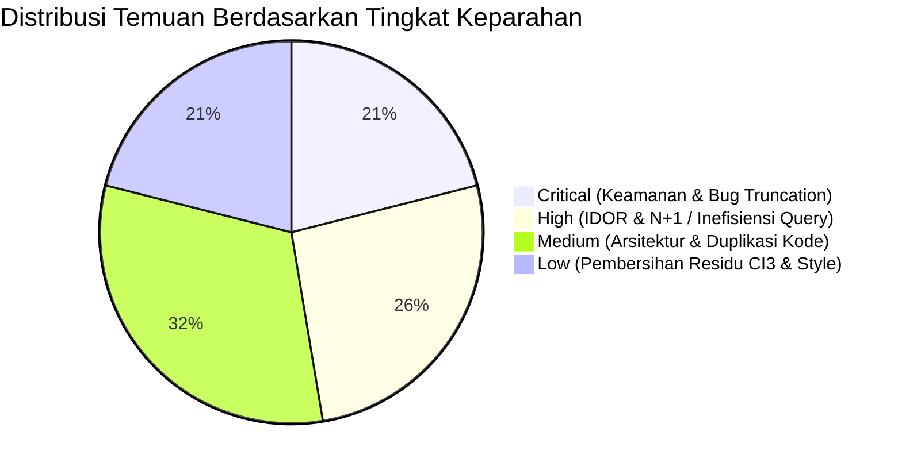

# LAPORAN AUDIT TEKNIS KODE, DATABASE, DAN QUERY
## SISTEM DDA ONLINE - BPS PROVINSI JAWA TENGAH
**Dokumen Hasil Pemeriksaan Kualitas Perangkat Lunak, Keamanan, & Kepatuhan Best Practice**

---

### 📋 Metadata Laporan Audit

| Parameter | Keterangan |
| :--- | :--- |
| **Aplikasi** | DDA Online (Jawa Tengah Dalam Angka) |
| **Framework** | CodeIgniter 4 (PHP 8.x) |
| **Database Engine** | MySQL / MariaDB (InnoDB, utf8mb4) |
| **Tanggal Audit** | 21 Oktober 2026 |
| **Fokus Audit** | Celah Keamanan (OWASP), Efisiensi Database & Query, Sintaks & Pola Desain (Clean Code/SOLID), serta Bug Fungsional |
| **Status Tindakan** | **HANYA LAPORAN (Tanpa Eksekusi Perubahan Kode)** |

---

## 🧭 Ringkasan Eksekutif (Executive Summary)

Pemeriksaan komprehensif dilakukan terhadap arsitektur backend, skema database, pengolahan query, pustaka (*libraries*), dan *views* pada repositori DDA Online. Sistem ini memiliki fondasi fitur tabel dinamis yang sangat kaya dan fungsional, namun ditemukan sejumlah **celah keamanan kritis**, **potensi bug pemotongan data (*data truncation*)**, serta **pelanggaran *best practice* arsitektur** yang membutuhkan perhatian sebelum rilis produksi skala besar.

### 📊 Rekapitulasi Temuan



| Tingkat Keparahan | Jumlah | Dampak Utama |
| :--- | :---: | :--- |
| 🔴 **CRITICAL** | **4** | Risiko kebocoran data, bypass otentikasi/CSRF, crash database akibat pemotongan teks satuan. |
| 🟠 **HIGH** | **5** | Manipulasi data antar-OPD (*IDOR*), query lambat akibat pembacaan seluruh baris ke memori. |
| 🟡 **MEDIUM** | **6** | Kesulitan *maintenance* akibat *God Controller* (5.600+ baris) dan duplikasi *view* 2.100+ baris. |
| 🟢 **LOW** | **4** | Sisa sintaks CI3 dan pustaka usang (*deprecated libraries*). |

---

## 🔍 TEMUAN RINCI PER KATEGORI

---

### KATEGORI 1: KEAMANAN & OTENTIKASI (SECURITY & OWASP)

#### 1.1. [CRITICAL] Proteksi CSRF (*Cross-Site Request Forgery*) Dinonaktifkan Secara Global
* **Lokasi Berkas:** [`app/Config/Filters.php:76`](file:///e:/BPS%20JATENG/DDA/dda-online-ci4-tabel-dinamis/app/Config/Filters.php#L76) & [`app/Config/Routes.php:9`](file:///e:/BPS%20JATENG/DDA/dda-online-ci4-tabel-dinamis/app/Config/Routes.php#L9)
* **Temuan Kode:**
  ```php
  // app/Config/Filters.php
  public array $globals = [
      'before' => [
          // 'csrf',  <-- DIKOMENTARI / DINONAKTIFKAN!
      ],
  ];
  // app/Config/Routes.php
  $routes->setAutoRoute(true);
  ```
* **Dampak Risiko:**  
  Karena CSRF dimatikan dan fitur `autoRoute` aktif, penyerang dapat membuat situs berbahaya yang mengeksekusi aksi POST/GET secara diam-diam menggunakan sesi login admin yang sedang aktif (misalnya: mereset tabel, mengubah password, atau menghapus master data).
* **Rekomendasi *Best Practice*:**
  - Aktifkan filter `'csrf'` di `$globals['before']`.
  - Kecualikan (*except*) hanya untuk webhook pihak ketiga jika ada.
  - Tambahkan helper `csrf_field()` pada seluruh form HTML dan sertakan `X-CSRF-TOKEN` pada AJAX request.

---

#### 1.2. [CRITICAL] Penggunaan Algoritma Hashing Usang (MD5) untuk Password Pengguna
* **Lokasi Berkas:** [`app/Controllers/Admin.php:356`](file:///e:/BPS%20JATENG/DDA/dda-online-ci4-tabel-dinamis/app/Controllers/Admin.php#L356)
* **Temuan Kode:**
  ```php
  $p = md5($this->input->post('p'));
  $q_cek = $this->db->query("SELECT * FROM t_admin WHERE username = ? AND password = ?", [$u, $p]);
  ```
* **Dampak Risiko:**  
  MD5 telah dinyatakan usang dan tidak aman (*cryptographically broken*). Password dengan MD5 sangat mudah dipecahkan dalam hitungan detik menggunakan *rainbow table* atau *brute-force GPU*. Jika database bocor, seluruh akun admin dan OPD dapat langsung diketahui kata sandinya.
* **Rekomendasi *Best Practice*:**
  - Ganti dengan fungsi standar PHP / CI4: `password_hash($p, PASSWORD_BCRYPT)` atau `PASSWORD_ARGON2ID`.
  - Verifikasi menggunakan `password_verify($inputPassword, $user->password)`.

---

#### 1.3. [HIGH] Celah Otorisasi / IDOR (*Insecure Direct Object Reference*) pada Unggah Excel & Simpan Catatan
* **Lokasi Berkas:** [`app/Controllers/Admin.php:5524`](file:///e:/BPS%20JATENG/DDA/dda-online-ci4-tabel-dinamis/app/Controllers/Admin.php#L5524) & [`Admin.php:5617`](file:///e:/BPS%20JATENG/DDA/dda-online-ci4-tabel-dinamis/app/Controllers/Admin.php#L5617)
* **Temuan Kode:**
  ```php
  public function upload_excel_dinamis() {
      // Hanya mengecek apakah sesi login valid
      if ($this->session->get('admin_valid') == FALSE ...) return redirect()->to("admin/login");

      $id_tahun_tabel = (int)$this->request->getPost('id_tahun_tabel');
      // LANGSUNG MEMPROSES EXCEL TANPA CEK:
      // Apakah user OPD login adalah pemilik instansi tabel ini?
  }
  ```
* **Dampak Risiko:**  
  Seorang pengguna dari satu OPD (misal: Dinas Perikanan) yang mengetahui ID tabel dinas lain (misal: Dinas Kesehatan) dapat mengirimkan POST request dengan berkas Excel dan secara sepihak menimpa (*overwrite*) data tabel milik dinas lain.
* **Rekomendasi *Best Practice*:**
  - Tambahkan validasi kepemilikan tabel:
    ```php
    if ($userLevel !== 'Admin' && $userLevel !== 'Super Admin') {
        $tabel = $this->db->table('t_tahun_tabel t')
            ->join('m_list_tabel m', 't.id_tabel = m.id')
            ->where('t.id', $id_tahun_tabel)
            ->get()->getRow();
        if (!$tabel || $tabel->id_unitkerja !== $userUnitKerja) {
            return $this->response->setStatusCode(403)->setJSON(['status' => 'error', 'message' => 'Akses ditolak']);
        }
    }
    ```

---

#### 1.4. [HIGH] Adanya Potensi SQL Injection dari Rangkaian String (*String Concatenation*)
* **Lokasi Berkas:** [`app/Controllers/Admin.php:397`](file:///e:/BPS%20JATENG/DDA/dda-online-ci4-tabel-dinamis/app/Controllers/Admin.php#L397), [`Admin.php:222`](file:///e:/BPS%20JATENG/DDA/dda-online-ci4-tabel-dinamis/app/Controllers/Admin.php#L222), [`Admin.php:598`](file:///e:/BPS%20JATENG/DDA/dda-online-ci4-tabel-dinamis/app/Controllers/Admin.php#L598)
* **Temuan Kode:**
  ```php
  // Baris 397:
  $query = $this->db->query("SELECT * FROM m_jeniskegiatan WHERE substring(id_jeniskegiatan,1,4)='$bidang'");
  
  // Baris 222:
  $a['data'] = $this->db->query("SELECT * FROM t_admin LIMIT $awal, $akhir ")->getResult();

  // Baris 637:
  $a['data'] = $this->db->query("SELECT * FROM m_unitkerja WHERE user_wali IN ($in_clause) ...", $team_codes);
  ```
* **Dampak Risiko:**  
  Meskipun mayoritas query baru sudah memakai binding parameter (`?`), masih tersisa query yang menempelkan variabel langsung ke SQL tanpa sanitasi atau *type casting* eksplisit.
* **Rekomendasi *Best Practice*:**
  - Gunakan query binding murni: `WHERE substring(id_jeniskegiatan,1,4) = ?` dengan parameter array `[$bidang]`.
  - Pastikan variabel pagination selalu di-*cast* ke integer: `LIMIT ?, ?` dengan parameter `[(int)$awal, (int)$akhir]`.

---

### KATEGORI 2: STRUKTUR DATABASE & EFISIENSI QUERY

#### 2.1. [RESOLVED] Pemotongan Data Teks (*Data Truncation Bug*) pada `t_nilai_dinamis.simbol`
* **Status:** ✅ **SELESAI (RESOLVED - 23 Oktober 2026)**
* **Lokasi Berkas:**
  - Database: Migrasi [`app/Database/Migrations/2026-10-22-100000_IncreaseSimbolLengthInNilaiDinamis.php`](file:///e:/BPS%20JATENG/DDA/dda-online-ci4-tabel-dinamis/app/Database/Migrations/2026-10-22-100000_IncreaseSimbolLengthInNilaiDinamis.php)
  - Parser Excel: [`app/Libraries/ExcelDataParser.php:727`](file:///e:/BPS%20JATENG/DDA/dda-online-ci4-tabel-dinamis/app/Libraries/ExcelDataParser.php#L727)
* **Tindakan Penyelesaian:**
  - Kolom `t_nilai_dinamis.simbol` telah diperluas dari `VARCHAR(10)` menjadi `VARCHAR(100)` melalui migrasi Batch 11.
  - Batasan fungsi sanitasi teks sel pada `ExcelDataParser.php` diperbarui dari `substr($str, 0, 10)` menjadi `mb_substr($str, 0, 100)` agar teks satuan/simbol panjang dari Excel tidak terpotong saat diimpor.

---

#### 2.2. [HIGH] Anti-Pattern Penghitungan Baris: `SELECT * FROM table ->getNumRows()`
* **Lokasi Berkas:** [`app/Controllers/Admin.php:155`](file:///e:/BPS%20JATENG/DDA/dda-online-ci4-tabel-dinamis/app/Controllers/Admin.php#L155), [`Admin.php:669`](file:///e:/BPS%20JATENG/DDA/dda-online-ci4-tabel-dinamis/app/Controllers/Admin.php#L669), [`Admin.php:1451`](file:///e:/BPS%20JATENG/DDA/dda-online-ci4-tabel-dinamis/app/Controllers/Admin.php#L1451)
* **Temuan Kode:**
  ```php
  $total_row = $this->db->query("SELECT * FROM m_unitkerja")->getNumRows();
  $total_row = $this->db->query("SELECT * FROM m_master_tabel_usulan")->getNumRows();
  ```
* **Dampak Performa:**  
  Query ini mengambil **seluruh baris dan seluruh kolom** dari tabel database ke memori RAM server PHP hanya untuk sekadar menghitung jumlah barisnya. Jika tabel memiliki ribuan data, ini akan menyebabkan *high memory usage* dan memperlambat waktu respon server (*server bottleneck*).
* **Rekomendasi *Best Practice*:**
  Ganti dengan query agregasi database ringan:
  ```php
  $total_row = (int)($this->db->table('m_unitkerja')->countAllResults());
  // atau
  $total_row = (int)($this->db->query("SELECT COUNT(*) AS total FROM m_unitkerja")->getRow()->total ?? 0);
  ```

---

#### 2.3. [RESOLVED] Kolom Usang / *Dead Column* yang Masih Tertinggal di Database
* **Status:** ✅ **SELESAI (RESOLVED - 23 Oktober 2026 - Fase 1 Cleanup)**
* **Lokasi Berkas:**
  - Migrasi Cleanup: [`app/Database/Migrations/2026-10-23-143000_DropUnusedPhase1DynamicColumns.php`](file:///e:/BPS%20JATENG/DDA/dda-online-ci4-tabel-dinamis/app/Database/Migrations/2026-10-23-143000_DropUnusedPhase1DynamicColumns.php)
  - Model: [`app/Models/M_tabeldinamis.php`](file:///e:/BPS%20JATENG/DDA/dda-online-ci4-tabel-dinamis/app/Models/M_tabeldinamis.php)
  - Controller: [`app/Controllers/Admin.php`](file:///e:/BPS%20JATENG/DDA/dda-online-ci4-tabel-dinamis/app/Controllers/Admin.php)
  - Views: [`f_generator_tabel.php`](file:///e:/BPS%20JATENG/DDA/dda-online-ci4-tabel-dinamis/app/Views/admin/f_generator_tabel.php), [`v_tabel_dinamis.php`](file:///e:/BPS%20JATENG/DDA/dda-online-ci4-tabel-dinamis/app/Views/admin/v_tabel_dinamis.php)
* **Tindakan Penyelesaian:**
  - Telah dihapus 6 kolom usang dari database dan kodingan:
    1. `m_indikator_tabel.format_nomor_baris`
    2. `m_indikator_tabel.satuan`
    3. `m_baris_kelompok.keterangan`
    4. `m_karakteristik_kelompok.keterangan`
    5. `m_periode_kelompok.keterangan`
    6. `m_baris_item.parent_id`
  - Seluruh referensi pada model `$allowedFields`, payload controller, dan input view tersembunyi telah dibersihkan secara tuntas.

---

#### 2.4. [MEDIUM] Ketiadaan *Foreign Key Constraints* dengan Aturan *Cascade Delete*
* **Lokasi:** Relasi antara `m_indikator_tabel` dengan `t_nilai_dinamis`, serta kamus item baris/kolom.
* **Kondisi:**
  Tabel `t_nilai_dinamis` menyimpan ribuan titik koordinat sel (`id_indikator`, `id_baris_item`, `id_karakteristik_item`, `id_periode_item`). Namun ketiadaan *Foreign Key* fisik di MySQL membuat potensi terjadinya **data yatim piatu (*orphaned records*)** jika data master dihapus melalui operasi SQL langsung di luar aplikasi.
* **Rekomendasi:**
  - Tambahkan integritas referensial atau pastikan seluruh operasi penghapusan selalu dibungkus *Database Transaction* (`transStart()` / `transComplete()`) yang membersihkan tabel anak.

---

### KATEGORI 3: ARSITEKTUR PERANGKAT LUNAK & CLEAN CODE (SOLID)

#### 3.1. [MEDIUM] Anti-Pattern "God Controller" pada `Admin.php` (5.637 Baris)
* **Lokasi Berkas:** [`app/Controllers/Admin.php`](file:///e:/BPS%20JATENG/DDA/dda-online-ci4-tabel-dinamis/app/Controllers/Admin.php)
* **Kondisi:**
  Satu berkas controller ini memiliki ukuran **233 KB** dengan **5.637 baris kode**, menangani puluhan tanggung jawab yang sama sekali berbeda:
  - Otentikasi dan ganti password
  - CRUD master instansi OPD dan pengguna
  - Generator tabel dinamis dan perakitan dimensi
  - Parser dan generator Excel
  - Ekstraksi PDF Python
  - Forum diskusi
  - Laporan rekapitulasi
* **Pelanggaran Prinsip:**  
  Melanggar *Single Responsibility Principle* (SRP). Controller yang terlalu masif sangat berisiko memicu *merge conflict* pada tim developer, sulit diuji (*untestable via unit tests*), dan menyulitkan pelacakan alur data.
* **Rekomendasi *Best Practice*:**
  Pecah controller menjadi controller modular berbasis domain:
  - `App\Controllers\Admin\AuthController`
  - `App\Controllers\Admin\TabelDinamisController`
  - `App\Controllers\Admin\MasterDimensiController`
  - `App\Controllers\Admin\ReportController`
  - `App\Controllers\Admin\ForumController`

---

#### 3.2. [MEDIUM] Pelanggaran Prinsip DRY (*Don't Repeat Yourself*) & "Fat View"
* **Lokasi Berkas:**  
  - [`app/Views/admin/v_tabel_dinamis.php`](file:///e:/BPS%20JATENG/DDA/dda-online-ci4-tabel-dinamis/app/Views/admin/v_tabel_dinamis.php) (2.122 baris)  
  - [`app/Views/frontend/v_tabel_dinamis.php`](file:///e:/BPS%20JATENG/DDA/dda-online-ci4-tabel-dinamis/app/Views/frontend/v_tabel_dinamis.php) (2.040 baris)
* **Kondisi:**
  Kedua file ini memiliki kesamaan kode lebih dari **90%** (duplikasi masif). Selain itu, di dalam file view terdapat logika komputasi matriks yang sangat berat (fungsi parsing level kolom, penentuan leaf columns, deteksi nomor baris regex, dsb.).
* **Dampak:**  
  Setiap kali ada perbaikan bug (seperti penomoran baris kemarin), pengembang harus mengedit dua file yang berukuran ribuan baris secara manual. Jika salah satu lupa diselaraskan, terjadi inkonsistensi antara tampilan Admin dan Frontend Publik.
* **Rekomendasi *Best Practice*:**
  - Pindahkan logika pemrosesan matriks dan hierarki baris/kolom ke dalam sebuah **Service / ViewComponent / Helper** (misalnya `TabelDinamisRendererService`).
  - Satukan file render tabel menjadi satu *partial view* yang dapat dipanggil ulang:
    `<?= view('common/parts/dynamic_table_render', $dataTabel); ?>`

---

#### 3.3. [LOW] Residu Pustaka Usang (*Deprecated Libraries*) & Sintaks CI3
* **Lokasi Berkas:**  
  - Pustaka `app/Libraries/PHPMailerAutoload.php` dan `class.phpmailer.php` (berasal dari tahun 2012, format PHP 5).
  - Panggilan `$this->input->post()` di beberapa baris `Admin.php` (sintaks CodeIgniter 3).
* **Rekomendasi:**
  - Hapus berkas PHPMailer legacy dan gunakan pustaka email bawaan CI4 (`Services::email()`) atau instal versi terbaru via Composer (`composer require phpmailer/phpmailer`).
  - Ganti seluruh `$this->input->post()` menjadi standar CI4 `$this->request->getPost()`.

---

### KATEGORI 4: BUG FUNGSIONAL & EDGE CASES

#### 4.1. [HIGH] Data Numerik Masuk ke Kolom Simbol Akibat Typo OCR dari PDF
* **Bukti di Database:**
  Pada pemeriksaan tabel 562, ditemukan rekaman:
  - `[simbol] => '193.6i78 .'` (huruf `i` menggantikan angka `1`)
  - `[simbol] => '130.1s68'` (huruf `s` menggantikan angka `5`)
  - `[simbol] => 'a236'` (huruf `a` menggantikan angka `2`)
* **Penyebab:**
  Saat proses impor data hasil ekstraksi PDF, jika string hasil OCR mengandung typo karakter alfabet, fungsi `is_numeric()` menganggap data tersebut bukan angka sehingga parser menyimpannya ke kolom `simbol` alih-alih `nilai`.
* **Dampak:**
  Di tampilan web angka ini tetap muncul, namun di sistem rekapitulasi atau rumus matematika, angka tersebut tidak bisa dijumlahkan (menghasilkan angka 0 pada grand total).
* **Rekomendasi:**
  - Tambahkan sanitasi cerdas pada parser impor PDF: jika pola teks dominan angka dengan 1 typo huruf yang mirip (seperti `i`/`l` $\rightarrow$ `1`, `s` $\rightarrow$ `5`, `O`/`o` $\rightarrow$ `0`), lakukan koreksi sebelum parsing atau berikan peringatan validasi kepada pengguna.

---

## 🗺️ MATRIKS RENCANA PERBAIKAN BERTAHAP (ACTIONABLE ROADMAP)

> **Catatan:** Sesuai permintaan Anda, seluruh poin perbaikan di bawah ini **TIDAK DIEKSEKUSI SEKARANG**, melainkan disusun sebagai panduan prioritas perbaikan tim:

| Fase | Prioritas | Butir Tindakan | Estimasi Dampak |
| :---: | :---: | :--- | :--- |
| **FASE 1**<br>*(Urgent / Hotfix)* | 🔴 Critical | 1. Perbesar kolom database `t_nilai_dinamis.simbol` menjadi `VARCHAR(100)` agar teks satuan tidak terpotong.<br>2. Validasi IDOR pada `upload_excel_dinamis` dan `simpan_catatan_tabel` (cek kepemilikan OPD).<br>3. Aktifkan proteksi CSRF di `Filters.php`. | Mengeliminasi celah manipulasi data dan mencegah crash pemotongan teks satuan. |
| **FASE 2**<br>*(Hardening)* | 🟠 High | 1. Migrasi hashing password dari MD5 ke `password_hash()` BCRYPT.<br>2. Ganti semua query `SELECT * FROM table ->getNumRows()` menjadi `SELECT COUNT(*)`.<br>3. Sanitasi query string concatenation yang masih tersisa di `Admin.php`. | Mengamankan kredensial akun dan mempercepat waktu muat server (*memory optimization*). |
| **FASE 3**<br>*(Refactoring)* | 🟡 Medium | 1. Pecah `v_tabel_dinamis.php` (Admin & Frontend) menjadi satu komponen terpusat (*partial component*).<br>2. Modularisasi `Admin.php` (5.600+ baris) ke dalam sub-controller domain.<br>3. Bersihkan library usang PHPMailer 2012 dan residu `$this->input->post`. | Meningkatkan keterbacaan kode (*clean code*), mudah di-maintain, dan mencegah duplikasi kerja saat ada perubahan fitur di masa depan. |

---

### 📌 Kesimpulan Audit

Secara keseluruhan, fitur **Tabel Dinamis** yang baru saja dibangun memiliki logika matriks multidimensi yang sangat kuat dan presisi sesuai format publikasi BPS. Namun, aspek **keamanan dasar (CSRF, IDOR, MD5)** dan **kapasitas tipe data (`simbol VARCHAR(10)`)** merupakan hal krusial yang sangat direkomendasikan untuk diperbaiki sebelum sistem diluncurkan secara resmi ke seluruh OPD Provinsi Jawa Tengah.
