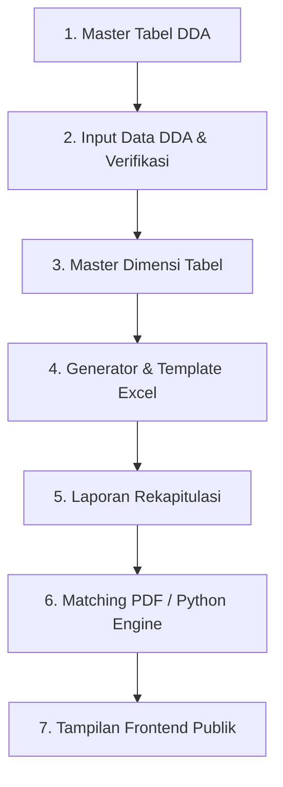

# Panduan Lengkap Pengujian & Verifikasi Fitur DDA Online
**Dokumentasi Quality Assurance (QA) Sistem Jawa Tengah Dalam Angka (DDA)**

Dokumen ini disusun sebagai panduan verifikasi fungsionalitas menyeluruh setelah integrasi fitur **Tabel Dinamis** ke dalam sistem DDA Online berbasis CodeIgniter 4.

---

## 📌 Ringkasan Pembaruan Terakhir (Bugfix & Hardening)

Sebelum pengujian dilakukan, dua potensi celah pada operasi Master Tabel telah diperbaiki:
1. **Pendaftaran Tabel Baru (`Admin::master_tabel/act_add`)**:
   - Nilai opsi radio `is_dynamic` kini ditangkap langsung dari form [f_master_tabel.php](file:///e:/BPS%20JATENG/DDA/dda-online-ci4-tabel-dinamis/app/Views/admin/f_master_tabel.php) dan disimpan ke database (`t_tahun_tabel.is_dynamic`).
   - Tabel baru berformat dinamis langsung dikenali sistem tanpa perlu diedit ulang.
2. **Duplikasi Tahun / Operasi Tahunan (`Admin::clone_tahunan`)**:
   - Kolom `is_dynamic` disertakan dalam proses kloning master tabel ke tahun tujuan.
   - Konfigurasi dimensi matriks pada tabel dinamis (`m_indikator_tabel`) otomatis diduplikasi ke `id_tahun_tabel` baru sehingga admin tidak perlu merakit ulang dimensi dari nol di tahun baru.
   - Nilai sel data (`t_nilai_dinamis`) tetap dikosongkan (fresh year) dan status `is_periksa` diset ke `0` (menunggu pengisian tahun baru).

---

## 📋 Langkah-Langkah Pengujian Modul Sistem

---

### 1. Modul Master Tabel DDA (`admin/master_tabel`)

| ID Test | Skenario Pengujian | Langkah Pengujian | Hasil yang Diharapkan |
| :--- | :--- | :--- | :--- |
| **MT-01** | Visualisasi Jenis Sumber Data | Buka halaman `admin/master_tabel`. Periksa kolom *SUMBER / LINK*. | • Tabel Dinamis menampilkan badge ungu gradient `TABEL DINAMIS` dengan tautan ke Generator. • Tabel Portal menampilkan badge biru soft `PORTAL DATA`. • Tabel Spreadsheet menampilkan badge hijau soft `SPREADSHEET`. |
| **MT-02** | Live Search (AJAX Debounce) | Ketik nama tabel dinamis di kotak pencarian kanan atas. Tunggu 450ms. | Baris tabel terfilter seketika tanpa reload halaman penuh. Badge ungu tetap muncul dengan benar. |
| **MT-03** | Filter Bidang, OPD, dan Tahun | Pilih dropdown Bidang / Tim atau Instansi OPD, lalu klik tombol **Filter**. | Data terfilter sesuai parameter. Sesi filter tersimpan. Tombol **Reset Filter** mengembalikan ke seluruh data. |
| **MT-04** | Tambah Tabel Baru (Dinamis) | Klik tombol **Tambah Data**, pilih format *Tabel Dinamis*, isi judul & OPD, lalu simpan. | Data berhasil ditambahkan dan baris baru di tabel master langsung berlabel ungu `TABEL DINAMIS`. |
| **MT-05** | Edit Detail Format Tabel | Klik menu dropdown baris `...` -> **Edit Detail**. Ubah format atau judul lalu simpan. | Perubahan judul dan format tersimpan ke database tanpa merusak ID master. |
| **MT-06** | Hapus Tabel (Safe Delete) | Klik menu dropdown baris `...` -> **Hapus Tabel**. Konfirmasi pada modal popup. | Entri tahunan terhapus. Jika master tabel sudah tidak dipakai di tahun lain, kamus master otomatis dibersihkan. |
| **MT-07** | Rapikan Urutan Nomor Tabel | Klik tombol dropdown **Pengelolaan Tahun** -> **Rapikan Urutan**. | Nomor urut tabel disusun ulang secara terstruktur (hierarki titik nomor) tanpa mengubah tipe data tabel. |
| **MT-08** | Duplikasi Tahun (Kloning) | Pilih **Duplikasi Tahun**, masukkan tahun sumber (misal: 2025) dan tujuan (misal: 2026). | Tabel dinamis terduplikasi dengan `is_dynamic = 1` dan konfigurasi dimensi ikut tersalin ke tahun baru. |

---

### 2. Modul Input Data DDA (`admin/dda`)

*Pengujian ini ditujukan untuk alur penyerahan data oleh OPD dan pengawasan oleh Admin BPS.*

| ID Test | Skenario Pengujian | Langkah Pengujian | Hasil yang Diharapkan |
| :--- | :--- | :--- | :--- |
| **ID-01** | Navigasi Judul Tabel Dinamis | Sebagai Admin BPS atau OPD, buka daftar tabel OPD (`admin/dda/view_tabel?id={id_opd}`). | Mengklik judul tabel dinamis langsung membuka halaman `admin/view_tabel_dinamis/{id}` (bukan link spreadsheet kosong). |
| **ID-02** | Tombol Pintas Dimensi | Periksa baris tabel dinamis di bawah judul (khusus akun BPS). | Terdapat tombol badge `Dimensi` yang langsung mengarah ke `admin/generator_tabel/{id}`. |
| **ID-03** | Status Belum Diisi | Periksa tabel dinamis yang belum memiliki nilai data sel. | Status berlabel `Belum Diisi` (badge merah soft). |
| **ID-04** | Status Sudah Diisi (Pasca Unggah Excel) | Unggah file template Excel terisi melalui review tabel dinamis. | Status otomatis berubah menjadi `Sudah Diisi` (badge hijau) dengan teks keterangan nama uploader dan timestamp. |
| **ID-05** | Catatan & Verifikasi Admin | Klik tombol **Catatan** atau **Periksa** pada baris tabel dinamis. Masukkan catatan validasi. | Modal catatan terbuka, catatan tersimpan dan dapat dibaca oleh OPD. |

---

### 3. Modul Master Dimensi Tabel (`admin/master_dimensi`)

*Pengujian ini ditujukan untuk memverifikasi manajemen kamus data baris, kolom, dan periode.*

| ID Test | Skenario Pengujian | Langkah Pengujian | Hasil yang Diharapkan |
| :--- | :--- | :--- | :--- |
| **MD-01** | Akses Tab Dimensi | Buka `admin/master_dimensi`. Berpindah antar tab: Karakteristik, Baris, Periode, Satuan. | Tab aktif berpindah mulus, daftar kelompok beserta jumlah item di dalamnya terhitung akurat. |
| **MD-02** | Deteksi Duplikasi Real-time | Buka modal **Tambah Kelompok Baru**, ketikkan nama kelompok yang telah ada. | Muncul notifikasi inline berwarna oranye/merah yang memberitahu bahwa nama kelompok sudah digunakan. |
| **MD-03** | Proteksi Hapus (Foreign Guard) | Cari kelompok baris atau karakteristik yang sedang dipakai oleh tabel dinamis aktif, lalu coba hapus. | Sistem menolak penghapusan dengan alert peringatan bahwa dimensi masih terikat pada tabel aktif. |
| **MD-04** | Tambah Item Asimetris | Tambah sub-item pada karakteristik (hierarki multi-level). | Struktur pohon sub-kolom tersimpan dan dapat dirender berjenjang. |

---

### 4. Modul Generator & Editor Tabel Dinamis (`admin/generator_tabel`)

| ID Test | Skenario Pengujian | Langkah Pengujian | Hasil yang Diharapkan |
| :--- | :--- | :--- | :--- |
| **GN-01** | Live Matrix Preview | Buka `admin/generator_tabel/{id}`. Ubah pilihan dropdown Kelompok Baris atau Karakteristik. | Matriks preview di bawah langsung memperbarui header kolom bertingkat dan baris secara real-time. |
| **GN-02** | Unduh Template Excel | Klik tombol **Download Template Excel**. Buka file `.xlsx` di Microsoft Excel / LibreOffice. | File terunduh rapi, sel judul dan label terproteksi (lock), sel input nilai terbuka (unlocked), dan sheet mapping tersembunyi. |
| **GN-03** | Impor Excel Dinamis | Unggah file Excel yang telah diisi angka pada halaman view tabel dinamis. | Data sel masuk ke tabel database `t_nilai_dinamis`, notifikasi jumlah sel berhasil terisi muncul. |
| **GN-04** | Tampilan Review Tabel Dinamis | Buka `admin/view_tabel_dinamis/{id}`. | Kolom judul baris kiri tebal (*bold*), pemisah ribuan rapi, dan filter periode dinamis responsif. |

---

### 5. Modul Laporan Rekapitulasi (`admin/report`)

| ID Test | Skenario Pengujian | Langkah Pengujian | Hasil yang Diharapkan |
| :--- | :--- | :--- | :--- |
| **RP-01** | Rekap Progres Instansi | Buka `admin/report` -> pilih rekap **Berdasarkan Instansi**. | Tabel dinamis terhitung ke dalam total tabel instansi terkait secara proporsional. |
| **RP-02** | Status Penghitungan Otomatis | Periksa OPD yang memiliki tabel dinamis (sudah diisi vs belum diisi). | • Jika belum ada data sel -> masuk kolom **Belum Diisi**. • Jika sudah diunggah tapi belum di-ACC -> masuk kolom **Menunggu Validasi**. • Jika sudah disetujui (`is_confirm = 1`) -> masuk kolom **Validasi**. |
| **RP-03** | Rekap Berdasarkan Tim | Ganti opsi ke **Berdasarkan Tim**. | Agregasi tim LO menampilkan progres kumulatif yang sesuai dengan pembagian unit kerja. |
| **RP-04** | Ekspor Excel Laporan Rekap | Klik tombol **Export Excel** pada halaman rekap. | File laporan terunduh dengan total angka dan persentase yang identik dengan tampilan web. |

---

### 6. Modul Matching PDF / Python Engine (`admin/matching_pdf`)

| ID Test | Skenario Pengujian | Langkah Pengujian | Hasil yang Diharapkan |
| :--- | :--- | :--- | :--- |
| **MP-01** | Ekspor JSON Database | Buka menu **Matching PDF (Python)**. Periksa pembuatan file sinkronisasi `dda_db_{ta}.json`. | Nomor dan judul tabel dinamis ikut terekspor ke file JSON tanpa error string. |
| **MP-02** | Pencocokan Publikasi DDA | Jalankan verifikasi pencocokan PDF publikasi DDA. | Engine Python membandingkan nomor dan teks judul tabel dinamis terhadap halaman PDF master DDA tanpa gagal akibat `link_tabel` kosong. |

---

### 7. Modul Frontend Publik (`home/search` & `home/view_dinamis`)

| ID Test | Skenario Pengujian | Langkah Pengujian | Hasil yang Diharapkan |
| :--- | :--- | :--- | :--- |
| **FE-01** | Eksplorasi & Pencarian Tabel | Buka portal publik di `localhost:8080/` -> lakukan pencarian kata kunci. | Kartu hasil pencarian untuk tabel dinamis menampilkan tautan langsung ke `home/view_dinamis/{id}`. |
| **FE-02** | Tampilan Tabel Publik | Buka halaman tabel dinamis publik. | Tampilan tabel modern, responsif pada layar laptop/ponsel, judul baris kiri tebal (*bold*), dan header kolom sejajar. |
| **FE-03** | Interaksi Filter Dinamis | Gunakan filter periode atau cari baris tertentu pada kotak pencarian cepat. | Baris tabel menyaring instan tanpa reload halaman. |
| **FE-04** | Unduh Data Publik | Klik tombol ekspor publik: **Excel (.xlsx)**, **CSV**, dan **PDF**. | File unduhan memuat data yang sesuai dengan filter yang aktif saat tombol ditekan. |

---

## 💡 Rekomendasi Alur Pengujian Mandiri

Untuk melakukan pengujian secara efisien tanpa mengganggu data riil:
1. **Gunakan Tahun Anggaran Uji Coba**: Pilih atau buat tahun data uji coba (misal: Tahun 2026).
2. **Buat 1 Tabel Dinamis Sampel**:
   - Daftarkan tabel uji coba di menu Master Tabel dengan format *Tabel Dinamis*.
   - Rangkai dimensinya menggunakan kombinasi kelompok yang sudah ada di *Generator Tabel*.
   - Unduh template Excel, isi beberapa angka, lalu unggah kembali.
3. **Amati Dampaknya**:
   - Periksa perubahan status di menu **Input Data DDA** (dari *Belum Diisi* menjadi *Sudah Diisi*).
   - Periksa persentase pada **Laporan Rekap**.
   - Buka halaman depan publik untuk memastikan tabel dapat dicari dan diunduh.

---
*Dokumen ini diperbarui secara otomatis seiring perkembangan kode repositori DDA Online.*
