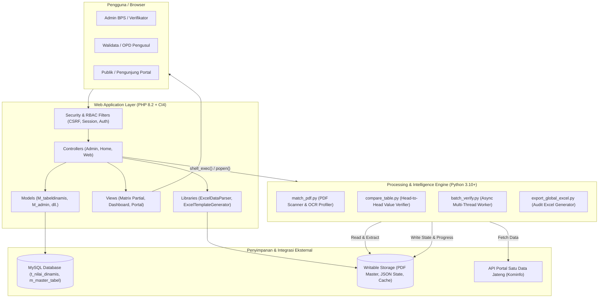

# DDA Online — BPS Provinsi Jawa Tengah

<p align="center">
  
  
  
  
  
  
</p>

---

## 📖 Tentang DDA Online

**DDA Online (Jawa Tengah Dalam Angka)** adalah sistem manajemen publikasi dan rekonsiliasi data statistik tahunan yang dikembangkan untuk **Badan Pusat Statistik (BPS) Provinsi Jawa Tengah**. Sistem ini dirancang untuk menyederhanakan, mengotomatiskan, dan mempercepat alur kerja pengumpulan, validasi, dan penyusunan tabel publikasi *Daerah Dalam Angka* (DDA) dari Organisasi Perangkat Daerah (OPD) dan instansi lintas sektor.

Dengan mengadopsi **arsitektur hybrid**, DDA Online mengintegrasikan aplikasi web berbasis **PHP CodeIgniter 4** dengan mesin analitik berbasis **Python** (`python_engine/`) yang mampu mengekstraksi dan mencocokkan dokumen buku publikasi PDF secara cerdas menggunakan algoritma NLP dan fuzzy matching.

---

## 🚀 Fitur Unggulan

### 1. 📊 Generator Tabel Dinamis (Dynamic Table Engine)
* **Hierarki Multidimensi**: Mendukung baris bertingkat (*nested rows*), sub-data, kolom bertingkat (*multi-level columns*), serta runtun waktu multi-tahun (*time series*).
* **Standarisasi Kaidah Statistik BPS**:
  * Nilai `0` (nihil) otomatis ditampilkan sebagai tanda strip / en-dash (`-`).
  * Nilai kosong / belum tersedia otomatis ditampilkan sebagai tiga titik (`...`).
  * Dukungan simbol statistik resmi: `NA` (tidak dapat ditampilkan), `*` (angka sementara), dan `e` (angka estimasi).
* **Live Excel Preview & Bulk Import**: Unggah berkas spreadsheet Excel dengan validasi token dua tahap (*preview* sebelum simpan permanen) serta generator template otomatis.

### 2. 🔗 Integrasi Portal Satu Data Jawa Tengah
* Sinkronisasi data otomatis dengan endpoint API **Open Data / Satu Data Kominfo Provinsi Jawa Tengah**.
* Ekstraksi otomatis UUID tabel dari tautan portal data.
* Deteksi status koneksi dan *live data fetching*.

### 3. 🤖 AI & NLP Matching Engine (Python)
* **Ekstraksi PDF Tingkat Lanjut**: Menggunakan `PyMuPDF` dan `pdfplumber` untuk membedah tabel dari buku publikasi PDF resmi DDA.
* **Fuzzy Matching Cerdas**: Memanfaatkan `RapidFuzz` dan algoritma Hungarian (`scipy.optimize.linear_sum_assignment`) untuk memetakan judul baris/kolom antara PDF dan database dengan toleransi variasi teks/typo.
* **Deteksi Diskrepansi Real-Time**: Membandingkan angka pada PDF dengan database secara presisi dengan ambang batas toleransi desimal, mendeteksi ketidaksesuaian secara visual (kuning/merah).
* **Pekerja Latar Belakang (*Background Batch Worker*)**: Verifikasi ratusan tabel sekaligus secara asinkron tanpa membebani thread server web.

### 4. 📈 Laporan Rekapitulasi & Monitoring Progres
* Dashboard visual progres pengumpulan data berdasarkan **Instansi (OPD)**, berdasarkan **Tim Kerja BPS**, serta **Progress Portal**.
* Tampilan tabel rekapitulasi yang responsif tanpa perlu scroll horizontal berlebih.
* Ekspor laporan audit validasi ke berkas Excel resmi.

### 5. 🛡️ Keamanan & Role-Based Access Control (RBAC)
* Proteksi sesi ganda dengan filter RBAC dinamis untuk berbagai level pengguna: Superadmin, Admin Pengusul, Walidata, dan Tim Verifikator BPS.
* Proteksi CSRF berbasis sesi (*session-based CSRF protection*).
* Audit jejak pengunggah dan riwayat perubahan data.

---

## 🏗️ Arsitektur Sistem



---

## 🛠️ Teknologi & Dependensi (Tech Stack)

| Komponen | Teknologi | Keterangan |
|---|---|---|
| **Bahasa Pemrograman** | PHP `>= 8.2` | Bahasa utama backend web |
| **Framework Web** | CodeIgniter `^4.7.0` | Arsitektur MVC ringan, cepat, dan terstruktur |
| **Pustaka Spreadsheet** | `phpoffice/phpspreadsheet ^5.10` | Pemrosesan berkas Excel (XLSX, XLS, CSV) |
| **Mesin Pencocokan PDF** | Python `>= 3.10` | Pemrosesan ekstraksi tabel dan verifikasi data |
| **Pustaka PDF Python** | `PyMuPDF >= 1.23.0`, `pdfplumber >= 0.10.0` | Pembacaan dan ekstraksi matriks dokumen PDF |
| **Pustaka Algoritma & AI** | `rapidfuzz >= 3.0.0`, `scipy >= 1.10.0`, `numpy >= 1.24.0` | Pencocokan string berbobot & Hungarian matching |
| **Database** | MySQL `8.0+` / MariaDB `10.5+` | Relasional database dengan tipe numerik presisi tinggi |
| **Frontend UI** | Bootstrap `5.3`, Bootstrap Icons, SweetAlert2 | Antarmuka responsif dan ramah pengguna |
| **Manipulasi Interaktif** | SortableJS, jQuery | Fitur drag-and-drop baris tabel bertingkat |

---

## 💻 Panduan Instalasi Lingkungan Lokal (Local Development)

Ikuti langkah-langkah berikut untuk menjalankan DDA Online di komputer pengembang:

### 1. Prasyarat Sistem
Pastikan perangkat Anda telah terpasang:
- **PHP** versi 8.2 atau lebih baru dengan ekstensi: `intl`, `mbstring`, `curl`, `json`, `mysqlnd`, `gd`, `openssl`.
- **Composer** (Dependency manager PHP).
- **Python** versi 3.10 atau lebih baru serta `pip`.
- **MySQL / MariaDB** Server (misal via XAMPP, Laragon, atau Docker).
- **Git**.

### 2. Kloning Repositori
```bash
git clone https://github.com/Maganghub-BPS/DDA-Online.git
cd DDA-Online
```

### 3. Konfigurasi Berkas Lingkungan (`.env`)
Salin file template lingkungan dan sesuaikan konfigurasinya:
```bash
cp env .env
```
Buka file `.env` dan sesuaikan pengaturan berikut:
```ini
CI_ENVIRONMENT = development

app.baseURL = 'http://localhost:8080/'

# Konfigurasi Database
database.default.hostname = localhost
database.default.database = dda_database
database.default.username = root
database.default.password = 
database.default.DBDriver = MySQLi
database.default.port = 3306

# Keamanan Enkripsi (Wajib generate 32 karakter unik)
encryption.key = hex2bin:fe891234abcd5678ef0123456789abcdef0123456789abcdef0123456789abcd
```

### 4. Instalasi Dependensi PHP
```bash
composer install
```

### 5. Penyiapan Lingkungan Python
Buat dan aktifkan virtual environment Python, lalu pasang dependensi:

**Untuk Windows (PowerShell / Command Prompt):**
```powershell
python -m venv venv
.\venv\Scripts\activate
pip install -r requirements.txt
```

**Untuk Linux / macOS:**
```bash
python3 -m venv venv
source venv/bin/activate
pip install -r requirements.txt
```

### 6. Impor Basis Data
1. Buat basis data baru di MySQL (misal bernama `dda_database`).
2. Impor berkas struktur skema basis data ke MySQL melalui phpMyAdmin, DBeaver, atau terminal CLI:
   ```bash
   mysql -u root -p dda_database < path/to/database_schema.sql
   ```

### 7. Menjalankan Server Lokal
Jalankan server pengembangan bawaan CodeIgniter:
```bash
php spark serve
```
Buka peramban (*browser*) Anda dan akses:
👉 **`http://localhost:8080`**

---

## 🌐 Panduan Deployment Lingkungan Produksi (Production Guide)

Agar sistem berjalan aman, stabil, dan berkinerja tinggi di server produksi, ikuti panduan *deployment hardening* berikut:

### 1. Pengaturan Web Server (VirtualHost / Server Block)
> [!IMPORTANT]
> **PENTING — KEAMANAN UTAMA**:
> Web server (Apache / Nginx) **WAJIB** mengarahkan `DocumentRoot` langsung ke subdirektori `/public`. Jangan pernah mengarahkan root domain ke folder utama aplikasi agar file sensitif (`.env`, `backup.sql`, `app/`, `writable/`) tidak dapat diunduh publik.

#### Contoh Konfigurasi Nginx (`/etc/nginx/sites-available/dda-online.conf`):
```nginx
server {
    listen 80;
    server_name dda.jatengprov.go.id;
    return 301 https://$host$request_uri;
}

server {
    listen 443 ssl http2;
    server_name dda.jatengprov.go.id;

    # SSL Certificate
    ssl_certificate /etc/letsencrypt/live/dda.jatengprov.go.id/fullchain.pem;
    ssl_certificate_key /etc/letsencrypt/live/dda.jatengprov.go.id/privkey.pem;

    # Root diarahkan WAJIB ke subfolder /public
    root /var/www/dda-online/public;
    index index.php index.html;

    client_max_body_size 50M;

    location / {
        try_files $uri $uri/ /index.php?$args;
    }

    location ~ \.php$ {
        include snippets/fastcgi-php.conf;
        fastcgi_pass unix:/run/php/php8.2-fpm.sock;
        fastcgi_param SCRIPT_FILENAME $document_root$fastcgi_script_name;
        include fastcgi_params;
        fastcgi_read_timeout 300;
    }

    # Blokir akses ke file tersembunyi
    location ~ /\. {
        deny all;
    }
}
```

#### Contoh Konfigurasi Apache VirtualHost:
```apache
<VirtualHost *:80>
    ServerName dda.jatengprov.go.id
    # Arahkan DocumentRoot ke /public
    DocumentRoot "/var/www/dda-online/public"

    <Directory "/var/www/dda-online/public">
        AllowOverride All
        Require all granted
    </Directory>

    ErrorLog ${APACHE_LOG_DIR}/dda_error.log
    CustomLog ${APACHE_LOG_DIR}/dda_access.log combined
</VirtualHost>
```

---

### 2. Pengaturan Izin Folder (*Permissions*)
Berikan izin tulis hanya pada direktori yang membutuhkan akses penyimpanan:
```bash
cd /var/www/dda-online

# Atur kepemilikan ke user web server (misal www-data)
sudo chown -R www-data:www-data writable/ public/upload/

# Atur permission yang aman
sudo chmod -R 775 writable/
sudo chmod -R 775 public/upload/
```

---

### 3. Konfigurasi Lingkungan Produksi (`.env`)
Pastikan berkas `.env` di server produksi disetel secara ketat:
```ini
# Wajib disetel ke production
CI_ENVIRONMENT = production

# URL resmi domain dengan HTTPS
app.baseURL = 'https://dda.jatengprov.go.id/'

# Kunci Enkripsi 32-karakter unik
encryption.key = hex2bin:isi_dengan_kunci_acak_rahasia_anda_sepanjang_64_hex

# Database Server Produksi
database.default.hostname = 127.0.0.1
database.default.database = dda_prod
database.default.username = dda_user
database.default.password = PasswordKuatRahasia123!
database.default.DBDriver = MySQLi
database.default.port = 3306
```

---

### 4. Konfigurasi Eksekusi Python di Server Linux
Di server Linux, pemanggilan latar belakang (*background job*) memerlukan ketersediaan runtime Python 3 dan penyesuaian fungsi eksekusi:
1. Pastikan fungsi PHP `shell_exec` dan `popen` tidak masuk ke dalam `disable_functions` pada file `/etc/php/8.2/fpm/php.ini`.
2. Pasang dependensi Python sistem:
   ```bash
   sudo apt update
   sudo apt install -y python3 python3-pip python3-venv
   pip3 install -r /var/www/dda-online/requirements.txt
   ```
3. Pastikan perintah `python` dapat memanggil Python 3:
   ```bash
   sudo update-alternatives --install /usr/bin/python python /usr/bin/python3 1
   ```

---

### 5. Pengamanan Tambahan (*Security Checklist*)
- [x] **Hapus File Cadangan Database**: Jangan pernah menyimpan file dump SQL (`*.sql`) di dalam folder web server.
- [x] **Enforce HTTPS**: Gunakan sertifikat SSL/TLS valid (misal: Let's Encrypt / Certbot).
- [x] **Nonaktifkan Display Errors**: Pada mode `production`, error PHP otomatis dicatat ke log `writable/logs/` dan tidak ditampilkan ke pengunjung.
- [x] **Batas Ukuran Upload**: Sesuaikan nilai `upload_max_filesize = 50M` dan `post_max_size = 50M` di `php.ini` agar unggahan dokumen PDF master buku DDA berjalan lancar.

---

## 📊 Kaidah Penulisan Nilai & Simbol Statistik BPS

Sistem DDA Online secara ketat mematuhi standar notasi publikasi statistik resmi Badan Pusat Statistik:

| Simbol / Tampilan | Makna Statistik | Nilai di Basis Data (`t_nilai_dinamis`) |
|:---:|---|---|
| **`-`** | **Nihil / Bernilai Nol ($0$)** | `nilai = 0.0000`, `simbol = '-'` atau `NULL` |
| **`...`** | **Data belum tersedia / belum diisi** | `nilai = NULL`, `simbol = NULL` atau `'...'` |
| **`NA`** | **Data tidak dapat ditampilkan (*Not Available*)** | `nilai = NULL`, `simbol = 'NA'` |
| **`*`** | **Angka sementara** (Contoh: `125*` atau `12,5*`) | `nilai = 125.0`, `simbol = '*'` |
| **`e`** | **Angka estimasi / perkiraan** (Contoh: `450e`) | `nilai = 450.0`, `simbol = 'e'` |

> [!NOTE]
> Format numerik di database selalu dipertahankan sebagai tipe data numerik `DECIMAL(20,4)` agar fungsi agregasi (`SUM`, `AVG`), total vertikal/horizontal, serta grafik visualisasi tidak mengalami galat tipe data.

---

## 📁 Struktur Direktori Proyek

```text
dda-online-ci4-tabel-dinamis/
├── app/
│   ├── Commands/               # Perintah CLI Spark kustom
│   ├── Config/                 # Konfigurasi aplikasi, filter, rbac, & security
│   ├── Controllers/            # Controller MVC (Admin, Home, Auth)
│   ├── Filters/                # HTTP Request Filters (RbacFilter, CSRF)
│   ├── Helpers/                # Helper kustom (my_helper: formatDynamicCellValue)
│   ├── Libraries/              # Pustaka (ExcelDataParser, ExcelTemplateGenerator, RBAC)
│   ├── Models/                 # Model database (M_tabeldinamis, M_admin, M_web)
│   └── Views/                  # Template tampilan antarmuka (Admin, Frontend, Parts)
├── public/                     # DOCUMENT ROOT PUBLIK (Web Accessible)
│   ├── .htaccess               # Konfigurasi rewrite Apache
│   ├── index.php               # Front Controller aplikasi
│   ├── assets/                 # Aset statis CSS, JS, Vendor, Gambar
│   └── upload/                 # Direktori berkas unggahan publik (logo, surat)
├── python_engine/              # MESIN CERDAS EKSTRAKSI & PENCOCOKAN PDF
│   ├── auto_config_pdf.py      # Otomatisasi konfigurasi pemetaan tabel PDF
│   ├── batch_verify.py         # Pekerja batch verifikasi asinkron
│   ├── compare_table.py        # Komparasi nilai data head-to-head (PDF vs DB)
│   ├── export_excel.py         # Generator laporan perbandingan lembar kerja Excel
│   ├── export_global_excel.py  # Generator rekapitulasi audit global
│   ├── match_pdf.py            # Pencocokan judul tabel PDF dengan database
│   ├── normalizer.py           # Pembersihan watermark & normalisasi teks statistik
│   ├── pdf_extractor.py        # Modul pembaca tabel berstruktur dari dokumen PDF
│   └── table_profiler.py       # Profiling struktur baris & kolom tabel
├── writable/                   # DIREKTORI TULIS PRIVATE (Non-Accessible via URL)
│   ├── cache/                  # File cache halaman dan query
│   ├── logs/                   # Log pencatatan error aplikasi harian
│   ├── session/                # Sesi penyimpanan login pengguna
│   └── uploads/                # Berkas sensitif (PDF Master DDA, State JSON)
├── .env                        # Konfigurasi environment (diabaikan dari Git)
├── composer.json               # Dependensi paket PHP
├── requirements.txt            # Dependensi paket Python
└── README.md                   # Dokumentasi utama sistem
```

---

## ❓ FAQ & Pemecahan Masalah (Troubleshooting)

<details>
<summary><b>1. Error: "Gagal mengeksekusi script Python" saat proses verifikasi PDF</b></summary>

* **Penyebab**: Perintah `python` tidak ditemukan di PATH sistem server atau fungsi `shell_exec()` dinonaktifkan di `php.ini`.
* **Solusi**:
  1. Periksa `php.ini` pada bagian `disable_functions` dan pastikan `shell_exec` serta `popen` tidak tercantum.
  2. Buka terminal dan pastikan `python --version` atau `python3 --version` merespons dengan benar.
  3. Pastikan dependensi di `requirements.txt` sudah terpasang di environment Python server.
</details>

<details>
<summary><b>2. Halaman tampil error 403 atau "The action you requested is not allowed" saat submit form</b></summary>

* **Penyebab**: Token CSRF kedaluwarsa (*mismatch*).
* **Solusi**: Pastikan form menyertakan `<?= csrf_field(); ?>` dan pada permintaan AJAX sertakan header `X-CSRF-TOKEN: <?= csrf_hash(); ?>`.
</details>

<details>
<summary><b>3. Tampilan asset CSS/JS tidak termuat atau broken link setelah deploy</b></summary>

* **Penyebab**: Nilai `app.baseURL` pada berkas `.env` masih mengarah ke `http://localhost:8080/`.
* **Solusi**: Ubah `app.baseURL` di `.env` menjadi domain lengkap server Anda, misalnya `https://dda.jatengprov.go.id/`.
</details>

---

## 👥 Tim Pengembang & Kontributor

Sistem DDA Online dikembangkan oleh:
* **Tim BPS Provinsi Jawa Tengah** — Bidang Integrasi Pengolahan dan Diseminasi Statistik (IPDS).
* **Tim Pengembang & Maganghub BPS** — Kontributor fitur Tabel Dinamis, Portal Satu Data, dan Python Matching Engine.

---

## 📄 Lisensi

Aplikasi ini dikembangkan untuk kepentingan kedinasan dan operasional internal **Badan Pusat Statistik (BPS) Provinsi Jawa Tengah**. Seluruh hak cipta kode dan data dilindungi oleh ketentuan instansi yang bersangkutan.
