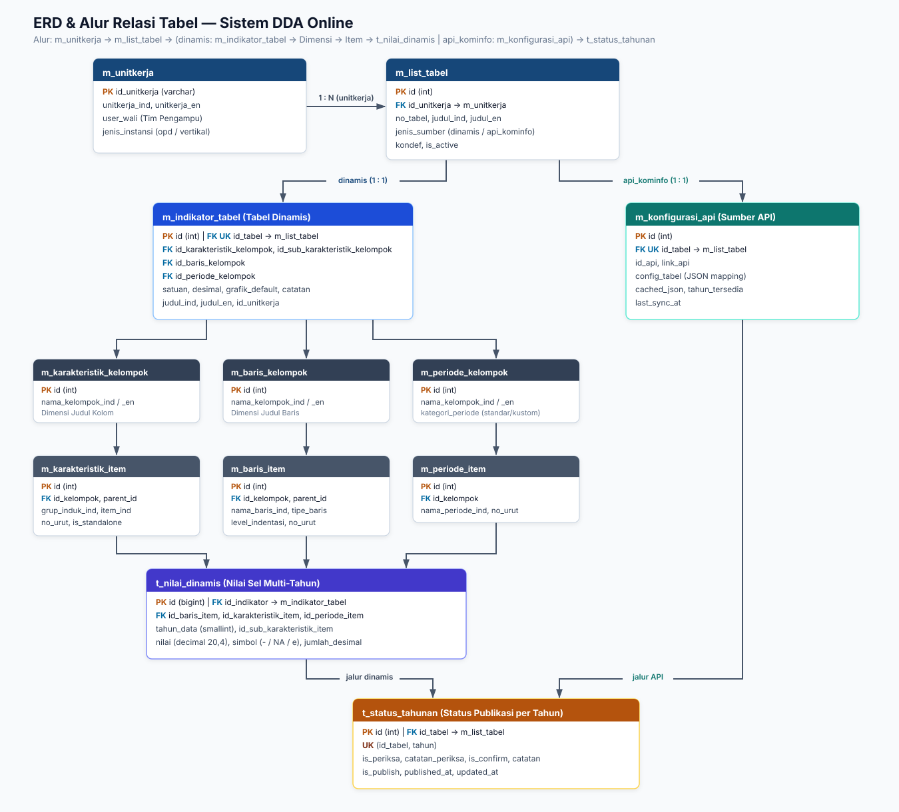
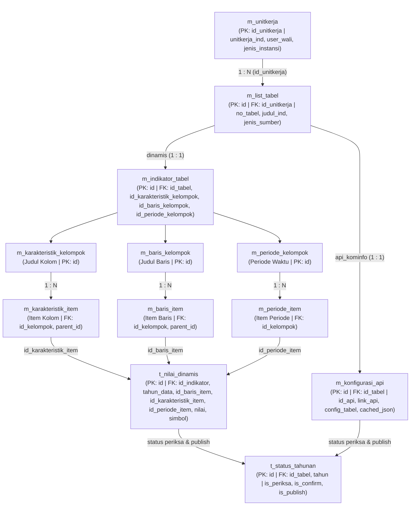

# Diagram Relasi & Alur Tabel — Sistem DDA Online

Tata letak diagram mengalir **dari atas ke bawah**, kecuali `m_unitkerja` yang mengarah ke kanan ke `m_list_tabel`. Node yang setara (`m_indikator_tabel` & `m_konfigurasi_api`, ketiga kelompok dimensi, serta ketiga item dimensi) sejajar secara horizontal pada levelnya masing-masing.

> [!NOTE]
> Secara skema fisik database, `t_status_tahunan` berelasi ke `m_list_tabel` melalui `id_tabel` dengan kunci unik `(id_tabel, tahun)`. Panah dari `t_nilai_dinamis` dan `m_konfigurasi_api` ke `t_status_tahunan` menunjukkan alur proses bahwa kedua jalur sumber data tersebut bermuara pada status periksa, konfirmasi, dan publikasi tahunan.
