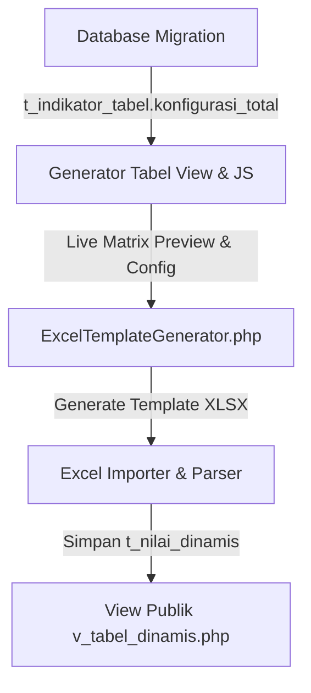

# Rencana Implementasi: Fitur Baris Total Runtun Waktu (Time-Series Multi-Year Total)
**Sistem Tabel Dinamis DDA Online BPS Provinsi Jawa Tengah**

---

## 1. Latar Belakang & Identifikasi Kasus (Problem Statement)

Dalam publikasi resmi BPS (*Provinsi Jawa Tengah Dalam Angka* maupun publikasi sektoral tematik), terdapat pola penyajian tabel khusus yang menggabungkan:
1. **Data Spasial/Sektoral Tahun Berjalan:** Rincian baris unit wilayah/KPH/komoditas hanya disajikan untuk **1 periode tahun aktif** (misalnya tahun 2025).
2. **Baris Total Runtun Waktu (*Multi-Year Time Series Benchmark*):** Pada bagian bawah tabel, baris `Jumlah / Total` disajikan bersusun vertikal mencakup beberapa tahun historis pembanding (misalnya 5 tahun terakhir: 2021, 2022, 2023, 2024, 2025).

Contoh kasus nyata:
- **Tabel Objek Wisata Alam / Wana Wisata Perhutani:**
  - Baris rincian: 22 KPH di Jawa Tengah (Balapulang, Blora, Banyumas Barat, dsb.) untuk tahun 2025.
  - Kolom karakteristik: *Pengunjung (orang)* dan *Pendapatan (ribu rupiah)*.
  - Baris total: `Jumlah / Total` dengan *rowspan* 5 baris, menampilkan angka total tahun 2025, 2024, 2023, 2022, dan 2021.

---

## 2. Konsep Arsitektur Data (*Data Cube Model*)

### Tantangan Arsitektur Standar
Pada mesin *Data Cube* OLAP standar (Baris × Kolom × Periode):
- Jika periode dipilih 5 tahun (2021–2025), tabel standar akan menduplikasi 22 baris wilayah sebanyak 5 kali (atau kolomnya beranak 5 tahun).
- Jika periode hanya dipilih 1 tahun (2025), maka total historis 2021–2024 tidak memiliki wadah penyimpanan nilai di database.

### Solusi Opsi 2 (Perlakuan Khusus Dimensi Periode)
Menerapkan aturan pemodelan:
> **"Dimensi Periode Waktu hanya diaplikasikan pada Baris Total, sedangkan baris rincian unit wilayah dibatasi hanya pada periode tahun aktif publikasi (tahun berjalan)."**

```
Data Cube Mapping:
┌─────────────────────────┬──────────────────────────┬──────────────────────┬─────────────┐
│ Baris                   │ Karakteristik Kolom      │ Periode Waktu        │ Target Nilai│
├─────────────────────────┼──────────────────────────┼──────────────────────┼─────────────┤
│ KPH 1..22 (Rincian)     │ Pengunjung & Pendapatan  │ 2025 (Tahun Berjalan)│ Data Sel    │
│ Baris Total             │ Pengunjung & Pendapatan  │ 2025                 │ Total 2025  │
│ Baris Total             │ Pengunjung & Pendapatan  │ 2024                 │ Total 2024  │
│ Baris Total             │ Pengunjung & Pendapatan  │ 2023                 │ Total 2023  │
│ Baris Total             │ Pengunjung & Pendapatan  │ 2022                 │ Total 2022  │
│ Baris Total             │ Pengunjung & Pendapatan  │ 2021                 │ Total 2021  │
└─────────────────────────┴──────────────────────────┴──────────────────────┴─────────────┘
```

> [!NOTE]
> **Keunggulan Skema Ini:** Tabel nilai `t_nilai_dinamis` **TIDAK PERLU DIUBAH STRUKTURNYA** sama sekali, karena relasi `(id_indikator, id_baris_item, id_karakteristik_item, id_periode_item)` sudah unik dan valid secara database relasional.

---

## 3. Komponen yang Terdampak & Detail Modifikasi



### A. Database (Migration CI4)
- **File:** `app/Database/Migrations/`
- **Tabel:** `t_indikator_tabel`
- **Perubahan:**
  - Menambahkan nilai opsi baru pada kolom `konfigurasi_total`:
    - `default` : Sesuai Master
    - `jawa_tengah` : Label Jawa Tengah
    - `jumlah` : Label Jumlah
    - `none` : Tanpa Total (Disembunyikan)
    - `kustom` : Label Kustom Bebas
    - **`runtun_waktu`** : Total Multi-Tahun (*Time-Series Total*)
  - *(Opsional)* Kolom `id_periode_aktif_rincian` (INT, nullable) untuk menentukan periode mana yang menjadi acuan baris rincian jika tabel memiliki banyak periode (default: mengambil tahun dari `t_tahun_tabel.tahun`).

### B. Generator Form & Live Matrix Engine
- **File:** `app/Views/admin/f_generator_tabel.php`
- **Perubahan:**
  1. **UI Dropdown Baris Total:**
     - Menambahkan opsi menu: `Runtun Waktu (Multi-Tahun)`.
  2. **Mesin Kalkulasi JavaScript (`renderMatrix`):**
     - Jika `konfigurasi_total === 'runtun_waktu'`:
       - Kolom data (*leaf columns*) tidak dikalikan dengan jumlah periode (hanya sejumlah karakteristik kolom, misal 2 kolom).
       - Baris rincian (1..N) hanya dirender 1 baris per unit untuk periode aktif.
       - Baris total dirender bersusun sebanyak daftar periode yang terpilih:
         - Sel Kolom A: `Jumlah / Total` dengan atribut `rowspan="N"` (misal 5).
         - Sel Kolom B: teks tahun (`2025`, `2024`, `2023`, `2022`, `2021`).
         - Sel Kolom Data: sel placeholder strip `–` dengan latar oranye BPS pekat (`#FFF5ED` / border `#FF6D1F`).

### C. Generator Template Excel
- **File:** `app/Libraries/ExcelTemplateGenerator.php`
- **Perubahan:**
  1. **Grid Layout Excel:**
     - Kolom data header hanya mencetak karakteristik kolom (2 kolom).
     - Baris data unit dicetak normal (baris 1 s.d. 22).
     - Baris total dicetak sebanyak $N$ tahun:
       - Kolom 1 di-merge vertikal: `$sheet->mergeCells("A{start}:A{end}")` bernilai `Jumlah / Total`.
       - Kolom 2 diisi nama tahun pembanding (`2025`, `2024`, dst.).
       - Kolom 3 & 4 diformat sebagai sel angka berlatar oranye BPS (`F28C38` / `FFEAD5`).
  2. **Metadata Sel Tersembunyi (*Embedded Cell Coordinates*):**
     - Pada metadata generator (`_meta_cells`), sel total masing-masing tahun dicatat dengan `id_periode` yang sesuai:
       - Baris Total 2025 -> `id_periode = 2025`
       - Baris Total 2024 -> `id_periode = 2024`
       - Baris Total 2023 -> `id_periode = 2023`
       - Baris Total 2022 -> `id_periode = 2022`
       - Baris Total 2021 -> `id_periode = 2021`

### D. Importer Data Excel
- **File:** `app/Controllers/Admin.php` & `app/Models/M_tabeldinamis.php`
- **Perubahan:**
  - Parser impor membaca file Excel terisi:
    - Sel 22 unit wilayah otomatis dipetakan ke tahun berjalan (2025).
    - Sel 5 baris total otomatis dipetakan dan disimpan ke tahun masing-masing di tabel `t_nilai_dinamis`.

### E. Portal Publikasi Web Frontend
- **File:** `app/Views/admin/v_tabel_dinamis.php` & modul portal publik.
- **Perubahan:**
  - Merender tabel publik dengan struktur yang sama persis: rincian unit di atas dan blok total runtun waktu di bawah.

---

## 4. Alur Kerja Pengguna (*User Flow*)

```
[1. Pilih Dimensi]
   ├── Judul Baris        : KPH Wana Wisata (22 Unit)
   ├── Karakteristik Kolom : Pengunjung & Pendapatan
   └── Periode Waktu      : 5 Tahun (2021, 2022, 2023, 2024, 2025)
           │
           ▼
[2. Ribbon Pengaturan Matriks]
   └── Baris Total -> Pilih "Runtun Waktu (Multi-Tahun)"
           │
           ▼
[3. Live Matrix Preview]
   ├── 22 Baris Unit Wilayah (Tahun 2025)
   └── 5 Baris Bersusun "Jumlah / Total" (2025..2021)
           │
           ▼
[4. Simpan Matriks & Unduh Template Excel]
   └── ExcelTemplateGenerator menyusun XLSX berstandar BPS
           │
           ▼
[5. Pengisian Data oleh Operator/Dinas]
   ├── Mengisi sel 22 unit wilayah untuk tahun 2025
   └── Mengisi 5 baris total runtun waktu (2021 s.d. 2025)
           │
           ▼
[6. Upload Excel ke Sistem]
   └── Importer menyimpan nilai ke t_nilai_dinamis secara presisi
           │
           ▼
[7. Tayang di Portal Publik & Buku DDA]
```

---

## 5. Visualisasi Mockup Tampilan Tabel

```
┌────────────────────────────────┬──────────────────────┬────────────────────────────┐
│ Kabupaten/Kota                 │  Pengunjung (orang)  │  Pendapatan (ribu rupiah)  │
│ Regency/Municipality           │     Guest (person)   │  Revenue (thousand rupiahs)│
│              (1)               │         (2)          │            (3)             │
├────────────────────────────────┼──────────────────────┼────────────────────────────┤
│ Hutan Wisata                   │                      │                            │
│   1. Balapulang                │               32.751 │                    197.517 │
│   2. Blora                     │              311.444 │                  7.503.663 │
│   ...                          │                  ... │                        ... │
│   22. KBM WBU                  │                    – │                          – │
├────────────────────────┬───────┼──────────────────────┼────────────────────────────┤
│                        │ 2025  │            2.427.479 │                 49.354.839 │
│                        │ 2024  │            3.391.641 │                 62.814.367 │
│ Jumlah / Total         │ 2023  │            2.815.636 │                 55.372.677 │
│                        │ 2022  │            3.488.393 │                 73.232.365 │
│                        │ 2021  │            3.339.945 │                 53.595.105 │
└────────────────────────┴───────┴──────────────────────┴────────────────────────────┘
```

---

## 6. Tahapan Eksekusi Bertahap (Roadmap)

| Tahap | Aktivitas | File Utama |
| :---: | :--- | :--- |
| **Fase 1** | Migrasi database penambahan opsi `runtun_waktu` pada konfigurasi total | `app/Database/Migrations/` |
| **Fase 2** | Penambahan opsi pada UI dropdown & render matrix JavaScript | `app/Views/admin/f_generator_tabel.php` |
| **Fase 3** | Penyesuaian layout template Excel & metadata sel | `app/Libraries/ExcelTemplateGenerator.php` |
| **Fase 4** | Penyesuaian parser upload Excel & validasi penyimpanan | `app/Models/M_tabeldinamis.php`, `Admin.php` |
| **Fase 5** | Penyesuaian view publik web & pengujian integrasi penuh | `app/Views/admin/v_tabel_dinamis.php` |

---

*Dokumen ini disusun sebagai panduan teknis implementasi pengembangan lanjutan modul Generator Tabel Dinamis DDA Online BPS Provinsi Jawa Tengah.*
