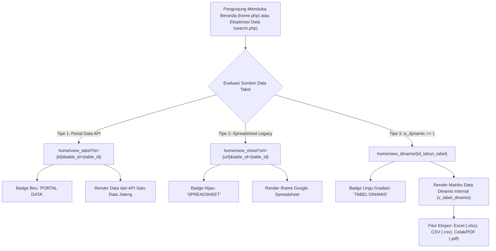

# Rencana Implementasi: Frontend Publik Tabel Dinamis (Tanpa Visualisasi Grafik)

Dokumen ini merinci rancangan teknis dan rencana eksekusi untuk menyajikan **Tabel Dinamis Internal (*Data Cube Engine*)** ke halaman publik portal DDA Online Provinsi Jawa Tengah, sebagai kelanjutan dari Sprint 1 hingga Sprint 5.

Sesuai arahan teknis, modul **Visualisasi Grafik (*Bar, Line, Pie*) ditiadakan pada tahap ini** untuk memprioritaskan performa rendering instan, ketepatan penyajian matriks data tabel bertingkat tinggi (hingga 5 tingkat kolom dan multi-level baris), serta kemudahan unduh data (*Excel, CSV, PDF*) bagi masyarakat dan periset.

---

## 1. Arsitektur Alur Pengguna Publik (*User Flow*)

Sistem DDA Online menyajikan 3 tipe sumber data secara harmonis pada portal publik:



---

## 2. Perubahan pada Data Model & Query (`App\Models\M_frontend.php`)

### Status Saat Ini:
Fungsi `getBaseTableSelect()` pada `M_frontend.php` belum menyertakan kolom `t.is_dynamic`, sehingga di halaman pencarian (`search.php`) dan beranda (`home.php`), tabel dinamis keliru teridentifikasi sebagai spreadsheet (`$is_sheet`).

### Perubahan yang Direncanakan:
1. **Tambahkan `t.is_dynamic` pada `getBaseTableSelect()`**:
   ```sql
   t.id,
   t.id_tabel,
   t.tahun,
   t.no_tabel,
   t.periode_id,
   t.periode_en,
   t.link_tabel,
   t.link_sebelumnya,
   t.config_tabel,
   t.is_confirm,
   t.is_publish,
   t.is_dynamic, -- Menentukan apakah tabel adalah Tabel Dinamis Internal
   m.id_unitkerja,
   m.kondef,
   ...
   ```
2. **Kueri Metadata Tabel Dinamis**:
   Memastikan metode pencarian dan pengambilan detail tabel mengenali status tabel dinamis beserta relasi indikatornya (`m_indikator_tabel`).

---

## 3. Spesifikasi Endpoint Controller (`App\Controllers\Home.php`)

Membuat method publik baru:
```php
public function view_dinamis($table_id = null)
```

### Alur Kerja Controller:
1. **Validasi Parameter & Akses Keamanan**:
   - Parameter `$table_id` mewakili `t_tahun_tabel.id`.
   - Mengambil metadata tabel tahunan (`t_tahun_tabel`), master tabel (`m_list_tabel`), dan produsen data (`m_unitkerja`).
   - **Proteksi Publikasi (*Publish Gate*)**:
     Jika `t.is_publish != 1` dan pengunjung bukan admin yang sedang login (`session()->get('admin_valid')`), sistem me-redirect ke `/home/search` dengan pesan peringatan: *"Tabel data belum dipublikasikan untuk umum."*
2. **Pengambilan Konfigurasi Indikator & Dimensi**:
   - Memanggil `M_tabeldinamis` untuk mengambil rekaman `m_indikator_tabel`.
   - Mengambil struktur kolom via `buildColumnStructure($itemsKolom)` (mendukung hirarki 1 hingga 5 tingkat).
   - Mengambil data baris hierarki (`itemsBaris`) beserta `kelompokBaris` (judul sub baris, format 1 kolom atau 2 kolom).
   - Mengambil periode waktu (`itemsPeriode`).
3. **Penyusunan Matriks Nilai Sel**:
   - Mengambil data dari `t_nilai_dinamis` berdasarkan `id_indikator`.
   - Memetakan ke dalam array associative `$nilaiMap[$id_baris . '_' . $id_kolom . '_' . $id_periode] = $nilai;` untuk akses sel instan berkecepatan $O(1)$.
4. **Passing Data ke View**:
   - Merender view dengan template induk publik `frontend/layout.php` dan sub-view `frontend/v_tabel_dinamis`.

---

## 4. Tampilan Halaman Publik (`App\Views\frontend\v_tabel_dinamis.php`)

Tampilan publik mengadopsi standar visual fisik buku publikasi BPS *Provinsi Jawa Tengah Dalam Angka*:

### Komponen Halaman:
1. **Header & Breadcrumb Navigasi Modern**:
   - Breadcrumb: `Beranda > Eksplorasi Data > [Tabel X.X.X Nama Tabel]`.
   - Tombol Salin Tautan (*Copy Shareable Link*) dengan feedback tooltip.
2. **Kop Tabel Resmi DDA**:
   - **Kotak Nomor Tabel**: Blok abu-abu/navy khas BPS bertuliskan `Tabel / Table` dan nomor tabel (misal: `1.1.5`).
   - **Judul Dwibahasa**:
     - Judul Bahasa Indonesia (huruf tebal/bold di atas).
     - Judul Bahasa Inggris (*italic/miring* di bawahnya).
   - **Metadata Tambahan**:
     - Instansi / Produsen Data (e.g. *Dinas Pertanian dan Perkebunan Provinsi Jawa Tengah*).
     - Satuan Data (*Unit*): e.g. *Hektar (Ha), Ton, Jiwa, Persen (%)*.
3. **Toolbar Aksi Pengunjung (Dropdown "Unduh Data")**:
   - 📥 **Format Excel (.xlsx)**: Unduh dokumen spreadsheet lengkap dengan format merge bertingkat dan sel terisi.
   - 📄 **Format CSV (.csv)**: Unduh data tabular mentah (*raw tabular matrix*) ramah analitik.
   - 🖨️ **Cetak / Format PDF (.pdf)**: Cetak langsung tata letak buku BPS menggunakan print stylesheet presisi.
4. **Matriks Data Responsif (*Data Grid*)**:
   - **Sticky Header**: Seluruh baris header kolom (hingga 5 tingkat) tetap menempel di atas saat menggulir tabel ke bawah.
   - **Frozen Columns**: Kolom Nomor dan Kolom Baris/Wilayah terkunci di sebelah kiri saat tabel digeser ke kanan.
   - **Styling Baris Sesuai Peran**:
     - *Baris Kategori (Level 0 Induk)*: Teks tebal, latar belakang abu-abu lembut.
     - *Baris Data (Level 1 & 2)*: Teks normal dengan indentasi visual hierarki.
     - *Baris 2 Kolom*: Kolom 1 untuk Induk (rowspan dinamis), Kolom 2 untuk Rincian Anak.
     - *Baris Subtotal*: Warna latar peach cerah (`#f9a066`) dengan teks tebal dan border putih.
     - *Baris Grand Total*: Garis bawah ganda (*double bottom border*) standar akuntansi statistik BPS.
   - **Format Angka**:
     - Rata kanan (*right-aligned*).
     - Pemisah ribuan titik (`.`) dan desimal koma (`,`) sesuai jumlah digit desimal yang dikonfigurasi.
     - Menampilkan simbol resmi BPS jika ada (`-`, `NA`, `e`).
5. **Catatan Kaki & Sumber Data Resmi**:
   - **Konsep & Definisi (Kondef)**: Penjelasan metodologi jika tersedia.
   - **Catatan Kaki (*Footnotes*)**: Keterangan khusus tabel.
   - **Sumber Data (*Source*)**: Produsen data resmi instansi penanggung jawab.

---

## 5. Integrasi Tautan & Badge di Beranda dan Pencarian

### A. Pada File `app/Views/frontend/search.php` & `app/Views/frontend/home.php`:
Mengubah penentuan tautan tabel dari:
```php
// SEBELUMNYA:
$is_sheet = (strpos($row->link_tabel, 'view_portal_tabel') === false);
if ($is_sheet) {
    $href = base_url('home/view_sheet?url=' . urlencode($row->link_tabel) . '&table_id=' . $row->id);
} else {
    $href = base_url('home/view_tabel?id=' . urlencode($portal_id) . '&table_id=' . $row->id);
}
```

Menjadi:
```php
// SETELAHNYA:
if (!empty($row->is_dynamic)) {
    // 1. TABEL DINAMIS (Sistem Baru)
    $href = base_url('home/view_dinamis/' . $row->id);
    $type_badge = '<span class="badge bg-purple-subtle text-purple border border-purple-subtle"><i class="fa-solid fa-cube me-1"></i> Tabel Dinamis</span>';
} elseif (strpos($row->link_tabel, 'view_portal_tabel') !== false) {
    // 2. PORTAL DATA / API
    $href = base_url('home/view_tabel?id=' . urlencode($portal_id) . '&table_id=' . $row->id);
    $type_badge = '<span class="badge bg-primary-subtle text-primary border border-primary-subtle"><i class="fa-solid fa-globe me-1"></i> Portal Data</span>';
} else {
    // 3. SPREADSHEET (Legacy)
    $href = base_url('home/view_sheet?url=' . urlencode($row->link_tabel) . '&table_id=' . $row->id);
    $type_badge = '<span class="badge bg-success-subtle text-success border border-success-subtle"><i class="fa-solid fa-table me-1"></i> Spreadsheet</span>';
}
```

---

## 6. Spesifikasi Fitur Ekspor Data Publik (Tanpa Grafik)

| Format | Mekanisme Teknis | Output Pengguna |
| :--- | :--- | :--- |
| **Excel (.xlsx)** | Menggunakan engine `ExcelTemplateGenerator` dengan injeksi data nilai terisi langsung dari database | File `.xlsx` rapi dengan header berjenjang dan angka terformat sesuai desimal |
| **CSV (.csv)** | Endpoint ringan streaming teks CSV tabular berkarakter pemisah koma / titik koma | Dataset tabular siap olah di SPSS, R, Python, atau Excel |
| **Cetak / PDF** | Menggunakan CSS print `@media print` presisi standar buku DDA (`A4 Landscape`, auto-break, non-clipping) | Hasil cetak atau dokumen PDF siap arsip fisik |

---

## 7. Rencana Tahapan Eksekusi

- [x] **Langkah 1**: Perbarui `App\Models\M_frontend.php` agar menyertakan `t.is_dynamic` pada `getBaseTableSelect()`.
- [x] **Langkah 2**: Tambahkan method `view_dinamis($table_id)` di `App\Controllers\Home.php` lengkap dengan proteksi draft/publish dan query matriks sel.
- [x] **Langkah 3**: Buat file view publik `app/Views/frontend/v_tabel_dinamis.php` dengan tata letak resmi BPS, sticky header, frozen column, dan pewarnaan subtotal/total.
- [x] **Langkah 4**: Perbarui logika tautan dan lencana tipe data pada `app/Views/frontend/search.php` dan `app/Views/frontend/home.php`.
- [x] **Langkah 5**: Sediakan fitur unduh publik (Excel, CSV, Cetak/PDF) pada dropdown aksi tabel.
- [ ] **Langkah 6**: Uji coba responsivitas tampilan di layar desktop dan mobile serta validasi sintaks PHP (`php -l`).
