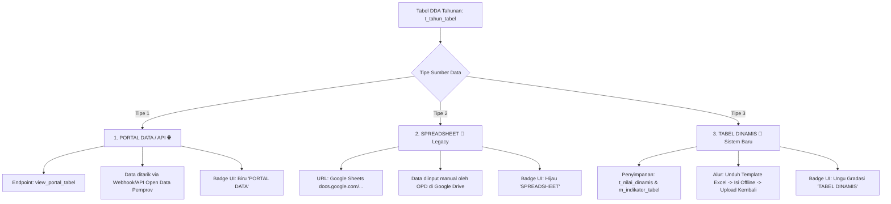
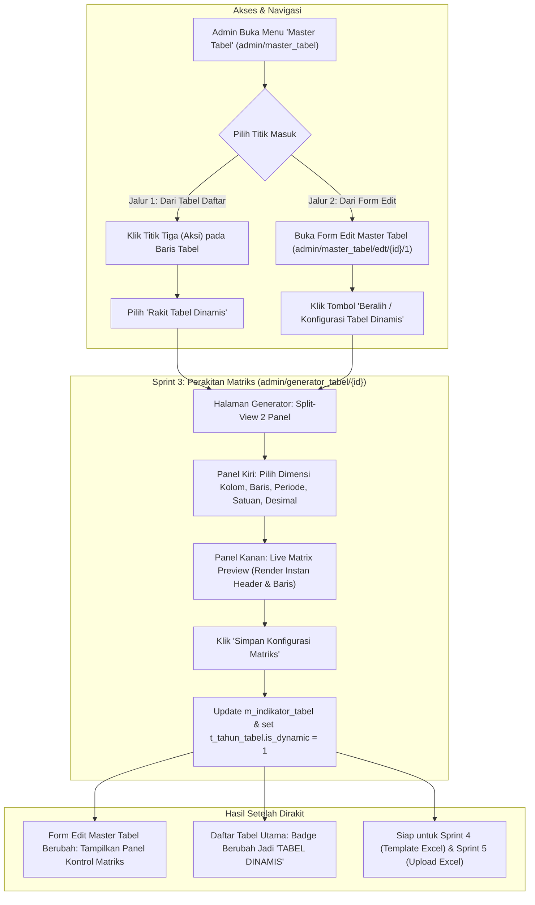
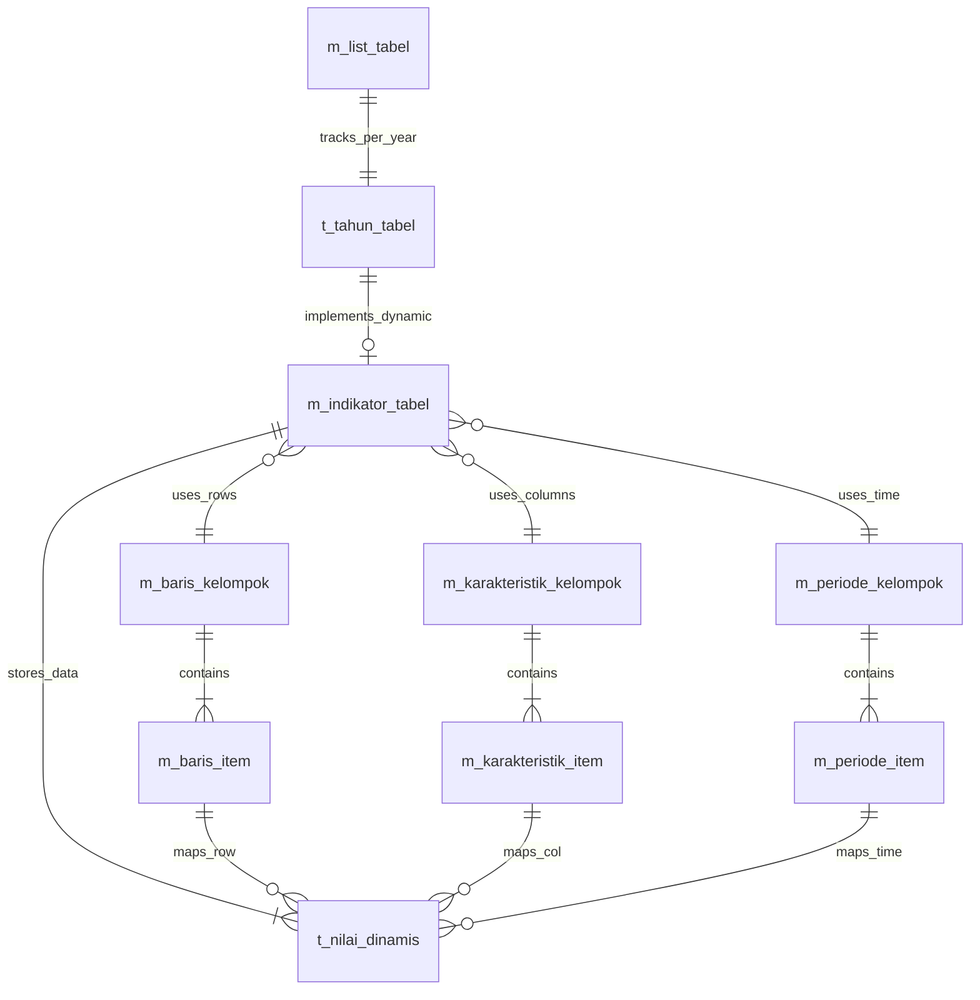

# Rencana Implementasi: Generator Tabel Dinamis & Alur Entri Excel Walidata

Dokumen ini merinci rencana arsitektur dan langkah implementasi teknis untuk membangun modul **Generator Tabel Dinamis** (*Data Cube Engine*) serta **Alur Kerja Distribusi & Entri Data Excel untuk Walidata/OPD**, dengan dukungan komprehensif terhadap:
1. **Model Hybrid 3 Sumber Data Tabel**: Portal Data/API, Google Spreadsheet, dan Tabel Dinamis Internal.
2. **Baris Bertingkat (*Hierarchical Rows*)**: 3 Level Kedalaman (Bab, Sub Bab, Sub Sub Bab), Item Data Ber-indentasi, Subtotal, dan Grand Total.
3. **Header Kolom Bertingkat Simetris & Asimetris**: Mendukung sub-kolom yang sama maupun **sub-kolom yang berbeda di setiap kategori induk** *(misal: Distribusi [2 kolom], Pelayanan [8 kolom], dan Jumlah [1 kolom mandiri])* menggunakan notasi cerdas `Induk || Anak`.
4. **Alur Kerja Admin & Walidata**: Dari pemilihan master tabel, konfigurasi matriks, hingga generate & parsing file Excel.

---

## 1. Arsitektur Sumber Data: Model Hybrid 3 Tipe

Sistem DDA Online dirancang dengan prinsip **backward compatibility**, mendukung 3 tipe sumber data secara harmonis tanpa merusak ribuan tabel yang sudah berjalan:



### Karakteristik & Perbandingan:

| Parameter | 1. PORTAL DATA / API 🌐 | 2. SPREADSHEET 📑 *(Legacy)* | 3. TABEL DINAMIS 🎲 *(Sistem Baru)* |
| :--- | :--- | :--- | :--- |
| **Sumber Penyimpanan** | Server API Luar (Portal Satu Data Jateng) | Google Drive milik OPD/Admin | Database Internal DDA (`t_nilai_dinamis`) |
| **Alur Pengisian** | Otomatis via API / Webhook | Mengetik langsung di Google Sheet online | **Download Template Excel $\rightarrow$ Entri Offline $\rightarrow$ Upload Excel** |
| **Ketergantungan** | Server API eksternal | Akun Google Drive & izin akses email | **100% Mandiri (Bebas Ketergantungan Eksternal)** |
| **Integritas Struktur** | Tinggi | Rentan rusak/terhapus oleh OPD | **Sangat Tinggi** (Header & kategori di-protect di Excel) |
| **Status Database** | `is_dynamic = 0`, link berawalan `view_portal_tabel` | `is_dynamic = 0`, link Google Sheet | `is_dynamic = 1`, terhubung ke `m_indikator_tabel` |

---

## 2. Alur Pengguna (*User Flow*): Dari Master Tabel Menuju Generator

Admin memiliki 2 titik masuk untuk merakit tabel dinamis:



### Transformasi Form Edit Master Tabel (`f_edt_master_tabel`):
Ketika tabel masih berstatus **Spreadsheet (Legacy)**, form menampilkan input tautan Google Docs.  
Ketika tabel **Sudah Dikonfigurasi Menjadi Dinamis**, form secara adaptif menampilkan:
1. **Lencana Status**: `[ ✓ TABEL DINAMIS AKTIF ]`
2. **Ringkasan Dimensi Terpasang**:
   - Kolom Karakteristik yang dipilih.
   - Judul Baris yang dipilih (beserta jumlah baris).
   - Periode Waktu & Satuan Data.
3. **Tombol Manajemen Cepat**:
   - ⚙️ **"Kelola Konfigurasi Dimensi Matriks"** (Membuka kembali Generator).
   - 👁️ **"Lihat Pratinjau Matriks Data"** (Melihat tampilan tabel).
   - 📥 **"Unduh Template Excel Walidata"** (Tersedia setelah Sprint 4).
4. **Cadangan Tautan Spreadsheet**: Opsi melihat/menyimpan link spreadsheet lama sebagai arsip cadangan.

---

## 3. Desain Solusi: Header Kolom Bertingkat (Simetris & Asimetris)

Sistem dirancang untuk mengenali 2 tipe struktur kolom:

### Tipe 1: Simetris (Perkalian 2 Master Karakteristik)
* **Kasus**: Setiap kategori induk memiliki sub-kolom yang sama persis (misal: 9 Jenis Bencana $\times$ 3 Jenis Dampak = 27 kolom).
* **Solusi**: Admin memilih Karakteristik 1 (Jenis Bencana) dan Karakteristik 2 (Dampak Korban), sistem melakukan perkalian silang otomatis.

### Tipe 2: Asimetris (Sub-Kolom Berbeda di Setiap Kategori Induk + Kolom Mandiri)
* **Kasus Nyata (Contoh: Sarana Farmasi & Kesehatan)**:
  * Kelompok `Distribusi`: Membawahi 2 sub-kolom (*Pedagang Besar Farmasi*, *Gudang Farmasi*).
  * Kelompok `Pelayanan`: Membawahi 8 sub-kolom berbeda (*Toko Obat*, *Apotek*, *RS Pemerintah*, *RS Swasta*, *Puskesmas*, *Pustu*, *Rumah Bersalin*, *Klinik*).
  * Kolom `Jumlah / Total`: Kolom mandiri tanpa sub-kolom (`rowspan="2"`).

### Mekanisme Notasi Input Cerdas: `Induk || Anak`
```text
1. Distribusi || Pedagang Besar Farmasi
2. Distribusi || Gudang Farmasi Kab/Kota
3. Pelayanan || Toko Obat
4. Pelayanan || Apotek
5. Pelayanan || Rumah Sakit Pemerintah
6. Pelayanan || Rumah Sakit Swasta
7. Pelayanan || Puskesmas
8. Pelayanan || Puskesmas Pembantu
9. Pelayanan || Rumah Bersalin
10. Pelayanan || Klinik
11. Jumlah
```

#### Aturan Kalkulasi Otomatis Grid:
1. **Grup Induk (*Colspan*)**:
   - `Distribusi` muncul 2 kali $\rightarrow$ otomatis dibuat sel atas `Distribusi` dengan **`colspan="2"`**.
   - `Pelayanan` muncul 8 kali $\rightarrow$ otomatis dibuat sel atas `Pelayanan` dengan **`colspan="8"`**.
2. **Sub-Kolom Bawah**:
   - Teks sesudah `||` otomatis diletakkan pada baris kedua sebagai sub-kolom.
3. **Kolom Mandiri (*Rowspan*)**:
   - Item tanpa tanda `||` (seperti `Jumlah` / `Total`) otomatis dibuat menggabungkan baris vertikal (**`rowspan="2"`**).
4. **Kolom Kiri Judul Baris (*Kabupaten/Kota*)**:
   - Otomatis dibuat menggabungkan baris vertikal (**`rowspan="2"`**).

---

## 4. Desain Solusi: Baris Bertingkat (*Hierarchical 3-Level Rows*)

Struktur baris pohon yang telah diselesaikan di Sprint 2 mendukung 3 tingkatan (Bab, Sub Bab, Sub Sub Bab):

```text
[Level 0] Makanan / Food                           <-- KATEGORI INDUK (Bold, Arsir/Non-Input)
  [Level 1]   Padi-padian / Cereals                <-- DATA ITEM LEVEL 1 (Indented, Diisi Angka)
  [Level 1]   Umbi-umbian / Tubers                 <-- DATA ITEM LEVEL 1 (Indented, Diisi Angka)
    [Level 2]   Singkong / Cassava                 <-- DATA ITEM LEVEL 2 (Indented Lebih Dalam)
[Level 0] Jumlah Makanan / Total Food              <-- SUBTOTAL (Bold, Formula SUM)
[Level 0] Bukan Makanan / Non-Food                 <-- KATEGORI INDUK (Bold, Arsir/Non-Input)
  [Level 1]   Perumahan & Fasilitas RT             <-- DATA ITEM LEVEL 1 (Indented, Diisi Angka)
[Level 0] TOTAL / JUMLAH                           <-- GRAND TOTAL (Bold, Garis Ganda BPS)
```

1. **Atribut `tipe_baris`**:
   - `'kategori'`: Baris judul kelompok. Sel nilai di-arsir/kunci di Excel, di-skip saat parser upload.
   - `'data'`: Baris item data murni. Wajib diisi angka oleh Walidata.
   - `'subtotal'`: Baris sub-penjumlahan kelompok.
   - `'total'`: Baris grand total dengan garis ganda standar akuntansi BPS.
2. **Atribut `level_indentasi`**:
   - `0`: Level 0 (Bab) - Rata kiri, teks tebal (*Bold*).
   - `1`: Level 1 (Sub Bab) - Indentasi 16px.
   - `2`: Level 2 (Sub Sub Bab) - Indentasi 32px.

---

## 5. Rincian Teknis Sprint 3: Generator Indikator Tabel & Live Preview

### Layout Halaman: Split View 2 Panel
1. **Panel Kiri: Form Konfigurasi Dimensi (~35% lebar layar)**
   - Pilihan Master Karakteristik Kolom (`id_karakteristik_kelompok`).
   - Pilihan Master Judul Baris (`id_baris_kelompok`).
   - Pilihan Master Periode Waktu (`id_periode_kelompok`).
   - Input Satuan (*Unit*): e.g. *Jiwa, Ton, Persen, Desa/Kelurahan*.
   - Pilihan Format Desimal: `0` (Bulat), `1` (1 Desimal), `2` (2 Desimal standar BPS).
   - Pilihan Grafik Rekomendasi: `Bar Chart`, `Line Chart`, `Pie Chart`.
   - Catatan Kaki & Sumber Data Resmi BPS.
2. **Panel Kanan: Kanvas Live Matrix Preview (~65% lebar layar)**
   - Merender struktur tabel secara real-time via AJAX/Client Engine begitu dropdown dimensi dipilih.
   - Header multi-level dengan kalkulasi `colspan` dan `rowspan` presisi.
   - Rendering Dwibahasa langsung (*Indonesian* di atas, *English* miring di bawah).
   - Baris bertingkat dengan indentasi visual dan styling sel data contoh (`0.00`).
   - Baris total dengan garis ganda standar BPS (*double bottom border*).

---

## 6. Desain Basis Data (*Database Schema*)



### Tabel Rincian:
1. `m_indikator_tabel`:
   - `id` (PK)
   - `id_tahun_tabel` (Relasi 1:1 ke `t_tahun_tabel.id`)
   - `id_karakteristik_kelompok` (FK: Master Kolom)
   - `id_baris_kelompok` (FK: Master Baris)
   - `id_periode_kelompok` (FK: Master Waktu)
   - `satuan`, `desimal`, `grafik_default`, `sumber`, `catatan`
2. `t_nilai_dinamis`:
   - `id` (PK BigInt)
   - `id_indikator` (FK ke `m_indikator_tabel.id`)
   - `id_baris_item`, `id_karakteristik_item`, `id_periode_item`
   - `nilai` (Decimal 20,4), `simbol` (Varchar 5: `-`, `NA`, `e`)
   - `UNIQUE KEY` (`id_indikator`, `id_baris_item`, `id_karakteristik_item`, `id_periode_item`)

---

## 7. Rincian Fase Implementasi & Roadmap

- [x] **Sprint 1 (Database & Models)**:
  - Migrasi skema tabel dimensi (`m_karakteristik_*`, `m_baris_*`, `m_periode_*`, `m_indikator_tabel`, `t_nilai_dinamis`).
  - Core Model `M_tabeldinamis.php` dengan metode sinkronisasi batch, parsing cerdas, dan relasi.
- [x] **Sprint 2 (UI Master Dimensi & Tree Builder)**:
  - Antarmuka CRUD 3 tab (`admin/master_dimensi`): Karakteristik, Baris, Periode.
  - Dukungan Pohon 3-Level (Bab, Sub Bab, Sub Sub Bab).
  - Default 4 input kosong untuk penambahan cepat.
  - Rendering langsung Dwibahasa (*Indonesian* & *English*).
  - Modal scroll responsif tanpa inner scroll traps.
- [x] **Sprint 3 (Generator Indikator Tabel & Live Matrix Preview)**:
  - Integrasi titik masuk di `l_master_tabel` dan `f_edt_master_tabel`.
  - Toolbar compact & responsif `admin/generator_tabel/{id_tahun_tabel}`.
  - Engine perhitungan otomatis `colspan` dan `rowspan` kolom asimetris.
  - Live Matrix Preview interaktif dengan sticky header, freeze column, scroll horizontal mandiri, dan label kolom dinamis.
  - Penyimpanan status tabel dinamis (`is_dynamic = 1`), proteksi integritas relasi, dan pembersihan orphan data.
- [x] **Sprint 4 (Service Generator Template Excel .xlsx)**:
  - Generate berkas Excel dinamis berbasis PhpSpreadsheet.
  - Auto-merge sel bertingkat horizontal & vertikal.
  - Protection sheet untuk header dan baris kategori non-input.
  - Token metadata tersembunyi untuk identifikasi sel.
- [x] **Sprint 5 (Parser & Upload Excel Walidata)**:
  - Service `App\Libraries\ExcelDataParser` dengan verifikasi lembar `__METADATA_DDA__` dan token payload JSON B15.
  - Sanitasi komprehensif angka desimal Indonesia/Excel dan simbol resmi statistik BPS (`-`, `NA`, `e`).
  - Endpoint `Admin::upload_excel_dinamis` dengan batch upsert performan ke `t_nilai_dinamis` via `M_tabeldinamis::batchUpsertNilai`.
  - Otomatisasi pembaruan status pengisian (`is_periksa = 1`), waktu, dan catatan jumlah sel terisi pada `t_tahun_tabel`.
  - Antarmuka upload di `l_dda.php` dilengkapi tombol interaktif "Upload Excel" & "Unduh Template", modal drag-and-drop file modern, validasi ekstensi, indikator progress animasi, dan umpan balik SweetAlert2.
- [ ] **Sprint 6 (Frontend Publik & Ekspor Data - Tanpa Grafik)**:
  - Tampilan publik responsif menyatu dengan layout portal DDA Jawa Tengah.
  - Sticky header berjenjang (hingga 5 tingkat) & frozen columns (nomor & nama baris/wilayah).
  - Integrasi tautan publik dan badge "Tabel Dinamis" pada beranda (`home.php`) dan pencarian (`search.php`).
  - Dropdown unduh publik: format Excel (.xlsx), CSV (.csv), dan Cetak/PDF (.pdf).
  - *Catatan*: Modul grafik otomatis ditiadakan sesuai arahan teknis agar performa maksimal dan penyajian data tabel presisi 100%. Rincian lengkap tersedia di [Rencana_Implementasi_Frontend_Publik_Tabel_Dinamis.md](file:///e:/BPS%20JATENG/DDA/dda-online-ci4-tabel-dinamis/documentation/Rencana_Implementasi_Frontend_Publik_Tabel_Dinamis.md).
